<p align="center">
  <a href="https://148.100.99.205/">
    <picture>
      <source media="(prefers-color-scheme: dark)" srcset="docs/assets/readme/logo-dark.svg">
      
    </picture>
  </a>
</p>

<h3 align="center">Real-time AI for critical decisions.<br>Phalanx Twin, the fleet-availability digital twin that gets more aircraft flying every morning — built and running on IBM LinuxONE.</h3>

<p align="center">
  <a href="https://148.100.99.205/"></a>
  <a href="docs/ibmz/README.md"></a>
  
  
  
</p>

<p align="center">
  <b><a href="https://148.100.99.205/">▶ Open the live app — https://148.100.99.205</a></b>
  &nbsp;·&nbsp; <a href="docs/prototype/DEMO.md">8-minute demo guide</a>
  &nbsp;·&nbsp; <a href="docs/ibmz/README.md">The IBM Z story</a>
  &nbsp;·&nbsp; <a href="docs/architecture/README.md">Architecture</a>
</p>

<p align="center"><b>Team Dilijens</b> · IBM Z Datathon · theme: <i>real-time AI for critical decisions</i></p>

<a href="https://148.100.99.205/">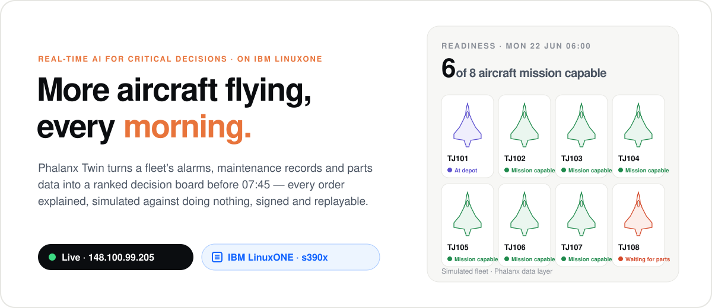</a>

**Phalanx Twin** is real-time AI for one of the most critical decisions a fleet makes every day: which aircraft fly,
and what to do about the ones that cannot. It is a decision-support digital twin for military aircraft fleet
availability, answering the problem statement *"Air Power – Predictive Maintenance & Fleet Availability"* (Ministry of Defence, India). Every morning it
reads what the fleet reported overnight, works out which aircraft can fly and why the others cannot, and puts a short,
ranked list of decisions in front of the engineering officer before 07:45 — each one with its evidence, a simulation
of what it will do against doing nothing, and a place for the right person's signature. The whole system — fleet
simulator, models, rules engine, daily loop, audit log and web app — runs on **IBM LinuxONE** and is live at
**[https://148.100.99.205](https://148.100.99.205/)**.

<p align="center">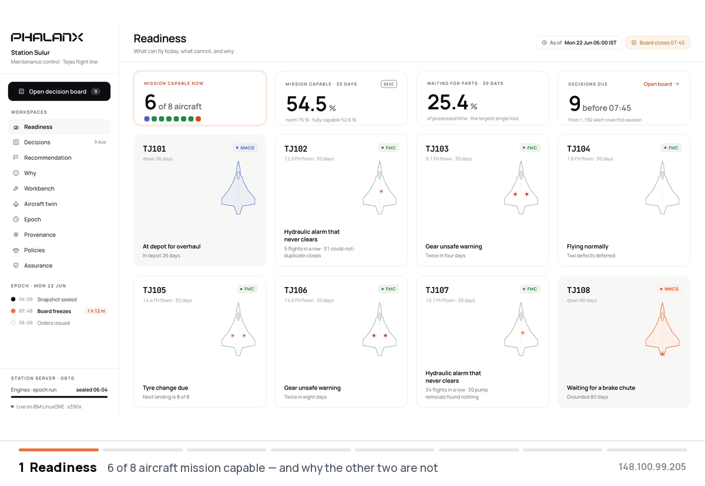</p>

---

## The problem

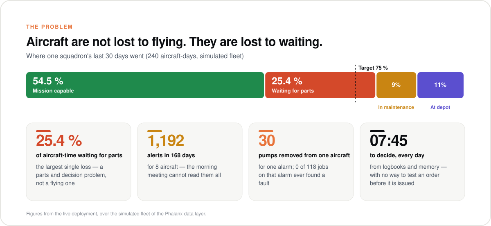

A fighter squadron does not lose availability in the air. It loses it on the ground:

- **Waiting** — for parts, for a repair slot, for someone to decide. In our fleet a quarter of all aircraft-time is
  spent waiting for parts.
- **False alarms** — healthy parts pulled off aircraft because an alarm keeps firing. One aircraft had its hydraulic
  pump replaced 30 times; across the fleet, not one of 118 jobs on that alarm ever confirmed a fault.
- **Too much signal, too little time** — 1,192 fault and caution reports for eight aircraft, and a decision deadline
  every morning, made from logbooks and memory with no way to test an order before it is issued.
- **No trail** — when an order turns out wrong, nobody can show what was known at the time, which rule fired and who
  approved it.

## The solution

Phalanx Twin runs a **daily decision loop** over a live twin of every aircraft and every serialised part.

<p align="center">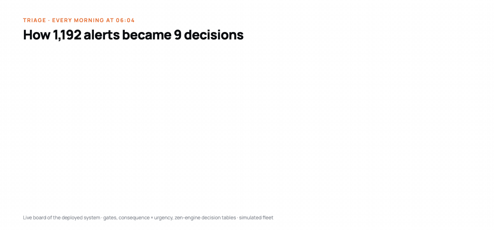</p>

| | What it does | How |
|---|---|---|
| **See** | One state per aircraft and per part, as of 06:00, from only the data received by then | contract-checked records, "as-of" reads, a 3D twin per aircraft |
| **Understand** | Separates real faults from false alarms and finds where the fault really is | false-alarm model (champion vs challenger), noisy-OR fault isolation with best next test, removal-risk survival model, engine-health tracking, drift detection |
| **Decide** | Turns 1,192 alerts into 9 ranked decisions, each with an order and an owner | safety gates, consequence × urgency, versioned zen-engine decision tables, HUMAN-only orders for changes that need a signature |
| **Prove** | Shows what each order will do before it is issued | paired what-if simulations of the fleet: the order vs doing nothing |
| **Act and audit** | Issues signed orders at 08:00 and records everything | one hash-chained event log; any decision can be verified and replayed |

<p align="center">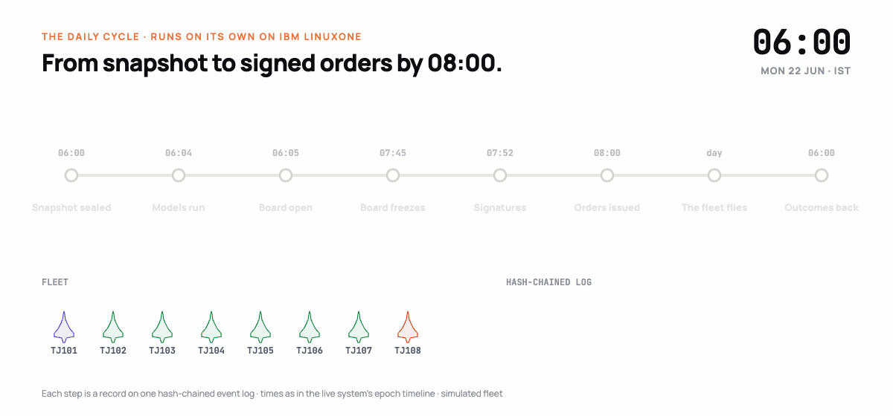</p>

### Real-time AI for critical decisions

Whether an aircraft flies is a critical decision, and it is made against the clock. Phalanx Twin is built for that:

- **Minutes, not days.** The 06:00 snapshot becomes a ranked board by 06:05: 1,192 alerts triaged, each fault scored
  by the models, every proposed order simulated against doing nothing — all before the 07:45 freeze.
- **Instant answers.** On the LinuxONE server every screen's data comes back in 0.6 ms (median); a whole simulated
  fleet day runs in 3.5 s, so what-if questions are answered while the officer is still looking at the board.
- **AI that respects the clock.** Every model, rule and order sees only what was received by decision time, so no
  answer leans on information that was not there yet.
- **People decide.** The AI ranks, explains and simulates; critical orders need a named signature, and every step
  is on a hash-chained log that can be replayed.
- **Next on IBM Z:** models compiled for the Telum on-chip AI accelerator score each alert the moment it lands, inside
  the transaction that stores it.

### How it works

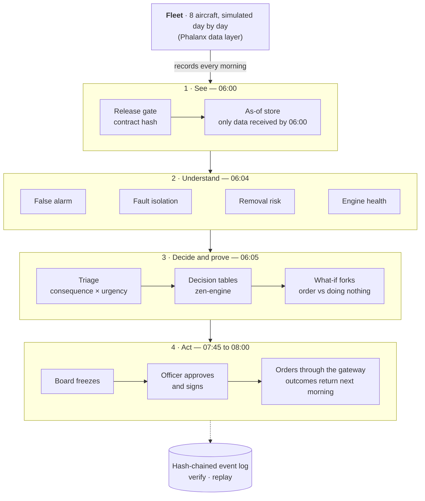

### Every order is tested before it is issued

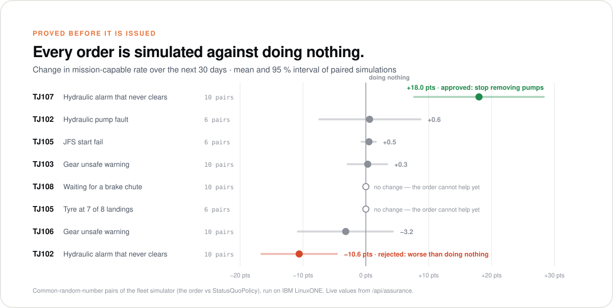

For TJ107 the twin recommends **stopping the pump removals** and troubleshooting the indication path instead. Ten
paired simulations say TJ107 is mission capable **18 points more of the next 30 days** (95 % interval +7.7 to +28.3)
— about five more flyable days for one aircraft, with 136 fewer maintenance man-hours. The similar-looking order for
TJ102 makes things worse (−10.6 points), so the officer rejects it. Nothing is issued on a hunch.

### Inside the app

<table>
  <tr>
    <td width="50%"><a href="https://148.100.99.205/readiness.html">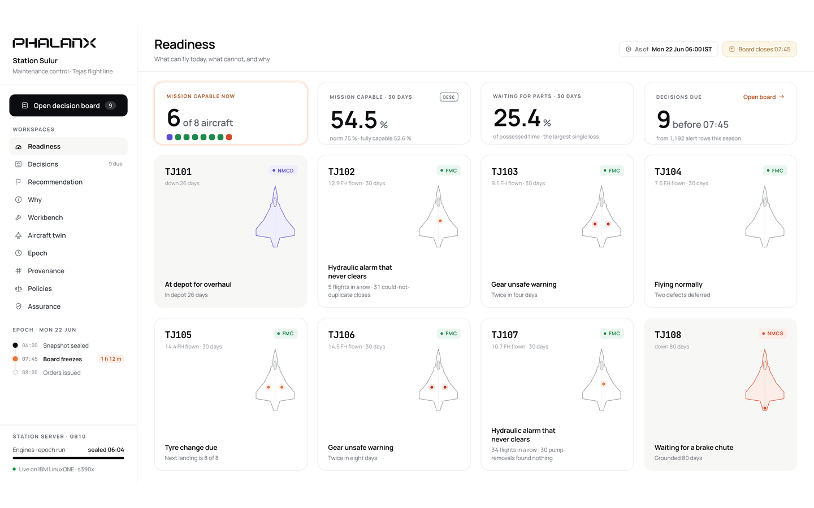</a><br><b>Readiness</b> — which aircraft can fly today, and why the others cannot</td>
    <td width="50%"><a href="https://148.100.99.205/decisions.html">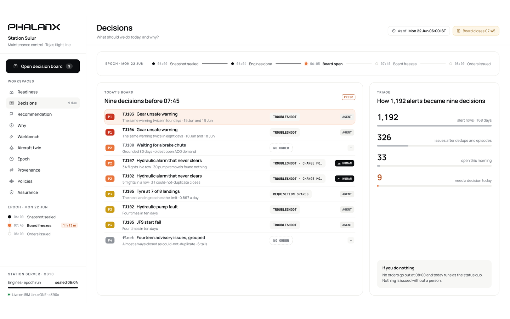</a><br><b>Decisions</b> — the morning board: 9 ranked items before 07:45</td>
  </tr>
  <tr>
    <td><a href="https://148.100.99.205/decision.html?issue=TJ107-HYD-101">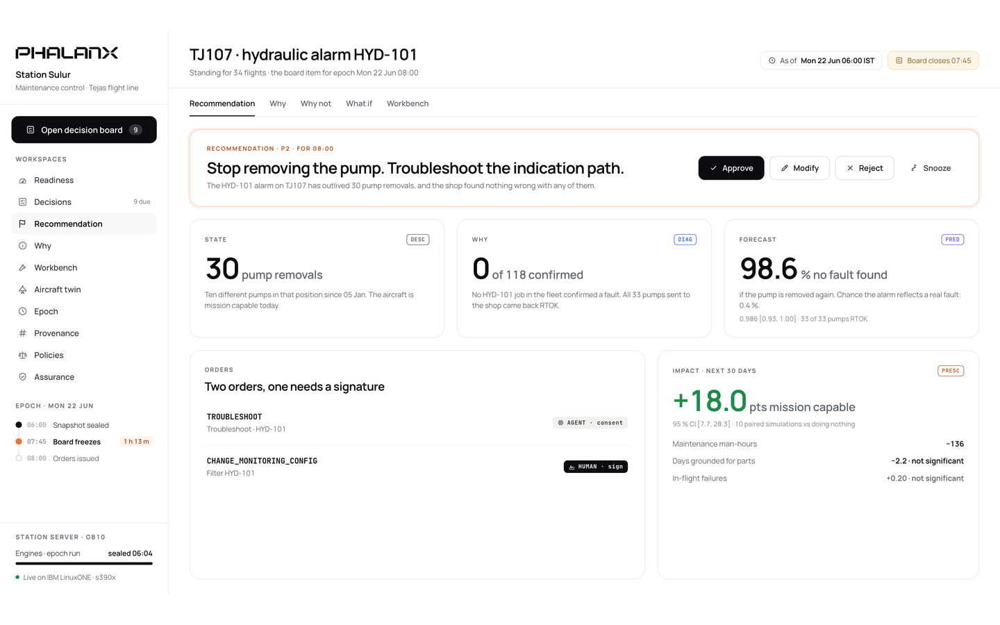</a><br><b>Recommendation</b> — the order, its evidence and its simulated impact</td>
    <td><a href="https://148.100.99.205/workbench.html?issue=TJ107-HYD-101">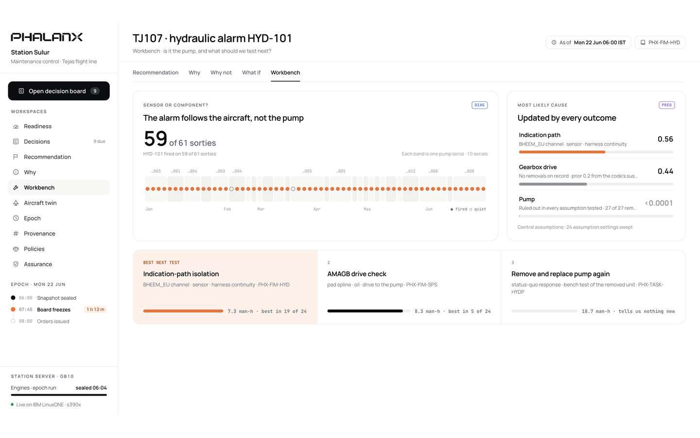</a><br><b>Workbench</b> — the alarm follows the aircraft, not the pump; the best next test</td>
  </tr>
  <tr>
    <td><a href="https://148.100.99.205/twin.html?issue=TJ107-HYD-101&tail=TJ107">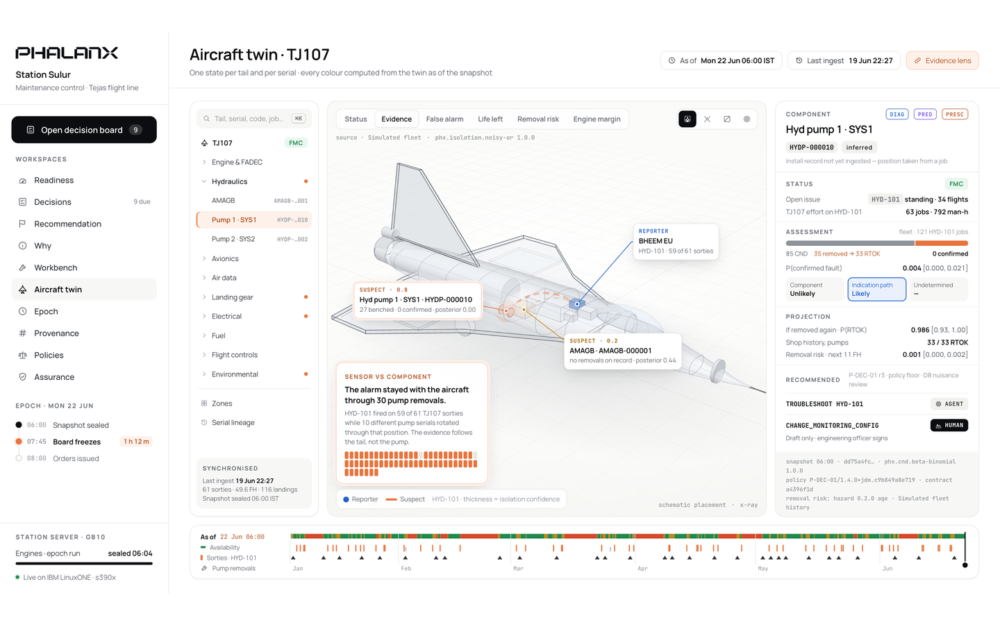</a><br><b>Aircraft twin</b> — every part's status, evidence, life and removal risk in 3D</td>
    <td><a href="https://148.100.99.205/provenance.html">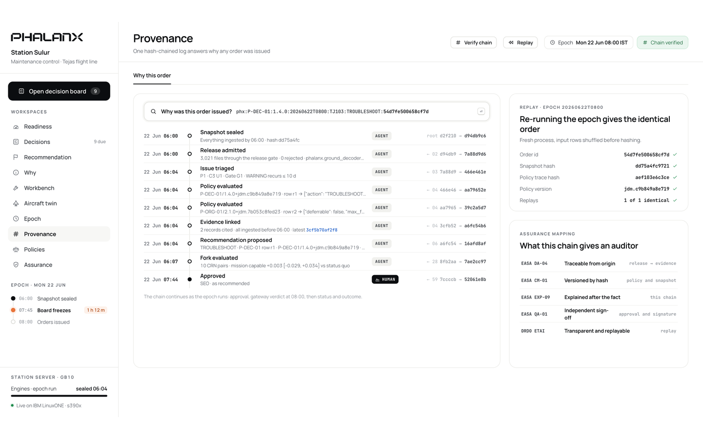</a><br><b>Provenance</b> — the hash chain behind every order; verify and replay</td>
  </tr>
</table>

### What changes for a squadron

| Today | With Phalanx Twin |
|---|---|
| 1,192 alerts read by hand, or not at all | 9 ranked decisions, each with the rule that put it there |
| Parts replaced because the alarm fired again | A false-alarm forecast and the most likely real cause before anything is removed |
| Orders judged by experience alone | Every order simulated against doing nothing, with a confidence interval |
| "Who decided this, and on what?" | One hash-chained record from snapshot to signature to outcome; replay gives the same answer |
| Availability reviewed after the month ends | Readiness, causes and the day's decisions every morning at 06:05 |

---

## Built on IBM LinuxONE

A system that decides whether aircraft fly has to be as available, trustworthy and protected as the aircraft
themselves. That is what IBM Z is built for, so we built Phalanx Twin on it from day one, not as a port at the end.

| What the mission needs | What IBM Z / LinuxONE gives it |
|---|---|
| The board must be ready every morning | Mainframe availability — IBM states up to 99.999999 % for LinuxONE Emperor 5 in its stated configurations |
| Every decision traceable and signed | Cryptography on every core (CPACF) and FIPS 140-2 Level 4 hardware security modules (Crypto Express) |
| Defence data that never leaves the base, hidden even from administrators | Confidential computing with IBM Secure Execution for Linux |
| One version of the truth for readiness, maintenance and supply | Many Linux workloads and the existing z/OS systems of record on one frame, next to the data |
| AI on every alert the moment it arrives | The Telum on-chip AI accelerator, with ONNX models compiled by the IBM Z Deep Learning Compiler |

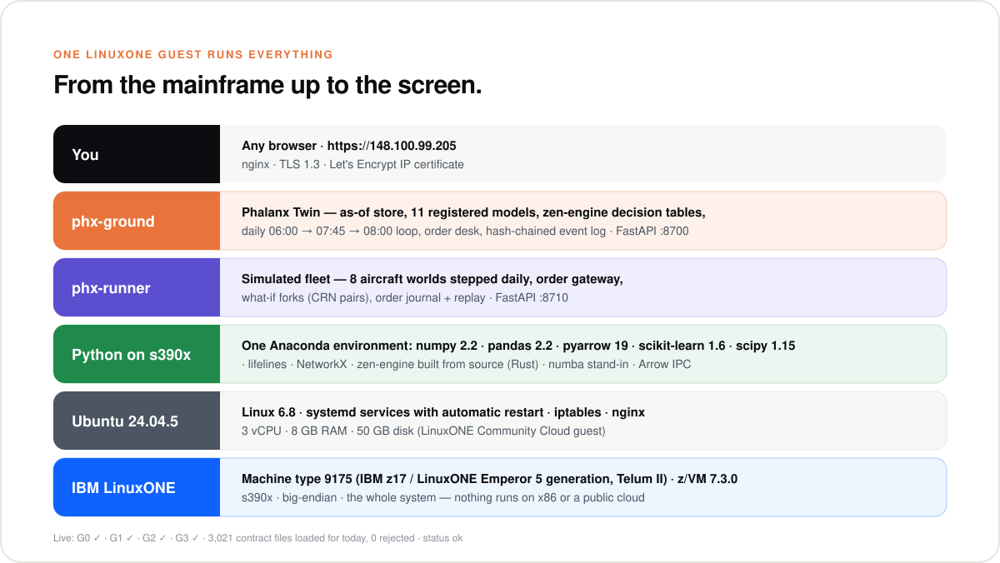

**Our LinuxONE instance** — one LinuxONE Community Cloud guest (AI_LAB flavour: 3 vCPUs, 8 GB RAM, 50 GB disk,
Ubuntu 24.04), running the whole system since day one:

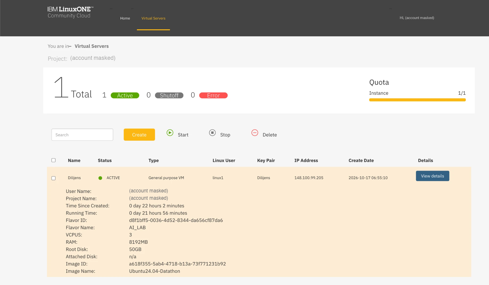

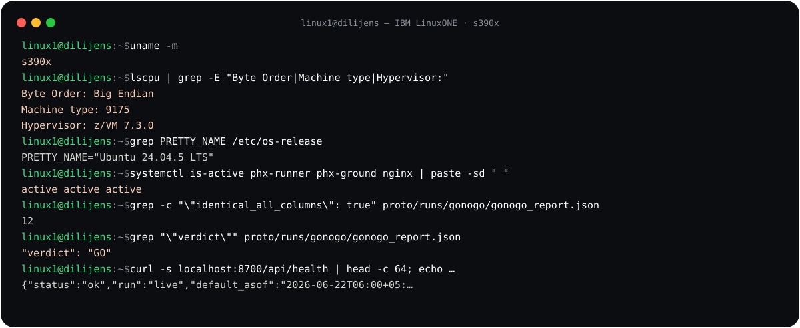

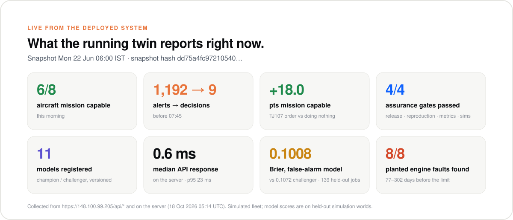

### What we proved on LinuxONE

| Proof point | Result on the s390x guest |
|---|---|
| **Same answers on a mainframe** | The 8-aircraft fleet rebuilt on big-endian s390x matches the reference data **row for row in every topic** (9,202 maintenance records, 1,192 alerts, 19,404 usage counters), and so does the next simulated day |
| Daily cycle | One simulated day for all 8 aircraft in **3.5 s**; full rebuild to the demo day in about 4 minutes |
| Training at scale | 32 training worlds (64 aircraft-years) built on the guest in 57 minutes with 2 workers |
| What-if analysis | 10 paired fleet simulations per order in 2–3 minutes |
| Responsiveness | Median API response **0.6 ms** on the server (p95 23 ms) once the morning is computed |
| Quality | 74 automated tests and the end-to-end flow pass on LinuxONE and on a little-endian laptop |

### What it took on s390x

| Challenge | What we did |
|---|---|
| No PyPI wheels for the scientific stack on s390x | One Anaconda environment with s390x builds of numpy, scipy, pandas, pyarrow, scikit-learn and statsmodels |
| Parquet written by pyarrow on big-endian lost data in null and list columns | All run data stored as **Arrow IPC**, which records byte order; the contract-hash check still applies to every file |
| The simulator needs numba, which has no s390x build | A small pure-Python stand-in for numba's decorator — the simulator runs unchanged |
| The rules engine (zen-engine, Rust) had no s390x wheel | Built from source on LinuxONE after supplying a missing s390x binding; decisions verified against the reference |
| DuckDB has no s390x build | The as-of store uses pyarrow and pandas |

---

## The plan for IBM Z: from one guest to the mainframe

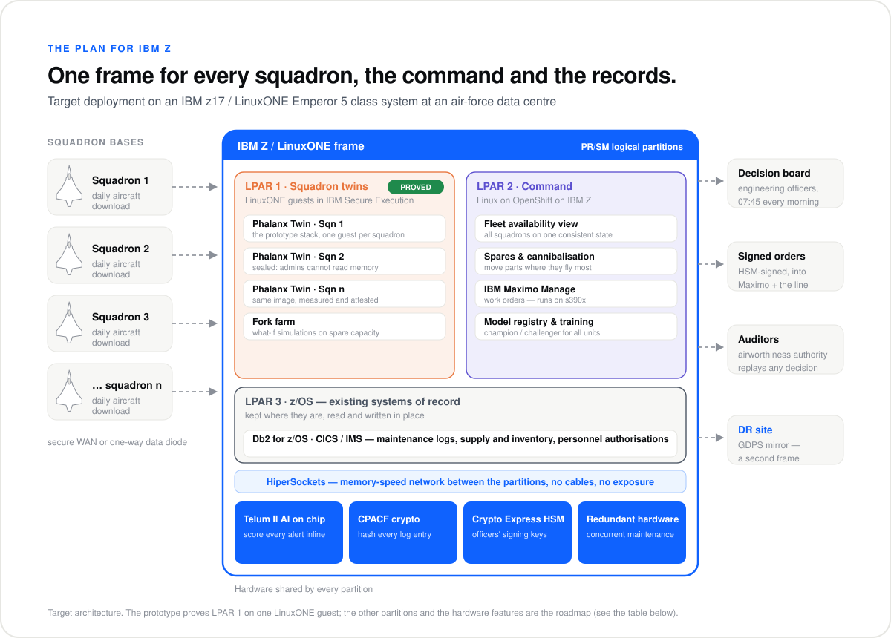

The prototype is one squadron on one LinuxONE guest. The production picture is one IBM Z frame at an air-force data
centre that runs **every squadron's twin, the command's fleet view and the existing systems of record side by side**.

### Use cases and the value IBM Z adds

| Use case | How it runs on IBM Z | Value |
|---|---|---|
| **Morning board for every squadron** | One Phalanx Twin guest per squadron on LinuxONE partitions; the fork farm uses spare capacity overnight | Every squadron gets its board by 06:05, on hardware built for availability — no lost mornings |
| **Score every alert as it lands** | False-alarm and isolation models exported to ONNX and run on the **Telum II on-chip AI accelerator**, inside the ingest transaction | Fewer healthy parts pulled; each alert scored in the same pass that stores it |
| **Signed, auditable orders** | HUMAN-only orders signed with keys held in **Crypto Express HSMs**; the event log hashed with **CPACF** | An airworthiness authority can verify who decided what, on which evidence, and replay it |
| **One truth for readiness, maintenance and supply** | The twin reads and writes the existing **Db2 / CICS** maintenance and supply systems on the z/OS partition over **HiperSockets**; work orders go to **IBM Maximo** on OpenShift on IBM Z | No copies or nightly exports drifting apart; parts can be moved between squadrons on one consistent state |
| **Sovereign, sealed data** | Each twin in **IBM Secure Execution for Linux** — memory and images protected even from platform administrators | Defence maintenance data stays on premises and private, by design |
| **Always on** | Redundant hardware with concurrent maintenance; **GDPS** mirrors to a second frame | The decision loop survives hardware faults and site loss |

### One alert's journey on the target platform

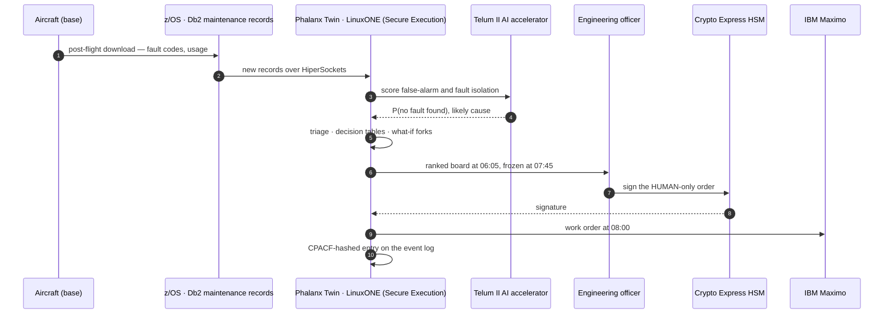

### Roadmap

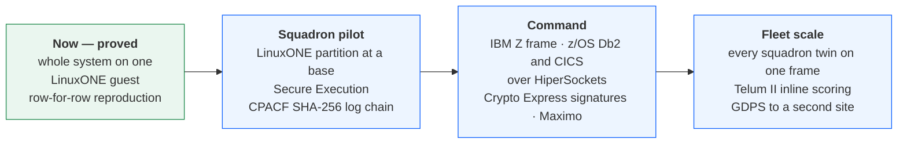

The full platform story, with sources for every IBM figure: **[docs/ibmz/README.md](docs/ibmz/README.md)**.

---

## Try it

Open **[https://148.100.99.205](https://148.100.99.205/)** and follow the [demo guide](docs/prototype/DEMO.md)
(about 8 minutes): Readiness → Decisions → Recommendation → Why → Workbench → Aircraft twin → Orders (sign, advance
a day) → Provenance (verify the chain) → Policies → Assurance.

Run it on LinuxONE from a checkout (SSH details in `proto/deploy/ssh_config`, copied from `ssh_config.example`):

```bash
proto/deploy/sync.sh --restart
```

```bash
proto/deploy/remote.sh 'proto/deploy/services.sh reset'
```

## Repository

| Path | Contents |
|---|---|
| [`docs/ibmz/`](docs/ibmz/README.md) | Phalanx Twin on IBM Z and LinuxONE — platform story, porting, proof points, roadmap, sources |
| [`docs/architecture/`](docs/architecture/README.md) | the solution architecture and decision register |
| [`docs/prototype/`](docs/prototype/DEVELOPMENT.md) | the prototype's development document and the demo guide |
| [`docs/data-layer/`](docs/data-layer/README.md) | how we read the data layer: contract, time discipline, quality |
| [`proto/`](proto/README.md) | the system: `runner/` (simulated fleet), `ground/` (twin, models, triage, policies, loop, API), `web/` (screens), `deploy/` (LinuxONE scripts), `tests/` |
| [`docs/assets/readme/`](docs/assets/readme/src/README.md) | this page's pictures and the scripts that rebuild them from the live system |
| [`data_layer/`](data_layer/README.md) | the Phalanx data layer preview v0.9: simulator source (`code/`) and the consumer fleet data (`data/v0.9/fleet`); telemetry and the hidden truth labels are not included |
| [`video/`](video/STORYBOARD.md) | the product film (`video/renders/phalanx_twin_film.mp4`): storyboard, compositions, narration, edit |
| [`RULES.md`](RULES.md) | the rules every line of code follows when reading the data layer |

Media files (`*.mp4`, `*.mov`, `*.wav`, `*.m4a`, `*.mp3`) are stored with **Git LFS** — run `git lfs install` before cloning.

## The data behind it: a physics-based fleet you can fork

Phalanx Twin is built and tested on the team's **Phalanx data layer**: a deterministic simulator of a Tejas
Mk1A-class / F404-IN20 fleet, engineered to behave like real flight-line data, including its flaws.

| | How the data layer does it |
|---|---|
| **Physics first** | 240 Hz flight physics with hidden per-serial health and injected faults, through sensors, MIL-STD-1553B and ARINC-429 buses and per-sortie IRIG 106 Chapter 10 recordings, decoded on the ground into nine topics: samples, BIT, exceedance and caution events, usage counters, sortie manifests, maintenance records, orders and order status |
| **Real-world mess, on purpose** | late downloads, sentinels and out-of-range values, sensor freezes and top-of-scale glitches (some deliberately unflagged), healthy parts removed on false alarms, serials that move between aircraft, parts that take months to arrive |
| **A frozen contract** | every file carries the contract hash (0.2.0); the twin's release gate rejects anything else, and every read is "as of" its ingest time, so no model ever sees the future |
| **A closed loop** | the twin's orders go back into the simulator through its own order gateway, and their outcomes return as new records the next morning |
| **Forkable futures** | what-if forks with common random numbers give paired, like-for-like comparisons of an order against doing nothing |
| **Truth kept apart** | the hidden ground truth exists only for offline scoring; the system under test never reads it |
| **Reproducible anywhere** | deterministic seeds: rebuilt on big-endian IBM LinuxONE, the fleet matches the reference row for row |
| **Enough history to learn from** | 64 aircraft-years of training worlds; models are scored on held-out worlds they never saw |

Aircraft codes, part numbers and the ICD are stand-ins, so everything can be shown openly; connecting a real fleet
means implementing the same contract. The IBM figures quoted above are IBM's published claims (sources in
[docs/ibmz](docs/ibmz/README.md)); Secure Execution, Crypto Express, HiperSockets, Maximo and the Telum accelerator
are the roadmap shown above.

<p align="center"><sub><b>Team Dilijens</b> · IBM Z Datathon · real-time AI for critical decisions</sub></p>
