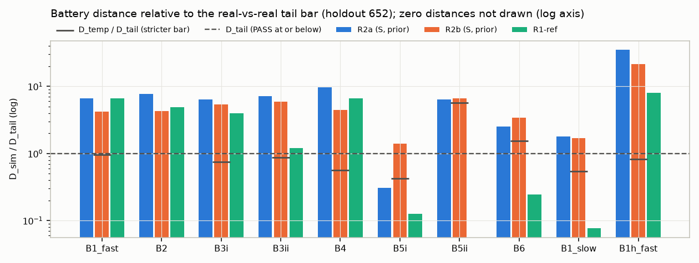
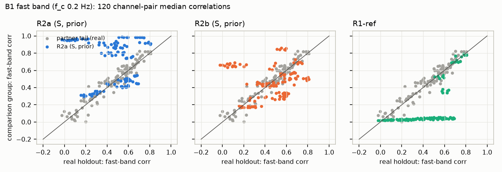
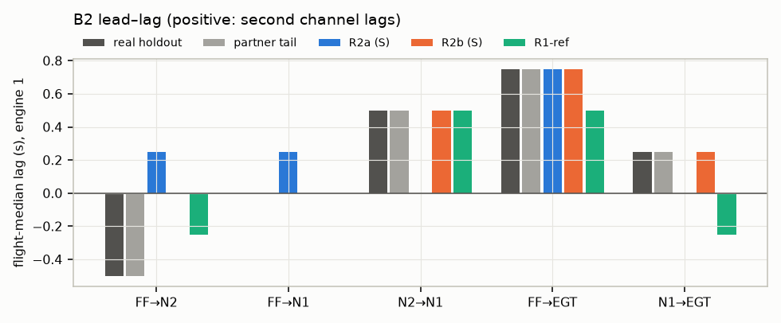

# Settling experiment, round 2: report

**Holdout:** Tail 652 archive 8 (primary under amendment A1). 110 holdout flights, compared with 110 round-1
687-TEST flights.

**Frozen models:** commit `5c0bba5`, fitted on all 152 687-CAL flights. The runner checked hashes before reading
any holdout file and found no mismatch.

**Decision (pre-registered rule, §5): REWORK.** Every arm fails all six tests. The guard G0 passes.

**Credibility ceiling:** NASA-STD-7009B Level 2 against proxy (airliner) data. Nothing here is evidence about the
Tejas or the F404-IN20 themselves.

**Tail 687 archive 2** is unread. It is reserved as the holdout for the build's proxy-mode acceptance gate
(user-confirmed; `DEVIATIONS.md` F1).

Machine-generated tables for every arm are in `results/holdout_652/report_tables.md`; numbers are in
`results/holdout_652/battery.json`.

## 1. Per-test verdicts (primary: variant S, fleet-prior unit parameters)

- D_sim is the distance between the synthetic and real versions of the same 110 holdout flights, paired by flight.
- D_tail is real 652 vs real 687-TEST (unpaired, equal n).
- D_temp is 652 early vs late, split at the median date (55 vs 55).
- 95 % CIs are from a joint flight bootstrap (2,000 resamples).
- FAIL means the one-sided 95 % lower bound of D_sim − D_tail is above 0.

| Test | Part | D_sim R2a | D_sim R2b | D_tail [95 % CI] | D_temp | R2a | R2b |
|---|---|---|---|---|---|---|---|
| **B1** cohesion, fast band (primary) | | 0.313 [0.303, 0.323] | 0.196 [0.157, 0.208] | 0.047 [0.042, 0.057] | 0.045 | **FAIL** | **FAIL** |
| **B2** lead–lag (s) | | 0.388 [0.338, 0.419] | 0.212 [0.175, 0.287] | 0.050 [0.025, 0.062] | 0.000 | **FAIL** | **FAIL** |
| **B3** dynamic response | (i) gain + coherence | 0.499 | 0.417 | 0.078 [0.068, 0.098] | 0.058 | FAIL | FAIL |
| | (ii) time constants | 0.816 | 0.682 | 0.115 [0.050, 0.211] | 0.100 | FAIL | FAIL |
| | test | | | | | **FAIL** | **FAIL** |
| **B4** Granger structure | | 1.491 | 0.690 | 0.154 [0.126, 0.223] | 0.086 | **FAIL** | **FAIL** |
| **B5** physical laws | (i) corrected FF–N2 scatter | 0.150 | 0.686 | 0.491 [0.426, 0.564] | 0.209 | PASS | FAIL |
| | (ii) EGT exponent a | 0.19 | 0.20 | 0.03 [0.00, 0.08] | 0.17 | FAIL | FAIL |
| | test | | | | | **FAIL** | **FAIL** |
| **B6** regime behaviour | | 1.230 | 1.675 | 0.488 [0.409, 0.705] | 0.747 | **FAIL** | **FAIL** |
| **Count** | | | | | | 0 PASS / 6 FAIL | 0 PASS / 6 FAIL |

- No test reaches STRICT PASS (D_sim ≤ D_temp).
- **G0** (binding, pipeline-only metadata): PASS for S_R2a, S_R2b, P_R2a and P_R2b. AUC is 0.5 with CI [0.5, 0.5],
  because counts, length, dtype, NaN and float32 representability are identical.

**Decision.**
- The decision is taken on the better arm (R2b): 0/6 PASS and 6/6 FAIL.
- Under §5, a FAIL that implicates the architecture premise means REWORK. Both named examples hold:
  - "neither arm reproduces … lead–lag order": real FF→N2 is −0.50 s; R2a gives +0.25 s and R2b 0.00 s;
  - "… cannot reproduce B1 even with M-C": R2b's B1 is 0.196 against a bar of 0.047.
- The same verdict holds for variant P and for CAL-fitted unit parameters: 0/6 PASS for all eight arms
  (§2; `report_tables.md`).

**Reference arm, R1-ref** (round-1 FULL texture on the low-passed real truth):
- FAIL: B1 0.311, B2 0.244, B3 (i) 0.310, B4 1.025.
- PASS: B5 (0.063 / 0.000) and B6 (0.120).
- Its passes are inherited by construction, because its slow structure *is* the real flight.

## 2. Arm and variant contrast (D_sim on the 652 holdout)

| Label | B1 fast | B1 slow | B1 fast (0.5 Hz split) | B2 | B3 (i) | B3 (ii) | B4 | B5 (i) | B5 (ii) | B6 |
|---|---|---|---|---|---|---|---|---|---|---|
| S_R2a prior | 0.313 | 0.018 | 0.668 | 0.388 | 0.499 | 0.816 | 1.491 | 0.150 | 0.19 | 1.230 |
| S_R2b prior | **0.196** | 0.017 | 0.405 | **0.212** | 0.417 | 0.682 | **0.690** | 0.686 | 0.20 | 1.675 |
| P_R2a prior | 0.336 | 0.021 | 0.661 | 0.450 | 0.536 | 0.891 | 1.679 | 0.416 | 0.19 | 1.205 |
| P_R2b prior | 0.215 | 0.016 | 0.463 | 0.225 | 0.502 | 0.713 | 0.766 | 0.580 | 0.19 | 1.673 |
| S_R2a CAL offsets | 0.320 | 0.021 | 0.683 | 0.375 | 0.496 | 0.812 | 1.454 | 0.063 | 0.19 | 1.263 |
| S_R2b CAL offsets | 0.188 | 0.017 | 0.294 | 0.275 | 0.422 | 0.694 | 0.689 | 0.782 | 0.19 | 1.696 |
| R1-ref | 0.311 | 0.001 | 0.153 | 0.244 | 0.310 | 0.138 | 1.025 | 0.063 | 0.000 | 0.120 |
| **D_tail** | 0.047 | 0.010 | 0.019 | 0.050 | 0.078 | 0.115 | 0.154 | 0.491 | 0.03 | 0.488 |
| **D_temp** | 0.045 | 0.005 | 0.016 | 0.000 | 0.058 | 0.100 | 0.086 | 0.209 | 0.17 | 0.747 |

- **M-C (R2a → R2b)** improves B1 by 37 %, B2 by 45 % and B4 by 54 %. It worsens B5 (i) (more scatter) and B6
  (wider regime spread). The physics-only arm carries some coupling but not enough; the statistical discrepancy
  layer adds the rest only partially.
- **Amendments A6 + A7 (P → S)** improve B1, B2, B3 and B4 by 4–11 %. They change no verdict.
- **Unit parameters (prior → CAL-fitted)** change nothing material, except B5 (i) for R2a (0.150 → 0.063).

## 3. Attribution of the failures

**3.1 Cross-engine over-coupling of the deterministic M-A (B1, B4).**
- M-A is a deterministic function of inputs that are common to all four engines: TAT/θ, ALT/δ, MACH, and PLA_k,
  which move together under autothrottle. Its fast band is therefore almost perfectly correlated across engines
  and between spools.

| Fast-band median correlation (f_c 0.2 Hz) | Real 652 | Real 687-TEST | S_R2a | S_R2b | R1-ref |
|---|---|---|---|---|---|
| N1_1–N2_1 (within engine) | 0.47 | 0.43 | **0.92** | 0.61 | 0.05 |
| N1_1–EGT_1 | 0.56 | 0.57 | 0.81 | 0.56 | 0.05 |
| N1_1–FF_1 | 0.65 | 0.63 | 0.54 | 0.57 | 0.05 |
| N2_1–FF_1 | 0.67 | 0.57 | 0.45 | 0.43 | 0.04 |
| N1_1–N1_2 (across engines) | 0.81 | 0.80 | 0.91 | **0.50** | 0.78 |
| N2_1–N2_2 | 0.75 | 0.71 | **0.98** | 0.68 | 0.70 |
| EGT_1–EGT_2 | 0.59 | 0.58 | **0.99** | 0.84 | 0.54 |

Mean |Δ correlation| by pair class (120 pairs):

| Pair class | S_R2a | S_R2b | R1-ref | 687-TEST (real) |
|---|---|---|---|---|
| Within engine | 0.33 | 0.18 | 0.42 | 0.03 |
| Across engines, same parameter | 0.25 | 0.17 | 0.08 | 0.05 |
| Across engines, different parameter | 0.33 | 0.21 | 0.35 | 0.05 |

- R2a restores within-engine coupling relative to round 1 (0.33 vs 0.42) but destroys cross-engine independence
  (0.25 vs 0.08).
- **M-C is insufficient.** Its per-engine VAR(8) innovations decorrelate the engines too far (N1_1–N1_2 0.50 vs
  0.81) while leaving EGT over-coupled (0.84).

**3.2 Lead–lag (B2).**

Engine-1 flight-median lags (s; positive = second channel lags):

| Pair | Real 652 | Real 687-TEST | S_R2a | S_R2b | P_R2a | P_R2b | R1-ref |
|---|---|---|---|---|---|---|---|
| FF→N2 | **−0.50** | −0.50 | +0.25 | 0.00 | +0.25 | 0.00 | −0.25 |
| FF→N1 | 0.00 | 0.00 | +0.25 | 0.00 | +0.50 | 0.00 | 0.00 |
| N2→N1 | +0.50 | +0.50 | 0.00 | +0.50 | 0.00 | +0.50 | +0.50 |
| FF→EGT | +0.75 | +0.75 | +0.75 | +0.75 | +1.00 | +0.75 | +0.50 |
| N1→EGT | +0.25 | +0.25 | 0.00 | +0.25 | 0.00 | +0.25 | −0.25 |

- **The same pattern appears on the 51-flight CAL fold** (development; out-of-fold models). Real FF→N2 is −0.50 s
  on all four engines; S_R2a is +0.25 s on all four; S_R2b is 0.00 s on all four; R1-ref is −0.50/−0.25 s
  (`results/dev_battery_fold0.json`).
- **The fitted FF sensor lag is small.**
  - τ_FFs = **0.218 s** in the frozen S model. The naive AR-inflated SE on log τ is 0.23 (≈ 0.14–0.35 s).
  - Over the three CV folds it is 0.232 s, with grouped-jackknife 95 % ≈ **0.19–0.29 s**.
  - A flowmeter lag this size keeps the true fuel flow leading N2. **Sensor dynamics are necessary but not
    sufficient** for B2, consistent with the corrected AD-31.
- **Post-hoc diagnostic (not pre-registered; no verdict; phase-confounded).** Real CAL FF→N2 lag with autothrottle
  engaged vs manual, same B2 estimator, PH 4–6 (`results/posthoc_at_leadlag_cal_ph456.json`):

| Real CAL, PH 4–6 | A/T engaged | Manual | Paired difference (82 flights) |
|---|---|---|---|
| FF→N2 | −0.375 s (147 flights) | 0.00 s (87 flights) | **−0.375 s [−0.375, −0.31]** |
| N2→N1 | +0.50 s | +0.375 s | +0.125 s [0.125, 0.156] |
| FF→EGT | +0.75 s | +0.75 s | 0.00 s |
| PLA activity (SD of 1-s ΔPLA) | 0.49° | 1.22° | — |

  - The inversion appears only when the autothrottle loop is closed. Under manual control FF and N2 are
    synchronous.
  - This supports small-signal closed-loop governing (AD-31) rather than sensor physics.
  - Confounds: autothrottle use differs by phase; manual segments have larger, open-loop-like lever moves.
  - The cruise-only version is underpowered: only 5 manual-cruise flights (−0.25 s vs −0.125 s).

**3.3 B6 and B3 (ii): the running-state PROXY and slow-dynamics errors.**
- **Running state.** It is derived from PH (PROXY; `DEVIATIONS.md` B3). Synthetic engines run through the whole of
  taxi, and the synthetic ground-idle N1 sits above the 25 % airborne threshold. The airborne-mask fraction is
  therefore 0.98 (R2a) vs 0.91 (real), which changes the samples behind per-phase medians, IQRs and fast σ.
- **Slow levels.** M-A level errors are out-of-fold RMSE N1 3.1 %, N2 2.1 %, EGT 21 °C, FF 103 lb/h.
- **Step time constants (B3 ii; median τ, s):**

| Response | Real 652 | Real 687-TEST | S_R2a | S_R2b | R1-ref |
|---|---|---|---|---|---|
| N1 accel / decel | 1.03 / 3.06 | 1.09 / 3.03 | 1.66 / 1.59 | 1.75 / 1.73 | 1.33 / 3.10 |
| FF accel / decel | 0.81 / 1.58 | 1.08 / 1.56 | 0.69 / **0.25** | 0.97 / 0.40 | 1.19 / 1.77 |
| EGT accel / decel | 3.45 / 4.70 | 4.17 / 4.10 | 2.05 / **1.37** | 2.87 / 1.34 | 3.29 / 4.77 |

- Deceleration is far too fast. Three causes:
  - The FF decel rate limit is unidentified (left at its 5,000 lb/h/s initial value).
  - The fan lag τ_1 and the gas-path thermal lag τ_T sit at their 0.1 s lower bounds.
  - The output-error loss is dominated by levels, not transients.

  The fitted N2 lags are plausible (τ_2u 1.33 s, τ_2d 1.79 s).
- R1-ref passes B6 and nearly passes B3 (ii) because it inherits the real slow trajectory.

**3.4 B5 (ii): EGT temperature exponent.**
- The fitted M-A exponent is a = 0.546 (SE 0.006; CV 0.551 ± 0.003). The B5 estimator recovers 0.53–0.54 from the
  synthetic data, against 0.73 for real 652 and 0.70 for 687-TEST.
- The EGT map (k_W(Wc) + k_N(N1c)) is flat in k_W over the lower half of the fuel-flow range (knots at bound). The
  θ^a term, driven by 1-Hz TAT, has to absorb altitude effects that the real gas path carries differently.

**3.5 What is settled.**
- **Double quantiser (M-B, AD-05).** G1 residue-usage total-variation distance is 0.011–0.017 for N1, N2 and EGT
  (R2b), against 0.19–0.27 for R1-ref's single lattice. The CAL-fitted native grids reproduce the never-used
  residues exactly (N1/N2 {3, 8, 12, 17, 21, 26, 31} mod 32; EGT {1, 4, 7} mod 8).
- **Idiosyncratic sensor noise (A3).** σ = 0 for EGT, FF and N2_4; 0.003–0.008 % for N2_1–3; 0.013–0.031 % for N1.
  The idiosyncratic part sits below the quantiser variance, so the independent texture is quantisation-dominated.
- **B9 downstream fitness** (report only). Predicting EGT 10 s ahead, TSTR/TRTR R² is 0.92–0.95 for both models and
  every R2 arm; R1-ref is 0.99–1.00. The ridge-vs-GBM ranking agrees in every arm (TRTR ridge 0.815 / GBM 0.957).

## 4. Guards and discriminator diagnostics (diagnosis only; no verdict)

**G0.**

| Arm | Pipeline-only LR / GB AUC | Verdict | Full metadata LR / GB (diagnostic) |
|---|---|---|---|
| S_R2a, S_R2b, P_R2a, P_R2b (prior) | 0.500 / 0.500 [0.5, 0.5] | **PASS** | 1.000 / 1.000 |

**G1** (diagnostic), total-variation distance of residue usage, N1 / N2 / EGT / FF:

| Arm | N1 | N2 | EGT | FF |
|---|---|---|---|---|
| S_R2a | 0.021 | 0.015 | 0.016 | 0.106 |
| S_R2b | 0.017 | 0.011 | 0.014 | 0.028 |
| R1-ref | 0.208 | 0.192 | 0.270 | 0.012 |

FF's single 8 lb/h lattice is matched once M-C adds variability. The deterministic R2a fuel flow dwells on
particular codes.

**Discriminators.**
- D2 (LR and GB on 64-s windows and whole segments) gives AUC 1.000 on every arm. D3 (MiniRocket, S arms) also gives
  1.000.
- In the family ablation, every texture family alone separates (AUC 1.000). The discriminators therefore cannot
  localise the difference; the behavioural battery does.
- This matches round 1's finding that real-vs-real tail AUC is already 1.0 (AD-30).

## 5. Phase A summary (CAL only; development diagnostics, never verdicts)

**Models frozen** (`results/frozen/{S,P}/`; SHA-256 in `results/frozen_models.json`). Every stage converged (status 2).

**M-A, variant S.**
- Fuel control:
  - f(PLA): 450 → 3,203 lb/h corrected over PLA 23–88°;
  - cM = +249 lb/h per unit Mach (SE 3); cD = −263 lb/h per ln δ (SE 3); cT = −146 lb/h per unit θ (SE 4);
  - τ_f = 0.1 s (at bound); R_up = 262 lb/h/s; R_dn not identified.
- Core and fan:
  - g: N2c 46.1 % at Wc 301 lb/h → 99.8 % at 3,746 lb/h; τ_2u 1.33 s, τ_2d 1.79 s;
  - h: N1c 25.1 % at N2c 49.6 % → 104 % at 98.4 %; τ_1 = 0.1 s (at bound).
- EGT: a = 0.546; τ_T = 0.1 s (at bound); thermocouple τ_TC,ref = 0.81 s (CV 0.55–1.18 s); τ_FFs = 0.218 s.
- Unit parameters (positions 1–4; fleet-prior SD in brackets):
  - fuel-efficiency delta e: +4.8, −2.2, −3.7, +1.1 % [3.8 %];
  - N2 sensor bias: +0.13, −0.02, −0.14, +0.03 % [0.11 %];
  - fan/core match m: +0.83, −0.49, −0.13, −0.21 % [0.57 %];
  - EGT bias: +2.8, +0.1, −4.2, +1.3 °C [3.0 °C].

**M-A, variant P** (pre-registered structure).
- The maps and dynamics are within a few per cent of S. a = 0.550; gas-path τ_T = 1.54 s (no thermocouple stage).
- Output offsets: a_f ±5.6 lb/h [4.1]; a_g ±0.13 % [0.11]; a_h ±0.74 % [0.57]; a_k ±4.9 K [4.1].

**M-B.** Native steps as in A2. Grid offset φ0 = 1.04 LSB (N1, N2) and 0.049 LSB (EGT). Noise as in §3.5. Round-1
recorder effects.

**M-C.**
- VAR(8) chosen by BIC for both variants (BIC still decreasing at p = 8).
- Companion spectral radius ≤ 0.969 on all four engines.
- Engine-1 innovation correlations: FF–N1 0.30, FF–N2 0.22. Cross-engine innovations: N1 0.26, FF 0.32, EGT 0.16.

**Out-of-fold fit quality** (3-fold flight-grouped CV, all 152 CAL flights out of fold, S;
`results/cv_fit_quality_S.json`):

| Output | RMSE (CAL unit params) | Bias | R² | R² (fleet prior) |
|---|---|---|---|---|
| FF | 103 lb/h | −12.6 | 0.966 | 0.957 |
| N2 | 2.07 % | −0.01 | 0.981 | 0.981 |
| N1 | 3.12 % | −0.02 | 0.986 | 0.985 |
| EGT | 20.7 °C | −0.04 | 0.914 | 0.909 |

- Per-fold R² varies by ≤ 0.006.
- The CV fold fits stopped their FF+N2 stage at the 100-evaluation cap (not converged; `DEVIATIONS.md` F2), so these
  numbers are conservative.
- Grouped-jackknife SEs for every parameter are in the same file.

**Development battery** (pseudo-holdout, out-of-fold synthesis). The reference is CAL early vs late (a D_temp
analogue; never a bar).

| Batch | Arm | B1 fast | B2 | B3 (i) | B3 (ii) | B4 | B5 (i) | B5 (ii) | B6 |
|---|---|---|---|---|---|---|---|---|---|
| 20-flight sample | S_R2a / S_R2b | 0.173 / 0.154 | 0.31 / 0.20 | 0.59 / 0.49 | 0.81 / 0.41 | 1.41 / 0.82 | 0.43 / 0.14 | 0.08 / 0.08 | 1.01 / 1.42 |
| 51-flight fold 0 | S_R2a / S_R2b | 0.290 / 0.194 | 0.29 / 0.21 | 0.55 / 0.45 | 0.84 / 0.71 | 1.48 / 0.84 | 0.40 / 0.17 | 0.14 / 0.14 | 1.05 / 1.53 |
| 51-flight fold 0 | R1-ref | 0.320 | 0.21 | 0.35 | 0.11 | 1.04 | 0.02 | 0.00 | 0.12 |
| 51-flight fold 0 | CAL early vs late | 0.022 | 0.025 | 0.065 | 0.186 | 0.119 | 0.096 | 0.02 | 0.78 |

The CAL development numbers anticipated the 652 outcome closely. The same tests failed in the same order, so the
cross-tail transfer is not what drives the failures.

**Quick look** (`results/QUICK_LOOK.md`, earlier code state): it showed the same structure first. Within-engine
coupling restored, cross-pattern distorted, FF→N2 inverted.

## 6. Threats to validity

1. **Fallback holdout (A1).** Tail 652 was round 1's tail baseline, so its data has been seen in aggregate, although
   no round-2 model was fitted or tuned on it. Fitted on 687 (2001) and tested on 652 (2003–2010), this is a
   cross-tail transfer test. D_tail is the matching bar.
2. **Weak temporal bar on 652.** Most 652 holdout flights fall in mid-2003. The median split lies within one day
   (2003-07-09), so D_temp is mostly a sampling-variability bar, not a seasonal one. D_temp(B2) = 0.000.
3. **Proxy aircraft.** DASHlink is a four-engine airliner of undisclosed type with a hydromechanical/TMS-era control,
   not a fighter with a FADEC. The structural lessons transfer; parameter values do not.
4. **Running-state PROXY and the airborne mask.** Engines run whenever PH ∈ 2..7, and start/stop transients are not
   modelled. Ground-idle N1 (25–26 %) sits at the 25 % airborne threshold, so the mask composition differs between
   synthetic and real data (0.98 vs 0.91). This contaminates B6 and part of B1/B3.
5. **Fit design.**
   - The output-error loss is level-dominated. Several dynamic parameters sit at bounds or are unidentified (τ_f, τ_1,
     τ_T, R_dn).
   - The CV fold fits are unconverged at their cap. The frozen fits converged.
   - The fleet prior comes from the four positions of one tail (n = 4).
6. **Inputs.**
   - TAT is 1 Hz, linearly interpolated, and is a common EGT driver.
   - PT is not used (the pre-registered inputs are ALT, MACH and TAT).
   - The A/T engage state and N1 command (N1C/N1T) were not allowed as inputs, although the real control uses them.
7. **Estimator clarifications** (multi-part rule, B6 airborne rule in every phase, B3/B4/B9 details;
   `DEVIATIONS.md` D1–D8). All were fixed before the freeze.
8. **Discriminator ceiling.** AUC is 1.0 everywhere, so discriminators carry no localising information here.
9. **Post-hoc diagnostic.** The autothrottle analysis (§3.2) was not pre-registered and is phase-confounded.
10. **Archive 2 not run.** There is no confirmation on the pristine 687 holdout. When archive 2 is used, it is
    Sep–Dec 2001, a seasonal shift relative to CAL (Mar–Sep 2001).

## 7. Implications for the Tejas build (M07, M08, M12, M13)

- **M13 (acquisition/texture) is settled in form.**
  - Double quantiser: native step plus recorder lattice.
  - Independent sensor noise at or below the quantiser variance.
  - No slip missingness on digital words.
  - No coupled or multivariate terms (AD-04, AD-05). The values are platform-specific.
- **M12 (sensor dynamics).** Measured FF lag ≈ 0.2 s and a thermocouple stage (τ_ref ≈ 0.8 s, τ ∝ W^−0.5) are
  plausible and cheap. They are not sufficient for the lead–lag order (AD-23, AD-31).
- **M07/M08 (engine and control).** The open-loop, deterministic, input-driven chain cannot pass B1, B2 or B4: it
  over-couples spools and engines and inverts the small-signal lead–lag. The acceptance tests for B1–B4 therefore
  require process disturbances and closed-loop governing (§8). Decel schedules, fan lag and gas-path thermal lag
  must be identified on transients (B3 ii).
- **AD-29 (coupled discrepancy layer, M-C).** It helps (best on B1, B2 and B4) but is insufficient. It should stay
  a labelled fallback, not the mechanism.
- **AD-07 (unit variation as health deltas plus sensor biases).** Physically consistent, slightly better than output
  offsets on B1/B2/B4, no verdict change.

## 8. What the rework needs: hypotheses to test, not conclusions

**H-a. Per-engine independent process disturbances.**
- The truth model should be a stochastic state-space system. Disturbance inputs, keyed per engine (identity-keyed
  streams, AD-15), enter the *dynamics*, not the sensors. Candidates: fuel-metering and combustor fluctuations,
  inlet distortion and turbulence, bleed and accessory-load variation.
- Testable predictions:
  - Cross-engine fast-band correlation falls from 0.98–0.99 toward the real 0.6–0.8.
  - Within-engine coupling is preserved, because the disturbances propagate through the same causal chain.
  - N1–N2 falls from 0.92 toward 0.47 if the fan and core receive partly independent disturbances.
- Pass criteria: B1 within- and cross-engine pair classes at or below the tail bar (≈ 0.05); B4 at or below 0.15.

**H-b. Closed-loop engine control (governing) driven by those disturbances.**
- A speed governor (FADEC/M08, and the autothrottle where engaged) acts on the disturbed spool speed, so fuel flow
  *responds to* speed errors at small amplitude while leading on commanded steps.
- Testable predictions:
  - B2 FF→N2 becomes negative (≈ −0.4 to −0.5 s) in A/T-engaged and governed segments, and stays ≈ 0 in manual,
    open-loop segments (the §3.2 post-hoc contrast).
  - Step responses keep FF leading.
  - B3 (i) coherence and gain recover in the 0.05–1 Hz bands.
- Pass criteria: B2 at or below the tail bar (0.05 s); B3 (i) at or below 0.08.

**H-c. CAL-only diagnostics that could size H-a and H-b before any build commitment.**
1. **Closed-loop identification of per-engine disturbance spectra.** A prediction-error method with an innovations
   model: a state-space or ARMAX/Box–Jenkins model with PLA, ALT, MACH and TAT as inputs and FF, N2, N1, EGT as
   outputs, fitted per engine on 687-CAL. The innovations covariance and spectra size the disturbance power per
   band. Their cross-engine coherence separates aircraft-common from engine-specific disturbances.
2. **Direct vs indirect closed-loop identification on A/T-engaged vs manual segments.** This separates the governor
   (feedback) path from the plant: if the N2-leads-FF signature is a feedback effect, the indirect method attributes
   it to the controller.
3. **M-A residual cross-spectral density on CAL steady segments** (the A3 regression already isolates the
   idiosyncratic part). This gives the disturbance PSD and the cross-engine coherence the H-a generator must
   reproduce.
4. **Transient-weighted dynamic identification.** Accel and decel steps (round-1 detector) fitted with a loss that
   weights transients, to identify the decel schedule (R_dn), fan lag τ_1 and gas-path thermal lag that the
   level-dominated loss left at bounds (B3 ii).
5. **Acceptance.** Run the same battery and bars on the reserved archive 2 (proxy-mode acceptance gate; Sep–Dec
   season noted).

## 9. Archive 2

- Downloaded at 16:55 IST: SHA-256 df7bdda1…6fcc, recomputed at the freeze and equal to the fetch log. 602 MAT
  files, Sep–Dec 2001.
- Not read and not evaluated. Reserved for the build's proxy-mode acceptance gate (coordinator decision,
  user-confirmed; `DEVIATIONS.md` F1). No archive-2 result exists.

## 10. Reproducibility

- Exact commands are in `README.md`. Runs use the pinned environment in `requirements.txt` (round-1 `.venv-settling`,
  nothing added).
- **Seeds:** root 20261015; SeedSequence streams keyed by (flight, engine/channel, component); fleet-prior tail key
  "virtual_tail_1".
- **Hashes:** `results/frozen_models.json` (models, binding code, imported round-1 code, inputs) and
  `results/manifest.json` (CAL MAT hashes, equal to round 1; archive integrity metadata).
- **Checks:** sample-batch log in `results/log_sample_batches.md` (19 entries) and self-tests in
  `results/log_selftest.txt`.
- **Runner verification:** CAL-only (`results/holdout_devcal/`) and the 20-flight 652 sample batch
  (`results/holdout_652_s20/`).
- **Synthetic files and statistics:** regenerable under `research_sources/settling_round2_synthetic/` (gitignored).
