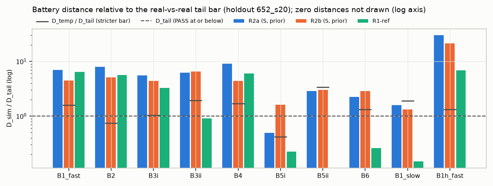
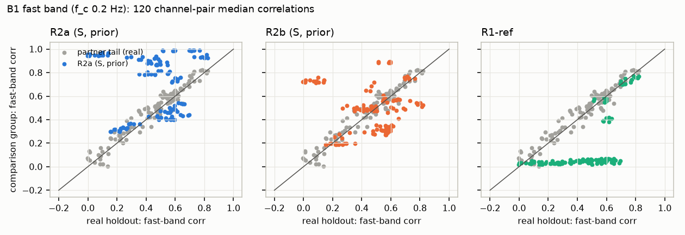
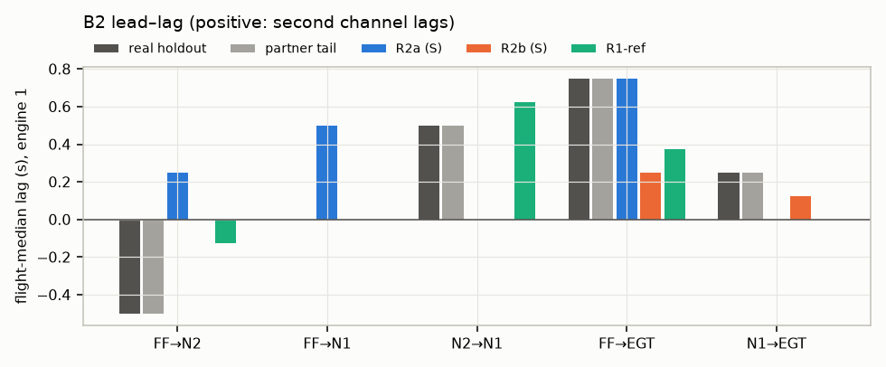

## Run facts (holdout 652_s20)

- Flights: {'holdout': 20, 'partner': 20, 'early': 10, 'late': 10} (holdout dates 2003-06-26T06:54 to 2010-01-15T06:50; median split ['2003-07-09T15:35', '2003-07-13T14:28']).
- Freeze check: frozen at 2026-10-14 17:14:38 IST; mismatches [].
- Holdout input checks (report only, no exclusion): 0 of 20 flights flagged (airborne MACH zeros > 5 %, PLA range < 5 deg or ALT max < 5,000 ft): [].
- Archive-2 status: ready=True, downloaded=True, extracted=True, last log line: `2026-10-14 16:55:13 extracted n_mat=602 first=687200109141013.mat last=687200112311241.mat`.

### Verdicts — PRIMARY: variant S (A6+A7), fleet-prior unit parameters

| Test | part | D_sim R2a | D_sim R2b | D_tail | D_temp | R2a | R2b | strict R2a | strict R2b |
|---|---|---|---|---|---|---|---|---|---|
| B1 | B1_fast | 0.320 | 0.207 | 0.046 | 0.073 | FAIL | FAIL | False | False |
| **B1** | test | | | | | **FAIL** | **FAIL** | False | False |
| B2 | B2 | 0.400 | 0.256 | 0.050 | 0.037 | FAIL | FAIL | False | False |
| **B2** | test | | | | | **FAIL** | **FAIL** | False | False |
| B3 | B3i | 0.535 | 0.426 | 0.096 | 0.100 | FAIL | FAIL | False | False |
| B3 | B3ii | 0.866 | 0.908 | 0.139 | 0.271 | FAIL | FAIL | False | False |
| **B3** | test | | | | | **FAIL** | **FAIL** | False | False |
| B4 | B4 | 1.467 | 0.708 | 0.161 | 0.274 | FAIL | FAIL | False | False |
| **B4** | test | | | | | **FAIL** | **FAIL** | False | False |
| B5 | B5i | 0.196 | 0.640 | 0.396 | 0.166 | PASS | FAIL | False | False |
| B5 | B5ii | 0.230 | 0.240 | 0.080 | 0.270 | FAIL | FAIL | True | True |
| **B5** | test | | | | | **FAIL** | **FAIL** | False | False |
| B6 | B6 | 1.613 | 2.065 | 0.719 | 0.951 | FAIL | FAIL | False | False |
| **B6** | test | | | | | **FAIL** | **FAIL** | False | False |

Decision rule (S, prior): **GO WITH FIXES or REWORK (depends on module attribution of the FAILs; see report)**; better arm R2b; PASS count 0; FAILs ['B1', 'B2', 'B3', 'B4', 'B5', 'B6']; G0 used True; ranking [['R2b', 0, 6, 4.0592934910495995], ['R2a', 0, 6, 5.182740329942871]].

### Verdicts — Variant P (pre-registered structure), fleet-prior unit parameters

| Test | part | D_sim R2a | D_sim R2b | D_tail | D_temp | R2a | R2b | strict R2a | strict R2b |
|---|---|---|---|---|---|---|---|---|---|
| B1 | B1_fast | 0.349 | 0.217 | 0.046 | 0.073 | FAIL | FAIL | False | False |
| **B1** | test | | | | | **FAIL** | **FAIL** | False | False |
| B2 | B2 | 0.450 | 0.194 | 0.050 | 0.037 | FAIL | FAIL | False | False |
| **B2** | test | | | | | **FAIL** | **FAIL** | False | False |
| B3 | B3i | 0.551 | 0.507 | 0.096 | 0.100 | FAIL | FAIL | False | False |
| B3 | B3ii | 0.940 | 1.410 | 0.139 | 0.271 | FAIL | FAIL | False | False |
| **B3** | test | | | | | **FAIL** | **FAIL** | False | False |
| B4 | B4 | 1.604 | 0.778 | 0.161 | 0.274 | FAIL | FAIL | False | False |
| **B4** | test | | | | | **FAIL** | **FAIL** | False | False |
| B5 | B5i | 0.461 | 0.538 | 0.396 | 0.166 | INCONCLUSIVE | FAIL | False | False |
| B5 | B5ii | 0.230 | 0.230 | 0.080 | 0.270 | FAIL | FAIL | True | True |
| **B5** | test | | | | | **FAIL** | **FAIL** | False | False |
| B6 | B6 | 1.603 | 2.064 | 0.719 | 0.951 | FAIL | FAIL | False | False |
| **B6** | test | | | | | **FAIL** | **FAIL** | False | False |

Decision rule (P, prior): **GO WITH FIXES or REWORK (depends on module attribution of the FAILs; see report)**; better arm R2b; PASS count 0; FAILs ['B1', 'B2', 'B3', 'B4', 'B5', 'B6']; G0 used True; ranking [['R2b', 0, 6, 4.490941553663944], ['R2a', 0, 6, 5.6623084305807305]].

### Verdicts — Secondary: variant S, CAL-fitted unit parameters

| Test | part | D_sim R2a | D_sim R2b | D_tail | D_temp | R2a | R2b | strict R2a | strict R2b |
|---|---|---|---|---|---|---|---|---|---|
| B1 | B1_fast | 0.335 | 0.215 | 0.046 | 0.073 | FAIL | FAIL | False | False |
| **B1** | test | | | | | **FAIL** | **FAIL** | False | False |
| B2 | B2 | 0.412 | 0.250 | 0.050 | 0.037 | FAIL | FAIL | False | False |
| **B2** | test | | | | | **FAIL** | **FAIL** | False | False |
| B3 | B3i | 0.520 | 0.429 | 0.096 | 0.100 | FAIL | FAIL | False | False |
| B3 | B3ii | 0.838 | 1.317 | 0.139 | 0.271 | FAIL | FAIL | False | False |
| **B3** | test | | | | | **FAIL** | **FAIL** | False | False |
| B4 | B4 | 1.432 | 0.678 | 0.161 | 0.274 | FAIL | FAIL | False | False |
| **B4** | test | | | | | **FAIL** | **FAIL** | False | False |
| B5 | B5i | 0.005 | 0.721 | 0.396 | 0.166 | PASS | FAIL | True | False |
| B5 | B5ii | 0.230 | 0.230 | 0.080 | 0.270 | FAIL | FAIL | True | True |
| **B5** | test | | | | | **FAIL** | **FAIL** | True | False |
| B6 | B6 | 1.556 | 1.996 | 0.719 | 0.951 | FAIL | FAIL | False | False |
| **B6** | test | | | | | **FAIL** | **FAIL** | False | False |

Decision rule (S, cal): **GO WITH FIXES or REWORK (depends on module attribution of the FAILs; see report)**; better arm R2b; PASS count 0; FAILs ['B1', 'B2', 'B3', 'B4', 'B5', 'B6']; G0 used True; ranking [['R2b', 0, 6, 4.412020178173309], ['R2a', 0, 6, 5.112285654250025]].

### Verdicts — Secondary: variant P, CAL-fitted unit parameters

| Test | part | D_sim R2a | D_sim R2b | D_tail | D_temp | R2a | R2b | strict R2a | strict R2b |
|---|---|---|---|---|---|---|---|---|---|
| B1 | B1_fast | 0.322 | 0.218 | 0.046 | 0.073 | FAIL | FAIL | False | False |
| **B1** | test | | | | | **FAIL** | **FAIL** | False | False |
| B2 | B2 | 0.456 | 0.250 | 0.050 | 0.037 | FAIL | FAIL | False | False |
| **B2** | test | | | | | **FAIL** | **FAIL** | False | False |
| B3 | B3i | 0.657 | 0.508 | 0.096 | 0.100 | FAIL | FAIL | False | False |
| B3 | B3ii | 1.003 | 1.023 | 0.139 | 0.271 | FAIL | FAIL | False | False |
| **B3** | test | | | | | **FAIL** | **FAIL** | False | False |
| B4 | B4 | 1.583 | 0.822 | 0.161 | 0.274 | FAIL | FAIL | False | False |
| **B4** | test | | | | | **FAIL** | **FAIL** | False | False |
| B5 | B5i | 0.434 | 0.539 | 0.396 | 0.166 | INCONCLUSIVE | FAIL | False | False |
| B5 | B5ii | 0.220 | 0.230 | 0.080 | 0.270 | FAIL | FAIL | True | True |
| **B5** | test | | | | | **FAIL** | **FAIL** | False | False |
| B6 | B6 | 1.554 | 2.073 | 0.719 | 0.951 | FAIL | FAIL | False | False |
| **B6** | test | | | | | **FAIL** | **FAIL** | False | False |

Decision rule (P, cal): **GO WITH FIXES or REWORK (depends on module attribution of the FAILs; see report)**; better arm R2b; PASS count 0; FAILs ['B1', 'B2', 'B3', 'B4', 'B5', 'B6']; G0 used True; ranking [['R2b', 0, 6, 4.3253584419067295], ['R2a', 0, 6, 5.749775067692399]].

### All arms: D_sim (synthetic vs real holdout, paired) with the bars

| label | B1_fast | B1_slow | B1h_fast | B2 | B3i | B3ii | B4 | B5i | B5ii | B6 |
|---|---|---|---|---|---|---|---|---|---|---|
| S_R2a_prior | 0.320 | 0.018 | 0.674 | 0.400 | 0.535 | 0.866 | 1.467 | 0.196 | 0.230 | 1.613 |
| S_R2a_cal | 0.335 | 0.021 | 0.700 | 0.412 | 0.520 | 0.838 | 1.432 | 0.005 | 0.230 | 1.556 |
| S_R2b_prior | 0.207 | 0.015 | 0.474 | 0.256 | 0.426 | 0.908 | 0.708 | 0.640 | 0.240 | 2.065 |
| S_R2b_cal | 0.215 | 0.016 | 0.496 | 0.250 | 0.429 | 1.317 | 0.678 | 0.721 | 0.230 | 1.996 |
| P_R2a_prior | 0.349 | 0.023 | 0.679 | 0.450 | 0.551 | 0.940 | 1.604 | 0.461 | 0.230 | 1.603 |
| P_R2a_cal | 0.322 | 0.016 | 0.605 | 0.456 | 0.657 | 1.003 | 1.583 | 0.434 | 0.220 | 1.554 |
| P_R2b_prior | 0.217 | 0.015 | 0.481 | 0.194 | 0.507 | 1.410 | 0.778 | 0.538 | 0.230 | 2.064 |
| P_R2b_cal | 0.218 | 0.016 | 0.473 | 0.250 | 0.508 | 1.023 | 0.822 | 0.539 | 0.230 | 2.073 |
| R1ref | 0.296 | 0.002 | 0.154 | 0.281 | 0.316 | 0.126 | 0.971 | 0.088 | 0.000 | 0.188 |
| **D_tail** | 0.046 | 0.012 | 0.022 | 0.050 | 0.096 | 0.139 | 0.161 | 0.396 | 0.080 | 0.719 |
| **D_temp** | 0.073 | 0.022 | 0.029 | 0.037 | 0.100 | 0.271 | 0.274 | 0.166 | 0.270 | 0.951 |

### Descriptive group values

| group | B5 scatter | B5 a | B2 lags eng1 (FF→N2, FF→N1, N2→N1, FF→EGT, N1→EGT) | airborne frac |
|---|---|---|---|---|
| real_holdout | 0.035 | 0.77 | [-0.5, 0.0, 0.5, 0.75, 0.25] | 0.916 |
| real_partner | 0.049 | 0.69 | [-0.5, 0.0, 0.5, 0.75, 0.25] | 0.920 |
| S_R2a_prior | 0.028 | 0.54 | [0.25, 0.5, 0.0, 0.75, 0.0] | 0.974 |
| S_R2a_cal | 0.035 | 0.54 | [0.25, 0.5, 0.0, 0.625, 0.0] | 0.979 |
| S_R2b_prior | 0.058 | 0.53 | [0.0, 0.0, 0.0, 0.25, 0.125] | 0.888 |
| S_R2b_cal | 0.061 | 0.54 | [0.0, 0.0, 0.0, 0.25, 0.0] | 0.888 |
| P_R2a_prior | 0.019 | 0.54 | [0.5, 0.5, 0.0, 0.875, 0.0] | 0.987 |
| P_R2a_cal | 0.020 | 0.55 | [0.5, 0.5, 0.0, 0.875, 0.0] | 0.915 |
| P_R2b_prior | 0.054 | 0.54 | [0.0, 0.0, 0.5, 0.75, 0.25] | 0.893 |
| P_R2b_cal | 0.054 | 0.54 | [0.0, 0.0, 0.0, 0.5, 0.0] | 0.880 |
| R1ref | 0.038 | 0.77 | [-0.125, 0.0, 0.625, 0.375, 0.0] | 0.900 |

### B9 (report only) and G1 (diagnostic)

| label | TRTR R² ridge/gbm | TSTR R² ridge/gbm | TSTR/TRTR ridge/gbm | ranking agrees | G1 TV N1/N2/EGT/FF |
|---|---|---|---|---|---|
| S_R2a_prior | 0.784/0.924 | 0.677/0.857 | 0.864/0.928 | True | 0.026/0.034/0.018/0.073 |
| S_R2a_cal | 0.784/0.924 | -0.266/0.847 | -0.340/0.918 | True | 0.031/0.041/0.008/0.068 |
| S_R2b_prior | 0.784/0.924 | 0.667/0.852 | 0.851/0.922 | True | 0.020/0.027/0.012/0.017 |
| S_R2b_cal | 0.784/0.924 | 0.643/0.840 | 0.821/0.909 | True | 0.020/0.027/0.011/0.018 |
| P_R2a_prior | 0.784/0.924 | -0.435/0.847 | -0.555/0.917 | True | 0.018/0.037/0.011/0.114 |
| P_R2a_cal | 0.784/0.924 | 0.644/0.845 | 0.821/0.915 | True | 0.029/0.038/0.007/0.069 |
| P_R2b_prior | 0.784/0.924 | 0.674/0.848 | 0.860/0.918 | True | 0.020/0.026/0.011/0.018 |
| P_R2b_cal | 0.784/0.924 | 0.662/0.844 | 0.844/0.914 | True | 0.020/0.027/0.011/0.018 |
| R1ref | 0.784/0.924 | 0.771/0.924 | 0.984/1.001 | True | 0.210/0.195/0.278/0.010 |

### G0 (binding) and discriminator diagnostics (no verdict)

| label | G0 pipeline-only LR AUC [CI] | GB AUC [CI] | G0 | full-metadata LR/GB (diag.) | D2 LR/GB 64 s | D2 LR/GB seg | D3 64 s |
|---|---|---|---|---|---|---|---|
| P_R2a_prior | 0.500 [0.5, 0.5] | 0.500 [0.5, 0.5] | PASS | 0.953/0.500 | 1.000/1.000 | 1.000/0.500 | – |
| P_R2b_prior | 0.500 [0.5, 0.5] | 0.500 [0.5, 0.5] | PASS | 0.953/0.500 | 1.000/1.000 | 1.000/0.500 | – |
| S_R2a_prior | 0.500 [0.5, 0.5] | 0.500 [0.5, 0.5] | PASS | 0.953/0.500 | 1.000/1.000 | 1.000/0.500 | – |
| S_R2b_prior | 0.500 [0.5, 0.5] | 0.500 [0.5, 0.5] | PASS | 0.953/0.500 | 1.000/1.000 | 1.000/0.500 | – |

Family ablation, P_R2a_prior, D2_lr_64_tex: drop_cross 1.000, drop_missing 1.000, drop_noise 1.000, drop_quant 1.000, drop_spectral 1.000, drop_tails 1.000, only_cross 1.000, only_missing 1.000, only_noise 1.000, only_quant 1.000, only_spectral 1.000, only_tails 1.000

Family ablation, P_R2b_prior, D2_lr_64_tex: drop_cross 1.000, drop_missing 1.000, drop_noise 1.000, drop_quant 1.000, drop_spectral 1.000, drop_tails 1.000, only_cross 1.000, only_missing 1.000, only_noise 1.000, only_quant 1.000, only_spectral 1.000, only_tails 1.000

Family ablation, S_R2a_prior, D2_lr_64_tex: drop_cross 1.000, drop_missing 1.000, drop_noise 1.000, drop_quant 1.000, drop_spectral 1.000, drop_tails 1.000, only_cross 1.000, only_missing 1.000, only_noise 1.000, only_quant 1.000, only_spectral 1.000, only_tails 1.000

Family ablation, S_R2b_prior, D2_lr_64_tex: drop_cross 1.000, drop_missing 1.000, drop_noise 1.000, drop_quant 1.000, drop_spectral 1.000, drop_tails 1.000, only_cross 1.000, only_missing 1.000, only_noise 1.000, only_quant 1.000, only_spectral 1.000, only_tails 1.000

### Automatic attribution evidence (input to the module attribution in the report)

- B1_fast: R2a→R2b (M-C) S/prior 0.320→0.207; P→S (A6+A7) R2a 0.349→0.320; prior→cal offsets S/R2a 0.320→0.335; R1-ref 0.296; D_tail 0.046
- B2: R2a→R2b (M-C) S/prior 0.400→0.256; P→S (A6+A7) R2a 0.450→0.400; prior→cal offsets S/R2a 0.400→0.412; R1-ref 0.281; D_tail 0.050
- B3i: R2a→R2b (M-C) S/prior 0.535→0.426; P→S (A6+A7) R2a 0.551→0.535; prior→cal offsets S/R2a 0.535→0.520; R1-ref 0.316; D_tail 0.096
- B3ii: R2a→R2b (M-C) S/prior 0.866→0.908; P→S (A6+A7) R2a 0.940→0.866; prior→cal offsets S/R2a 0.866→0.838; R1-ref 0.126; D_tail 0.139
- B4: R2a→R2b (M-C) S/prior 1.467→0.708; P→S (A6+A7) R2a 1.604→1.467; prior→cal offsets S/R2a 1.467→1.432; R1-ref 0.971; D_tail 0.161
- B5i: R2a→R2b (M-C) S/prior 0.196→0.640; P→S (A6+A7) R2a 0.461→0.196; prior→cal offsets S/R2a 0.196→0.005; R1-ref 0.088; D_tail 0.396
- B5ii: R2a→R2b (M-C) S/prior 0.230→0.240; P→S (A6+A7) R2a 0.230→0.230; prior→cal offsets S/R2a 0.230→0.230; R1-ref 0.000; D_tail 0.080
- B6: R2a→R2b (M-C) S/prior 1.613→2.065; P→S (A6+A7) R2a 1.603→1.613; prior→cal offsets S/R2a 1.613→1.556; R1-ref 0.188; D_tail 0.719

### Figures

