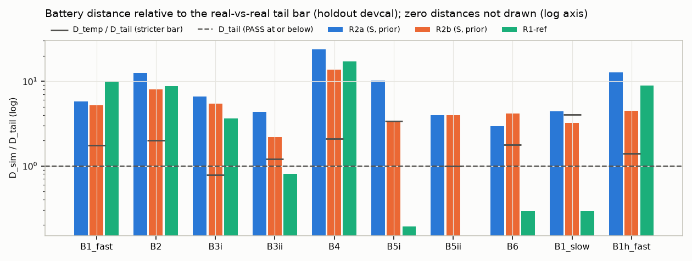
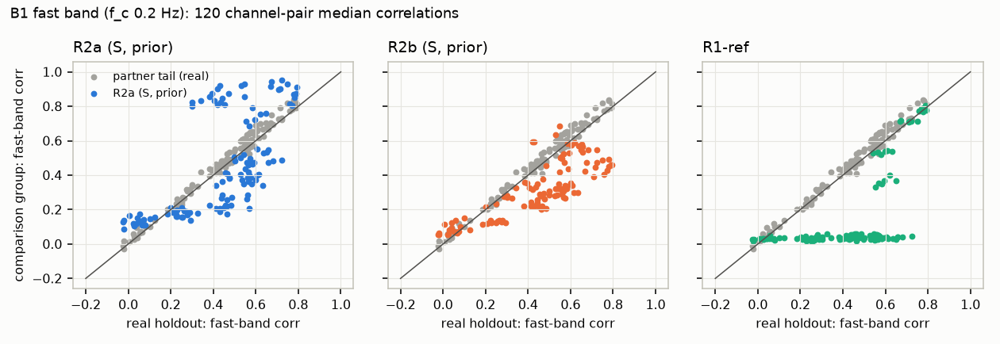
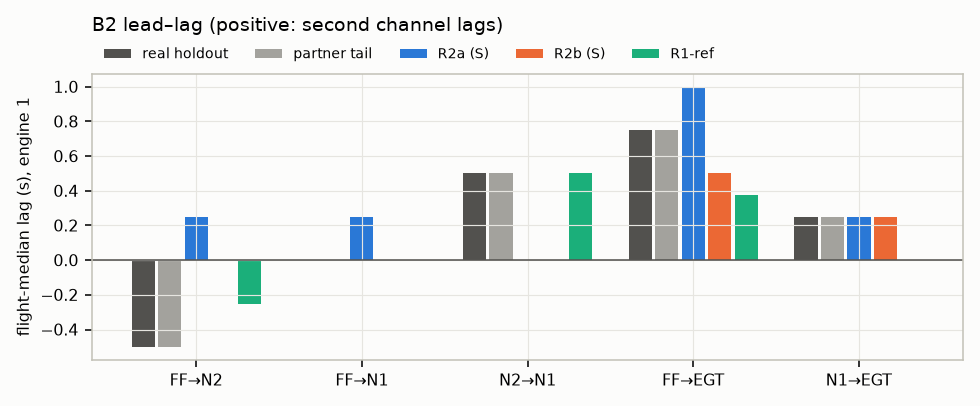

## Run facts (holdout devcal)

- Flights: {'holdout': 20, 'partner': 20, 'early': 10, 'late': 10} (holdout dates 2001-04-11T11:58 to 2001-09-11T08:53; median split ['2001-07-26T07:33', '2001-08-15T05:46']).
- Freeze check: frozen at devcal (not frozen); mismatches [].
- Holdout input checks (report only, no exclusion): 0 of 20 flights flagged (airborne MACH zeros > 5 %, PLA range < 5 deg or ALT max < 5,000 ft): [].
- Archive-2 status: ready=True, downloaded=True, extracted=True, last log line: `2026-10-14 16:55:13 extracted n_mat=602 first=687200109141013.mat last=687200112311241.mat`.

### Verdicts — PRIMARY: variant S (A6+A7), fleet-prior unit parameters

| Test | part | D_sim R2a | D_sim R2b | D_tail | D_temp | R2a | R2b | strict R2a | strict R2b |
|---|---|---|---|---|---|---|---|---|---|
| B1 | B1_fast | 0.173 | 0.154 | 0.030 | 0.053 | FAIL | FAIL | False | False |
| **B1** | test | | | | | **FAIL** | **FAIL** | False | False |
| B2 | B2 | 0.312 | 0.200 | 0.025 | 0.050 | FAIL | FAIL | False | False |
| **B2** | test | | | | | **FAIL** | **FAIL** | False | False |
| B3 | B3i | 0.593 | 0.487 | 0.089 | 0.070 | FAIL | FAIL | False | False |
| B3 | B3ii | 0.809 | 0.406 | 0.186 | 0.226 | FAIL | FAIL | False | False |
| **B3** | test | | | | | **FAIL** | **FAIL** | False | False |
| B4 | B4 | 1.412 | 0.818 | 0.059 | 0.124 | FAIL | FAIL | False | False |
| **B4** | test | | | | | **FAIL** | **FAIL** | False | False |
| B5 | B5i | 0.429 | 0.144 | 0.042 | 0.141 | FAIL | FAIL | False | False |
| B5 | B5ii | 0.080 | 0.080 | 0.020 | 0.020 | INCONCLUSIVE | FAIL | False | False |
| **B5** | test | | | | | **FAIL** | **FAIL** | False | False |
| B6 | B6 | 1.011 | 1.420 | 0.342 | 0.607 | FAIL | FAIL | False | False |
| **B6** | test | | | | | **FAIL** | **FAIL** | False | False |

Decision rule (S, prior): **GO WITH FIXES or REWORK (depends on module attribution of the FAILs; see report)**; better arm R2b; PASS count 0; FAILs ['B1', 'B2', 'B3', 'B4', 'B5', 'B6']; G0 used True; ranking [['R2b', 0, 6, 5.769415756588595], ['R2a', 0, 6, 8.774748732705888]].

### Verdicts — Variant P (pre-registered structure), fleet-prior unit parameters

| Test | part | D_sim R2a | D_sim R2b | D_tail | D_temp | R2a | R2b | strict R2a | strict R2b |
|---|---|---|---|---|---|---|---|---|---|
| B1 | B1_fast | 0.195 | 0.161 | 0.030 | 0.053 | FAIL | FAIL | False | False |
| **B1** | test | | | | | **FAIL** | **FAIL** | False | False |
| B2 | B2 | 0.381 | 0.225 | 0.025 | 0.050 | FAIL | FAIL | False | False |
| **B2** | test | | | | | **FAIL** | **FAIL** | False | False |
| B3 | B3i | 0.711 | 0.570 | 0.089 | 0.070 | FAIL | FAIL | False | False |
| B3 | B3ii | 1.130 | 0.512 | 0.186 | 0.226 | FAIL | FAIL | False | False |
| **B3** | test | | | | | **FAIL** | **FAIL** | False | False |
| B4 | B4 | 1.692 | 0.866 | 0.059 | 0.124 | FAIL | FAIL | False | False |
| **B4** | test | | | | | **FAIL** | **FAIL** | False | False |
| B5 | B5i | 0.641 | 0.064 | 0.042 | 0.141 | FAIL | INCONCLUSIVE | False | True |
| B5 | B5ii | 0.080 | 0.080 | 0.020 | 0.020 | INCONCLUSIVE | FAIL | False | False |
| **B5** | test | | | | | **FAIL** | **FAIL** | False | False |
| B6 | B6 | 1.280 | 1.355 | 0.342 | 0.607 | FAIL | FAIL | False | False |
| **B6** | test | | | | | **FAIL** | **FAIL** | False | False |

Decision rule (P, prior): **GO WITH FIXES or REWORK (depends on module attribution of the FAILs; see report)**; better arm R2b; PASS count 0; FAILs ['B1', 'B2', 'B3', 'B4', 'B5', 'B6']; G0 used True; ranking [['R2b', 0, 6, 5.949145401238656], ['R2a', 0, 6, 10.909921225519733]].

### Verdicts — Secondary: variant S, CAL-fitted unit parameters

| Test | part | D_sim R2a | D_sim R2b | D_tail | D_temp | R2a | R2b | strict R2a | strict R2b |
|---|---|---|---|---|---|---|---|---|---|
| B1 | B1_fast | 0.174 | 0.155 | 0.030 | 0.053 | FAIL | FAIL | False | False |
| **B1** | test | | | | | **FAIL** | **FAIL** | False | False |
| B2 | B2 | 0.325 | 0.225 | 0.025 | 0.050 | FAIL | FAIL | False | False |
| **B2** | test | | | | | **FAIL** | **FAIL** | False | False |
| B3 | B3i | 0.610 | 0.489 | 0.089 | 0.070 | FAIL | FAIL | False | False |
| B3 | B3ii | 0.782 | 0.459 | 0.186 | 0.226 | FAIL | FAIL | False | False |
| **B3** | test | | | | | **FAIL** | **FAIL** | False | False |
| B4 | B4 | 1.389 | 0.791 | 0.059 | 0.124 | FAIL | FAIL | False | False |
| **B4** | test | | | | | **FAIL** | **FAIL** | False | False |
| B5 | B5i | 0.162 | 0.281 | 0.042 | 0.141 | FAIL | FAIL | False | False |
| B5 | B5ii | 0.080 | 0.080 | 0.020 | 0.020 | INCONCLUSIVE | FAIL | False | False |
| **B5** | test | | | | | **FAIL** | **FAIL** | False | False |
| B6 | B6 | 0.996 | 1.395 | 0.342 | 0.607 | FAIL | FAIL | False | False |
| **B6** | test | | | | | **FAIL** | **FAIL** | False | False |

Decision rule (S, cal): **GO WITH FIXES or REWORK (depends on module attribution of the FAILs; see report)**; better arm R2b; PASS count 0; FAILs ['B1', 'B2', 'B3', 'B4', 'B5', 'B6']; G0 used True; ranking [['R2b', 0, 6, 6.2756982453711885], ['R2a', 0, 6, 7.997527201548735]].

### Verdicts — Secondary: variant P, CAL-fitted unit parameters

| Test | part | D_sim R2a | D_sim R2b | D_tail | D_temp | R2a | R2b | strict R2a | strict R2b |
|---|---|---|---|---|---|---|---|---|---|
| B1 | B1_fast | 0.194 | 0.163 | 0.030 | 0.053 | FAIL | FAIL | False | False |
| **B1** | test | | | | | **FAIL** | **FAIL** | False | False |
| B2 | B2 | 0.381 | 0.188 | 0.025 | 0.050 | FAIL | FAIL | False | False |
| **B2** | test | | | | | **FAIL** | **FAIL** | False | False |
| B3 | B3i | 0.709 | 0.570 | 0.089 | 0.070 | FAIL | FAIL | False | False |
| B3 | B3ii | 1.128 | 0.537 | 0.186 | 0.226 | FAIL | FAIL | False | False |
| **B3** | test | | | | | **FAIL** | **FAIL** | False | False |
| B4 | B4 | 1.641 | 0.886 | 0.059 | 0.124 | FAIL | FAIL | False | False |
| **B4** | test | | | | | **FAIL** | **FAIL** | False | False |
| B5 | B5i | 0.604 | 0.073 | 0.042 | 0.141 | FAIL | INCONCLUSIVE | False | True |
| B5 | B5ii | 0.080 | 0.080 | 0.020 | 0.020 | INCONCLUSIVE | FAIL | False | False |
| **B5** | test | | | | | **FAIL** | **FAIL** | False | False |
| B6 | B6 | 1.030 | 1.358 | 0.342 | 0.607 | FAIL | FAIL | False | False |
| **B6** | test | | | | | **FAIL** | **FAIL** | False | False |

Decision rule (P, cal): **GO WITH FIXES or REWORK (depends on module attribution of the FAILs; see report)**; better arm R2b; PASS count 0; FAILs ['B1', 'B2', 'B3', 'B4', 'B5', 'B6']; G0 used True; ranking [['R2b', 0, 6, 5.856934079985344], ['R2a', 0, 6, 10.593420704281074]].

### All arms: D_sim (synthetic vs real holdout, paired) with the bars

| label | B1_fast | B1_slow | B1h_fast | B2 | B3i | B3ii | B4 | B5i | B5ii | B6 |
|---|---|---|---|---|---|---|---|---|---|---|
| S_R2a_prior | 0.173 | 0.018 | 0.228 | 0.312 | 0.593 | 0.809 | 1.412 | 0.429 | 0.080 | 1.011 |
| S_R2a_cal | 0.174 | 0.020 | 0.222 | 0.325 | 0.610 | 0.782 | 1.389 | 0.162 | 0.080 | 0.996 |
| S_R2b_prior | 0.154 | 0.013 | 0.081 | 0.200 | 0.487 | 0.406 | 0.818 | 0.144 | 0.080 | 1.420 |
| S_R2b_cal | 0.155 | 0.013 | 0.081 | 0.225 | 0.489 | 0.459 | 0.791 | 0.281 | 0.080 | 1.395 |
| P_R2a_prior | 0.195 | 0.017 | 0.173 | 0.381 | 0.711 | 1.130 | 1.692 | 0.641 | 0.080 | 1.280 |
| P_R2a_cal | 0.194 | 0.015 | 0.152 | 0.381 | 0.709 | 1.128 | 1.641 | 0.604 | 0.080 | 1.030 |
| P_R2b_prior | 0.161 | 0.014 | 0.082 | 0.225 | 0.570 | 0.512 | 0.866 | 0.064 | 0.080 | 1.355 |
| P_R2b_cal | 0.163 | 0.014 | 0.082 | 0.188 | 0.570 | 0.537 | 0.886 | 0.073 | 0.080 | 1.358 |
| R1ref | 0.297 | 0.001 | 0.160 | 0.219 | 0.327 | 0.151 | 1.015 | 0.008 | 0.000 | 0.100 |
| **D_tail** | 0.030 | 0.004 | 0.018 | 0.025 | 0.089 | 0.186 | 0.059 | 0.042 | 0.020 | 0.342 |
| **D_temp** | 0.053 | 0.016 | 0.025 | 0.050 | 0.070 | 0.226 | 0.124 | 0.141 | 0.020 | 0.607 |

### Descriptive group values

| group | B5 scatter | B5 a | B2 lags eng1 (FF→N2, FF→N1, N2→N1, FF→EGT, N1→EGT) | airborne frac |
|---|---|---|---|---|
| real_holdout | 0.051 | 0.66 | [-0.5, 0.0, 0.5, 0.75, 0.25] | 0.920 |
| real_partner | 0.049 | 0.68 | [-0.5, 0.0, 0.5, 0.75, 0.25] | 0.916 |
| S_R2a_prior | 0.029 | 0.58 | [0.25, 0.25, 0.0, 1.0, 0.25] | 0.896 |
| S_R2a_cal | 0.043 | 0.58 | [0.25, 0.25, 0.0, 0.75, 0.0] | 0.923 |
| S_R2b_prior | 0.058 | 0.58 | [0.0, 0.0, 0.0, 0.5, 0.25] | 0.847 |
| S_R2b_cal | 0.065 | 0.58 | [0.0, 0.0, 0.0, 0.25, 0.0] | 0.846 |
| P_R2a_prior | 0.018 | 0.58 | [0.25, 0.25, 0.0, 1.0, 0.0] | 0.867 |
| P_R2a_cal | 0.020 | 0.58 | [0.25, 0.25, 0.0, 0.875, 0.0] | 0.867 |
| P_R2b_prior | 0.054 | 0.58 | [0.0, 0.0, 0.0, 0.5, 0.0] | 0.843 |
| P_R2b_cal | 0.055 | 0.58 | [0.0, 0.0, 0.0, 0.75, 0.0] | 0.840 |
| R1ref | 0.051 | 0.66 | [-0.25, 0.0, 0.5, 0.375, 0.0] | 0.916 |

### B9 (report only) and G1 (diagnostic)

| label | TRTR R² ridge/gbm | TSTR R² ridge/gbm | TSTR/TRTR ridge/gbm | ranking agrees | G1 TV N1/N2/EGT/FF |
|---|---|---|---|---|---|
| S_R2a_prior | 0.805/0.944 | 0.796/0.895 | 0.989/0.947 | True | 0.027/0.026/0.016/0.039 |
| S_R2a_cal | 0.805/0.944 | 0.796/0.908 | 0.989/0.961 | True | 0.022/0.029/0.018/0.026 |
| S_R2b_prior | 0.805/0.944 | 0.821/0.892 | 1.020/0.945 | True | 0.009/0.020/0.009/0.029 |
| S_R2b_cal | 0.805/0.944 | 0.828/0.901 | 1.029/0.954 | True | 0.011/0.021/0.009/0.030 |
| P_R2a_prior | 0.805/0.944 | 0.472/0.902 | 0.586/0.955 | True | 0.023/0.029/0.009/0.032 |
| P_R2a_cal | 0.805/0.944 | 0.812/0.904 | 1.008/0.957 | True | 0.014/0.026/0.010/0.029 |
| P_R2b_prior | 0.805/0.944 | 0.810/0.899 | 1.006/0.952 | True | 0.010/0.021/0.010/0.031 |
| P_R2b_cal | 0.805/0.944 | 0.824/0.900 | 1.023/0.954 | True | 0.010/0.020/0.010/0.031 |
| R1ref | 0.805/0.944 | 0.814/0.944 | 1.011/0.999 | True | 0.211/0.198/0.283/0.011 |

### G0 (binding) and discriminator diagnostics (no verdict)

| label | G0 pipeline-only LR AUC [CI] | GB AUC [CI] | G0 | full-metadata LR/GB (diag.) | D2 LR/GB 64 s | D2 LR/GB seg | D3 64 s |
|---|---|---|---|---|---|---|---|
| P_R2a_prior | 0.500 [0.5, 0.5] | 0.500 [0.5, 0.5] | PASS | 0.952/0.500 | 1.000/1.000 | 1.000/0.500 | – |
| P_R2b_prior | 0.500 [0.5, 0.5] | 0.500 [0.5, 0.5] | PASS | 0.952/0.500 | 1.000/1.000 | 1.000/0.500 | – |
| S_R2a_prior | 0.500 [0.5, 0.5] | 0.500 [0.5, 0.5] | PASS | 0.990/0.500 | 1.000/1.000 | 1.000/0.500 | – |
| S_R2b_prior | 0.500 [0.5, 0.5] | 0.500 [0.5, 0.5] | PASS | 0.990/0.500 | 1.000/1.000 | 1.000/0.500 | – |

Family ablation, P_R2a_prior, D2_lr_64_tex: drop_cross 1.000, drop_missing 1.000, drop_noise 1.000, drop_quant 1.000, drop_spectral 1.000, drop_tails 1.000, only_cross 1.000, only_missing 1.000, only_noise 1.000, only_quant 1.000, only_spectral 1.000, only_tails 1.000

Family ablation, P_R2b_prior, D2_lr_64_tex: drop_cross 1.000, drop_missing 1.000, drop_noise 1.000, drop_quant 1.000, drop_spectral 1.000, drop_tails 1.000, only_cross 1.000, only_missing 1.000, only_noise 1.000, only_quant 1.000, only_spectral 1.000, only_tails 1.000

Family ablation, S_R2a_prior, D2_lr_64_tex: drop_cross 1.000, drop_missing 1.000, drop_noise 1.000, drop_quant 1.000, drop_spectral 1.000, drop_tails 1.000, only_cross 1.000, only_missing 1.000, only_noise 1.000, only_quant 1.000, only_spectral 1.000, only_tails 1.000

Family ablation, S_R2b_prior, D2_lr_64_tex: drop_cross 1.000, drop_missing 1.000, drop_noise 1.000, drop_quant 1.000, drop_spectral 1.000, drop_tails 1.000, only_cross 1.000, only_missing 1.000, only_noise 1.000, only_quant 1.000, only_spectral 1.000, only_tails 1.000

### Automatic attribution evidence (input to the module attribution in the report)

- B1_fast: R2a→R2b (M-C) S/prior 0.173→0.154; P→S (A6+A7) R2a 0.195→0.173; prior→cal offsets S/R2a 0.173→0.174; R1-ref 0.297; D_tail 0.030
- B2: R2a→R2b (M-C) S/prior 0.312→0.200; P→S (A6+A7) R2a 0.381→0.312; prior→cal offsets S/R2a 0.312→0.325; R1-ref 0.219; D_tail 0.025
- B3i: R2a→R2b (M-C) S/prior 0.593→0.487; P→S (A6+A7) R2a 0.711→0.593; prior→cal offsets S/R2a 0.593→0.610; R1-ref 0.327; D_tail 0.089
- B3ii: R2a→R2b (M-C) S/prior 0.809→0.406; P→S (A6+A7) R2a 1.130→0.809; prior→cal offsets S/R2a 0.809→0.782; R1-ref 0.151; D_tail 0.186
- B4: R2a→R2b (M-C) S/prior 1.412→0.818; P→S (A6+A7) R2a 1.692→1.412; prior→cal offsets S/R2a 1.412→1.389; R1-ref 1.015; D_tail 0.059
- B5i: R2a→R2b (M-C) S/prior 0.429→0.144; P→S (A6+A7) R2a 0.641→0.429; prior→cal offsets S/R2a 0.429→0.162; R1-ref 0.008; D_tail 0.042
- B5ii: R2a→R2b (M-C) S/prior 0.080→0.080; P→S (A6+A7) R2a 0.080→0.080; prior→cal offsets S/R2a 0.080→0.080; R1-ref 0.000; D_tail 0.020
- B6: R2a→R2b (M-C) S/prior 1.011→1.420; P→S (A6+A7) R2a 1.280→1.011; prior→cal offsets S/R2a 1.011→0.996; R1-ref 0.100; D_tail 0.342

### Figures

