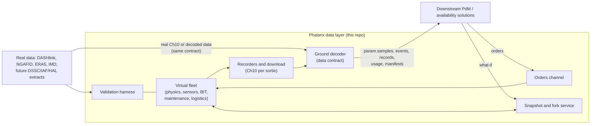
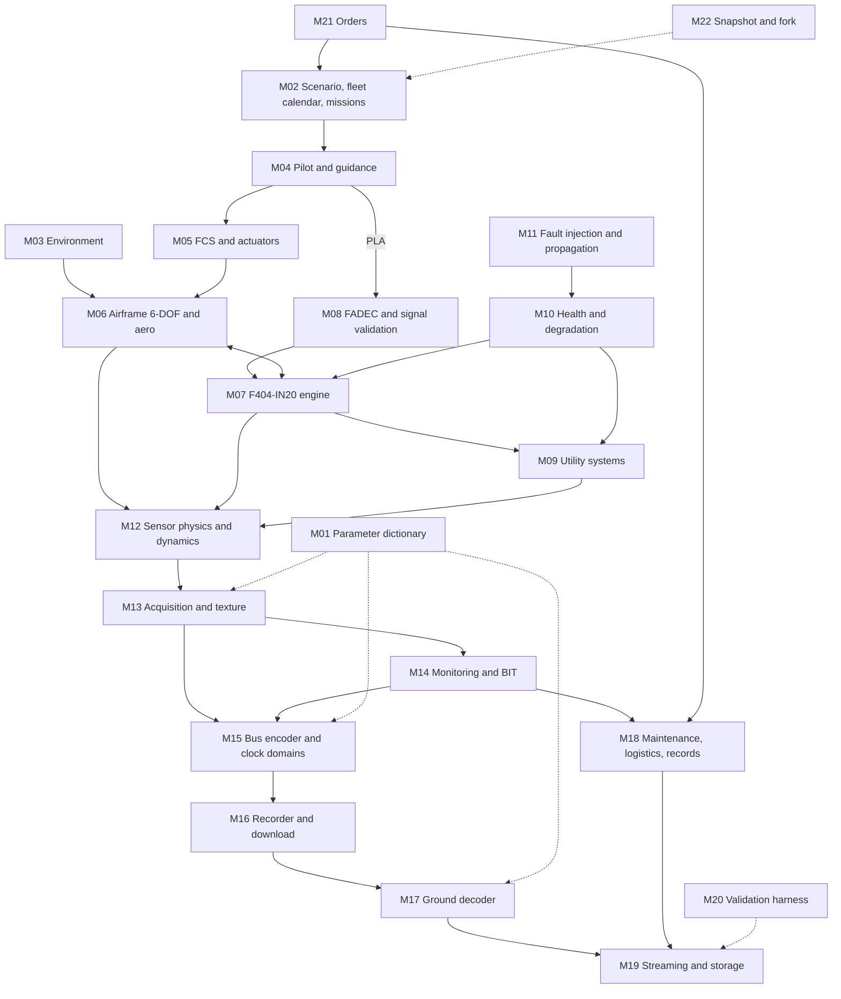

# Phalanx Data Layer: Architecture Specification

**Version:** 1.0 (2026-10-14). Round 2 is resolved, verdict REWORK (`analysis/settling_experiment_round2/REPORT.md`); its lessons are folded in as requirements.

**Status:** approved for build. **⟂B** items are now decided (AD-22: Numba, W0.6). Items marked **⟂G** are acceptance gates that the build must pass in proxy mode on the reserved Tail 687 archive 2.

**History:**
- rc1: first release candidate.
- rc2: corrected the lead–lag attribution.
- v1.0: stochastic closed-loop truth (AD-32), and archive 2 as the proxy-mode gate (AD-33).

**Scope:** the data-generation and data-streaming layer only. It provides a deterministic, forkable virtual
Tejas-class fleet, and downstream predictive-maintenance and availability solutions are built on top of it.

**Companion documents:**

| Document | Role |
|---|---|
| `RULES.md` | Working rules |
| `reports/Virtual fighter telemetry layer research.md` | Evidence and rationale; cited as **[R§n]** |
| `research_notes/Virtual fighter telemetry layer research/` | Detailed notes, `parameter_inventory.csv`, `not_measured_states.csv`; cited as **[N:file]** |
| `analysis/*/` | Experiments; cited as **[E:…]** |

**Normative language:** **MUST**, **SHOULD** and **MAY** have their usual meanings. Every MUST is a requirement
that the build verifies with a test or gate.

---

## Contents
1. [Purpose, principles and definition of done](#1-purpose-principles-and-definition-of-done)
2. [Target platform and evidence basis](#2-target-platform-and-evidence-basis)
3. [System context](#3-system-context)
4. [Architecture overview](#4-architecture-overview)
5. [Core concepts and invariants](#5-core-concepts-and-invariants)
6. [Module specifications (M01–M22)](#6-module-specifications-m01m22)
7. [The measurement chain (physics → recorded value)](#7-the-measurement-chain-physics--recorded-value)
8. [Time, clocks and rate groups](#8-time-clocks-and-rate-groups)
9. [Health, degradation, faults and BIT](#9-health-degradation-faults-and-bit)
10. [Maintenance, logistics, records and availability](#10-maintenance-logistics-records-and-availability)
11. [Orders channel and forkable world](#11-orders-channel-and-forkable-world)
12. [Data contract](#12-data-contract)
13. [Execution model, fidelity tiers and compute](#13-execution-model-fidelity-tiers-and-compute)
14. [Validation and calibration architecture](#14-validation-and-calibration-architecture)
15. [Reproducibility, provenance and configuration](#15-reproducibility-provenance-and-configuration)
16. [Repository and package layout](#16-repository-and-package-layout)
17. [Architecture decision register](#17-architecture-decision-register)
18. [Experimental evidence behind this architecture](#18-experimental-evidence-behind-this-architecture)
19. [Open items and external requests](#19-open-items-and-external-requests)
20. [Glossary](#20-glossary)

---

## 1. Purpose, principles and definition of done

**Purpose.**
- Produce, for a virtual fleet of Tejas-class aircraft, the data a real fleet generates. That covers sensor values, avionics-bus traffic, recorder files, BIT and exceedance events, usage counters, and maintenance, logistics and availability records.
- Every observation is the consequence of a simulated physical and operational state.
- Downstream solutions plug in at one stable **data contract** (§12). They act on the fleet through one **orders channel** (§11).

**Principles.** Each traces to evidence in §18 or the report.

| # | Principle | Consequence |
|---|---|---|
| P1 | **State produces observations.** Data are never generated directly. | Every value has a causal path back to state and inputs. |
| P2 | **Physics carries causality and coupling, as a stochastic closed-loop system.** The texture layer carries only effects that are physically independent per sensor. | Coupled fast dynamics (FF–N2–N1–EGT) MUST come from the engine model running in closed loop with its control and driven by **per-unit process disturbances** that enter the dynamics, plus the sensor-dynamics models. Banned: "independent noise per channel" for coupled behaviour, and deterministic input-driven physics, which over-couples engines and spools [E:correlation_check; E:round 2 REPORT §3]. |
| P3 | **Fidelity follows maintenance relevance.** | The engine gas path, monitoring, hydraulic and actuator duty, data-path texture and records get the most effort. Lateral high-α aero and avionics internals get just enough [R§0]. |
| P4 | **Parameters are data.** | Every number lives in the versioned parameter dictionary with an evidence tag. Real data replaces values, not code [R§15]. |
| P5 | **One contract, many sinks.** | The ground-decoder contract is stable. Real data must be ingestible through it unchanged [R§5]. |
| P6 | **Determinism and forkability.** | A run is a pure function of (root seed, config, dictionary version, order log). Any snapshot can be forked with common random numbers. |
| P7 | **No shallow proxies; minimal sufficient samples.** | Unavoidable simplifications are labelled `PROXY` and tested. Every check uses the smallest sample that answers it (RULES.md). |
| P8 | **Behavioural fidelity is the realism gate.** | The bars are real-vs-real distances. Discriminators are diagnostic only [E:round1 closeout]. |
| P9 | **Honest credibility.** | NASA-STD-7009B Level 2 against proxy data. Platform-specific values are swept, not asserted [R§15]. |

**Definition of done (v1).**
1. All 22 modules pass their acceptance tests (§6), including the ⟂G proxy-mode gate (AD-33).
2. The engine calibration targets C1–C28 and aero tests V1–V12 pass within the stated tolerances (§14).
3. In proxy mode, the behavioural battery passes against real-vs-real bars, and the binding guards pass (§14).
4. Bitwise replay, snapshot/restore and fork tests pass (§11, §15).
5. The ground-decoder contract v1 is frozen and documented. A downstream consumer can run on the fast path and the full path with identical schemas (§12).
6. A reference fleet dataset is generated with a manifest and a credibility card.

---

## 2. Target platform and evidence basis

**Target:** HAL Tejas Mk1A-class, single-engine tailless compound delta with quadruplex FBW, and the GE F404-GE-IN20
modelled as a **composite F404** [R§0, AD-01].
- Mk1 evidence plus the announced Mk1A changes: new mission computer, indigenous DFCC, indigenous HUMS DAU.
- No Mk1A was delivered as of 15 May 2026 [R§1].

**Donor map.** Every donor-derived parameter carries `[TRANSFER: donor]` in the dictionary.

| Layer | Primary anchor | Donors |
|---|---|---|
| Geometry, mass, inertia, longitudinal aero, FCS, air data, actuators | Tejas [DIRECT / DIRECT-unnamed] | — |
| Lateral-directional and nonlinear aero | — | FOI ADMIRE/GAM (canards neutralised); NASA F-106B; F-16 TP-1538 as fallback |
| Engine cycle, sensors, control, monitoring, life usage | IN20 ratings: 84 kN, 70 kg/s, OPR 28, 1,072 kg, FADEC [DIRECT] | F404-400/402 (F/A-18, CF-18, RAAF); RM12; F404-102 (T-50) |
| Engine modelling method | — | NASA F100 corpus; C-MAPSS40k/MAPSS; T-MATS; pyCycle |
| Utilities | Tejas LRU facts [DIRECT / DIRECT-part] | MIL-STD-704F, MIL-H-5440H, MIL-E-18927E, MIL-G-26988C; Gripen practice |
| Fleet, maintenance and availability | IAF process facts | CAG Su-30MKI / MiG-21 / IL-76 figures; USN NAMP, USAF TO 00-20, UK MAM-D, ASD S5000F |
| Recorder and texture | — | DASHlink Tail 687 [MEASURED]; IECMS precision tables; F/A-18C 1553 word lists |

**Evidence assets to load at build time:**
- `parameter_inventory.csv`: 189 logical parameters × 33 fields. It seeds the dictionary (M01); dictionary 0.1.0 expands them to 464 physical channels (lanes, voted outputs, status words, FTI).
- `not_measured_states.csv`: 50 hidden states in 4 observability classes. It seeds the hidden-state catalogue (M10).
- Calibration-target lists C1–C28 (engine) and V1–V12 (aero) [R§10].
- Usage gates [R§4].
- Fault catalogue: 38 + 41 rows [N:faults_and_degradation; N:texture_and_fault_gap_closure].

**Restricted values:**
- Values that exist only in restricted manuals are never used [R App. A1]. The unreplaced items stay `[ASSUMPTION]` and are swept.
- Open conflicts are configurable parameters with both values recorded [R App. A4].

---

## 3. System context



| Actor | Interaction |
|---|---|
| Downstream solution (PdM, RUL, availability optimiser) | Reads the contract (§12); sends orders (§11); requests forks (§11). Never sees truth. |
| Planner / human operator | Same as above, through the same channel. |
| Validation / calibration engineer | Runs the harness (M20) in proxy mode or Tejas mode. Reads truth and labels. |
| External real data | Proxy datasets for calibration and validation. Future real extracts enter through the ground decoder unchanged. |

**Out of scope:** the downstream AI models, dashboards and optimisation policies. The layer ships reference
policies (§11) only as baselines.

---

## 4. Architecture overview



The architecture has **four layers**, each with a single responsibility.

1. **Truth layer** (M02–M11): the world as it is.
   - Physics, health states, faults and operations, all at simulation time.
   - Truth values are recorded only to a restricted labels store.
2. **Observation layer** (M12–M14): how the aircraft perceives itself.
   - Sensor physics and dynamics, acquisition texture, signal validation, BIT and monitoring.
   - Output: the **Canonical Internal Representation (CIR)**.
3. **Data-path layer** (M15–M17, M19): how the data leaves the aircraft and reaches the ground.
   - Bus encoding on asynchronous clocks, recorder files, batch download, decoding into the contract, streaming and storage.
4. **Operations layer** (M18, M21, M22): maintenance, logistics, records, availability, orders and forks.

M01 (dictionary) and M20 (validation) cut across all four layers.

**Fast path.** CIR → M17 contract schema directly (`provenance = direct`), for early downstream work. **Full path.**
CIR → bus → Ch10 → decoder. Both paths MUST produce identical schemas (AD-12).

---

## 5. Core concepts and invariants

### 5.1 Truth vs observation
- Each tail holds a **truth state**: kinematics, engine stations, utility states, hidden health states per serial, sensor installation states, clock phases.
- Observations are functions of truth through the measurement chain (§7).
- **The truth is never part of the downstream contract.** It goes to the restricted `labels.truth` store for validation and scoring only.

### 5.2 Hidden states
- The 50 states in `not_measured_states.csv`, plus per-serial life consumption, form the **hidden-state catalogue** (M10). They fall into four observability classes [R§2]:

  | Class | Examples |
  |---|---|
  | Model-observable | Component health, tip clearance, pump efficiency, sensor biases |
  | Usage-inferred | Disc LCF, creep, brake/tyre wear, chute life |
  | Late-symptom | Spall, crack, seal wear, wiring |
  | Ground-inspection | Accumulator precharge, filter loading, fluid contamination |

- **Sensor bias and component deterioration MUST be separate latent processes with separate ground truth.** They are observationally confounded (TM-4551), so downstream models must be testable for confusing them [R§2, AD-26].

### 5.3 Identity
Everything that persists has a stable identity:
- `tail_no`;
- `engine_serial` and module serials;
- component triplet (P/N, S/N, maker);
- `sortie_id` (tail + date + take-off time);
- `job_no`;
- `demand_no`;
- `sw_config_id`;
- `order_id`;
- `snapshot_id`.

Identity keys drive RNG streams (§15), linkage (§12) and forks (§11).

### 5.4 Invariants (each enforced by a test)

| ID | Invariant |
|---|---|
| I1 | **Determinism:** same (seed, config, dictionary, order log) → bitwise-identical outputs, on the pinned platform and backend. |
| I2 | **No hidden state:** `get_state` ∘ `set_state` round-trips exactly; no global RNG; no wall-clock reads. |
| I3 | **Units:** SI inside modules; checked at module boundaries in validation mode. |
| I4 | **Provenance:** every parameter value has an evidence tag + source; unlabelled `PROXY` = defect. |
| I5 | **Information discipline:** consumers of the contract and the orders interface see only data with `t_ingest ≤ t_now`; truth is never exposed. |
| I6 | **Same path for healthy and faulty:** fault and health effects enter only as physical state changes, never as a different generation path (label-leak guard). |
| I7 | **Conservation:** energy, mass and fuel balances close within tolerance; corrected-parameter relations hold. |
| I8 | **Fork CRN:** exogenous randomness for a shared identity is identical across branches. |

### 5.5 Module contract (all modules)

```text
Module
  id, version
  ports_in / ports_out : [Port(name, unit, dtype, shape, rate_group)]
  params               : ParamSet (from M01, hashed)
  init(params, keys) -> State
  step(state, inputs, t, dt) -> (State, Outputs)            # continuous modules (truth/observation layers)
  on_event(state, event, t) -> (State, [Event])             # discrete modules (operations layer, BIT)
  get_state(state) -> bytes  /  set_state(bytes) -> State   # complete, versioned
  acceptance_tests : [Test]                                  # §6 per module
```

- Continuous modules are **pure functions over explicit state**, with no side effects. That makes them JIT-compilable (Numba or JAX) and makes snapshots trivial.
- Discrete modules are event-driven over a simulation-time event queue.

**Extensions in the built kernel (AD-36, `src/phalanx/core/README.md` is the reference):**
- `initial_outputs(state)`: outputs at t₀. Event-only modules also refresh their outputs this way after each event.
- Optional `step_block(state, inputs[n], t[n], dt)`. It MUST equal n repeated `step` calls **bitwise** (tested).
- `rate`: a `RateGroup` (an integer divisor of 240 Hz), or `None` for an event-only module.
- Declared class attributes: `state_schema`, `streams` (`StreamDecl`s), `identity` and `emits_events`. A module that emits events from `step` runs per step.
- **Held port values are part of the world state and of every snapshot.** Without them a restored run does not continue bitwise (there is a negative test).

---

## 6. Module specifications (M01–M22)

**How to read each module:**
- **Does:** responsibility. **In → Out:** ports.
- **Method:** technique, with the v1 fidelity.
- **Evidence:** pointers to the report and notes.
- **Accept:** the acceptance tests the build must pass.
- **Proxy:** how the module runs in "simulate DASHlink" mode (§14.3).

### M01: Parameter dictionary and provenance registry
- **Does:**
  - The single source of truth for every parameter, channel, scaling, rate, limit and code table.
  - Generates TMATS (Ch10 metadata), bus maps (synthetic Phalanx ICD), the contract schemas and the documentation.
- **In → Out:** YAML sources per subsystem → a versioned, hashed `dictionary.<ver>.json` plus generated artefacts.
- **Content per channel:**
  - `param_id`, name, units, physical quantity;
  - source LRU, lane and channel;
  - sensor type;
  - native step, recorder LSB, ADC bits, range;
  - bus mapping (RT/SA/word or label/SDI), encoding, validity mapping;
  - rate groups (acquisition / bus / record);
  - sinks (cockpit, CDR, ECMS/HUMS, MPDRU, FTI);
  - calibration polynomial and date, limits;
  - evidence tag, source, `PROXY` flag;
  - version and hash.
- **Seed:** `parameter_inventory.csv` (189 rows, 33 fields).
- **Accept:**
  - 100 % of rows carry a tag and a source;
  - TMATS parses with pyChapter10;
  - schemas regenerate deterministically (hash stable);
  - no orphan channel (every channel has a producer and at least one sink).

### M02: Scenario, fleet calendar and mission generator
- **Does:** produces the fleet's operating plan, in six layers [R§4]:
  1. calendar from the flying task;
  2. sortie: mission mix, duration, configuration, base, ambient;
  3. phase grammar;
  4. semi-Markov manoeuvre primitives within envelope, fuel and AB budgets;
  5. latent pilot traits;
  6. hand-off to the physics.
- **In → Out:** flying task, bases, climate, squadron role, orders from M21 (programme changes, tail swaps, usage restrictions) → sortie plans and tail assignments.
- **Method:** a seeded stochastic generator with acceptance gates.
- **Evidence:**
  - sortie lognormal, median ≈45–55 min, P5–P95 ≈25–90 min [R§4, ASSUMPTION];
  - 1–2 sorties per aircraft per flying day in peace, 4–6 in surge;
  - night ≈10–20 %;
  - IMD weather-cancel probabilities.
- **Accept:** fleet statistics fall inside the usage gates:
  - Type III cycles per FH: 5 ± 2;
  - AB lights per FH: 4–5;
  - time at ≥IRP: 17–20 %; in AB: ≈5 %;
  - TAC per FH: ≈2.2–3.3;
  - EOT per EFH: 1.56;
  - per-flight usage CV ≈0.5;
  - engine dispersion ≈1.3;
  - Nz exceedance spectrum within ±30 % of the F-16 operational curve.
- **Proxy:** replays the recorded DASHlink flight inputs instead of generating them.

### M03: Environment and process disturbances
- **Does:** all exogenous stochastic inputs:
  - atmosphere, weather, turbulence, humidity and base climate;
  - **per-unit process-disturbance streams (AD-32)**, which enter the *dynamics* of M07, M09 and M05: fuel-metering and combustor fluctuation per engine, inlet distortion and turbulence coupling, bleed/PTO/accessory load variation, and hydraulic demand variation.
  - Each stream is identity-keyed (tail, engine or unit serial, sortie). It has a fitted PSD and cross-unit coherence: aircraft-common components are shared, engine-specific components are independent.
- **In → Out:** base, date and time, unit identities → T, P, ρ, wind, turbulence, humidity, and disturbance signals w_unit(t).
- **Method:**
  - USSA-76 / ISA;
  - MIL-HDBK-310 extremes;
  - ERA5 replay with METAR override (IGRA radiosondes for validation);
  - von Kármán turbulence (Dryden for tests); 1−cos gusts; log-profile shear;
  - own RNG stream [R§7].
- **Evidence:** Indian bases span δ ≈0.67–0.99 and −28 to 49.9 °C; Thar density altitude ≈4,000–5,200 ft; Leh ≈14,500–15,300 ft [R§3].
- **Accept:**
  - USSA tables reproduced to 1e-6;
  - MIL-HDBK-310 profiles reproduced;
  - turbulence PSD vs analytic;
  - ERA5-vs-IGRA residual checks;
  - disturbance PSD and cross-unit coherence reproduce the identified targets (closed-loop prediction-error identification on proxy CAL data; round-2 REPORT §8 H-c);
  - streams are bitwise reproducible per identity key, and identical across forks (CRN).

### M04: Pilot and guidance
- **Does:** converts plans into stick, pedal and PLA.
- **Method:** deterministic guidance plus a crossover-model stochastic overlay; per-pilot traits.
- **Accept:**
  - tracking spectra mostly below 0.25 Hz (V11);
  - PLA activity statistics meet the M02 duty-cycle gates;
  - AAR closure per pilot 2–3.5 kt, SD ≈0.7.

### M05: FCS (DFCC replica) and actuators
- **Does:** quadruplex DFCC replica.
  - 80 Hz frame, 8 ms computation delay, median voting;
  - gain scheduling on Mach and altitude;
  - AoA and g limiters; reversionary law with WoW/undercarriage-dependent gains;
  - CBIT/PBIT/MBIT over 23 subsystems per channel;
  - 13 actuators: 4 elevons, rudder, 6 slats, 2 airbrakes. Dual-hydraulic primaries at 280 bar; ~9 Hz; rate and position limits; rate capability scaled by √(ΔP_avail − ΔP_load) [R§1, R§3].
- **In → Out:**
  - in: commands, sensor lanes from M13, hydraulic supply from M09, WoW;
  - out: surface commands and positions, actuator duty (stroke, rate, flow Q = A·ẋ), BIT words, channel status.
- **Evidence:** Kala; JOAST 58(4); JOAST 782 [DIRECT]. Gain tables and voting thresholds are [ASSUMPTION/TRANSFER].
- **Accept:**
  - closed-loop margins ≥6 dB / ≥35°, targeting 9–17 dB / 58–68°, with 8 ms delay and 9 Hz actuators (V8);
  - step responses and limiter behaviour;
  - injected sensor-lane faults vote out correctly;
  - the false-WoW → ground-law cascade is reproducible.

### M06: Airframe 6-DOF and aero database
- **Does:** rigid-body dynamics with a quaternion 6-DOF and fixed-step integration inside the 240 Hz truth step. Includes the gear, ground and brake-energy model.
- **Method:** a **Tejas-anchored parametric build-up** (AD-08):
  - longitudinal core fitted to the Tejas lift curve, pitch derivatives, trim points and instability map;
  - lateral and nonlinear shapes from ADMIRE/GAM and F-106B;
  - Mach trends from DATCOM/VSPAERO, with the vortex lift added by hand;
  - build-up drag;
  - HAL-style per-surface tables, including hinge moments.
- **Evidence:** [R§0, R§1, R§3]; inertia 14,088 / 66,559 / 77,875 / 2,491 kg·m² at ≈9 t, CG 34 % MAC.
- **Accept:** V1–V12 [R§10]:
  - CL(α) at M≈0.2 within ±0.03 of the Tejas WT curve;
  - trim α at 8 km within ±1° of 12.45 / 6.59 / 2.46° at M0.4 / 0.6 / 1.0;
  - short-period eigenvalues ≈ +0.26 s⁻¹ (±0.1) / −1.16 s⁻¹ (±0.3);
  - time-to-double 0.2–0.3 s at M0.5–0.8, 3–8 km;
  - Cnβ zero crossing at 23–26°;
  - level M1.6 at ~11–12 km;
  - ≥620 kt at sea level;
  - NESC check cases for the propagator;
  - step-halving convergence.

### M07: F404-IN20 engine (truth model)
- **Does:** generates the gas-path truth at all stations, consistent with one engine state.
- **Structure:**
  - steady state: a 0-D component-level model (CLM) of a two-spool mixed-flow afterburning turbofan, with pyCycle-derived scaled maps and humid-air thermodynamics;
  - **dynamic shell:** rotor ODEs (I_HP ≈3, I_LP ≈3.5 kg·m², tuned), volume dynamics, metal-temperature and tip-clearance states, an AB light-off state machine and a surge model;
  - outputs in corrected parameters (θ, δ).
  - A **PWL/LPV surrogate** identified from the CLM, with an error envelope, serves usage mode (AD-09, AD-10).
- **In → Out:**
  - in: Wf, A8 and VG commands from M08; inlet conditions from M06/M03; health scalars from M10; bleed and PTO extraction from M09;
  - out: N1, N2, T2, T25, PS3, T5/T56, P5, thrust, airflow, oil temperature, vibration source amplitudes, stall margin.
- **Evidence:**
  - IN20 ratings [DIRECT];
  - -400 cycle table (TIT 1,390 °C, FPR 4.1, CPR 6.0, BPR 0.34, OPR 25) [TRANSFER];
  - IN20 closure: FPR 4.3–4.4, BPR 0.27–0.30, CPR 6.4–6.5, T4 ≈1,770–1,790 K [ASSUMPTION];
  - 100 % N1 13,270 rpm, 100 % N2 16,810 rpm [TRANSFER];
  - control structure [R§3].
- **Accept:**
  - **C1–C28** [R§10]: IN20 ratings reproduced exactly; -400 corrected airflow vs N1c (×1.05); MIL nozzle tables vs altitude; idle/MIL test-cell points; slam steps (TM-4240); AB light-off times; start timelines; RM12 flameout rundown; Muir fault-direction matrix signs;
  - tolerances: ±3 % steady and ±25 % transient timing, never tighter than real repeatability;
  - energy balance ≈0;
  - corrected-parameter invariance under ISA offset.
  - **Behavioural (AD-04, AD-31, AD-32): within-engine coupling, cross-engine independence and lead–lag (B1, B2, B4) MUST come from this module running as a stochastic state-space system, in closed loop with M08 and driven by M03 process disturbances, plus M12 sensor dynamics.** Round 2 showed that a deterministic, open-loop, input-driven chain cannot pass:
    - it over-couples (EGT_1–EGT_2 0.99 vs 0.59 real; N1–N2 0.92 vs 0.47);
    - it inverts the small-signal FF→N2 lag (+0.25 s vs −0.50 s real) [E:round 2 REPORT §3].
  - **Dynamics MUST be identified on transients** with a transient-weighted loss: decel schedule R_dn, fan lag, gas-path thermal lag. A level-dominated output-error fit leaves them at bounds (decel FF τ 0.25 s vs 1.58 s real) (AD-34).
  - **Gate ⟂G:** the same model structure in proxy mode passes B1–B6 on archive 2 (AD-33).
- **Proxy:** the same method structure, re-fitted on DASHlink 687-CAL as the "proxy engine". The round-2 M-A (open-loop, deterministic) is the negative baseline. The proxy configuration MUST include the autothrottle loop when it is engaged (A/T state and N1 command as inputs), because the real control uses them.

### M08: FADEC and engine signal validation
- **Does:** engine control and engine-sensor signal validation.
  - **Closed-loop governing (AD-31):**
    - The control acts on measured spool speeds and temperatures every frame, so process disturbances (M03) produce small-signal fuel-flow corrections that lag the speed excursion, while commanded steps still lead with fuel.
    - Loop bandwidth and gains are identified on proxy data and transferred as structure to the IN20.
    - The proxy configuration adds the autothrottle loop and its engage state.
  - **Control:** MIN/MAX selection of schedules and limiters, per the F404 structure [R§3]:
    - below IRP: N2 scheduled on PLA/T25 and A8 on PLA, with PS3 overrides;
    - at and above IRP: N1 isochronous vs T1 with a 104.4 % corrected cap, and A8 modulated to hold T5 = f(T1, P0);
    - accel/decel on Wf/PS3; VG schedules; AB ratio-unit fuel with nozzle pre-open;
    - flameout detection and auto-relight; hung-start monitor.
  - **Signal validation template** [R§9]:
    - range checks: n consecutive frames;
    - rate checks: 4 frames;
    - cross-channel checks: safer value + soft-fail; average when agreeing;
    - analytical comparison with model substitution: 25 % steady / 45 % transient tolerance; heal after 10 good frames;
    - accommodation that changes the plant: inhibit AB, force actuators safe, reduce N2 limit ≈1,000 rpm.
  - **Required validator failure modes (injected deliberately):** tolerance too wide, scaling wrap, persistence too long, skew + noise false failures, common-mode faults.
- **In → Out:** PLA, sensor lanes (from M13) → Wf, A8 and VG commands; substitutions; fault codes; caution discretes.
- **Accept:**
  - limiter tests;
  - injected-sensor-fault responses reproduce the released cascades qualitatively: pop stall, mechanical stall code timing, AB no-light at 2.5 s, hung start;
  - the hung-start rule fires on N2 < 60 % and not rising for 1 s.

### M09: Utility systems
- **Does:** secondary power, hydraulics, fuel, electrical, ECS/OBOGS, gear/brakes/tyres/chute, fire. Each is modelled as a lumped network or state machine; **N2 is the master variable** [R§3]. Sub-models:
  - **AMAGB and PTO:** fixed ratios to N2.
  - **Hydraulics:** two 280 bar networks with a compensated-pump flow limit Q_max(N2), leakage conductances, accumulators, temperature, and filter ΔP.
  - **Fuel:** tank network with a gauging model (attitude, acceleration and slosh; Class I accuracy); the false low-fuel artefact at >40° pitch, max AB and <1,200 kg; fuel as a heat sink.
  - **Electrical:** average-value network with MIL-STD-704F bands; generator underspeed → 5 kW DC backup / battery with ≤50 ms transfer.
  - **ECS:** ε-NTU model; bleed 2.8→6.4 bar and 175→440 °C over 75→97 % rpm.
  - **GTSU-110 JFS start model:** battery SOC, OAT and altitude drive start success, with the 3-consecutive-start requirement.
  - **Brakes:** energy → heat sink → wear; carbon 3R/4S.
  - **Tyres:** wear per landing.
  - **Chute:** streaming limits and life.
- **Accept:**
  - mass, energy and charge balances;
  - every coupling-map sign correct (all edges in [R§3]);
  - ADA test points reproduced: JFS cold/altitude behaviour, RTO at 50/70/90 % brake wear, the zoom-climb gauging artefact.

### M10: Health state, usage damage and degradation
- **Does:** maintains the hidden state per serial (§5.2) and advances it from usage drivers produced by M02/M06/M07/M09: cycles, time at temperature, g, landings, starts, dust and salt exposure.
- **Method:** the process family per mechanism (§9.2).
- **Accept:**
  - a zero rate gives a flat trend;
  - gamma processes are monotone;
  - onset statistics are N-CMAPSS-like;
  - life-counter accrual matches the LUI/TAC definitions;
  - **bias and deterioration remain separate truths** (I-test).

### M11: Fault injection and propagation graph
- **Does:** schedules faults (stochastic or scripted), applies them as **state perturbations**, and propagates them through the **typed dependency graph**:
  - edge types: shaft, hydraulic, thermal, data/electrical, discrete, mechanical;
  - each edge carries a transfer function and a latency [R§3, R§9].
  - The same graph also provides normal-behaviour coupling and the validation invariants.
- **Accept:**
  - graph acyclic per step;
  - edge transfer tests;
  - cascade order and latency reproduce the AIB templates: engine → electrical, engine → AB → electrical, hydraulic, utility → braking, contamination → control law, electrical → avionics.

### M12: Sensor physics and sensor dynamics
- **Does:** truth → physical sensor output. This is where the **sensor-dynamics stage** lives (AD-23).
- **Sensor physics:**
  - T5 averaging harness: 2 × 4 probes, open-probe exclusion;
  - N1 eddy-current blade counting; N2 alternator frequency;
  - pressure transducers; LVDT/RVDT; RTD with de-icing;
  - air data: vane 2nd-order dynamics (fₙ ≈0.11–0.21 Hz per m/s EAS, ζ ≈0.04–0.10), upwash, boom bending, position error with the transonic jump, pneumatic lag (×4.3 at 40 kft), TAT recovery and heater error;
  - capacitance fuel gauging; flowmeter type.
- **Sensor dynamics:**
  - first-order lags such as the FF meter;
  - thermocouple τ ∝ W⁻⁰·⁵ (AGARD);
  - meter update intervals.
- **Per-sensor installation biases and aging:** part of the hidden state (AD-07).
- **Evidence:** [R§2, R§8]; round-2 amendment A6.
- **Correction (2026-10-14 16:50):** an earlier draft of this spec called N2 leading measured FF by ≈0.5 s "a sensor-dynamics effect". The round-2 sample batch does not support that.
  - The FF meter lag fitted jointly by output error is only τ ≈0.23 s.
  - Synthetic FF→N2 stays at +0.25 s (real −0.50 s) with the sensor stage, and moves to 0.0 s only with the coupled discrepancy layer.
  - The inversion is more consistent with **closed-loop governing** (AD-31).
  - Sensor dynamics remain necessary (thermocouple lag, meter lag), but they are not sufficient for B2.
  - **Confirmed by round 2:**
    - τ_FFs = 0.218 s (CV 0.19–0.29 s); thermocouple τ_TC,ref ≈0.81 s (CV 0.55–1.18 s), both on the proxy;
    - the inversion persists on the 652 holdout;
    - post hoc: FF→N2 is −0.375 s with autothrottle engaged vs 0.0 s manual.
- **Accept:**
  - τ laws match NACA/AGARD;
  - vane 2nd-order response;
  - class behaviours (air data, fuel, oil);
  - **B2 lead–lag order reproduced** jointly with M07, M08 (closed loop) and the M03 disturbances; M12 alone cannot achieve it (round 2).

### M13: Acquisition and residual texture (settled in form by round 2)
- **Does:** physical sensor output → digitised acquisition value (CIR), adding only **sensor-independent** effects:
  1. **Double quantiser:** native step, then recorder lattice (AD-05).
  2. **Independent sensor noise:** the idiosyncratic part only. AR(1) is allowed, with regime multipliers and a heavy-tail mixture.
  3. **Recorder and acquisition artefacts:** glitch words, validity gating, deadband and episodic freeze, sentinels in place of NaN.
- **Explicitly forbidden here:** any coupled multivariate dynamics. Those belong to M07/M12; any coupled discrepancy layer sits *before* M13 and is labelled (AD-04).
- **Evidence:**
  - native steps N1/N2 0.04 %, EGT 0.8 °C, FF single 8 lb/h lattice [E:native_step_cal; round-2 A2];
  - DASHlink texture components [R§8].
- **Accept:**
  - quantiser LSB, saturation and residue-usage patterns (G1);
  - σ/LSB, ACF, PSD and tails vs [MEASURED] priors;
  - **G0 trivial-cue audit** passes on the pipeline-only metadata.
- **Round-2 confirmation:**
  - The double quantiser reproduces the never-used residues exactly. G1 distance 0.01–0.02, vs 0.19–0.27 for a single lattice.
  - Idiosyncratic sensor noise sits at or below the quantiser variance, so independent texture is quantisation-dominated.
  - No slip sentinels on digital words.
  - Values are platform-specific; the form is settled.

### M14: Monitoring and BIT
- **Does:** the onboard monitoring:
  - CBIT/PBIT/IBIT/MBIT, with persistence and latch logic and per-caution missed-detection and false-alarm rates;
  - the CWS (30 legends, 4 voice warnings);
  - ECMS/HUMS: gas path at 10 Hz and slow channels at 1 Hz; event snapshots 5 s pre + 25–35 s post; take-off record 6–10 s; 8 LUIs updated twice per flight; TAC cross-check;
  - exceedances; PFL/MFL split.
- **Method:** two calibrated regimes:
  - immature: 0.1–1 FH between false alarms;
  - mature: ≥50 FH, and ≤1 per 1,000 flights for gas-path EHM.

  BIT runs on the **same coloured, heavy-tailed** sensor model (I6).
- **Accept:**
  - persistence and latch logic;
  - LUI counting on synthetic cycles;
  - event-rate Poisson tests;
  - **label-leak audit**: no non-physical cue separates faulty from healthy runs.

### M15: Bus encoder and clock domains
- **Does:**
  - CIR → MIL-STD-1553B messages: BC schedule, RT/SA, status and BIT words, AS15532-style scaling;
  - ARINC-429 labels with SSM;
  - driven by the **synthetic Phalanx ICD** generated by M01.
  - Each LRU runs on its own oscillator with frequency offset Δ (a per-unit parameter). The bus controller polls asynchronously (§8).
- **Accept:**
  - encode/decode round trip within quantisation;
  - bus loading ≤50 %;
  - duplicate, skip and skew statistics match the clock model;
  - slip-window period = 1/(f·Δ).

### M16: Recorder writer and download simulator
- **Does:** writes one IRIG 106 Ch10/11 file per sortie, with TMATS first, recording events, and the analog, discrete and time packets.
  - Separate sinks: CDR (continuous loop), ECMS log, HUMS DAU, OAC maintenance log, FTI (test only).
  - **Download** is a per-sortie batch with realistic delay and occasional duplicate or partial downloads.
- **Accept:**
  - conformance vs the public sample `.c10`;
  - independent parsers agree (pyChapter10, irig106lib / `c10 stat`);
  - packet time semantics per the standard.

### M17: Ground decoder → canonical contract
- **Does:** Ch10 (synthetic or real) → contract records (§12), with quality flags and provenance.
  - Handles duplicates, skips, skews, clock drift, sentinels and validity.
  - Idempotent: a deterministic `record_id`.
- **Accept:**
  - CIR → Ch10 → decode equals CIR within quantisation;
  - **identical schema on the fast and full paths**;
  - re-download produces no duplicates;
  - real sample Ch10 files decode.

### M18: Maintenance, logistics and records simulator
- **Does:** the discrete-event operations world.
  - Work orders (snags) from pilot write-ups, BIT and HMS codes, inspections, exceedances and orders.
  - Troubleshooting with misdiagnosis (NFF/RTOK); parts demands (AOG/MCM/PHU) with CAG-calibrated delay distributions; cannibalisation.
  - Inspections with detection probabilities; servicing; modifications and software loads; life-limited part retirement; depot turnaround.
  - Availability state computed from job states (§10).
  - **Data-quality defects injected after truth**, recorded in a defect manifest.
- **In → Out:** events from M14, hidden states from M10, validated orders from M21 → maintenance records, availability log, order outcomes, state changes (part swaps, health resets).
- **Accept:**
  - key integrity;
  - SCIR arithmetic;
  - resource and authority rules;
  - availability priors (Su-30 / CAG) reproduced in calibration;
  - defect rates match targets;
  - **the status-quo policy reproduces the open-loop KPIs.**

### M19: Streaming and storage
- **Does:** persists and serves the contract.
  - **v1, file-backed and deterministic:**
    - Parquet per (date, tail, sortie);
    - JSONL or Arrow event logs;
    - manifests;
    - a **replay streamer** that emits records in event-time order with per-sortie watermarks.
  - **v1.x:** a Kafka adapter (Avro generated from the same Arrow schema), partitioned by `tail_no` (AD-13).
- **Accept:**
  - live replay is bitwise identical to the files;
  - idempotency under replay;
  - per-sortie watermark semantics;
  - downstream reads by sortie, tail and time window.

### M20: Validation and calibration harness
- **Does:** the behavioural battery, guards, calibration loop, Phalanx MQTG golden tests, credibility card and **proxy mode** (§14).
- **Accept:** the harness validates itself:
  - simulation-based calibration (SBC) on the calibration code;
  - leakage checks;
  - known-separable sanity controls (C-MAPSS vs DASHlink).

### M21: Orders and decision interface
- **Does:** the typed, sim-time-stamped, logged decision ingress (§11).
- **Accept:**
  - schema validation;
  - no look-ahead;
  - idempotent `order_id`;
  - replay determinism;
  - reference policies.

### M22: World snapshot and fork service
- **Does:** content-hashed snapshots at decision epochs; copy-on-write branches; CRN; oracle, belief and ensemble forks; the what-if API (§11).
- **Accept:**
  - snapshot → restore → continue is bitwise identical;
  - identical suffixes produce identical branches;
  - CRN audit;
  - paired-difference variance is below that of independent seeds.

---

## 7. The measurement chain (physics → recorded value)

This is the normative composition. The order matters, because each stage owns one class of effect.

```text
x_true        = closed-loop M07/M08 + M06/M05 + M09 state, driven by inputs u and
                M03 process disturbances w_unit (+ M10 health, M11 faults)  # stochastic coupled physics, truth
s_phys        = H_sensor(x_true, env)                                    # M12: sensor physics (harness avg, position error, gauging…)
s_dyn         = D_sensor(s_phys)                                         # M12: sensor dynamics (FF meter lag, TC τ∝W^-0.5, vane 2nd order)
s_inst        = s_dyn + b_install(serial) + aging(serial, t)             # M12: per-unit installation bias / drift (hidden truth)
[fallback]    + d_coupled                                                # coupled discrepancy layer: labelled PROXY only, insufficient per round 2 (AD-29)
s_meas        = s_inst + n_indep(regime)                                 # M13: idiosyncratic sensor noise only
s_acq         = Q_rec( Q_nat(s_meas) )                                   # M13: double quantisation, saturation
s_valid       = V(s_acq, lanes, model)                                   # M08/M05/M14: voting, signal validation, substitution
bus/record    = clock-domain sampling of s_valid (dup/skip; analog slip at M13) # M15/M16 (AD-42)
decoded       = M17(record)                                              # contract value + quality flags
```

**Rules:**
- Coupled multivariate structure MUST arise in the `x_true` → `s_dyn` stages. In `x_true` it comes from closed-loop dynamics driven by process disturbances that are **independent per unit, apart from explicitly shared aircraft-level components**.
- `n_indep` MUST be independent across sensors. Its variance is estimated as the **idiosyncratic** residual after removing what the other channels explain [round-2 A3].
- Sensor faults (bias, drift, stuck, intermittent, spikes, open/short) act at the `s_inst`/`s_meas` stage, as separate latent processes from component deterioration.
- Analog acquisition paths lose samples in **slip windows** and write the bottom-of-scale sentinel, not NaN.
- Digital bus words do not show slip sentinels: P4 was refuted on DASHlink. They show duplicates and skips from schedule mismatch (§8).

---

## 8. Time, clocks and rate groups

**Simulation time:**
- One fixed truth step of **240 Hz** (= 3×80 = 2×120 = 4×60). Stiff engine and hydraulic states sub-step internally.
- Continuous modules run in a fixed Gauss–Seidel order: environment → guidance → FCS → engine → airframe → utilities → sensors. Loops are broken with documented one-frame delays [R§7].

**Clock domains:**
- Each LRU or acquisition unit samples truth on its **own oscillator** with frequency offset Δ.
- **Slip windows:** every 1/(f·Δ) seconds a consumer's read phase crosses the producer's update instant.
  - Reads within the collision window w (≈10–20 ms on DASHlink) return the sentinel on analog paths, with in-window loss probability p ≈0.15–0.35.
  - The recorder-vs-source Δ measured on DASHlink is **≈910 ppm**. The clock word reads 917.6 ppm against GMT.
  - Bursts, period, phase relations and co-occurrence all follow from the oscillator model. **There is no independent dropout process** (AD-06) [E:round1 P1/P5].

**Rate groups vs clock domains (kernel semantics, AD-36):**
- Truth modules run in **rate groups that are integer divisors of 240 Hz**: 240, 120, 80, 60, 40, 20, 10 Hz, … DFCC at 80 Hz is exact.
- Rates that do not divide 240 Hz are **clock domains**: AV50/25/12.5/6.25, FADEC 50–67 Hz, CDR and ECMS rates. Such a module samples truth on its own oscillator (exact integer-ns instants, linear interpolation, A-W0.2-2).
  - A control law in such a domain that feeds back into the truth loop has its update applied at the first truth frame after its compute instant. That is ≤4.17 ms quantisation (A-W0.2-3), negligible against the 0.2–0.5 s engine lead–lags in B2.
  - Events dispatch at the first truth frame with `t_k ≥ t_event`. Their timestamps stay exact.

**Rate groups** (from `parameter_inventory.csv`):

| Group | Rate | Domain | Contents | Basis |
|---|---|---|---|---|
| FCS80 / 40 / 20 / 10 | 80 Hz base | DFCC | Rate sensors, accelerometers, commands, surfaces, voting, CBIT | DIRECT 80 Hz; sub-rates TRANSFER |
| FADEC-INT | 50–67 Hz | FADEC | Engine sensors, loops, limiters | TRANSFER |
| AV50 / 25 / 12.5 / 6.25 | 1553 minor 50 Hz, major 12.5 Hz | Avionics BC | INS 50; air data and engine performance 25; health, status and fuel 12.5; slow temperatures and electrical 6.25 | DIRECT-unnamed + ASSUMPTION |
| SLOW1 / EVT | 1 Hz / on change | Bus and recorders | Time, LSS, battery, vibration features; discretes, cautions, BIT | TRANSFER |
| ECMS10 / ECMS1 | 10 Hz / 1 Hz + windows | ECMS | Gas path; oil, vibration, Nz, valves; LUIs twice per flight | TRANSFER: IECMS |
| CDR16 / 8 / 4 / 1 | 16/8/4/1 Hz | Crash recorder | Controls and surfaces / attitudes / air data and engine / utility | ASSUMPTION (DASHlink 0.25–16 Hz) |
| HUMS / HF / FTI | 1–10 Hz + bursts / kHz → 1 Hz features / 64–800 Hz | DAU / vibration front end / FTI | Utility analogs; vibration; test-only | DIRECT + TRANSFER |
| SORTIE / INSP | Per sortie / per inspection | Ground | Counters, configuration, inspection measurements | DIRECT/TRANSFER |

**Six timestamps per sample:**

| Field | Meaning |
|---|---|
| `t_true` | Physics time (CIR and labels only) |
| `t_sample` | When the LRU acquired the value, on its drifting oscillator |
| `t_bus` | When it appeared on the bus, at the Ch10-defined bit |
| `t_record` | Recorder counter |
| `t_utc` | Absolute time from a simulated GPS/IRIG source, with lock-loss flags |
| `t_ingest` | Arrival at the ground: hours later, as a per-sortie batch |

All are stored as int64 ticks [R§13].

---

## 9. Health, degradation, faults and BIT

### 9.1 State and observation
- Hidden state is kept per tail, per engine serial and per serialised component (M10).
- Observations come through the closed-loop physics, so signatures depend on the operating point. Signatures are weak at low power (VIPR).
- Faults are generated as **differences from a healthy per-tail baseline**. Downstream features built on that baseline transfer much better to real data: 52.9 % → 85.5 % in a sim-to-real study [R§9].

### 9.2 Process models per mechanism [R§9]

| Mechanism | Process | Anchors |
|---|---|---|
| Recoverable fouling | Wiener with drift on (η, Γ); drift ∝ dust index; partial reset by wash (fraction ρ) | ≈1 % Γ and η per roughness step [TRANSFER] |
| Erosion, clearance, wear | Gamma process; commercial rate × **fighter severity S = 1.5–2** [ASSUMPTION, swept] | ProDiMES HPC η ≈ −5 % at 5,000 flights |
| Early-life rub-in | Step + exponential after each build | ≈1 % TSFC on flight 1 |
| Abnormal onset | Usage-energy vs random threshold, then δ = 1 − exp(a·t^b) | N-CMAPSS form |
| Cracks and spalls | Weibull initiation + Paris/exponential growth; debris ∝ growth | Incubation 50–100 FH (field); 0.08–0.34 mm/h; 2–50 mg per mm |
| Shocks (FOD, birds) | Poisson with severity; seasonal and base dependence | Step loss + imbalance; stall cycling |
| Latent maintenance-induced defects | Per-action probability with a latency distribution | 1 flight to ≈6 years (AIB cases) |
| Intermittents | Two-state Markov, environment-dependent | NFF 30–60 % (avionics) |
| Utility wear | Monitoring curves | Case-drain ΔT flat ≈5 months → limit ≈11.5 months; filter ΔP rise in ≈4 weeks; carbon brakes 1,400 landings; tyres 4–12 landings; HX fouling 3–9 months |
| Tejas-specific events | Discrete | JFS cold/altitude start failure; gauging artefact; **brake-software configuration defect → tyre burst → excursion → fleet grounding**; FCS channel dropout |

**Configuration, supply and engineering-authority events are first-class.** The documented Tejas availability
shocks were of exactly this kind: engine supply, a starter failing in the cold, a gauging artefact and a
brake-software load [R§18].

### 9.3 Fault-signature library
- Released fighter traces define the channel ordering and code cascades:
  - pop stall: PS3 85 → 10–15 psia;
  - mechanical stall: N falls while T5 rises, with codes at +2/+4/+10/+13 s;
  - AB no-light at 2.5 s; 60 Hz rumble before blowout;
  - quickfill stall ≈1 per 994 lights;
  - nozzle limit cycle 1–2 Hz;
  - MFC over-fuelling FRU 102–105 %;
  - hung start;
  - shut-off valve partially closed, with **no caution**;
  - bleed leak −2–3 % thrust per lb/s [R§9].
- The CF-18 direction matrix and magnitudes define the corrected cross-plot signatures [R§3].

### 9.4 BIT
- **Coverage is incomplete and false alarms persist.** Evidence:
  - F-35: 0.09–1.03 FH between false alarms;
  - F/A-18E/F BIT false alarms: 33.5–86 %;
  - NFF: 29.5–63 % by LRU technology;
  - 10–18 % of false alarms persist ≥3 flights [R§9].
- Every caution has a missed-detection probability, a false-alarm rate, a CND/NFF propensity, sympathetic cascades and code bursts after software updates.

---

## 10. Maintenance, logistics, records and availability

**Record architecture.** Based on USN NAMP / USAF TO 00-20 / UK F700 / ASD S5000F, with IAF-relabelled synthetic
codes [R§12, AD-19].

| Record | Trigger | Key content |
|---|---|---|
| Sortie / flight record | Each flight | Tail, sortie ID, crew, mission, hours, landings, cycles, starts |
| Aircraft status / technical log | Continuous | Serviceability, deferred defects, limitations |
| Defect work order ("snag") | Write-up, HMS/BIT code, inspection, order | Job no., discovered-by, system code, malfunction, action, free text, times, signatures |
| Component life record | Install / remove | P/N, S/N, maker, time and cycles at removal and installation |
| Inspection / servicing | Interval, exceedance, order | Look/fix phases, findings |
| Supply demand / AOG | Part needed | Demand no., priority AOG/MCM/PHU, dates |
| Cannibalisation | Part robbed | Two linked jobs, donor and recipient S/N |
| Modification / software load | Order issued | Order ID, `sw_config_id`, compliance status |
| Exceedance / conditional inspection | Over-temperature, overspeed, over-g, hard landing | Down until inspected |
| Shop / depot finding | Turn-in | Confirmed / RTOK / BCM |
| Availability state log | Status change | 15-min-binned mission-capability states |

**Linkage keys:** tail; sortie ID; job number; component triplet; demand number; engine and module serials;
`sw_config_id`; telemetry `record_id`.

**Event chains** [R§12]:
1. engine lube anomaly;
2. BIT false alarm, with defer and monitor for 3 flights;
3. exceedance → conditional inspection;
4. scheduled servicing;
5. modification / life-limited part;
6. Tejas JFS cold start;
7. Tejas brake-software configuration;
8. Tejas fuel-gauging artefact.

Durations are anchored to the official examples; the others are [ASSUMPTION], swept.

**Availability:**
- Computed deterministically from job states, SCIR-style in 15-min bins. **Never asserted.**
- Priors come from the CAG figures:
  - Su-30MKI: ≈20 % in 1st/2nd-line maintenance, 11–12 % in HAL R&O, 13–14 % AOG; serviceability 55–60 % against a 75 % norm;
  - IL-76: AOG demands met in ≤15 days only 10.8 % of the time; 22.5 % take >6 months.
- These are pessimistic for an OEM-supported F404 fleet, so a "Tejas supply-chain events" layer sits on top.

**Data-quality defects** are injected **after** truth is recorded and logged in a defect manifest:
- CANN under-reporting up to 50 %;
- missing part records (81 % at one F-35 site);
- under-reported aircraft;
- unfilled log books;
- wrong form;
- 14-day reconciliation lag;
- free-text noise (97 of 106 tokens non-standard);
- default "XXX" S/N;
- duplicate snags;
- recorded health data never shown to the pilot.

**Sink fragmentation is preserved.** Each signal reaches a different subset of sinks: cockpit 72/44, CDR 93/56,
ECMS/HUMS 89/25, maintenance download 108/67 (evidenced/assumed rows). These are emitted as separate streams, so
downstream must reconcile them, as real maintainers do [R§2].

---

## 11. Orders channel and forkable world

### 11.1 Orders (M21)
- **Two feedback paths, kept apart:**
  - transport timing never alters state;
  - decisions enter only through orders [AD-16].
- **Order record:**
  - `order_id` (idempotent);
  - `issuer` (agent/human, policy version);
  - `t_issued`, `t_effective` (≥ next decision epoch);
  - `target` (tail, base, LRU, serial);
  - `action`, `parameters`, `priority`;
  - `evidence` (record_ids).
- **Action vocabulary:**
  - inspect (borescope, conditional, NDT);
  - troubleshoot a code;
  - remove/replace (specific S/N or any serviceable);
  - engine wash and servicing;
  - defer (limits, expiry);
  - cannibalise (donor);
  - requisition or expedite spares;
  - transfer stock;
  - ground or release;
  - bring forward or defer servicing;
  - assign or reassign sorties and mission types;
  - restrict usage (AB, g);
  - embody a modification or software load;
  - change monitoring configuration (filter lists, thresholds).
- **Semantics:**
  - Orders are *requests*. They are validated for authority and airworthiness (no release with open grounding defects) and for resources and supply (M18).
  - Status flows on `orders.status`: accepted, queued, in work, completed, rejected (with reason).
  - Execution is imperfect: partial wash recovery; inspection detection probability; misdiagnosis; induced defects; serial changes.
  - Every executed order produces normal records.
- **Information discipline:**
  - the observation set is the contract with `t_ingest ≤ t_decision`;
  - orders citing un-ingested evidence are rejected;
  - live orders apply at the next epoch boundary in simulation time.
- **Event sourcing:** a run = f(root seed, config, dictionary, order log). Replaying the order log reproduces the session.

### 11.2 Snapshot and fork (M22)
- **Snapshot**, at decision epochs (sortie boundaries by default), content-hashed. It contains:
  - all module states;
  - hidden health per serial; sensor installation states; clock phases;
  - BIT counters and latches;
  - open jobs, queues, inventories and in-transit spares;
  - schedules and pending events;
  - RNG stream counters;
  - config and dictionary versions;
  - the order log.
- **Fork:** parent snapshot + divergent order suffix, copy-on-write.
- **Common random numbers:** exogenous randomness is keyed by identity (tail, serial, date, sortie, event index), so branches share the same exogenous future. A newly fitted part draws from its own serial's stream.
- **Fork modes:**

  | Mode | Purpose |
  |---|---|
  | **Oracle** | True state; scoring advice. Privileged, never exposed to the system under test. |
  | **Belief** | Hidden states resampled consistent with the observations at t, e.g. the consumer's posterior or particles. |
  | **Ensemble** | Different exogenous seeds, for outcome distributions. |

- **What-if API:** `snapshot(t)` → `fork(snapshot, branch_id, order_suffix | policy)` → `run(horizon)` → KPIs. Branches are compared by CRN-paired differences with CIs. The KPIs are:
  - MC/FMC availability;
  - flying-task achievement;
  - AOG days;
  - CANN rate;
  - man-hours;
  - cost proxy;
  - in-flight failures.
- **Reference policies:** IAF-style hard-time / reactive status quo; scheduled; simple condition-based thresholds.
- **Forks run in usage mode by default.** Telemetry mode applies only to decisive windows (§13).

---

## 12. Data contract

**Contract v1 = the ground-decoder output.** It is identical for the fast path, the full path and future real data.

**Topics** (files in v1, Kafka in v1.x), partitioned by `tail_no`:

| Topic | Content |
|---|---|
| `param.samples` | Decoded samples (record below) |
| `events.bit_faults`, `events.exceedances`, `events.cautions` | Event records |
| `usage.counters` | LUIs, TAC, cycles, starts, landings, Nz counts, chute streamings |
| `sortie.manifest` | Tail, serials, software config, mission, dictionary version, seeds, code commit |
| `maint.records` | §10 record types |
| `orders.commands` | The order record (§11.1), as issued (AD-38) |
| `orders.status` | Order lifecycle |
| `labels.truth` | **Restricted:** hidden states, fault schedule, defect manifest |

**Canonical sample record:**

| Field | Content |
|---|---|
| `record_id` | Hash of (tail, sortie, channel ID, packet sequence, message index); the idempotency key |
| `param_id`, `dict_version`, `dict_hash` | Dictionary key |
| `tail_no`, `sortie_id`, `engine_serial` | Linkage |
| `source_lru`, `lane`, `bus`, `rt_sa_word` or `label_sdi` | Data-path provenance |
| `t_sample`, `t_bus`, `t_record`, `t_utc`, `t_ingest` | int64 ticks (`t_true` only in CIR and labels) |
| `value_eu`, `raw_counts`, `units` | Decoded engineering value and raw word |
| `validity` | NORMAL, NO_COMPUTED_DATA, FUNCTIONAL_TEST, FAILURE_WARNING, BUS_INVALID |
| `quality_flags` | SENTINEL, GATED, HELD_STALE, DUPLICATE_POLL, SUBSTITUTED, VOTED_OUT, OUT_OF_RANGE, CLOCK_SUSPECT, TIME_SOURCE_INTERNAL, DUPLICATE_DOWNLOAD, DECODER_INTERPOLATED |
| `provenance` | `full_path` or `direct` |
| `recording_id`, `sink` | Per-sink recording identity: nullable; both null (fast path, single bus-monitor capture) or both set, and a set `recording_id` qualifies the full-path record-id channel component (AD-25, AD-56; contract 0.2.0) |

**Event record:**
- S5000F Event fields: id, occurrence time, group, severity, description, confirmed status;
- DetectionMechanism (PBIT/CBIT/MBIT/IBIT/exceedance/pilot) with its false-alarm rate;
- PFL/MFL level, latch state, persistence count;
- suspect-LRU list with isolation confidence;
- snapshot window pointer.

Every event is emitted twice: inside Ch10 as a recording event, and decoded on the ground stream.

**Formats (AD-13):**
- Arrow schemas, generated by M01, are the single schema source.
- On disk: Parquet partitioned by date / tail / sortie, plus raw `.c10`.
- Kafka: Avro generated from the Arrow schema.
- Manifests and orders: JSON with JSON-Schema.

**Versioning:**
- Semantic versioning on the contract.
- Additive changes are a minor bump. Breaking changes need a major bump, a migration note and a decision-register entry.
- The dictionary hash appears on every record.

---

## 13. Execution model, fidelity tiers and compute

**Two fidelity tiers sharing one state and one set of RNG keys (AD-10):**

| Mode | What runs | Use | Target speed |
|---|---|---|---|
| **Usage mode** | M02, M10, M11, M18, M21, M22 at sortie-summary level: usage counters, health evolution, events, maintenance. Engine via the PWL/LPV surrogate. | Fleet-years, forks, availability | Fleet-year in minutes |
| **Telemetry mode** | Full 240 Hz truth → observation → data path for selected sorties or windows: samples, fault-onset windows, exceedances, validation sets | Recorder data | ≥5× real time per core for the whole Tejas aircraft (AD-55; was ≥50×) |

A full-rate replay of any sortie is consistent with its usage-mode summary, because the state and keys are shared.

**Compute (AD-22):**
- CPU-first.
- Parallelism across tails, sorties and forks (multiprocessing). Identity-keyed RNG makes partitioning exact.
- Hot loops compiled in **Numba** (AD-22, decided by the W0.6 benchmark `analysis/backend_benchmark/RESULTS.md`). Modules are pure step functions over flat state arrays; RNG blocks are fed from NumPy.
- Kaggle CPU kernels serve batch runs, via the coordinator process; private only. Kaggle reproducibility is verified (§18).
- No GPU needed for the data layer.
- **Guards:** compiled core; two-tier fidelity; forks in usage mode; nightly discriminator diagnostics trimmed.
- **Budget:** ≈20–40 machine-hours for a compressed multi-agent build. Fleet datasets ≈3–10 h with two-tier fidelity.

---

## 14. Validation and calibration architecture

### 14.1 Behavioural fidelity battery (primary gate)
Every test compares synthetic with real **using the same estimator**, against **real-vs-real bars**.

- **Pass:** D_sim ≤ D_tail (one real tail vs another).
- **Strict pass:** D_sim ≤ D_temp (same tail, different season).
- **Fail:** the one-sided 95 % bootstrap lower bound of (D_sim − D_tail) is above 0.

| Test | What | Status |
|---|---|---|
| B1 Cohesion | Slow- and fast-band correlation matrices (`analysis/correlation_check/`) | Implemented |
| B2 Lead–lag | Peak cross-correlation lags (FF, N2, N1, EGT) | Round 2 |
| B3 Dynamic response | Coherence and gain/phase PLA→FF, FF→N2/N1/EGT; step time constants | Round 2 |
| B4 Directional dependence | VAR(8) Granger matrix | Round 2 |
| B5 Physical laws | Corrected-parameter collapse; EGT θ exponent | Round 2 |
| B6 Regime behaviour | Per-phase medians, IQR, fast σ | Round 2 |
| B7 Fault behaviour | Signature direction, magnitude, ordering, cascade timing vs literature matrices | Build (Tejas) |
| B8 Event behaviour | BIT and false-alarm rates; event-chain timing | Build |
| B9 Downstream fitness | TSTR/TRTR; method-ranking agreement (Kendall τ) | Build |

**Binding guards:**
- **G0 trivial-cue audit:** pipeline-only metadata at chance.
- **Label-leak audit:** a texture-only or metadata-only classifier cannot predict fault labels.

G1 (quantiser residue fidelity) is a diagnostic.

**Discriminators** (C2ST ladder: catch22/tsfresh + LR/GB, MiniRocket) are **diagnostic only**:
- with feature-family ablation;
- with flight-grouped CV and flight-level statistics;
- never a verdict [E:round1 closeout].

### 14.2 Engineering objective tests (Phalanx MQTG)
- **Engine C1–C28** and **aero V1–V12** run as golden tests. Tolerance = max(measurement floor, real-vs-real variability, intended-use need):
  - engine ±3 % steady, ±25 % transient timing;
  - CIFER J_ave ≤ 100;
  - TIC ≤ 0.25.
- No tuning at test points; calibration and validation data are disjoint [R§10].

### 14.3 Proxy mode ("simulate DASHlink, then swap the platform")
- The build's own modules run in a **DASHlink configuration**:
  - real recorded inputs (PLA, altitude, Mach, TAT) drive a proxy engine dictionary;
  - the DASHlink recorder lattice and clock parameters apply.
- B1–B6 and the guards then run against **real** DASHlink data:
  - calibration on Tail 687 archive 1 CAL;
  - holdouts:
    - Tail 652, used in round 2;
    - **Tail 687 archive 2, reserved and unread: the acceptance gate for M07/M08/M03 disturbances (AD-33).** Archive 2 is Sep–Dec 2001, a seasonal shift relative to CAL.
- This validates the shared machinery (M12–M17, M20) on real data. The Tejas configuration then swaps only the platform-dependent dictionaries and models [R§10, AD-21].
- Round 2 was the first instance of this mode. Its verdict, REWORK, defines the negative baseline:
  - an open-loop, deterministic engine model with texture fails B1–B6;
  - the build must beat it.
- The proxy configuration includes the autothrottle loop and its engage state.

### 14.4 Calibration loop
1. Data compatibility (bias, scale, skew).
2. Split by flight.
3. Per-subsystem identification: output-error for the engine, observability-aware tuners.
4. History matching (implausibility 3).
5. Bayesian/L2 calibration with bounded discrepancy.
6. Residual analysis by regime.
7. Correct, in order of preference: structural physics fix → parameterised physics term → constrained ML residual (minimum-norm, gated, OOD fallback).
8. Validate on holdout.
9. Version everything.

**Credibility card per release:** NASA-STD-7009B factors per channel and regime, with the domain of validation.

---

## 15. Reproducibility, provenance and configuration

- **RNG:**
  - one 128-bit root seed per release;
  - streams spawned by **key path** (scenario, tail, serial, sortie, subsystem, sensor, component), via NumPy `SeedSequence` spawn keys feeding Philox (AD-37);
  - **never seed arithmetic.**
- **Manifest per run:** git commit, config hash, dictionary hash, data hashes, library versions, backend, BitGenerator, stream table, order-log hash.
- **Assumption registry** (`docs/assumptions.md`): ID, statement, tag, source, sweep range, affected modules and tests, owner, status. Every `PROXY` and `[ASSUMPTION]` appears here.
- **Test tiers:**
  1. bitwise determinism;
  2. golden MQTG replays (tolerances at 20–40 % of validation tolerances);
  3. statistical regression with fresh-seed ensembles and equivalence tests;
  4. metamorphic physics relations:
     - 2× resampling leaves the PSD below Nyquist unchanged;
     - an ISA offset leaves corrected relations invariant;
     - mirrored inputs give mirrored responses;
     - zero degradation gives a flat trend;
     - more degradation gives a monotone EGT-margin loss;
     - a fault-free run gives only the configured false-alarm rate;
  5. property-based invariants;
  6. closed-loop and fork tests (§11).
- **Minimal sufficient sample** (RULES.md):
  - smoke: 1–3 sorties;
  - integration: 5–20;
  - statistical: the stated minimum n.
  - Always sample → verify → scale. n is recorded with every result.
- **Experiments:** pre-registered, deviations logged, no tuning on holdouts.

---

## 16. Repository and package layout

```text
RULES.md                     working rules
docs/                         architecture.md (this), assumptions.md, insights.md, build_plan.md, contract/ (generated)
src/phalanx/
  core/        kernel (240 Hz scheduler, rate groups, event queue), module base, ports/units, rng (key paths), state & snapshot io
  dictionary/  M01 sources (YAML per subsystem), compiler, generators (TMATS, ICD, Arrow/Avro schemas)
  scenario/    M02     environment/ M03     pilot/ M04
  fcs/         M05     airframe/    M06     engine/ M07 (CLM, dynamic shell, surrogate)   fadec/ M08
  utilities/   M09     health/      M10     faults/ M11 (graph, catalogue)
  sensors/     M12     acquisition/ M13     monitoring/ M14
  bus/         M15     recorder/    M16     ground/ M17
  maintenance/ M18     streaming/   M19     validation/ M20 (battery, guards, MQTG, proxy mode, credibility)
  orders/      M21     fork/        M22
configs/                      tejas/ (platform dictionaries & models), proxy_dashlink/, scenarios/, policies/
tests/                        unit/, property/, golden/, integration/, statistical/, fork/
analysis/                     experiments (pre-registered), unchanged by the build
research_notes/ reports/      evidence base (read-only for the build)
research_sources/             git-ignored raw sources and data
```

---

## 17. Architecture decision register

Status: **D** = decided; **⟂B** = decided by the phase-1 benchmark; **⟂G** = decided, with an acceptance gate in proxy mode on archive 2.

| ID | Decision | Choice | Evidence | Status |
|---|---|---|---|---|
| AD-01 | Target | Tejas Mk1A-class + F404-IN20 composite | R§0 | D |
| AD-02 | Scope | Data layer only; downstream via contract and orders | User brief | D |
| AD-03 | ML role | None in the truth path; optional, flagged residual layers only with real data | R§7, D4 | D |
| AD-04 | Physics/texture split | Coupled dynamics in M07/M12; texture only for sensor-independent effects | E:correlation_check; E:round2 QL | D |
| AD-05 | Quantiser | Native step + recorder lattice (double quantisation) | E:Gate 0; native_step_cal | D |
| AD-06 | Missingness/timing | Clock-domain slip mechanism; no independent dropout process | E:round1 P1/P5; R§8 | D |
| AD-07 | Unit variation | Component-health deltas + sensor installation biases, not output offsets. Physically consistent; no verdict change in round 2. Proxy values: e-SD 3.8 %, N2 bias SD 0.11 %, EGT bias SD 3.0 °C. Tejas values come from the IN20 dispersion targets. | E:round2 A7; REPORT §2 | D |
| AD-08 | Aero | Tejas-anchored build-up | R§0, D2 | D |
| AD-09 | Engine | CLM + dynamic shell + FADEC replica; PWL surrogate for usage mode | R§7, D3 | D |
| AD-10 | Fidelity tiers | Usage mode + telemetry mode, shared state and keys | Compute analysis | D |
| AD-11 | Time | 240 Hz truth; asynchronous LRU clock domains | R§7, D10 | D |
| AD-12 | Emission | CIR → bus → Ch10 → ground decoder; fast path with identical schema | R§5, D7 | D |
| AD-13 | Formats and transport | Arrow schema source; Parquet + Ch10 on disk; file replay streamer (v1); Kafka/Avro adapter (v1.x) | R§13, D9 | D |
| AD-14 | Dictionary | YAML sources → versioned, hashed JSON; generates TMATS, ICD, schemas | R§13, D11 | D |
| AD-15 | RNG | Identity-keyed counter-based streams; CRN for forks | R§14, D16 | D |
| AD-16 | Decision feedback | Orders channel at decision epochs, event-sourced | R§14, D18 | D |
| AD-17 | What-if | Snapshot/fork with oracle, belief and ensemble modes | R§14, D19 | D |
| AD-18 | Faults | Hidden states + process families + separate sensor faults + typed graph + imperfect maintenance + imperfect BIT | R§9, D6 | D |
| AD-19 | Records | NAMP/TO 00-20/F700/S5000F structure, IAF-relabelled synthetic codes; synthetic `SSS-NNN` fault codes | R§12, D12–13 | D |
| AD-20 | Availability | Computed from job states; CAG priors + Tejas supply-chain layer | R§12 | D |
| AD-21 | Validation | Behavioural battery primary; guards binding; discriminators diagnostic; proxy mode in the build | E:round1; round-2 prereg | D |
| AD-22 | Compute | CPU-first. Hot loops compiled in **Numba**: `@njit`, fastmath off, `cache=True`.<br>• `step_block` is pure over flat state arrays (a float64 and an int64 vector per unit with name→index constants; tables as NamedTuples; parameters as a flat float64 vector), with block length a runtime value. Per-step execution equals block execution bitwise.<br>• Batches run via `prange` over units, with no cross-unit reductions inside.<br>• RNG is keyed NumPy Philox blocks (AD-37) fed into kernels as input arrays. Snapshots store the RNG identity (AD-36); each stream's key path is configuration (covered by the config hash), and its position is an absolute draw index in module state (block = i // B, offset = i % B).<br>• A module's own rate group is owned by the scheduler (absolute step k, saved in every snapshot). Phase counters for sub-rates *inside* a kernel, e.g. 80 Hz FCS inside a fused 240 Hz loop, live in the kernel's int state. Reference: `core/layout.py`, `core/example_kernel.py`.<br>• AD-34 Jacobians are computed by **complex step** through the same kernel source, so calibrated kernels must be complex-step safe, with a test per module against central finite differences.<br>• JAX is not used in the build. Revisit only under the flip conditions: F1 → hybrid if AD-34 fits need n ≳ 100–150 parameters (Jacobian) or n ≳ 40 (gradient-only); F2 → JAX only if XLA can disable FMA/reciprocal rewrites and reaches ≤ 1 µs/step. | W0.6 `analysis/backend_benchmark/RESULTS.md`, verified by the coordinator:<br>• Numba bitwise = NumPy reference (A1; D1–D7 determinism).<br>• JAX compiled ≠ NumPy (FMA contraction up to 17,017 ULP; scan-unroll-dependent digests).<br>• Speed: Numba 5,270× real time vs JAX 330× (M1).<br>• Complex-step Jacobian n = 30 in 0.88 s, exact to 3e-14; finite differences fail (M5). | D |
| AD-23 | Sensor dynamics | Explicit stage between truth and texture: FF meter lag (proxy τ 0.22 s), thermocouple τ ∝ W⁻⁰·⁵ (proxy τ_ref 0.81 s). **Necessary, not sufficient** for lead–lag. | E:round2 REPORT §3.2 | D |
| AD-31 | Source of small-signal engine fluctuations | M07↔M08 closed-loop governing (plus autothrottle where engaged) responding to process disturbances. FF responds to speed error at small amplitude and leads on commanded steps. | Round 2: inversion persists open-loop; post hoc, A/T engaged −0.375 s vs manual 0.0 s (82 flights) | ⟂G |
| AD-24 | Recorder container | IRIG 106 Ch10/11 + TMATS as surrogate; ARINC 717 adapter optional | R§5, D8 | D |
| AD-25 | Sinks | Separate streams per sink (cockpit, CDR, ECMS/HUMS, MPDRU, FTI) | R§2 | D |
| AD-26 | Bias vs deterioration | Separate latent processes, separate truth | R§2 (TM-4551) | D |
| AD-27 | Dependency graph | One typed graph for coupling, propagation and invariants | R§3 | D |
| AD-28 | Missions | Six-layer hierarchical generator with usage gates | R§4, D17 | D |
| AD-29 | Coupled discrepancy layer (M-C) | **Labelled PROXY fallback only.** Insufficient in round 2: B1 0.196 vs bar 0.047; it decorrelates engines too far (N1_1–N1_2 0.50 vs 0.81). Not the mechanism. | Round 2 REPORT §2–3 | D |
| AD-30 | Realism bars | Distances relative to real-vs-real (tail; temporal strict); never "indistinguishable" | E:round1 (tail AUC 1.0) | D |
| AD-32 | Process disturbances | Per-unit, identity-keyed stochastic disturbance streams (M03) enter the dynamics of M07/M09/M05. Aircraft-common and unit-specific components are separated; PSD and cross-unit coherence come from closed-loop prediction-error identification. | Round 2: deterministic M-A over-couples engines and spools | ⟂G |
| AD-33 | Proxy-mode acceptance gate | M07+M08+M03-disturbance structure must pass B1–B6 vs real-vs-real bars on the **reserved, unread Tail 687 archive 2** before the Tejas configuration is declared behaviourally validated. The round-2 open-loop model is the negative baseline. | User decision (Option B); REPORT §9 | D |
| AD-34 | Dynamic identification | Engine and utility dynamics are identified with transient-weighted losses on detected steps (accel/decel), separately from steady maps. A level-dominated output-error fit is not acceptable for dynamics. | Round 2: τ_f, τ_1, τ_T at bounds; R_dn unidentified; decel too fast | D |
| AD-35 | Time base | All times are int64 **nanoseconds** (kernel, CIR, contract). Truth step k sits at `(k·10⁹) // 240` ns: exact integer arithmetic, no cumulative drift. Physics uses `dt = 1/240` s. LRU oscillator instants are computed in integer or rational arithmetic and floored to ns. The Ch10 RTC (10 MHz) is 100 ns. Arrow time fields are int64 with `unit=ns` in the schema metadata. | Coordinator (build W0); R§13 (int64 ticks; Avro has no ns logical type) | D |
| AD-36 | Module contract and kernel semantics (W0.2) | The §5.5 contract plus the following:<br>• **Extensions:** `initial_outputs`, `step_block` (bitwise equal to repeated `step`), `rate` (`None` = event-only), `state_schema`, `streams`, `identity`, `emits_events`; held port values in the world state.<br>• **Snapshot contents:** module states, held ports, event queue, order log, and the RNG identity (mapping version, root, registry digest, NumPy version). Strict restore requires all of these to match.<br>• **Time conventions:** interpolation weight is 0 exactly at t_k; a delayed edge means the previous frame; events dispatch at the start of the first frame with t ≤ t_k; events emitted by `step` dispatch no earlier than k+1.<br>• **Config hash** covers semantics only (modules, parameters, wiring, identity, streams). The execution strategy (block length, fused groups) goes in the manifest.<br>• **Units:** coherent SI on ports and parameters; `ns` only on integer fields; rad ≠ Hz. | W0.2 report PD-1…PD-3, PD-5, PD-6; `src/phalanx/core/README.md` | D |
| AD-37 | RNG mapping v1 | Each key component (kind, type, value) → four fixed-width uint32 words (blake2b-128, personalised). This avoids NumPy's variable-width spawn-key collision: `(2**32,)` ≡ `(0, 1)`, demonstrated by a test. A draw unit is (path, variate tag, index) → `Generator(Philox(SeedSequence(root, spawn_key=…)))`, counter-addressable; stream counters are absolute draw indices held in module state. Key kinds, in canonical order: scenario, base, tail, serial, date, sortie, job, order, subsystem, sensor, component, event. Streams are declared in a registry; an undeclared stream is an error. A golden test pins the mapping. Changing it means a new `RNG_MAPPING_VERSION` plus a decision entry. | W0.2 report PD-4; `src/phalanx/core/rng.py`; tests/golden/test_core_rng_golden.py | D |
| AD-38 | Contract v0 conventions (W0.4) | • **Topics:** §12 plus `orders.commands`, the order record (§11.1), next to `orders.status`.<br>• **Sample `record_id`:** blake2b-128 over (provenance, tail_no, sortie_id, channel_id, param_id, seq, msg_index), with an unambiguous typed encoding. `param_id` is added because the §12 tuple identifies a bus message, not a sample. Ch10's 8-bit packet sequence is counted cumulatively by M16/M17.<br>• **Times:** simulated UTC int64 ns since the Unix epoch for every field except `t_record`, which is recorder-relative. Contract time = `scenario_epoch_utc_ns` (owned by M02) + kernel `t_ns`.<br>• **CIR values are in dictionary engineering units:** a documented I3 exception at the CIR boundary, because the recorder lattice is defined in EU. M13 converts SI → EU.<br>• **Event false-alarm rate:** the nominal M01 rate, never the simulated true rate.<br>• **I5 storage rule:** restricted topics and fields (labels, truth values, seeds, stream tables) are stored **physically separate** from the consumer tree. Reads default to the consumer audience. | W0.4 report §4; coordinator review | D |
| AD-39 | Dictionary and synthetic-ICD conventions (W0.3) | • **Synthetic Phalanx ICD:** AS15532-style 16-bit BNR; 32-bit values sent MSW first; validity word(s) at message start; words packed fastest rate group first, then by channel ID; ARINC-429 labels allocated from 0o100, SDI 0, 19-bit BNR; 12-bit FTI words. Labelled SYNTHETIC everywhere.<br>• **Contract mapping:** contract `param_id` = dictionary `measurand_id`; empty lane → null; `source_lru` = acquisition LRU; contract word index is 0-based (1553/TMATS are 1-based; `contract_location` converts).<br>• **Evidence:** a parameter's `core_tag` is the weakest evidence class among its tags (TRANSFER carries its donor), and it parses with core `EvidenceTag`. PROXY is a flag, not a tag kind.<br>• **FADEC nominal rate:** 60 Hz (band 50–67 Hz), run as a clock domain (§8).<br>• **Dictionary hash:** blake2b-256 with person `phx.dict.v1`, registered in `core.canonical`.<br>• **Published docs:** `docs/contract/` is built by `make contract-docs` (M01 build + the contract generator via `extra_generators`, so the dictionary hash is unaffected), and a drift test guards it. | W0.3 report §4 (a)–(g); W0.X wiring | D |
| AD-40 | Validation harness conventions (W0.5) | • The battery consumes **engineering values** (contract `value_eu`), not SI, because the pre-registered estimators are defined in recorder units. Units are checked, never converted.<br>• **Verdict-bearing runs** (e.g. the AD-33 gate) pin library versions and record them in the run manifest. B3 (ii) depends on scipy's least-squares path: about 1.7e-4 relative between scipy 1.17 and 1.18.<br>• **Contract → battery grid alignment:** latest sample at or before each grid instant (recorder-frame semantics), sentinels kept. *Proposed;* fixed in the W2.4 pre-registration.<br>• **G0 sidedness: one-sided** (owner decision, 2026-10-14). G0 FAILs only if the CI lower bound of the AUC is above 0.5; below-chance AUC (a cross-validation anti-learning artefact) never FAILs. The pre-registered two-sided rule falsely FAILed null metadata in 6/20 replicates, all below 0.5. The two-sided rule stays available only to reproduce round 2. The AD-33 pre-registration (W2.4) must state the one-sided rule before archive 2 is read. The **label-leak audit** uses the same one-sided default (same classifier-at-chance form); the W2.5 pre-registration states it. | W0.5 report §4 PD-W0.5-1…4; owner decision; `src/phalanx/validation/README.md` | D |
| AD-41 | Contract v0 frozen | Contract `0.1.0` (`phalanx.ground_decoder_contract`, 9 consumer topics + restricted `labels.truth`) is **frozen** by owner approval, 2026-10-14. Hash `18d7627b…`, pinned in `FROZEN_VERSIONS`. Any change needs a semver bump (additive → minor, breaking → major), a migration note and a register entry. A test enforces this. The v1 freeze at E3 follows the same rule. | Owner approval (E0); W0.4; `docs/contract/contract/v0/contract.md` | D |
| AD-42 | Observation-layer conventions (W1.6) | • **Analog slip windows live in M13** (acquisition): a beat between converter and read clocks on analog-path LRUs (utility EU, ECFM-C, FTI DAS), writing the bottom-of-scale sentinel. FADEC, DFCC and ADC sample synchronously. **Digital duplicates/skips live in M15** (bus schedule mismatch). Consistent with the contract SENTINEL flag's acquisition scope.<br>• **Clocks:** per-LRU acquisition clock domains are defined in M13 params and shared through `acquisition_clock()`. M05, M08 and M15 must use them.<br>• **Noise ceiling** is enforced when the M13 configuration is built.<br>• **LRU-computed recorded channels** (voted `.V`, the FADEC `ENG.T5` average, status, mode and BIT words, gauged totals) are supplied by the owning module as output ports listed in `ports.py` `RECORDED`. The recorder takes them via `external=`.<br>• **M12 ↔ M10/M11:** `health.sensor_bias` index map = `SensorConfig.bias_index()`. The M11 → M12 `sensor_fault` payload is `{channel, mode, value, rate, duty, probe}`.<br>• **Fuel gauging:** M12 owns the gauge measurement and the false low-fuel artefact (sensor physics on attitude and acceleration). M09 owns true tank quantities and tank geometry parameters.<br>• **Recorder runs outside the scheduler**, fed with M12 trace chunks from sortie start. *Provisional:* W2.1 must include recorder state in any mid-sortie snapshot, or show that it isn't needed.<br>• **Port catalogue additions (additive):** `af.hag`, `util.fuel_inlet_t`, `util.brake_p`, `util.hyd_res_level`, `util.probe_heat`.<br>• **Open (W2.2):** avionics computed outputs (INGPS, ADC, AHRS, RADAR, SMS) have no owning module. Proposal: a "just enough" (P3) avionics sensor-system extension of M12 (INS/AHRS error models, ADC computation, radar altimeter). CWS goes to M14; OAC logs to M14/M18. | W1.6 report PD-1…PD-8 and conflicts 1–4; coordinator review | D (recorder placement provisional; avionics owner open) |
| AD-43 | Proxy-engine topology | The DASHlink proxy is a **four-engine regional jet with separate-flow, high-bypass, fixed-nozzle, non-afterburning engines** [R: DASHlink §, "four-engine regional jet, not a fighter"]. "Same method structure" (§14.3, AD-33) means the **same component-level method**: 0-D CLM + stochastic dynamic shell (volumes, rotors, thermal states) + process disturbances in the dynamics + closed-loop governing. It is configured for that topology via an M07 **topology option**: `mixed_ab` (Tejas F404-IN20) and `separate_fixed` (proxy: two nozzles, no mixer, no AB, fixed nozzles, LP spool inertia including any fan gearbox). Maps and parameters are re-identified on 687-CAL (AD-34). A re-parameterised mixed-flow model is **not** acceptable for the gate, because topology drives the bypass/core dynamics and the EGT–N1 coupling. Implemented in W2.4a, reusing M07 components; proxy `n_engines = 4`. | W1.3a report §6.5; report DASHlink section; architecture §14.3 | D |
| AD-44 | Cross-module event protocol | Discrete modules exchange events through **one catalogued protocol**: `configs/interfaces/w1_events.yaml`, adopted from the M18 hub design (W1.8).<br>• **Scenario ↔ maintenance:** `ops.offer_request` / `offer` / `launch` / `launch_denied` / `ground_abort` / `sortie_done` / `assign` / `restrict`.<br>• **Usage drivers to health:** `usage.sortie_summary`.<br>• **Hidden truth from faults to maintenance:** `truth.fault` / `fault_clear` / `incident`. Used only to decide outcomes; decisions use tech-log knowledge.<br>• **Physical consequences of maintenance:** `cfg.install` / `remove`, `mx.action` / `repaired` / `monitoring`.<br>• **Observed events at ingest time:** `obs.event`.<br>• **Faults → sensors:** `sensor_fault` (AD-42).<br>• **Orders:** `order.exec` / `order.progress`.<br>Modules declare `EVENTS_OUT` / `EVENTS_IN` in `ports.py`, and a test checks them against the catalogue. Internal event names are free. | W1.8 report §4.5–4.6 (cohesion risk: W1.5 used different names); coordinator | D |
| AD-45 | Full-path time and validity semantics (W1.7) | • **`t_sample` on the full path** is the decoder's estimate of the acquisition instant, built only from what a ground station knows: 1553 `t_bus − (D_tag + L_proc + T_update/2 [+ relay])`; ARINC-429 `t_bus − (L_proc + T_acq/2)`; PCM `t_bus`. Error ≤ T_update/2 vs truth. Proxy-mode comparisons with real recordings use `latency_model="none"` (`t_sample = t_bus`, recorder-frame semantics, AD-40).<br>• **Other times:** `t_bus` = sim-UTC estimate of the tagged bit (causal time base); `t_utc` = aircraft time source (raw); `t_record` = IPTS × 100 ns. `DECODER_INTERPOLATED` only for time reconstructed during a time-source holdover. `CLOCK_SUSPECT` covers holdover anomalies, rate jumps and RTC sync errors.<br>• **Validity (contract precedence, AD-38/41):** a set 1553 validity/status invalid bit maps to **BUS_INVALID**. FAILURE_WARNING is reserved for ARINC-429 SSM failure warning. The dictionary code table `mil1553_validity_bit` is corrected in the next dictionary release.<br>• **Ch10 bytes** follow the IRIG 106-15 text where pyChapter10 1.1.19 deviates (4 places); TTB = 01 per the public KC-135 sample.<br>• **AD-25 per-sink recordings** need a recording/sink id. For now: a single recording per sortie (PROXY A-W1.7-11). Contract 0.2.0 (additive) is planned in W2.2. | W1.7 report §4–5; coordinator | D |
| AD-46 | LP-spool-specific process disturbance | `env.w_engine` gains a 5th column **`fan_face`**: fan-face/inlet distortion acting on **fan flow capacity and efficiency**, the LP-spool-specific path.<br>• **Why:** the independent review of W1.3a showed that the original four channels give collinear N1/N2 responses. Fuel metering, combustor efficiency and inlet recovery act through whole-engine corrected similarity, so no disturbance mix can bring fast-band N1–N2 below ≈0.78 (real **0.47**; round-2 open loop 0.92). The linear closed-loop analysis plus 13 nonlinear runs show a fan-specific path brings the achievable minimum to 0.2–0.5.<br>• **Requirements:** M03 provides the column (common + engine-specific components). M07 applies it in the fan dynamics. A test must show r(N1,N2) = 0.47 lies within the achievable range under closed-loop governing. Values are identified in W2.4a. **W2.4a check:** the fan-efficiency coupling `k_eta_fan_face` must come out ≤ ~0.3. Above that, the flow and efficiency effects cancel and 0.47 becomes unreachable (re-review: k 0.3 → 0.42, 0.4 → 0.53). If identification lands above 0.3, a second LP path (e.g. LP-shaft torque) is required. **Amended 2026-10-15 (AD-52, MF1 decision):** low fast-band N1–N2 comes mainly from fan lag. The LP-specific input acts through the **LP shaft-torque (fan efficiency-only) path**, with the flow share 0 by structure. The fan-flow path reproduced the E1 failure in the proxy study.<br>• **Related decisions:**<br>- MIL is placed at **≈95 % N2**, per released test-cell evidence, not at 100 % (W2.3 part-power matching with map modifiers).<br>- Until the sub-idle start model is fixed (structural PROXY, C20/21), sortie telemetry starts from **post-start idle**.<br>- Surge post-stall dynamics (C23) are a structural PROXY limit. | W1.3a adversarial review (Focus 1, 3); `docs/behavioural_targets.md` | D |
| AD-47 | Pilot brake and chute interfaces; FCS/airframe events (W1.2) | • **Brakes** are a continuous pilot input, the `pilot.brake_cmd` port (shape [2], 0..1), not an event. M06 binds it in W2.1, and brake torque is limited by the hydraulic system-2 supply pressure `util.hyd_p` (A-W1.4-32; amended 2026-10-15 by W2.1c: binding `util.brake_p` would be circular, because M09 derives it from the brake command).<br>• **Chute state** comes from M09, via a `util.chute_state` port added in W2.1. M06 applies drag from it, so M09's streaming limits and failures govern.<br>• The interim `af.brake` / `af.chute` events are test hooks only.<br>• **Catalogued events:** `fcs.channel_fault` / `actuator_fault` / `wow_fault` (M11 → M05, hidden), `fcs.reset` and `fcs.spin_mode` (M04), `fcs.pbit_start` (M02, power-up), `fcs.mbit_start` (M18, planned W2.6), `af.ground_elevation` (M02 → M06).<br>• The catalogue gains `planned:` for events whose producer does not emit yet; such events are still checked when declared.<br>• **Dictionary:** add `fcs_law` code 3 = GROUND (0.1.2 batch). | W1.2 report §4 | D |
| AD-48 | Health/faults/monitoring cohesion (W1.5) | 1. **Event payload encoding:** catalogued keys are **plain top-level payload keys**. The `{"doc": canonical JSON}` encoding is used by **18 catalogued kinds from M02, M11, M14, M18 and M21** (E1 runtime spy, U2; first attributed to M18 alone). All of them move to plain keys in W2.1, and every consumer reads plain keys. *(W2.1c measured 21 kinds, not 18; all migrated, 2026-10-15.)* Until then, consumers read both. *(Scope amended 2026-10-15 after E1.)*<br>2. **Take-off:** a new `ops.takeoff` event (M02 → M10/M11/M14) at the actual take-off. M11/M14 also consume `ops.sortie_done`. This replaces the internal sortie-start hooks in telemetry mode.<br>3. **`usage.sortie_summary` semantics:** `engine_cycles` = TAC; `time_at_temp_s` = time at/above the IRP T5 band; `nz_counts` (Nz level crossings) to replace the max-Nz PROXY.<br>4. **Physical fault injection:** catalogued `eng.fault_inject` (M11 → M07), `fadec.fault_inject` (→ M08), `af.fault_inject` (→ M06), hidden, payload `[tail, mode, param, instance, engine, clear]` (+ `leg` on `af.fault_inject`, W2.1c). Handlers are wired in W2.1.<br>5. **One FADEC/BIT code table in the dictionary** (0.1.2 batch). M08 and M14 currently collide (ENG-501 means different faults); a provisional translation table is used until then.<br>6. **Brake/tyre wear ownership:** M09 owns in-sortie physical accrual (energy-based). M10 holds the hidden-state truth between sorties and the usage-mode per-landing surrogate, calibrated to M09's accrual. W2.1 feeds M09 accrual back into M10.<br>7. **Graph edges:** physics edges are realised by M11 only in usage mode and are invariants in telemetry mode. The label-leak texture-only audit excludes sensor-fault classes whose physical effect *is* texture.<br>8. **Configuration hash:** W2.1 must put serials and the per-tail config in the System config hash. M18 → health/monitoring routing goes per tail (W2.6 router). | W1.5 report §4 | D |
| AD-49 | World-input conventions (W1.1) | • **`af.alt`** is **geometric (ellipsoidal) altitude**. M03 derives pressure altitude from it; a pressure-altitude input would make the atmosphere a function of itself.<br>• **`af.quat`** is scalar-first (w, x, y, z), body → NED. Confirmed against M06 in W2.1.<br>• **`util.refuel` uses fill-to-target semantics:** M02 sends the per-tank target load, and M09 fills to it with a capacity and temperature check (M09 change in W2.1). This avoids clipping the 2,458 kg internal load at hot-day density.<br>• **Uncatalogued kinds to add in W2.1:** `scenario.sortie_plan`, `kpi.plan`, `pilot.fire_warning` / `pilot.fcs_caution` (from M14), and a start-failure route (M09/M11 → M02 `ops.ground_abort`).<br>• **Pilot identity** reuses the `serial` RNG key kind; no new kind is needed (AD-37 unchanged).<br>• **Dictionary 0.1.2:** `flight_phase` codes 8–15.<br>• **Data request:** MIL-HDBK-310 and USSA-76 Table I are public documents. Obtain them in W2 to replace the strict xfail and the print-precision anchors. | W1.1 report §3 | D |
| AD-50 | Mechanism of the small-signal FF→N2 lag (refines AD-31) | The independent review of W1.3b tested the controller on the **real M07 kernel** as well as the fixture. The negative small-signal FF→N2 lag arises from **ratio-unit (Wf/PS3) PS3-proportional metering with weak small-signal governing**, not from speed-error governing:<br>• the sign survives with governing gains at zero;<br>• stronger governing destroys it (Kp ≥ 3–4);<br>• a pure direct-Wf governor is anti-correlated.<br>AD-31's "FF responds to speed error" is therefore amended. **Magnitude:** −0.50 s is **reachable** within the declared sweeps, via the PS3 input filter τ, gains and the disturbance mix, so W2.4a identifies them **jointly**, preserving fast-band r(N2,FF) ≈ +0.67. **Tests must assert the FF correlation sign** (positive), not only the lag. **Also decided:** the PS3-min "override" is an M08 MAX-branch limiter that is non-physical (no throttle authority below PLA ≈ 60 at SLS; overspeed at altitude). It is disabled or restricted to the governor branch below IRP, under the MIN protection limiters. The on-board model must not be fixture-matched; until an M07-derived on-board model exists, analytical checks default off. | W1.3b adversarial review (Focus 1–3) | D |
| AD-51 | Owner of avionics computed outputs (closes the AD-42 open item) | An **M12 avionics sensor-system extension** (`phalanx.sensors.avionics`) at "just enough" (P3) fidelity owns the computed avionics outputs:<br>• INS/GPS and AHRS error models;<br>• ADC computation from the probe and vane sensors, including the undercarriage-dependent air-data error;<br>• radar altimeter;<br>• SMS status.<br>CWS stays in M14; OAC logs go to M14/M18. Electrical supply loss reaches navigation outputs as a physical path from `util.bus_v` (navigation invalid **without a flag**, per accident-board evidence). Error models carry TRANSFER/ASSUMPTION tags with sweeps. **Why:** the report allocates avionics internals only enough fidelity to keep cross-system couplings consistent; M12 already owns the probes and vanes these outputs are computed from, and a separate module would duplicate the sensor clock and texture handling. | Report §3 (l.139, l.157, l.165, l.741); AD-42 (W1.6 report PD-1…PD-8) | D |
| AD-52 | Mechanism priority for the fast-band fan–core structure (refines AD-46, AD-50) | **Measured** on 687-CAL (MF1-D, pre-registered, CAL only, n = 20 flights; splits n = 30): fast-band N1–N2 r 0.43 [0.38, 0.47] is **phase-dominated**.<br>• The fan lags the core by ≈55° at 0.19–0.5 Hz (82–84 % of fast-band power) and ≈96° at 0.5–1 Hz; τ_eq 0.33 s; N2→N1 gain ≈1.0.<br>• Phase accounts for 0.91 of 1 − r, and texture for a negligible part. Independent variance beyond texture is 0.09–0.18.<br>• N1-specific input beyond its own N2 and FF is ≈24 % of N1 fast-band power (33–41 % in flight); about half is aircraft-common.<br>• N1–EGT +0.57 comes from EGT lagging N1 by ≈0.25 s. N2–EGT ≈ 0 is pure phase (≈−88°).<br>• The lever carries only 0.16–0.29 of the correlations; aircraft-common components carry 0.66–0.89.<br>**Decision:**<br>1. The **primary** mechanism for low N1–N2 is LP-spool dynamics: the fan's response to the core in M07, with the M08 loop. AD-46's `fan_face` path is **secondary**, sized to the N1-specific residual, with common and engine-specific components. It must not be the main lever on r(N1,N2), the E1 failure mode.<br>2. AD-46's required test becomes **joint**, on textured output: N2→N1 phase and gain per sub-band, plus the coherent fraction; B1 fast correlations with positive FF and EGT pairs; and the B2 lags.<br>3. EGT phase relative to N1 is a model target (M07 gas-path thermal lag + M12 thermocouple).<br>4. Proxy mode needs an aircraft-common fast driver beyond the lever (M03 common component).<br>5. Validation: a phase diagnostic sits beside B3(i) for development, and is a candidate for the W2.4b pre-registration with real-vs-real bars. B1 is also reported on phases 4–6, because the airborne rule admits taxi.<br>**Tejas:** the structure transfers (fan lags core; EGT lags N1); magnitudes come from IN20 evidence or sweeps.<br>**Limits:** one proxy tail; the 0.15 s pure-delay part cannot be separated from recorder word-slot skew; coherence is linear. | `analysis/mf1_lp_structure/` (README, results/summary.json); E1 report §8; `analysis/proxy_quicklook/` (W2.4a-1) <br>**MF1 decision (2026-10-15, after the W2.4a-1 reachability study: 77 configurations × 4 flights, best two re-run on 20):**<br>1. **Confirmed:** LP rotor dynamics reproduce the real N2→N1 phase on governed segments (−43/−67° vs real −46/−72°). Fan lag is the primary mechanism. N1 word-slot skew stays open as a texture candidate: M13 does not yet model per-word sample offsets.<br>2. **AD-46 amended:** the secondary LP input is an **LP shaft-torque (fan efficiency-only) path**, not the fan-flow path. In the proxy study the flow path reproduced the E1 failure (N1–FF 0.23); the torque path gave N1–N2 0.43 with N1–FF 0.41. The `fan_face` flow share is 0 by structure; the torque magnitude is identified.<br>3. **Gas-path timing is the open structural gap.** In every configuration the plant's T5 **leads** the spools, so EGT cannot lag N1 (real: EGT lags N1, −42° on governed segments; FF→EGT τ_eq 0.54 s). A thermocouple τ change alone moves it only +21° → +6°. W2.4a-2 first identifies the steady levels (part-power fuel gap, LP spool at flight idle; A-W2.4a-19), which change the local gains. If T5 still leads, a **gas-path thermal-lag** state is prototyped and decided on evidence (report: FF→EGT lag = gas-path thermal lag + thermocouple lag).<br>4. **Disturbances:** re-identify the bank with common spool-side factors and a per-unit share fitted to the cross-engine targets (per-unit 0 gives 0.95/0.87/0.87, too high).<br>5. **Identification is staged and indirect:** plant on A/T segments, governor gains on manual lever segments. The A2 self-test showed a joint six-parameter fit is ill-conditioned (condition number 22; the fit beats truth) and the direct method is biased.<br>6. **Jacobians:** finite differences with a step-convergence check are allowed (recorded deviation A-W2.4a-20) until M12 accepts complex truth rows; then complex step per AD-22.<br>7. **Reporting:** B1 is reported on the battery rule **and** per phase (PH 4–6, taxi), because composition can mask errors (bank19: battery-rule N1–N2 0.51 = 0.70 in flight vs 0.25 on taxi).<br>8. **Multi-engine channel identity:** no contract change. The Tejas is single-engine; proxy runs are validated on M13 recorded output. If a proxy run must pass through the contract, the proxy dictionary carries per-engine `param_id`s. `to_cir` keeps refusing engine-instance channels.<br>**Tejas:** the structure transfers. EGT phase vs N1 becomes a W2.3 calibration target, and the gas-path thermal-lag outcome from W2.4a-2 carries over. | D (amended 2026-10-15 by the MF1 decision) |
| AD-53 | Muir Fig. 15 VG rows: sign convention and acceptance (W1.3a xfail, E1 §3) | The VG rows of the Muir fault-signature matrix are a **convention and model-structure** question, not calibration.<br>**(a) Convention, read per row:**<br>- compressor VG "above limits" = **opened** beyond schedule. Only opening reproduces the row's PS3/Wfm/Fg increases (model +7.0/+10.5/+9.2 % for 6°; NRC model +8.1/+11.1/+11.7 %).<br>- fan VG = **closed**. Only closing gives W1 vs N1 down (−7.3 %).<br>Public evidence does not define one angle convention for both rows, so each row's direction is the one its own non-zero cells imply.<br>**(b) Acceptance:** a shift under 1 % counts as "no appreciable deviation" (Henry Table 2 scatter ±0.8–2 %).<br>**(c) Open cells** go to W2.3 as model-structure items under A-W1.3a-12:<br>- CVG T56 vs P56/P1 is +0.18 % (Muir: down);<br>- FVG N2 vs N1 is −0.98 % (Muir: up);<br>- FVG core shifts (Fg/Wfm/PS3 −5.5/−4.0/−4.1 %, T56 +1.9 %) where Muir shows none.<br>**Alternatives considered:** one convention for both rows (contradicts every non-zero cell of one row); drop the VG rows (loses the only released VG signature).<br>**Would change it:** a released CF-18 IECMS/NRC or GE VG-position convention, or Tejas ECMS VG data. | E1-HY proposal (E1 §3); Muir Fig. 15; NRC model; Henry Table 2 | D |
| AD-54 | Consumer-visible channel set is identical on the fast and full paths (refines AD-12) | The consumer-visible `param.samples` channel set must be **identical** on the fast path and the full path for the same sortie. The fast path emits only channels with a full-path transport (bus or recorder). LRU-internal lane channels (transport `internal`, e.g. `ENG.N2.A`) stay in the CIR and internal diagnostics. A test checks set equality for one sortie, with a negative control. **Why:** AD-12 guaranteed schema identity only, and a consumer of fast-path data would otherwise see channels no real recorder carries. | Solution-context kit cross-check (SC finding 7); architecture §12 ("identical for the fast path, the full path and future real data") | D |
| AD-55 | Owner-approved scope reductions for the remaining build (2026-10-15) | The owner asked for an earlier finish without losing the data stream's robustness, and approved the following:<br>1. **Performance:** the ≥50× real-time telemetry target becomes a **≥5× real-time floor for the whole Tejas aircraft** (≤ ≈833 µs per 240 Hz step, one tail). The floor comes from the dataset plan: ≈200 one-hour sorties in ≈4 h on 10 cores. Fusing the M12/M13 lane path into the compiled kernel is dropped unless needed to reach the floor. A9 still reports µs/step per module.<br>2. **FADEC analytical redundancy deferred:** the M07-derived on-board model and `vm_analytic` stay off. Range, rate and lane-compare validation remain. This is a tracked PROXY limitation: in-range sensor drift is not detected by model comparison. Replacement route: post-delivery.<br>3. **W2.5:** B7/B8 validation in depth for a **priority fault set** (≈10 maintenance-relevant faults: engine fouling and erosion, oil/bearing, sensor drift, hydraulics, electrical, brakes). Other catalogue faults are marked "unvalidated". The label-leak audit and G0 still cover **all** faults.<br>4. **W2.6:** the predictive-vs-reactive what-if demo moves out of the data layer: it is downstream-solution work on the fork interface. Kept: the closed operations loop, availability calibrated to CAG priors, a baseline (status-quo, reactive) maintenance behaviour, and fleet-scale fork/CRN tests.<br>5. **E2** is integration-focused and lighter.<br>6. **W2.3 calibration on a priority subset** (owner, 2026-10-15 11:53). Calibrate now the items that drive the generated behaviour:<br>• engine steady levels and operating line: C1–C3, C5, C6, C14, idle anchors, MIL Wf, SLS idle and part-power T5;<br>• transient timing: C17, C18 small-step, C22 run-down, accel vs decel τ;<br>• EGT level and the corrected-temperature exponent;<br>• fault-signature magnitudes: C26;<br>• the usage-mode surrogate and its error envelope;<br>• aero trim, short-period and any wrong-sign item (V7).<br>Deferred as strict xfails with their measured numbers: C4, C8, C10, C11 (a test-design defect), C15 (VG convention, AD-53), C24, the structural PROXY limits C20/21 and C23, and the remaining V tests. The W2.3 brief fixes the final list.<br>**Not changed:** none of the robustness guarantees is reduced: determinism and forks, cohesion gates, leak and G0 audits, the B1–B6 battery, the AD-33 archive-2 gate, contract stability, restricted-data hygiene. | Owner decision (chat), coordinator analysis | D |
| AD-56 | Contract 0.2.0 frozen: recording/sink identity on `param.samples` | **Additive minor version.** Two nullable fields are added to `param.samples`: `recording_id` (key-safe pattern, unique within tail and sortie) and `sink` (an M01 sinks id). Both are null, or both are set.<br>• On the full path, the record-id channel component becomes `<recording_id>:<Ch10 channel id>` when an identity is set. With a null identity, every 0.1.0 `record_id` and value is unchanged.<br>• 0.1.0 stays frozen and loadable. Parquet files are bound to their exact contract hash; consumers bridge with `ground.migrate.project` / `upgrade` (`docs/contract/MIGRATION.md`).<br>**Why:** under AD-25 each on-board sink is its own recording, and `t_record` and Ch10 channel ids are unique only within one recording.<br>**Frozen by the owner on 2026-10-15.** The pinned hashes are in the frozen-versions test. | AD-25, AD-45, A-W0.4-22, `MIGRATION.md`; W2.2 phase A report | D |
| AD-57 | FADEC limiter hand-off and governing on the real M07 (W2.1 entry gates 2 and 4) | M08 runs on the real M07 with this structure:<br>• **Governor:** Kp **1.5**, inside the identification window (1, 3) (AD-50); Kp 2 inverted r(N2,FF) from PLA 75.<br>• **Limiter hand-off:** a limiter past its limit while another holds fuel is clamped to the selected command (mask 27; the T5 fuel limiter is excluded).<br>• **Rate anticipation:** the PS3 limiter uses 1 s anticipation on a 1 s-filtered rate; the N1 limiter uses 1.5 s anticipation on a 1 s-filtered rate (a 0.25 s filter made both loops limit-cycle at cold, dense conditions).<br>• **N1 limiter gains** 2 / 1.5, scheduled up on hot days (×(1 + 0.0157(T1 − 288.15)), cap 1.5) and in thin air (×(P_std/P0)^0.5, cap 2).<br>**Results:** the deterministic property grid shows **0/192 bound violations** (was 29), with no bound widened. The N1 gain margin is ≥ 6.3 dB at every checked corner (was −0.6/−0.9 dB at the cold corners). The small-signal r(N2,FF) stays positive to ≈PLA 82; the N1-limiter onset is PLA 84. W1.3b A1–A7 stay green.<br>**Also:** altitude flame-out detection scales its threshold with P0/P_std and confirms relight by T5 or N2 recovery. At T1 below the span floor, both lanes at the floor stay valid and the law uses the floor value (residual N1c 1.049–1.050 against the 1.044 cap at 11 km, PLA 90; a W2.3 item). | W2.1b report; A-W2.1b-1…7; `tests/property/test_fadec_limiter_property.py`, `tests/integration/test_fadec_limiters_m07.py` | D |
| AD-58 | Observation-layer conventions from W2.2 part 1 | 1. **Word path (M13):** status, discrete, enum and code words are acquired as the producer's integer. They are held, not interpolated, with no quantiser, noise, glitch or slip; event-driven words are read at their bus rate; a declared dictionary range bounds a word's codes (A-W2.2-12).<br>2. **FTI spare slots** (extends AD-54): an FTI PCM word with no producer stays in the frame but is not described in the recording's setup record, so the ground emits no zero-fill records (A-W2.2-14).<br>3. **M08 P0 is an altitude signal:** on the Tejas, M08 `p0` binds to `avio.p0_from_hp`, the standard-atmosphere pressure at the ADC's position-error-corrected pressure altitude. It does not bind to truth or to the uncorrected static port; proxy mode keeps the replayed `env.p_s` (the F404 ECU P0 input is an altitude signal, NASA CR-179568 Fig. 3, TRANSFER).<br>4. **Discrete sensors:** an M12 discrete class has a first-order input response followed by a comparator, with faults acting before the comparator. `ENG.AB_LIT` is a UV flame detector reading the established flame (PROXY A-W2.2-15); a discrete has a range but no native step, so M13 never interpolates it. | W2.2 part-1 report; A-W2.2-12…16 | D |
| AD-59 | Label-leak verdict for same-path healthy/faulty pairs (amends the binding guards of AD-21/AD-40) | **Finding (W2.5, disclosed as a post-hoc change):** the pre-registered texture-only and G0 classifiers flagged separation (texture LR 0.585 [0.521, 0.650]; G0 LR 0.526 [0.505, 0.550]). The diagnostics showed that **every** separating feature lies on a channel the fault's physics reached: texture statistics of changed signal dynamics, and the float32 representability of changed values. There were 0 differences on channels with identical acquisition input, and the structural pipeline facts were identical in 166/166 pairs (AUC exactly 0.5). As specified, those classifiers are not physics-blind.<br>**Decision:** the binding label-leak verdict for pairs generated through one path is:<br>(1) **paired pipeline invariance**: identical acquisition input gives bitwise-identical output;<br>(2) **G0 on the structural pipeline facts only** (sample counts, count/rate, dtype, NaN, frames and seconds, record structure);<br>(3) the **texture-only classifier on unaffected channels** (identical acquisition input in the pair);<br>(4) **new: counterfactual re-acquisition** on affected channels. The faulty run's truth trace is re-acquired with the healthy run's label and configuration, and the output must equal the faulty run's output bitwise. This proves texture is a pure function of (truth signal, identity keys) and never of the label. It closes the gap that (1)–(3) leave on affected channels.<br>Texture and float32 features on affected channels remain **diagnostics**.<br>**Reporting:** both verdicts are always reported. The pre-registered rule's FAIL stays on record in `analysis/faults_b7b8/DEVIATIONS.md`, and the amended rule applies from W2.5b on. The E2 verifier re-checks it independently.<br>**What would change it:** a label-dependent branch found by (4), or a separation on an unaffected channel. | W2.5 report §4, D1; PD-W2.5-4; coordinator addition (4) | D |
| AD-60 | Integrated-loop placement decisions (W2.1a; closes the AD-42 provisional recorder item) | 1. **Recorder outside the scheduler:** M16 is fed M12/M13 trace chunks from sortie start. A mid-sortie snapshot is a **composite** of the System snapshot and the recorder writer state, and restore-and-continue is bitwise (W2.1a A1).<br>2. **DFCC after its lanes:** in the Gauss–Seidel order the DFCC (M05) runs after the M12/M13 lanes it reads, with the documented one-frame back-edges unchanged.<br>3. **Avionics in the fused loop:** because M08 P0 comes from the ADC (AD-58), the avionics module closes the engine loop. It is the **last member of the fused group**, with a documented `(avio, fadec)` back-edge. Its compiled ADC step is checked bitwise against its own block step, and the ADC is initialised at field static pressure before M08's first frame.<br>4. **Performance:** the whole Tejas aircraft runs at **23.2× real time** in telemetry mode (180 µs per 240 Hz step), above the AD-55 floor of 5×. | W2.1a report (PD-W2.1a-1/2) | D |

---

## 18. Experimental evidence behind this architecture

| ID | Finding | Numbers | Effect on the architecture | Source |
|---|---|---|---|---|
| E1 | Real recorder data is lattice-valued and frame-aligned, with no NaN | 186 params at 0.25–16 Hz; zero NaN in 121k records | Sentinels and validity, not NaN; lattice quantiser | `analysis/dashlink_texture/`, R§8 |
| E2 | Bursts and clock offset are one mechanism | Burst periods 137/275/549/1,099 s imply Δ 909–912 ppm; clock word 917.6 ppm | AD-06, §8 | R§8 correction; round 1 P1/P5 |
| E3 | Digital channels show no stale reads at slips | P4 refuted (CAL) | Slip sentinels on analog paths only | `analysis/settling_experiment/CLOSEOUT.md` |
| E4 | Double quantisation | EGT never uses residues 1, 4, 7 mod 8 → native step 0.8 °C; N1/N2 0.04 %; FF single | AD-05 | Gate 0 smoke; `native_step_cal.json` |
| E5 | Frequency-cutoff texture destroys coupling | Fast-band within-engine N1–FF 0.65 real vs 0.04 synthetic; distance 0.32 vs 0.02–0.05 real-vs-real | AD-04, P2 | `analysis/correlation_check/` |
| E6 | Physics chain restores coupling | Round-2 quick look: N1–FF 0.55 (real 0.62); fast distance 0.196 (R1 0.319). M-A out-of-sample R²: FF 0.98, N2 0.97, N1 0.99, EGT 0.91 | Validates AD-04/AD-09; coupling must come from physics | Round-2 `QUICK_LOOK.md` |
| E7 | N2 leads measured FF | N2 leads FF ≈0.5 s in real data; an open-loop chain inverts it. A fitted meter lag (τ ≈0.23 s) does not fix it; the coupled discrepancy layer does. | AD-23 (necessary, not sufficient) + AD-31 closed loop | Round-2 QL; A6; sample batch (dev) |
| E8 | Output offsets are physically inconsistent | B5 scatter 0.093 vs 0.049 from prior N2 offsets through the steep Wf(N2) curve | AD-07 | Round-2 QL; A7 |
| E9 | Real-vs-real distinguishability can be total | Tail engine AUC 1.000; temporal engine 0.968, VRTG 0.868 | AD-30; discriminators diagnostic | Round-1 closeout |
| E10 | Corrected parameters collapse imperfectly | FF scatter 22 % → 2 %; EGT exponent 0.5–0.7 | B5; M07 outputs in corrected form with a structured residual | R§3 |
| E11 | Sample-first catches defects cheaply | 5 pipeline bugs caught before full runs (filter edges, gating tolerance, Kaggle mount path, sample-mode subset, silent COMPLETE) | Minimal-sample rule; fail-fast wrappers | Round-1 `DEVIATIONS.md` |
| E12 | Kaggle reproduces local exactly | Max AUC diff 0.0; per-flight ≤ 3e-13; Py 3.13 vs 3.14 | Kaggle allowed for batch compute | `log_kaggle.txt` |

**Round 2 additions** (`analysis/settling_experiment_round2/REPORT.md`):

| ID | Finding | Numbers | Effect on the architecture | Source |
|---|---|---|---|---|
| E13 | Pre-registered verdict REWORK on Tail 652 | All arms 0/6 on B1–B6; G0 passes | Open-loop deterministic engine physics + texture is insufficient → AD-32, AD-33, AD-34 | REPORT §1 |
| E14 | Deterministic input-driven physics over-couples | Fast-band EGT_1–EGT_2 0.99 vs 0.59; N2_1–N2_2 0.98 vs 0.75; N1–N2 0.92 vs 0.47 | Per-unit process disturbances (AD-32) | REPORT §3.1 |
| E15 | Lead–lag inversion is closed-loop | FF→N2: real −0.50 s; open loop +0.25 s; M-C 0.0 s; τ_FFs 0.22 s; A/T engaged −0.375 s vs manual 0.0 s (post hoc) | AD-31 supported; M08 closed loop + autothrottle in proxy | REPORT §3.2 |
| E16 | Dynamics under-identified by level-dominated fits | Decel τ: FF 0.25 s vs 1.58 s real; EGT 1.37 s vs 4.70 s; several τ at bounds | Transient-weighted identification (AD-34) | REPORT §3.3 |
| E17 | EGT temperature exponent off | Synthetic a 0.54 vs real 0.73 | EGT map form and altitude terms need revision in M07 | REPORT §3.4 |
| E18 | Texture form settled | G1 0.01–0.02 (vs 0.19–0.27); idiosyncratic noise ≤ quantiser variance | M13 settled in form | REPORT §3.5 |
| E19 | Downstream fitness already reasonable | B9 TSTR/TRTR 0.92–0.95; model ranking agrees in every arm | Supports fit-for-purpose framing; not a verdict | REPORT §3.5 |
| E20 | Discriminators can't localise | Every single feature family gives AUC 1.0 | Confirms AD-21/AD-30 | REPORT §4 |

---

## 19. Open items and external requests

**Pending decisions:**
- **Resolved by round 2:** AD-07, AD-23, AD-29 (now D); M13 settled in form; AD-31, AD-32 move to the ⟂G gate (AD-33).
- **⟂G:** the proxy-mode acceptance of M07+M08+M03 disturbances on archive 2.
- **Resolved in W0:** AD-22 backend = Numba (W0.6 benchmark).
- **Open, for the W1.7 brief:** the meaning of `t_sample` on the full path (true acquisition instant vs what a decoder can know).

**Unavoidable assumptions:** swept and registered, never asserted [R§15]:
- the Phalanx ICD (bus allocation, RT map, rates);
- the CDR parameter list;
- ECMS limits and LUI gates;
- HUMS scope;
- oil-system numbers;
- the CWS legend logic;
- IAF form fields and codes;
- IAF per-aircraft hours and mission mix;
- fighter severity S;
- latent-defect probabilities;
- per-LRU Δ.

**Requests to DSSC/IAF/HAL.** Each one replaces a block of assumptions [R§17]:
- sanitised ECMS/HUMS/CDR extracts with their parameter lists;
- IN20 limits and LUI definitions;
- the CWS legend list and BIT code structure;
- blank e-MMS/IMMOLS/F700-equivalent templates and code lists;
- squadron flying-task, sortie and serviceability statistics;
- confirmation of the target fleet;
- acceptance of Ch10 + the decoded contract as the demo interface.

**Data acquisition:**
- Tail 687 archive 2 (confirmatory holdout; the NASA server was down at writing);
- DSTG HUMS2027, registration before 31 Oct 2026;
- NGAFID + MaintNet and RflyMAD, for B7–B9 proxies.

---

## 20. Glossary

| Term | Meaning |
|---|---|
| CIR | Canonical Internal Representation: acquisition-level samples with truth links, before bus encoding |
| CLM | Component-level (0-D thermodynamic) engine model |
| CRN | Common random numbers: identical exogenous randomness across forks |
| Contract | The ground-decoder output schema and topics (§12) that downstream consumes |
| Double quantisation | Rounding to a native sensor/LRU step, then to the recorder word lattice |
| LUI / TAC | F404 Life Usage Indices / Total Accumulated Cycles |
| MQTG | Master Qualification Test Guide; here, the golden objective-test suite |
| Proxy mode | Build modules run against real DASHlink data to validate the shared machinery |
| PROXY | Label for an unavoidable simplification; must be tested and registered |
| Slip window | Interval where a consumer's read phase crosses the producer's update on drifting clocks |
| Usage / telemetry mode | Sortie-summary fleet simulation / full-rate recorder-data rendering |
| ⟂B / ⟂G | Decided by the phase-1 backend benchmark / decided, with an acceptance gate in proxy mode on archive 2 |
