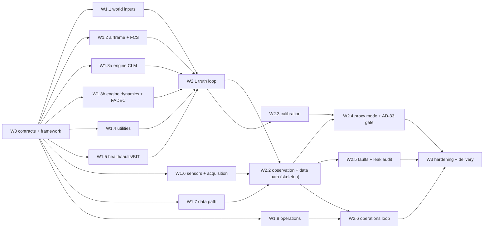

# Phalanx Data Layer: Phased Build Plan (multi-agent)

**Version:** 1.0-draft (2026-10-14). **Status:** for owner approval. Nothing is built until it is approved.

**Builds:** `docs/architecture.md` v1.0 (binding), following `RULES.md` (binding rules).

**Scope:** the data-generation and streaming layer only (M01–M22). The downstream PdM/availability solutions are
out of scope; their entry points are the contract (§12 of the architecture) and the orders/fork APIs.

**Target:**
- an **end-to-end skeleton in ≈1 day** of wall-clock time;
- a **full v1 in ≈2–3 days**;
- built in four waves by parallel the build agents agents under one coordinator.

---

## 1. Operating model

| Role | Who | Responsibilities |
|---|---|---|
| **Owner** | You | Approves the plan, the wave exits, contract freezes and RULES.md changes; decides on gate failures |
| **Coordinator** | Main coordinating session | Writes agent briefs, assigns ownership, reviews and merges, and is the only one who pushes. Runs Kaggle commands, keeps `docs/` current, reports status and ETAs |
| **Module agents** | Background build agents, one per work package | Build only their assigned modules behind frozen interfaces, with tests and a README; commit locally; report |
| **Verifier** | A fresh agent per wave exit | Independently re-runs tests and gates from a clean checkout, and spot-checks claims against outputs |

**Rules for every agent** (from RULES.md; repeated in every brief):
- **Consult the evidence before deciding:** `docs/architecture.md`, then grep the research report, then the notes and the experiment results.
- **Minimal sufficient sample.** Sample → verify → scale; record n in every result.
- **No shallow proxies.** Any simplification is labelled `PROXY`, tested, and listed in `docs/assumptions.md`.
- **Edit only your owned paths.** Interface changes go through the coordinator.
- **Report conflicts; never resolve them silently.**
- Commit locally with focused messages; never push.
- Kaggle: stage the folder and write the command to `kaggle_pending_cmds.txt`; never run uploads.
- Run Python with `-I`; pass data paths as arguments.

**Branching and merge.** Each work package (WP) has a branch `wp/<id>`; the coordinator merges to `main` after
review. Shared code (`src/phalanx/core`, dictionary schema, contract schemas) is frozen at Wave 0 exit; later
changes need a coordinator-approved interface change request.

**Status board:** `docs/build_status.md`, updated by the coordinator. Each WP row records owner, state, tests,
blockers and ETA.

**Agent brief template** (the coordinator fills one in per WP):
- objective;
- owned paths;
- architecture sections and decisions to implement;
- interfaces consumed and provided;
- acceptance tests;
- evidence pointers (report sections, notes, experiments);
- sample sizes;
- definition of done;
- what to report.

---

## 2. Wave overview

| Wave | Goal | Parallelism | Wall-clock | Exit gate |
|---|---|---|---|---|
| **W0 Contracts and framework** | Fix the interfaces everything plugs into; prove determinism, snapshots and the contract on a toy system; settle the backend | 2–3 agents + coordinator | **3–4 h** | E0 |
| **W1 Module build** | Every module at v1 fidelity behind frozen interfaces, with unit, property and acceptance tests | 9 agents | **6–10 h** (engine WPs longest) | E1 |
| **W2 Integration and calibration** | Closed-loop truth integration; fast and full data paths; engine/aero calibration; proxy-mode identification; **AD-33 gate on archive 2**; fault library; operations loop | 5–6 agents | **8–12 h** | E2 |
| **W3 Hardening and delivery** | Two-tier consistency, performance, reference fleet dataset, credibility card, docs, demo scenario | 3–4 agents | **4–6 h** | E3 (v1 release) |

**Totals:** ≈21–32 h of wall-clock time. With overnight runs this is about 2–3 days. The skeleton milestone
(after W0 + W1 stubs + the W2.2 fast path) comes in ≈1 day.

**Compute:** ≈20–40 machine-hours, mostly W2 identification and calibration and the W3 fleet dataset.
- Local: at most 2 heavy fits at a time (16 GB RAM).
- Kaggle CPU kernels for batch runs, through the coordinator.

---

## 3. Wave 0: contracts and framework (≈3–4 h)

| WP | Deliverables | Owner paths | Acceptance |
|---|---|---|---|
| **W0.1 Repo and tooling** | `pyproject.toml` (uv, pinned deps); `src/phalanx/` package skeleton per architecture §16; `ruff`, `pytest`; `make check` (lint + unit + determinism smoke); `docs/assumptions.md` and `docs/build_status.md` scaffolds | `pyproject.toml`, `Makefile`, `src/phalanx/__init__.py`, `tests/conftest.py` | `make check` green on an empty skeleton |
| **W0.2 Core kernel** | `core/`, described below | `src/phalanx/core/` | See below |
| **W0.3 Dictionary (M01)** | YAML schema per subsystem; compiler to a versioned, hashed `dictionary.<ver>.json`; generators for Arrow schemas, a TMATS stub and a synthetic ICD stub; seeding from `parameter_inventory.csv` (189 rows) with tags and sources carried over | `src/phalanx/dictionary/`, `configs/tejas/dictionary/` | Every row has a tag and a source; hash stable across runs; generated Arrow schemas validate; no orphan channels |
| **W0.4 Contract v0 and storage** | Arrow schemas for `param.samples`, `events.*`, `usage.counters`, `maint.records`, `orders.*`, `sortie.manifest`, `labels.truth` (architecture §12); a Parquet writer partitioned by date/tail/sortie; a replay streamer (event-time ordering, per-sortie watermarks, idempotent `record_id`); a **fast-path adapter** (CIR → contract) | `src/phalanx/ground/schema*`, `src/phalanx/streaming/` | Schema round-trip; idempotent replay; watermark semantics; a toy CIR → contract run |
| **W0.5 Test and validation harness skeleton (M20)** | Test layout (unit, property, golden, statistical, fork); a deterministic sample selector; ports of B1 (`analysis/correlation_check/corr_check.py`) and B2–B6 (`analysis/settling_experiment_round2/src/battery.py`) into `validation/battery/`; G0/G1 guards; a credibility-card stub | `src/phalanx/validation/`, `tests/` | The ported battery reproduces the round-2 `holdout_652` numbers on the same inputs, within floating-point tolerance |
| **W0.6 Backend benchmark (⟂B, AD-22)** | A two-spool rotor/fuel/EGT mini-model step in numpy, Numba and JAX-CPU: one sortie-hour, a batch of 1,000, compile overhead, bitwise reproducibility, and gradient availability for calibration | `analysis/backend_benchmark/` | Decision written to the architecture register (AD-22 → D) with measurements |

**W0.2 `core/` contents:**
- 240 Hz fixed-step scheduler with integer rate groups and sub-stepping;
- simulation-time event queue for discrete modules;
- `Module` protocol: `init`, `step`, `on_event`, `get_state`, `set_state`, typed `Port`s;
- unit checking (pint) in validation mode;
- **RNG key-path service** (SeedSequence spawn keys / Philox; identity-keyed; no global RNG);
- snapshot I/O (content-hashed, versioned);
- run manifest writer.

**W0.2 acceptance:**
- a two-module toy system (spring–damper + noisy sensor) is bitwise deterministic;
- snapshot → restore → continue equals an uninterrupted run;
- identical fork suffixes give identical branches;
- the CRN audit passes;
- no wall-clock reads.

**Exit gate E0** (checked by the verifier):
- `make check` is green;
- core invariants I1, I2, I3 and I8 pass on the toy system;
- contract v0 schemas are generated by M01 and frozen (**owner approval**);
- the backend is decided;
- the agent brief template is filled in for every W1 WP.

**Downstream unlock:** from E0, the downstream AI team can code against contract v0, using the fast-path toy data.

---

## 4. Wave 1: module build (≈6–10 h, 9 agents in parallel)

Each WP builds its modules to v1 fidelity per architecture §6, against fixed interfaces. Neighbours are stubbed
with contract-conformant **labelled** stubs (`STUB`, never shipped). Every WP delivers:
- code;
- unit and property tests;
- the module acceptance tests from §6;
- a README (assumptions, evidence tags, validation criteria);
- dictionary entries;
- `docs/assumptions.md` entries for every `PROXY` or `[ASSUMPTION]`.

| WP | Modules | Key content (from architecture v1.0) | Acceptance highlights |
|---|---|---|---|
| **W1.1 World inputs** | M03 Environment **+ process disturbances**, M02 Scenario/missions, M04 Pilot | USSA-76, MIL-HDBK-310, ERA5 replay hook, von Kármán; **identity-keyed per-unit disturbance streams with configurable PSD and cross-unit coherence (AD-32)**; six-layer mission generator with usage gates; crossover pilot | USSA to 1e-6; turbulence PSD; disturbance PSD and coherence reproduce configured targets; usage gates (Type III 5 ± 2/FH, AB 4–5/FH, ≥IRP 17–20 %, TAC 2.2–3.3/FH) |
| **W1.2 Airframe and FCS** | M06 Airframe 6-DOF + Tejas-anchored aero; M05 FCS/actuators | Quaternion 6-DOF; aero build-up (Tejas longitudinal core, ADMIRE/F-106B lateral shapes, DATCOM/VSPAERO Mach trends); gear/brakes energy; DFCC replica (80 Hz, 8 ms, voting, limiters, reversion); 13 actuators with √ΔP rate scaling | NESC check cases; V1–V12 targets wired as golden tests; margins with 8 ms delay; voting and false-WoW cascade |
| **W1.3a Engine truth model** | M07: CLM steady state + stochastic dynamic shell (one owner for the whole engine model) | pyCycle-derived two-spool mixed-flow AB model scaled to IN20 ratings; rotor/volume/metal-temperature/clearance states; AB state machine; surge; **disturbance inputs enter the dynamics (AD-32)**; corrected outputs; humid air; complex-step-safe Numba kernels; transient-window identification API (AD-34) | IN20 ratings exact; energy balance; corrected invariance under ISA offset; steady state = dynamic equilibrium; Muir signs; small-signal coherence < 1 (not over-coupled); C1–C28 implemented (calibration-dependent ones xfail until W2.3) |
| **W1.3b FADEC and closed-loop governing** | M08 FADEC and signal validation | F404 schedules/limiters (MIN/MAX selection); **closed-loop governing (AD-31)** on measured lanes in the FADEC clock domain; proxy autothrottle loop; signal validation template and injectable validator failure modes; hung-start and flameout logic | Limiter tests; closed-loop sign test (small-signal Wf lags N2, commanded steps lead); released fault cascades; hung-start rule; plug-in API for the real M07 |
| **W1.4 Utilities** | M09 | AMAGB/PTO; two 280 bar hydraulic networks (Q_max(N2), leakage, filters, accumulators); fuel network + gauging artefact; electrical (704F bands, backup transfer); ECS ε-NTU bleed; GTSU-110 start model; brakes, tyres, chute | Balances; coupling-map signs (all R§3 edges); ADA test points (JFS cold, RTO wear, zoom-climb artefact) |
| **W1.5 Health, faults, BIT** | M10, M11, M14 | Hidden-state catalogue (50 states + life consumption); process families per mechanism (architecture §9.2); typed dependency graph; fault library (released traces); BIT/CWS/ECMS-HUMS/LUIs/exceedances with incomplete coverage and false-alarm regimes | Monotonicity and flat-trend tests; graph acyclic; cascade timing templates; LUI counting on synthetic cycles; event-rate tests; **label-leak audit hook** |
| **W1.6 Sensors and acquisition** | M12, M13 | Sensor physics per class (T5 harness, eddy-current N1, alternator N2, air-data vanes/position error/pneumatic lag, capacitance gauging); **sensor dynamics stage**; installation bias and aging; **double quantiser**; idiosyncratic noise ≤ quantiser variance; validity gating, glitches, sentinels | τ laws vs NACA/AGARD; vane 2nd-order response; residue patterns reproduce the configured native grids (G1); G0 on pipeline-only metadata |
| **W1.7 Data path** | M15, M16, M17 (full path) | Synthetic Phalanx ICD from M01; 1553/429 encoding; per-LRU oscillator Δ, slip windows on analog paths, dup/skip on digital; Ch10/11 writer with TMATS and recording events; download simulator; ground decoder | Round trip within quantisation; slip period = 1/(f·Δ); `.c10` conformance vs the public sample; independent parsers agree; **identical schema to the fast path** |
| **W1.8 Operations** | M18, M21, M22, M19 (productionise W0.4) | Records (NAMP/TO 00-20/F700/S5000F with IAF-relabelled codes); troubleshooting/NFF; supply delays (CAG priors); CANN; availability bins; data-quality defects with a manifest; orders channel; snapshot/fork service (oracle/belief/ensemble); reference policies | Key integrity; availability arithmetic; no look-ahead; idempotent orders; replay determinism; fork tests; status-quo policy reproduces open-loop KPIs |

**Exit gate E1** (verifier):
- all W1 acceptance tests pass;
- every module conforms to its interface;
- `docs/assumptions.md` lists every PROXY;
- **no STUB remains in any path except where the neighbouring WP is not yet integrated (tracked)**.

---

## 5. Wave 2: integration and calibration (≈8–12 h)

| WP | Deliverables | Acceptance |
|---|---|---|
| **W2.1 Truth-loop integration** | M02–M11 in the 240 Hz kernel with the fixed Gauss–Seidel order and documented one-frame delays; closed loops FCS ↔ airframe and FADEC ↔ engine; utility coupling from N2 | Invariants I1–I8; energy, mass and fuel balances; step-halving convergence; a 1-sortie smoke run, then 5 sorties |
| **W2.2 Observation and data-path integration** | M12–M17 on top of W2.1: fast path first, then full path | **Skeleton milestone:** one tail, one sortie, end to end to the contract on both paths, identical schema, deterministic replay, fork from a snapshot |
| **W2.3 Engine and aero calibration** | **PWL/LPV usage-mode engine surrogate built from the calibrated CLM (moved from W1.3a, with an error envelope)**; C1–C28 (engine) and V1–V12 (aero) as golden MQTG tests; **transient-weighted identification** of dynamics (AD-34); EGT map/exponent revision (round-2 E17) | All C and V tests within tolerance (±3 % steady, ±25 % transient timing; trim ±1°; eigenvalues; Cnβ crossing); tolerances never tighter than real repeatability |
| **W2.4 Proxy-mode configuration and AD-33 gate** | See below | See below |
| **W2.5 Faults, BIT and leak audit** | Fault library injected through physics (released signature directions and timings, Muir matrix); BIT immature/mature regimes; B7/B8 against literature; **label-leak audit** (a texture-only or metadata-only classifier cannot predict fault labels) | B7 signature signs and orderings; B8 rates within regime ranges; leak audit at chance | *(AD-55: B7/B8 in depth for a ≈10-fault priority set; leak audit on all faults)*
| **W2.6 Operations loop** | M18/M21/M22 closed loop with the truth and data layers; availability calibrated to CAG priors plus the Tejas supply-chain events layer; reference policies; what-if demo (predictive vs reactive on identical futures) | Fork and CRN tests at fleet scale (usage mode); availability calibration within priors; reproducible what-if result with paired CIs | *(AD-55: the predictive-vs-reactive demo moves to the downstream solution; closed loop, CAG calibration, baseline reactive behaviour and fleet-scale fork/CRN tests stay)*

**W2.4 deliverables.** The DASHlink proxy configuration (`configs/proxy_dashlink/`):
- proxy engine dictionary; DASHlink lattice and clock parameters; **autothrottle loop and engage state**;
- **closed-loop identification on 687-CAL only**: a prediction-error method with an innovations model; per-engine disturbance PSD and cross-engine coherence; direct vs indirect identification on A/T-engaged vs manual segments (round-2 REPORT §8 H-c);
- **a new pre-registration** (`analysis/proxy_gate/PREREGISTRATION.md`), committed before archive 2 is read;
- then the **gate run on the reserved archive 2**: B1–B6, guards, R2-open-loop as the negative baseline.

**W2.4 acceptance:**
- the pre-registration is committed first;
- the gate verdict is per the pre-registered rules;
- PASS → AD-31 and AD-32 become D;
- FAIL → see risk R1.

**Exit gate E2:**
- the skeleton milestone is met;
- C, V, B7 and B8 tests pass;
- the leak audit passes;
- the AD-33 gate verdict is recorded (PASS, or FAIL with an owner decision);
- the operations loop and forks work at fleet scale.

---

## 6. Wave 3: hardening and delivery (≈4–6 h)

| WP | Deliverables | Acceptance |
|---|---|---|
| **W3.1 Two-tier consistency and performance** | Usage mode (fleet-years) and telemetry mode (selected sorties) share state and keys; a full-rate replay of any sortie matches its usage-mode summary; performance profiling | Telemetry ≥ 5× real time per core (AD-55; was ≥ 50×); fleet-year in usage mode in minutes; summary–replay consistency tests |
| **W3.2 Reference fleet dataset** | e.g. 30 tails × 2 years in usage mode, with telemetry for sampled sorties and every fault-onset or exceedance window. Generated locally plus on Kaggle shards (sample shard first, verified). Includes manifest, defect manifest and restricted labels | Dataset reproducible from its manifest; usage gates hold at fleet level; spot replay bitwise identical |
| **W3.3 Credibility card and docs** | NASA-STD-7009B card per channel and regime (Level 2 against proxy); contract documentation (`docs/contract/`); "plugging in a downstream solution" guide (contract, orders, forks, no-truth rule); module READMEs complete; `docs/assumptions.md` final | Verifier walkthrough: a fresh agent consumes the dataset and places an order using only the docs |
| **W3.4 Demo scenario** | A scripted availability what-if: reactive status quo vs a simple condition-based policy on identical futures (CRN), with paired KPI differences and CIs, plus one Tejas-specific event chain (brake-software or JFS cold start) | Reproducible from a single command |

**Exit gate E3 (v1 release)** = the architecture's definition of done (architecture §1), owner sign-off, and a
tagged release.

---

## 7. Dependency graph

**Critical path:** W0 → W1.3b → W2.1 → W2.3 → W2.4 → W3.

The engine dynamics/FADEC WP and the proxy-mode gate set the schedule; start them first and give them the
strongest briefs.

---

## 8. Indicative schedule (IST, starting after plan approval)

| When | Milestone |
|---|---|
| Day 0 evening (≈21:00 →) | W0 starts (W0.1–W0.5 in parallel where possible; W0.6 benchmark alongside) |
| Day 1 ≈01:00 | **E0**: contracts v0 frozen (owner approval in the morning if you're offline; W1 can start on the non-contract WPs) |
| Day 1 morning–afternoon | W1 (9 agents) |
| Day 1 evening | **E1**; W2.1/W2.2 start → **skeleton milestone** |
| Day 2 | W2.3–W2.6; AD-33 pre-registration, then the gate run on archive 2 |
| Day 2 evening | **E2** |
| Day 3 | W3 → **E3 v1 release** |

Owner check-ins: approval of this plan; the E0 contract freeze; the AD-33 gate verdict (and the decision if it
fails); E3 sign-off.

---

## 9. Risks and mitigations

| # | Risk | Likelihood / impact | Mitigation |
|---|---|---|---|
| R1 | **The AD-33 gate fails** (closed loop + disturbances still don't pass B1–B6 on archive 2) | Medium / high for realism claims | The build still completes; the Tejas configuration is marked "behavioural validation pending" on the credibility card. Use the per-test attribution to fix the responsible module. The labelled AD-29 fallback (M-C) may be enabled behind a flag with its limits stated. Owner decides whether to iterate. |
| R2 | IN20 data gaps (limits, LUI gates, FADEC thresholds) | Certain / medium | Sweep within transfer ranges; register in `docs/assumptions.md`; DSSC/IAF requests (architecture §19) |
| R3 | Interface drift across parallel agents | Medium / high | Frozen interfaces at E0; interface change requests via the coordinator; a verifier at every exit |
| R4 | Coordinator and review bandwidth | High / medium | Small WPs with crisp acceptance tests; the verifier agent; a status board; tests over prose reports |
| R5 | Memory and compute contention | Medium / low | ≤ 2 heavy fits locally; Kaggle for batch runs; minimal-sample rule |
| R6 | Kaggle uploads blocked for agents | Certain / low | Coordinator runs the staged commands (established) |
| R7 | Determinism broken by a library or backend | Low / high | Pinned stack; bitwise tests in `make check`; per-backend golden files |
| R8 | Scope creep into downstream AI | Medium / medium | The contract is the boundary; reference policies are baselines only |
| R9 | Shortcut cues in synthetic faults | Medium / high | Label-leak audit is binding in W2.5; faults only through physics |

---

## 10. Definition of done per WP (applies to every WP)

1. Code in the owned paths, following the module contract (architecture §5.5).
2. Unit, property and acceptance tests pass. Sample → verify → scale is logged, with n recorded.
3. A README with purpose, interfaces, assumptions (evidence-tagged), validation criteria and known limitations.
4. Dictionary entries added; `docs/assumptions.md` updated for every PROXY or [ASSUMPTION].
5. No unlabelled proxies; no STUB in shipped paths (except tracked integration stubs before W2).
6. A local commit on `wp/<id>`, plus a short report: what was built, test results with n, conflicts found, open items.
7. The coordinator reviews and merges; the verifier re-runs the tests at the wave exit.
