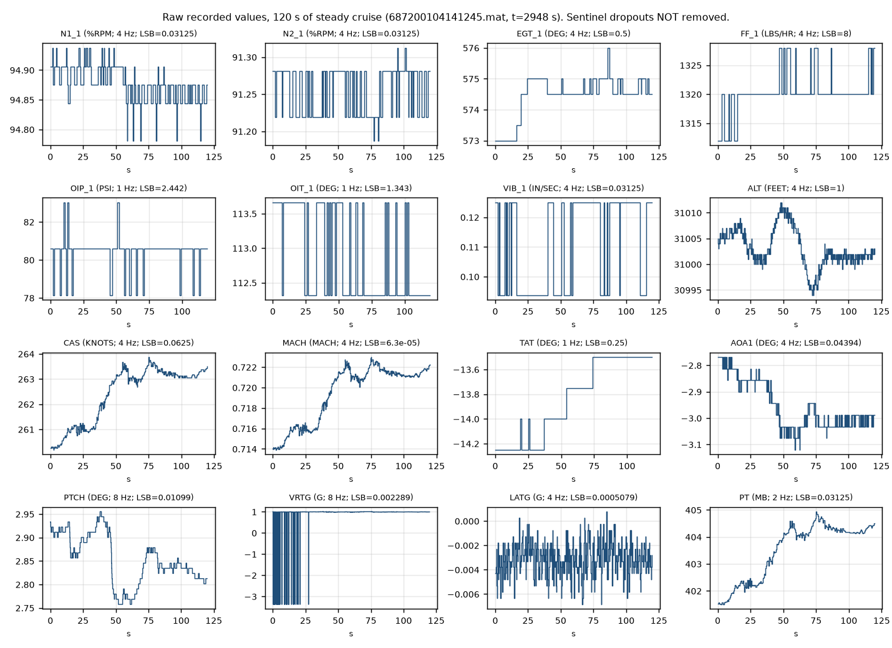
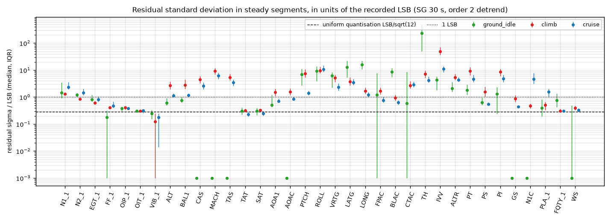
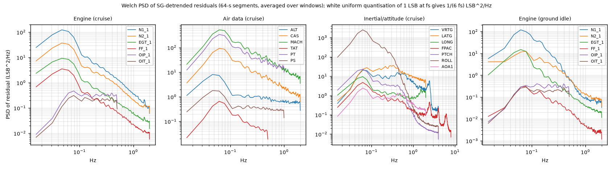
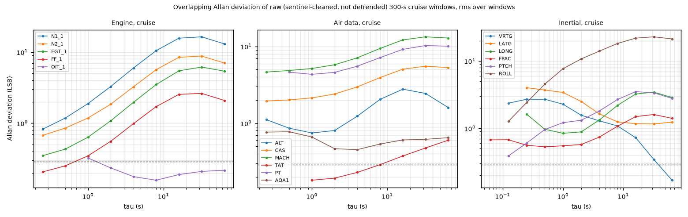
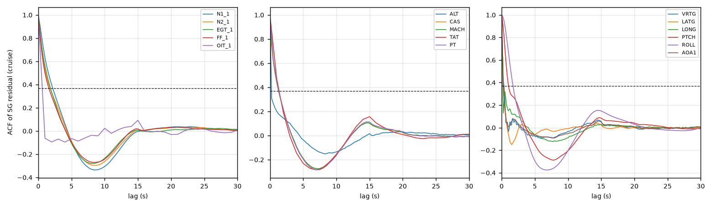
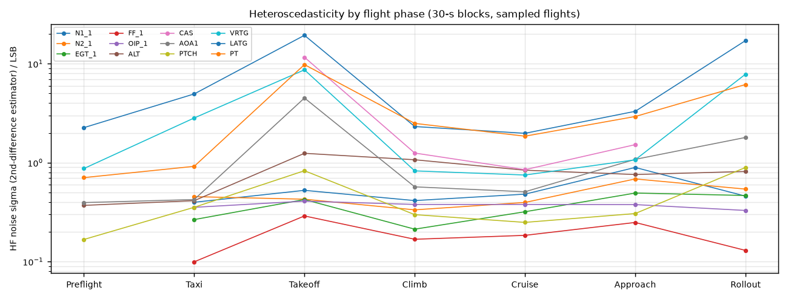
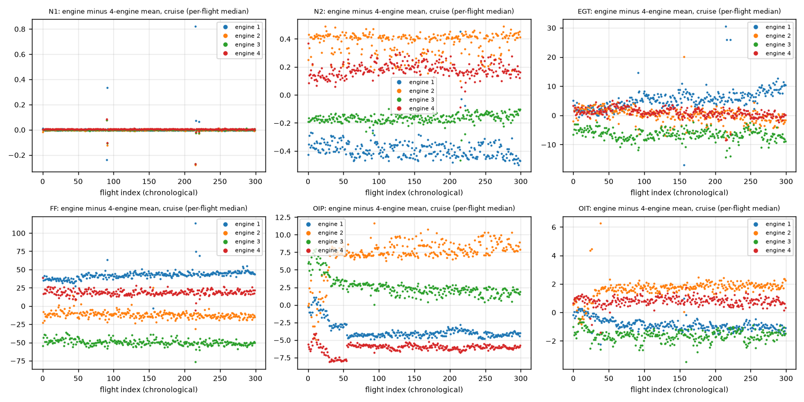
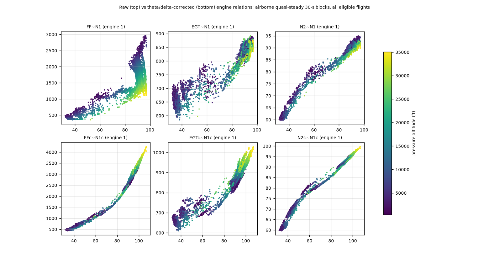
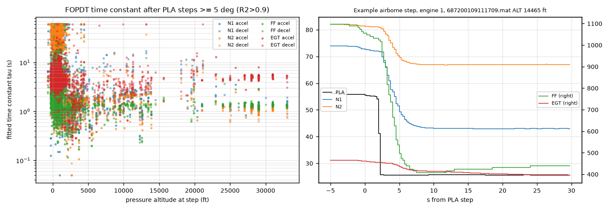
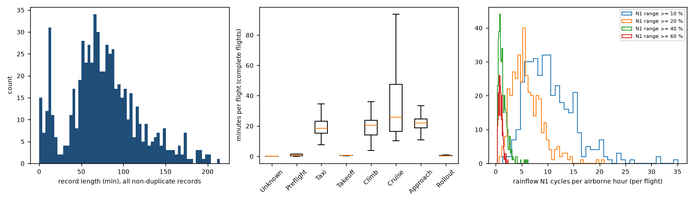

> **CORRECTION (2026-10-14).** This note treats the periodic missing-data bursts (every ≈1,099 samples, possibly a NASA processing artefact) and the 917 ppm recorder clock offset as separate findings. They are one mechanism: clock-domain slip. A recorder sampling a source on a clock offset by Δ loses one sample period of alignment every 1/(f·Δ) s, and reads near each slip collide with source updates and return the sentinel. Check against this note's own results:
> - The clock-word offset is 917.6 ppm (median, n = 590, from `gmt_vs_sample_slope`).
> - Burst intervals of 137/275/549/1,099 s at 8/4/2/1 Hz imply Δ = 912/909/911/910 ppm, against 136/272/545/1,089 s predicted from 917.6 ppm.
> - The ≈0.8 % difference suggests the bursts measure recorder-vs-source clock and the clock word measures recorder-vs-GMT.
> - The implied collision window (burst duration × Δ) is ≈9–22 ms.
>
> Residual-model components 6 and 11 are merged accordingly in the report (Section 8, decision D20). Predictions P1–P5 are tested in `analysis/settling_experiment/`.

# Empirical measurement "texture" of real flight-recorder data: NASA DASHlink Sample Flight Data, Tail 687, archive 1 (Project Phalanx)

Scope and conventions
- This note measures what recorded aircraft data actually looks like, from one archive of real data, so that the virtual-fighter sensor/residual/recording models can be grounded in measurement rather than only literature.
- Platform: a four-engine regional jet in airline service (type not disclosed by NASA). **Nothing here is fighter data.** Every fighter statement is an explicit [TRANSFER: DASHlink → fighter] or [ASSUMPTION].
- Tags: **[MEASURED]** = computed by me from the data (script and result file named in the link; data sets defined below); **[DIRECT]** = stated in DASHlink documentation or another cited source; **[TRANSFER: DASHlink → fighter]** = reasoned carry-over with stated limits; **[ASSUMPTION]** = my judgement.
- Data sets used (all from `Tail_687_1.zip`):
  - **A651** = all 651 records in the archive (used for per-parameter metadata, dropouts, recorder checks).
  - **U641** = A651 minus 10 `_1` duplicates (used for flight-level statistics and burst analysis).
  - **E381** = 381 complete eligible flights (used for the four-engine experiment, corrected parameters and transients).
  - **S40** = deterministic stratified sample of 40 flights from E381 (used for steady-segment residual texture and heteroscedasticity).
- Code: `/Users/abishaikc/Phalanx/analysis/dashlink_texture/` (README with exact commands, pinned `requirements.txt`). Results CSVs: `analysis/dashlink_texture/results/`. Figures: `figures/dashlink/`. Links below are relative to this notes folder.

---

## Q0. Provenance, method and reproducibility

### Takeaway
Archive 1 of Tail 687 is an 838 MB zip of 651 MATLAB v5 files. It was downloaded without login and its licence field is "N/A". All analysis is scripted, deterministic and re-runnable in about 15 minutes. The archive covers 2001-03-20 to 2001-09-14, with no June data, 819 record-hours and 607 airborne hours (U641).

### Cited Findings
- **Resource page.** "Flight Data For Tail 687" is shared by Bryan Matthews. Its fields read Licence "N/A", Operating System "N/A", and it lists 9 zips (Set 1 = 799.0 MB). Each file has "186 parameters each with a data structure that contains … sensor recordings, sampling rate, units, parameter description, parameter ID" [DIRECT] — [DASHlink resource 664](https://c3.ndc.nasa.gov/dashlink/resources/664/)
- **HEAD request before download** (2026-10-13) [DIRECT]:
  - `200 OK`, `Content-Length: 837837074` (0.84 GB, under the 2 GB stop rule), `Content-Type: application/zip`, `Last-Modified: Wed, 29 Jan 2014`.
  - No authentication, registration or licence click-through was needed.
  - Source: [Tail_687_1.zip](https://c3.ndc.nasa.gov/dashlink/static/media/dataset/Tail_687_1.zip)
- **Download and extraction** [MEASURED] — [extract.py → results/extract_report.json](../../analysis/dashlink_texture/results/extract_report.json):
  - SHA-256 `8a8b3f60e53e08fd085edb89ce7266a4c0b745831f6f88f5babfaac70f8f04a5`.
  - 651 members, all matching `687YYYYMMDDhhmm[_1].mat`. All were extracted basename-only into `research_sources/datasets/dashlink_tail687/raw/mat/` (814 MB). Nothing was executed. Files were parsed only with `scipy.io.loadmat`.
- **File structure** [MEASURED] — [inventory.py → results/inventory_flights.csv](../../analysis/dashlink_texture/results/inventory_flights.csv):
  - Each file holds 186 MATLAB structs with fields `data`, `Rate`, `Units`, `Description`, `Alpha`. All 651 files have the same 186 parameters.
  - Dates run from 2001-03-20 to 2001-09-14. Records per month: Mar 2, Apr 125, May 21, **Jun 0**, Jul 204, Aug 201, Sep 98.
  - No 2009–2010 files are in archive 1. Those appear only in Tail_687_9 per the zip-directory crawl in [public_aerospace_datasets.md](public_aerospace_datasets.md).
- **The ten `_1` files are duplicates, not distinct flights** [MEASURED] — [scratch check, summarised in analysis README](../../analysis/dashlink_texture/README.md):
  - Each `_1` file is identical to its twin in all 186 parameters except `DATE_DAY`.
  - The FAQ says the suffix only de-conflicts names and "does not have any meaning with respect to the contents" [DIRECT] — [DASHlink FAQ (Mar 2014)](https://c3.ndc.nasa.gov/dashlink/static/media/other/Sample_Flight_Data_FAQ_2.doc).
  - In archive 1 the suffixed files are re-copies of the same flight, so they are excluded from U641, E381 and S40.
- **Eligibility for E381** [MEASURED] — [sample_flights.py → results/eligible_flights.csv](../../analysis/dashlink_texture/results/eligible_flights.csv). A flight qualifies if it is not a `_1` twin, the record is at least 30 min, there are exactly 2 WOW transitions, there are at least 10 min of PH=5 (cruise), and there are at least 60 s of PH 1/2. 381 of 651 records qualify.
- **S40 sample design** [MEASURED] — [sample_flights.py → results/sample_flights.csv](../../analysis/dashlink_texture/results/sample_flights.csv):
  - 12 strata: calendar block {Mar–May, Jul, Aug, Sep} × record-duration tercile (cut points 80.5 and 105.8 min).
  - Allocation is proportional with a minimum of 2 per stratum, seed `numpy.random.default_rng(687)`.
  - The S40 files: 687200104141245, 687200104161114, 687200104181334, 687200104181801, 687200104201125, 687200104260757, 687200104261350, 687200104300621, 687200107041258, 687200107050507, 687200107060507, 687200107140721, 687200107150546, 687200107171131, 687200107171608, 687200107190506, 687200107192334, 687200107211146, 687200107221719, 687200107261123, 687200107281824, 687200108031000, 687200108041956, 687200108101254, 687200108110851, 687200108151000, 687200108161629, 687200108170757, 687200108171456, 687200108212101, 687200108231430, 687200108261844, 687200108270507, 687200108281858, 687200109011816, 687200109041600, 687200109060729, 687200109061347, 687200109131035, 687200109131813 (all `.mat`).
  - Why 40: steady windows are scarce because the autothrottle trims continuously in cruise. S40 yields 99 cruise windows (300 s) from 33 flights, 225 climb windows (120 s) from 39 flights and 161 ground-idle windows (120 s) from 36 flights, i.e. at least 30 flights per regime.
  - Everything cheap (offsets, transients, corrected parameters, dropouts, timing) uses all of E381 or A651 instead.
- **Documented method choices** [MEASURED, i.e. my choices] — [common.py](../../analysis/dashlink_texture/common.py):
  - **Detrending**: Savitzky–Golay, 30-s window, order 2. The residual is x − SG(x).
  - **Cruise windows**: PH=5, airborne, 300 s; ALT range ≤150 ft, CAS range ≤8 kt, |roll| ≤5°; each PLA range ≤8° with no 1-s PLA step >1.5° (autothrottle trim allowed).
  - **Climb windows**: PH=4, 120 s; mean ALTR >500 ft/min, |roll| ≤5°, PLA range ≤2°.
  - **Ground-idle windows**: PH 1/2, WOW=0, 120 s; at least 2 engines with N2 ≥40 %, PLA ≤30° and PLA range ≤0.5°. Engines shut down during taxi are excluded per engine.
  - **Sentinel samples** (bottom- or top-of-scale words) are replaced by interpolation before residual statistics are computed.
  - **Software**: CPython 3.14.6, numpy 2.5.4, scipy 1.18.1, matplotlib 3.11.2 — [requirements.txt](../../analysis/dashlink_texture/requirements.txt)
- **E381 flight list** (used by engines.py, transients.py and corrected_exponents.py) [MEASURED] — [results/eligible_flights.csv](../../analysis/dashlink_texture/results/eligible_flights.csv):
  - Membership is fully determined by the rule above.
  - The file names run from 687200104111158 to 687200109140804. The CSV is the authoritative list; it is not reproduced here to save space.

### Inferences
- [ASSUMPTION] Archive 1 is one tail over about 6 months. Fleet effects such as tail-to-tail calibration differences, and seasonal effects beyond spring–summer, cannot be estimated from it.
- [ASSUMPTION] The duplicate `_1` records in archive 1 suggest that other archives may also contain duplicates. Any multi-archive pipeline should hash parameter content to de-duplicate.

### Gaps
- Airframe and engine type are not disclosed. Physical interpretation of engine dynamics (spool time constants, EGT levels) therefore cannot be tied to a published engine model.
- No June 2001 data exist in archive 1. Any maintenance in that gap is unobservable.

---

## Q1. Per-parameter inventory: native rates, units, ranges, quantisation step and value grid, missing data, discrete vs continuous, inverted logic

### Takeaway
- **Rates.** The 186 parameters are recorded at exactly six rates: 0.25, 1, 2, 4, 8 and 16 Hz. This confirms the quoted 0.25–16 Hz range.
- **Frame alignment.** Every array is frame-aligned and complete (n = frames × 4 × rate in all 651 records).
- **No NaN.** There is not a single NaN in the archive. Missing data appears as values, not NaN: bottom-of-scale "zero-word" sentinels, held zeros from validity gating, all-ones words and frozen values.
- **Binary LSBs.** Values sit on exact, regular lattices whose LSB is mostly a power-of-two fraction of a power-of-two-like full scale (ARINC-429-BNR-like).
- **Analog channels.** A distinct group of parameters with non-binary LSBs, presumably analog-acquired, carries almost all the sentinel dropouts.
- **Polarity.** WOW, LGDN, LGUP and NSQT are polarity-inverted relative to their names.

### Cited Findings
**Rates, types and structure**
- **Rate counts** [MEASURED] — [param_table.py → results/param_table.csv](../../analysis/dashlink_texture/results/param_table.csv), A651:
  - 16 Hz: 4 parameters (FPAC, BLAC, CTAC, IVV); 8 Hz: 4 (PTCH, ROLL, VRTG, RALT); 4 Hz: 49; 2 Hz: 18; 1 Hz: 88; 0.25 Hz: 23.
  - The 0.25 Hz group (one sample per 4-s frame) is all frame-level words: 4 sync words, frame counter, date, aircraft ID, database version, engine serial numbers and engine hour/cycle counters.
- **Arrays** [MEASURED] — [results/inventory_flights.csv](../../analysis/dashlink_texture/results/inventory_flights.csv), A651:
  - For every parameter in every record, the sample count equals n_frames × 4 × rate (0 mismatches). Records last 4 s to 214.7 min.
  - There are no per-sample timestamps. Time is implicit (index/rate), and clock words are recorded as ordinary parameters (Q8).
- **Storage types** [MEASURED] — [results/inventory_params.csv](../../analysis/dashlink_texture/results/inventory_params.csv), A651:
  - **No NaN or Inf in any of 121,086 parameter-records.**
  - The storage dtype changes per flight to the smallest type that holds the values. For example, ALT is uint16 in 576 records, int16 in 64 (negative altitudes) and int32 in 6. N1_1 is uint8 in 2 records, where all its values happen to be integers.
  - So dtype says nothing about the sensor.
- **Classification** [MEASURED] — [results/param_table.csv](../../analysis/dashlink_texture/results/param_table.csv):
  - 67 discrete parameters (integer, ≤16 distinct values across the archive), 38 integer-valued continuous, 81 non-integer continuous.
  - **Dead channels** (constant 0 in every record): FQTY_3, APUF, CALT, POVT, SMOK, WAI_2.
  - **Single valid value**: DVER_1 is always 126. VAR_2670, VAR_5107 and VAR_6670 are constant.

**Quantisation and value grids** [MEASURED] — [dlio.lsb_estimate; results/param_table.csv](../../analysis/dashlink_texture/results/param_table.csv)
- LSB estimator: the smallest recurring spacing between distinct values, tolerant to float32 jitter. Grid regularity is the fraction of distinct-value spacings that are integer multiples of the LSB.
- Grid regularity is ≥0.98 for almost all continuous parameters, i.e. values lie on an exact affine lattice. Exceptions are CRSS/HDGS (0.20/0.26, selected course/heading, irregular mapping) and VSPS (0.60).
- **Engine LSBs**:
  - N1 and N2: 1/32 %RPM = 0.03125 %, i.e. 128 %/4096.
  - EGT: 0.5 °C (2048/4096).
  - Fuel flow: 8 lb/h (32768/4096).
  - VIB: 0.03125 in/s. Only 0–0.53 in/s is ever recorded, about 0–17 counts, and is 98–99 % repeats.
  - OIP: 2.442 psi. OIT: 1.343 °C. Both are non-binary.
  - PLA: 0.08789° (360/4096).
- **Air data and inertial LSBs**:
  - ALT, BAL1, BAL2: 1 ft. CAS, TAS: 0.0625 kt. MACH: 6.30×10⁻⁵. PT, PSA, PI: 1/32 mb. PS: 1/1024 inHg. TAT, SAT: 0.25 °C.
  - AOA (all four): 0.04394° = 180°/4096. PTCH, ROLL: 0.010986° = 180°/16384. Headings and tracks: 0.005493° = 180°/32768.
  - VRTG: 0.002289 g. Its zero-count value is −3.375 g and its full scale is 9.375 g over 4096 counts, i.e. −3.375…+6.0 g.
  - LATG, LONG: 0.000508 g, zero-count −1.0833 g, i.e. about ±1 g.
  - FPAC, BLAC, CTAC: 0.000977 g = 4/4096. IVV: 1 ft/min. ALTR: 16 ft/min. RALT: 0.125 ft.
- **Binary scaling vs dropouts.** Among non-discrete parameters at ≥1 Hz, a binary-scaled LSB co-occurs with absence of systematic sentinel dropouts (71 of 77 binary-scaled have none). A non-binary LSB co-occurs with systematic dropouts (15 of 32). The 6 binary-scaled exceptions are raw "COUNTS" channels (control column/wheel/pedal, BPYR_1), which are themselves analog — [make_tables.py → results/tables_param_inventory.md](../../analysis/dashlink_texture/results/tables_param_inventory.md)

**Missingness, sentinels and validity gating** (details in Q2)
- **Sentinels** [MEASURED] — [dropouts.py → results/dropouts_sentinels.csv](../../analysis/dashlink_texture/results/dropouts_sentinels.csv), A651, 831.8 record-h:
  - Missing samples in analog-type channels appear as the parameter's **zero-raw-count engineering value**: VRTG −3.375 g, LATG/LONG −1.0833 g, OIT −390 °C, RUDD/ELEV_1 −41.9°, AIL/ELEV_2 41.9°, SPL 36.54°, PTRM −36.86°, and 0 for COUNTS and OIP channels.
  - Rates (share of samples / per record-hour): VRTG 2.9 % (792/h); LONG 1.27 % (160/h); LATG 1.21 % (152/h); control column/wheel/rudder 0.45–0.55 % (32–40/h); surfaces, trims and OIT 0.24–0.31 % (8.7–11.3/h).
  - Isolated single-sample events are 87–100 % of these occurrences. The exception is CWPC, at 29 %, which often legitimately reads 0.
- **Digital channels are almost free of sentinels** [MEASURED] — [results/dropouts_sentinels.csv](../../analysis/dashlink_texture/results/dropouts_sentinels.csv):
  - N1, N2, EGT, FF, ALT, BAL, AOA, PTCH, ROLL, TAT, SAT, PT, PS, FPAC, BLAC, CTAC and IVV each show ≤0.0012 isolated end-of-scale events per record-hour.
  - Their rare out-of-family values are **all-ones words**: CAS 511.94 kt (3 events), N1C/N1T 127.97 % (2), PI 255.97 mb, ESN 262143 = 2¹⁸−1, ACID 755, PH 15.
- **Validity gating (held zeros, not dropouts)** [MEASURED] — [scratch check on S40](../../analysis/dashlink_texture/results/param_table.csv):
  - Smallest non-zero values are CAS 30.0 kt, GS 50 kt, TAS 100 kt and MACH ≈0.10. Below these the words read exactly 0, as on the ground.
  - FPAC reads 0 on the ground. AOAC is constant within every 120-s ground-idle window.
  - RALT clamps at 5500 ft (5626 max) above its range.
- **Dead or degenerate words** [MEASURED]: FQTY_3 is always 0; FQTY_2 repeats 100 % of the time in the median record; CASM is 100 % repeats.

**Discrete semantics and inverted logic** [MEASURED] — [recorder_checks.py → results/recorder_checks_flights.csv](../../analysis/dashlink_texture/results/recorder_checks_flights.csv), A651
- **WOW = 1 means airborne.** P(WOW=1 | RALT>1000 ft and CAS>150 kt) = 1.000 in all 563 records with such samples. P(WOW=1 | clearly on ground) = 0.0003. This confirms [DIRECT] "WOW=1 implies that airplane is airborne" — [DASHlink FAQ](https://c3.ndc.nasa.gov/dashlink/static/media/other/Sample_Flight_Data_FAQ_2.doc)
- **LGDN** ("gear down locked") reads 1 in 100 % of samples above FL150 and 0 on the ground. It is inverted, as the FAQ says for LGDN [DIRECT, same FAQ].
- **LGUP** ("gear up locked") is **also inverted**: 0 above FL150 and ≈1 on the ground (mean 0.99). The FAQ does not mention this [MEASURED].
- **NSQT** (nose squat switch) reads 1 airborne (mean 0.99) and 0 on the ground (mean 0.07), so it is inverted like WOW.
- **MSQT_1 and MSQT_2** (main squat switches) are 0 on the ground and 0 at altitude. They read 1 only while airborne with the gear extended: a 4-s pulse around lift-off until gear retraction, and from final approach until 2–3 s before WOW changes at touchdown.
- **PH codes.** Codes 0–7 occur as documented, plus a rare out-of-range 15 (all ones in a 4-bit field). Code 0 (Unknown) occurs in 0.3 % of 1-Hz samples (every-5th-file subsample).
- **Discrete enumerations observed** (values ever seen): LMOD {0–10, 12–14}; VMODE {0–8, 11, 13, 15}; TMODE {0, 1, 2, 4, 5, 7–10, 12}; MRK {0, 3–7}; APFD {0, 1, 2}; FADF {0, 1, 13, 14, 15}; FADS {0, 13, 14, 15}; BLV, EAI and OIPL {0–15}; PACK {0–3}. These are 4-bit status words, not booleans. The FAQ says the LMOD/VMODE/TMODE/MRK codes were "being investigated" [DIRECT] — [FAQ](https://c3.ndc.nasa.gov/dashlink/static/media/other/Sample_Flight_Data_FAQ_2.doc)

**Documentation discrepancies** [MEASURED vs DIRECT]
- The FAQ says "The actual fan speeds achieved by the four engines are: N2.1, N2.2, N2.3 and N2.4" [DIRECT] — [FAQ](https://c3.ndc.nasa.gov/dashlink/static/media/other/Sample_Flight_Data_FAQ_2.doc).
- In the files, N1.x is described as "FAN SPEED x LSP" and N2.x as "CORE SPEED x LSP". N1 is the parameter that tracks N1C to within 0.005 % (Q5) [MEASURED].
- The parameter descriptions in the files are therefore more reliable than the FAQ on this point.
- The FAQ also says inner engines "may get a secondary command – usually 90–95% value" [DIRECT, same FAQ]. In Tail 687 climb and cruise, all four N1 values agree with the four-engine mean to within 0.005 % (Q5). No inner/outer split was observed [MEASURED].

**Full per-parameter table (186 parameters, A651)** [MEASURED] — [make_tables.py → results/tables_param_inventory.md](../../analysis/dashlink_texture/results/tables_param_inventory.md); source rows in [results/param_table.csv](../../analysis/dashlink_texture/results/param_table.csv)

Column definitions:
- **Typical range**: 1st percentile of per-flight minima to 99th percentile of per-flight maxima.
- **LSB × 4096**: implied full scale of a 12-bit word.
- **Repeats %**: median share of consecutive identical samples.
- **Isolated sentinel dropouts**: per record-hour, with the sentinel value.
- **Stuck runs**: sibling-referenced rule (Q2).
- **Binary-scaled**: LSB = nice number / 2ᵏ.

| Param | Description | Units | Hz | Type | Typical range (p1 flight-min .. p99 flight-max) | LSB | Grid reg. | LSB x 4096 | Binary-scaled LSB | Repeats % | Isolated sentinel dropouts | Stuck runs (sibling rule) | Notes |
|---|---|---|---|---|---|---|---|---|---|---|---|---|---|
| BLAC | BODY LONGITUDINAL ACCELERATION | G | 16 | cont | -0.3781 .. 0.3463 | 0.000977 | 1 | 4.002 | no | 49.8 |  |  |  |
| CTAC | CROSS TRACK ACCELERATION | G | 16 | cont | -0.7327 .. 0.7157 | 0.000977 | 1 | 4.002 | no | 33.9 |  |  |  |
| FPAC | FLIGHT PATH ACCELERATION | G | 16 | cont | -0.3713 .. 0.3483 | 0.000977 | 1 | 4.002 | no | 60.1 |  |  | held 0 on ground |
| IVV | INERTIAL VERTICAL SPEED LSP | FT/MIN | 16 | int-cont | -4922 .. 5004 | 1 | 1 | 4096 | yes | 38.9 |  |  |  |
| PTCH | PITCH ANGLE LSP | DEG | 8 | cont | -11.57 .. 19.59 | 0.01099 | 1 | 45 | yes | 56.9 |  |  |  |
| RALT | RADIO ALTITUDE LSP | FEET | 8 | cont | -4.438 .. 5500 | 0.125 | 1 | 512 | yes | 81.3 |  |  | clamped ~5500 ft above range |
| ROLL | ROLL ANGLE LSP | DEG | 8 | cont | -36.66 .. 36.88 | 0.01099 | 1 | 45 | yes | 33.5 |  |  |  |
| VRTG | VERTICAL ACCELERATION | G | 8 | cont | -3.375 .. 1.677 | 0.002289 | 0.99 | 9.375 | no | 27.3 | 792/h @-3.375 |  | -3.375 g sentinel, periodic bursts |
| ALT | PRESSURE ALTITUDE LSP | FEET | 4 | int-cont | -289.5 .. 3.501e+04 | 1 | 1 | 4096 | yes | 27.5 |  |  |  |
| ALTR | ALTITUDE RATE | FT/MIN | 4 | int-cont | -5664 .. 5800 | 16 | 1 | 6.554e+04 | yes | 11.9 |  |  |  |
| AOA1 | ANGLE OF ATTACK 1 | DEG | 4 | cont | -16.48 .. 29.9 | 0.04394 | 1 | 180 | yes | 47.4 |  |  |  |
| AOA2 | ANGLE OF ATTACK 2 | DEG | 4 | cont | -15.42 .. 45 | 0.04394 | 1 | 180 | yes | 29.8 |  |  |  |
| AOAC | CORRECTED ANGLE OF ATTACK | DEG | 4 | cont | -15.49 .. 11.4 | 0.04394 | 1 | 180 | yes | 49.7 |  |  | constant within every 120-s ground-idle window |
| AOAI | INDICATED ANGLE OF ATTACK | DEG | 4 | cont | -15.64 .. 29.97 | 0.04394 | 1 | 180 | yes | 41.1 |  |  |  |
| BAL1 | BARO CORRECT ALTITUDE LSP | FEET | 4 | int-cont | -21 .. 3.502e+04 | 1 | 1 | 4096 | yes | 22.6 |  |  |  |
| BAL2 | BARO CORRECT ALTITUDE LSP | FEET | 4 | int-cont | -17 .. 3.502e+04 | 1 | 1 | 4096 | yes | 22.4 |  |  |  |
| CAS | COMPUTED AIRSPEED LSP | KNOTS | 4 | cont | 0 .. 303.1 | 0.0625 | 1 | 256 | yes | 43.7 | 1.44/h @0 |  | validity-gated: reads 0 below 30 kt |
| CASM | MAX ALLOWABLE AIRSPEED | KNOTS | 4 | cont | 0 .. 300 | 0.25 | 1 | 1024 | yes | 100 | 0.0709/h @0 |  | held (max airspeed schedule) |
| DA | DRIFT ANGLE | DEG | 4 | cont | -90 .. 89.96 | 0.04394 | 1 | 180 | yes | 63 | 0.51/h @-89.999 |  |  |
| EGT_1 | EXHAUST GAS TEMPERATURE 1 | DEG | 4 | cont | 0 .. 627 | 0.5 | 1 | 2048 | yes | 81.4 |  | 72 |  |
| EGT_2 | EXHAUST GAS TEMPERATURE 2 | DEG | 4 | cont | 0 .. 621.2 | 0.5 | 1 | 2048 | yes | 81.4 |  | 31 |  |
| EGT_3 | EXHAUST GAS TEMPERATURE 3 | DEG | 4 | cont | 0 .. 614.5 | 0.5 | 1 | 2048 | yes | 80.7 |  | 9 |  |
| EGT_4 | EXHAUST GAS TEMPERATURE 4 | DEG | 4 | cont | 0 .. 615.5 | 0.5 | 1 | 2048 | yes | 81.1 |  | 34 |  |
| FF_1 | FUEL FLOW 1 | LBS/HR | 4 | int-cont | 0 .. 3040 | 8 | 1 | 3.277e+04 | yes | 86.4 |  | 98 |  |
| FF_2 | FUEL FLOW 2 | LBS/HR | 4 | int-cont | 0 .. 2976 | 8 | 1 | 3.277e+04 | yes | 84.9 |  |  |  |
| FF_3 | FUEL FLOW 3 | LBS/HR | 4 | int-cont | 0 .. 2928 | 8 | 1 | 3.277e+04 | yes | 84.6 |  |  |  |
| FF_4 | FUEL FLOW 4 | LBS/HR | 4 | int-cont | 0 .. 3068 | 8 | 1 | 3.277e+04 | yes | 86.6 |  |  |  |
| GS | GROUND SPEED LSP | KNOTS | 4 | cont | 0 .. 512.5 | 0.125 | 1 | 512 | yes | 78.6 |  |  | validity-gated: reads 0 below 50 kt |
| LATG | LATERAL ACCELERATION | G | 4 | cont | -1.083 .. 0.224 | 0.0005079 | 1 | 2.081 | no | 10.5 | 152/h @-1.0833 |  | -1.083 g sentinel, periodic bursts |
| LONG | LONGITUDINAL ACCELERATION | G | 4 | cont | -1.083 .. 0.3317 | 0.0005079 | 1 | 2.081 | no | 19.5 | 160/h @-1.0833 |  | -1.083 g sentinel, periodic bursts |
| MACH | MACH LSP | MACH | 4 | cont | 0 .. 0.7441 | 6.3e-05 | 1 | 0.2581 | no | 35.1 | 0.286/h @0 |  | reads 0 below ~0.10 |
| MH | MAGNETIC HEADING LSP | DEG | 4 | cont | -180 .. 180 | 0.005493 | 1 | 22.5 | yes | 26.3 | 0.0721/h @-179.99; 0.0613/h @179.99 |  | wrap dither |
| N1C | N1 COMMAND LSP | %RPM | 4 | cont | 0 .. 97 | 0.01562 | 1 | 64 | yes | 64.7 |  |  | 127.97 all-ones glitch (2) |
| N1T | N1 TARGET LSP | %RPM | 4 | cont | 0 .. 97 | 0.01562 | 1 | 64 | yes | 56.9 |  |  |  |
| N1_1 | FAN SPEED 1 LSP | %RPM | 4 | cont | 0 .. 97.16 | 0.03125 | 1 | 128 | yes | 58.4 |  | 5 |  |
| N1_2 | FAN SPEED 2 LSP | %RPM | 4 | cont | 0 .. 101.2 | 0.03125 | 1 | 128 | yes | 57.3 |  |  |  |
| N1_3 | FAN SPEED 3 LSP | %RPM | 4 | cont | 0 .. 97.09 | 0.03125 | 1 | 128 | yes | 52.9 |  |  |  |
| N1_4 | FAN SPEED 4 LSP | %RPM | 4 | cont | 0 .. 97.23 | 0.03125 | 1 | 128 | yes | 57.2 |  |  |  |
| N2_1 | CORE SPEED 1 LSP | %RPM | 4 | cont | 0 .. 95.52 | 0.03125 | 1 | 128 | yes | 65 |  | 1 |  |
| N2_2 | CORE SPEED 2 LSP | %RPM | 4 | cont | 0 .. 95.92 | 0.03125 | 1 | 128 | yes | 63.5 |  |  |  |
| N2_3 | CORE SPEED 3 LSP | %RPM | 4 | cont | 0 .. 95.94 | 0.03125 | 1 | 128 | yes | 55.9 |  |  |  |
| N2_4 | CORE SPEED 4 LSP | %RPM | 4 | cont | 0 .. 96.02 | 0.03125 | 1 | 128 | yes | 65.6 |  |  |  |
| NSQT | SQUAT SWITCH NOSE MAIN GEAR |  | 4 | discrete | {0,1} |  | 1 |  |  | 98.5 |  |  | 1 = nose strut extended (airborne); leads WOW by ~6.5 s at lift-off |
| PLA_1 | POWER LEVER ANGLE 1 | DEG | 4 | cont | -1.055 .. 88.9 | 0.08789 | 1 | 360 | yes | 87.1 |  | 958 |  |
| PLA_2 | POWER LEVER ANGLE 2 | DEG | 4 | cont | -0.1758 .. 89.12 | 0.08789 | 1 | 360 | yes | 84.9 |  | 8 |  |
| PLA_3 | POWER LEVER ANGLE 3 | DEG | 4 | cont | 0 .. 89.12 | 0.08789 | 1 | 360 | yes | 84.2 |  | 8 |  |
| PLA_4 | POWER LEVER ANGLE 4 | DEG | 4 | cont | -1.934 .. 89.03 | 0.08789 | 1 | 360 | yes | 85.5 |  | 30 |  |
| TAS | TRUE AIRSPEED LSP | KNOTS | 4 | cont | 0 .. 446.6 | 0.0625 | 1 | 256 | yes | 40.9 | 0.28/h @0 |  | validity-gated: reads 0 below 100 kt |
| TH | TRUE HEADING LSP | DEG | 4 | cont | -180 .. 180 | 0.005493 | 1 | 22.5 | yes | 26.3 | 0.113/h @179.99; 0.107/h @-179.99 |  | +-179.99 flags are heading-wrap dither, not dropouts |
| TRK | TRACK ANGLE TRUE LSP | DEG | 4 | cont | -180 .. 180 | 0.005493 | 1 | 22.5 | yes | 28.7 | 0.131/h @179.99; 0.121/h @-179.99 |  | wrap dither |
| TRKM | TRACK ANGLE MAG LSP | DEG | 4 | cont | -180 .. 180 | 0.005493 | 1 | 22.5 | yes | 28.7 | 0.0613/h @-179.99; 0.0565/h @179.99 |  | wrap dither |
| VIB_1 | ENGINE VIBRATION 1 | IN/SEC | 4 | cont | 0 .. 0.3438 | 0.03125 | 1 | 128 | yes | 98.1 |  | 2 | only 0-0.53 in/s; 98-99 % repeats |
| VIB_2 | ENGINE VIBRATION 2 | IN/SEC | 4 | cont | 0 .. 0.3438 | 0.03125 | 1 | 128 | yes | 99 |  | 1 |  |
| VIB_3 | ENGINE VIBRATION 3 | IN/SEC | 4 | cont | 0 .. 0.4219 | 0.03125 | 1 | 128 | yes | 98.7 |  |  |  |
| VIB_4 | ENGINE VIBRATION 4 | IN/SEC | 4 | cont | 0 .. 0.2812 | 0.03125 | 1 | 128 | yes | 99.2 |  |  |  |
| WD | WIND DIRECTION TRUE | DEG | 4 | cont | -180 .. 179.3 | 0.7031 | 1 | 2880 | yes | 78.1 | 0.634/h @179.3; 0.63/h @-180 |  | wrap dither |
| WS | WIND SPEED | KNOTS | 4 | cont | 0 .. 143.4 | 0.9961 | 1 | 4080 | no | 91.2 |  |  |  |
| APUF | APU FIRE WARNING |  | 2 | discrete | {0} |  |  |  |  | 100 |  |  |  |
| CCPC | CONTROL COLUMN POSITION CAPT | COUNTS | 2 | int-cont | 0 .. 3322 | 1 | 1 | 4096 | yes | 45.8 | 39.6/h @0 |  |  |
| CCPF | CONTROL COLUMN POSITION F/O | COUNTS | 2 | int-cont | 0 .. 3069 | 1 | 1 | 4096 | yes | 51.2 | 32.5/h @0 |  |  |
| CWPC | CONTROL WHEEL POSITION CAPT | COUNTS | 2 | int-cont | 0 .. 3426 | 1 | 1 | 4096 | yes | 64.2 | 9.77/h @0 |  |  |
| CWPF | CONTROL WHEEL POSITION F/O | COUNTS | 2 | int-cont | 0 .. 3345 | 1 | 1 | 4096 | yes | 35.6 | 33.2/h @0 |  |  |
| GMT_HOUR | GREENWICH MEAN TIME (HOUR) | Hour | 2 | int-cont | 0 .. 45 | 1 | 1 | 4096 | yes | 100 |  |  |  |
| GMT_MINUTE | GREENWICH MEAN TIME (MINUTE) | Minute | 2 | int-cont | 0 .. 165 | 1 | 1 | 4096 | yes | 99.2 |  |  |  |
| GMT_SEC | GREENWICH MEAN TIME (SECOND) | Second | 2 | discrete | {0,6,12,18,24,30,36,42,48,54,90} | 6 | 1 | 2.458e+04 |  | 91.7 |  |  | 6-s granularity; constant in 57 records |
| MSQT_1 | SQUAT SWITCH LEFT MAIN GEAR |  | 2 | discrete | {0,1} |  | 1 |  |  | 100 |  |  | 1 only while airborne with gear extended (brief at lift-off, final approach) |
| MSQT_2 | SQUAT SWITCH RIGHT MAIN GEAR |  | 2 | discrete | {0,1} |  | 1 |  |  | 100 |  |  | as MSQT_1 |
| PI | IMPACT PRESSURE LSP | MB | 2 | cont | 0 .. 156.8 | 0.03125 | 1 | 128 | yes | 26.1 | 0.243/h @0 |  |  |
| PS | STATIC PRESSURE LSP | IN | 2 | cont | 3.515 .. 30.25 | 0.0009766 | 1 | 4 | yes | 31.4 |  |  |  |
| PSA | AVARAGE STATIC PRESSURE LSP | MB | 2 | cont | 119 .. 1024 | 0.03125 | 1 | 128 | yes | 30.1 |  |  |  |
| PT | TOTAL PRESSURE LSP | MB | 2 | cont | 150.5 .. 1059 | 0.03125 | 1 | 128 | yes | 13.2 |  |  |  |
| RUDD | RUDDER POSITION | DEG | 2 | cont | -41.9 .. 39.79 | 0.02046 | 0.99 | 83.8 | no | 29.3 | 33.9/h @-41.9 |  |  |
| RUDP | RUDDER PEDAL POSITION | COUNTS | 2 | int-cont | 0 .. 3026 | 1 | 1 | 4096 | yes | 59.5 | 36.2/h @0 |  |  |
| SHKR | STICK SHAKER |  | 2 | discrete | {0,1} |  | 1 |  |  | 0.66 |  |  |  |
| TOCW | TAKEOFF CONF WARNING |  | 2 | discrete | {0,1} |  | 1 |  |  | 100 |  |  |  |
| ABRK | AIRBRAKE POSITION | DEG | 1 | cont | 60 .. 120 | 0.01465 | 0.98 | 60 | yes | 97.5 | 11.4/h @60; 3.31/h @119.98 |  |  |
| ACMT | ACMS TIMING USED T1HZ |  | 1 | int-cont | 0 .. 86 | 1 | 1 | 4096 | yes | 54.1 | 401/h @0 |  |  |
| AIL_1 | AILERON POSITION LH | DEG | 1 | cont | 41.9 .. 104.1 | 0.02045 | 0.99 | 83.78 | no | 20.7 | 8.74/h @41.9 |  | 41.9 floor sentinel |
| AIL_2 | AILERON POSITION RH | DEG | 1 | cont | 41.9 .. 105.7 | 0.02045 | 0.99 | 83.78 | no | 15.3 | 10.3/h @41.9 |  |  |
| ALTS | SELECTED ALTITUDE LSP | FEET | 1 | int-cont | 0 .. 3.5e+04 | 100 | 1 | 4.096e+05 | yes | 99.7 |  |  |  |
| APFD | AP FD STATUS |  | 1 | discrete | {0,1,2} | 1 | 1 | 4096 |  | 99.9 |  |  |  |
| ATEN | A/T ENGAGE STATUS |  | 1 | discrete | {0,1} |  | 1 |  |  | 100 |  |  |  |
| A_T | THRUST AUTOMATIC ON |  | 1 | discrete | {0,1} |  | 1 |  |  | 100 |  |  |  |
| BLV | BLEED AIR ALL VALVES |  | 1 | discrete | {0,1,2,3,4,5,6,7,8,9,10,11,12,13,14,15} | 1 | 1 | 4096 |  | 99.9 |  |  |  |
| BPGR_1 | BRAKE PRESSURE LH GREEN | PSI | 1 | cont | 0 .. 405.3 | 4.883 | 1 | 2e+04 | yes | 100 |  |  |  |
| BPGR_2 | BRAKE PRESSURE RH GREEN | PSI | 1 | cont | 0 .. 2988 | 4.883 | 1 | 2e+04 | yes | 79.7 | 0.85/h @0 |  |  |
| BPYR_1 | BRAKE PRESSURE LH YELLOW | PSI | 1 | cont | 0 .. 3186 | 4.883 | 1 | 2e+04 | yes | 70.3 | 9.03/h @0 |  |  |
| BPYR_2 | BRAKE PRESSURE RH YELLOW | PSI | 1 | cont | 0 .. 400.4 | 9.766 | 1 | 4e+04 | yes | 100 |  |  |  |
| CALT | CABIN HIGH ALTITUDE |  | 1 | discrete | {0} |  |  |  |  | 100 |  |  |  |
| CASS | SELECTED AIRSPEED | KNOTS | 1 | cont | 0 .. 300 | 0.25 | 1 | 1024 | yes | 98.8 |  |  |  |
| CRSS | SELECTED COURSE | DEG | 1 | cont | -180 .. 178.9 | 0.9668 | 0.2 | 3960 | no | 99.5 |  |  |  |
| DFGS | DFGS 1&2 MASTER |  | 1 | discrete | {0,1} |  | 1 |  |  | 100 |  |  |  |
| DWPT | DISTANCE TO WAYPOINT LSP |  | 1 | int-cont | 0 .. 7.137e+05 | 4 | 1 | 1.638e+04 | yes | 44.1 | 20.9/h @0 |  |  |
| EAI | ENGINE ANTICE ALL POSITIONS |  | 1 | discrete | {0,1,2,3,4,5,6,7,8,9,10,11,12,13,14,15} | 1 | 1 | 4096 |  | 99.8 |  |  |  |
| ELEV_1 | ELEVATOR POSITION LEFT | DEG | 1 | cont | -41.9 .. 21.79 | 0.02046 | 1 | 83.8 | no | 25 | 10.2/h @-41.9 |  |  |
| ELEV_2 | ELEVATOR POSITION RIGHT | DEG | 1 | cont | 41.9 .. 105.5 | 0.02046 | 1 | 83.8 | no | 25.3 | 10.5/h @41.9 |  | range 41.9-105.9 vs ELEV_1 -41.9-22: inconsistent conversion |
| EVNT | EVENT MARKER |  | 1 | discrete | {0,1} |  | 1 |  |  | 92 |  |  |  |
| FADF | FADEC FAIL ALL ENGINES |  | 1 | discrete | {0,1,13,14,15} |  | 1 |  |  | 100 |  |  |  |
| FADS | FADEC STATUS ALL ENGINES |  | 1 | discrete | {0,13,14,15} |  | 1 |  |  | 100 |  |  |  |
| FGC3 | DFGS STATUS 3 |  | 1 | int-cont | 0 .. 2042 | 1 | 1 | 4096 | yes | 97.5 |  |  |  |
| FIRE_1 | ENGINE FIRE #1 |  | 1 | discrete | {0,1} |  | 1 |  |  | 100 |  |  |  |
| FIRE_2 | ENGINE FIRE #2 |  | 1 | discrete | {0,1} |  | 1 |  |  | 100 |  |  |  |
| FIRE_3 | ENGINE FIRE #3 |  | 1 | discrete | {0,1} |  | 1 |  |  | 100 |  |  |  |
| FIRE_4 | ENGINE FIRE #4 |  | 1 | discrete | {0,1} |  | 1 |  |  | 100 |  |  |  |
| FLAP | T.E. FLAP POSITION | COUNTS | 1 | int-cont | 54 .. 3691 | 1 | 1 | 4096 | yes | 57.8 |  |  |  |
| FQTY_1 | FUEL QUANTITY TANK 1 LSB | LBS | 1 | int-cont | 0 .. 8312 | 8 | 1 | 3.277e+04 | yes | 72.3 |  |  |  |
| FQTY_2 | FUEL QUANTITY TANK 2 LSB | LSB | 1 | int-cont | 0 .. 4528 | 8 | 1 | 3.277e+04 | yes | 100 |  |  |  |
| FQTY_3 | FUEL QUANTITY TANK 3 LSB | LSB | 1 | discrete | {0} |  |  |  |  | 100 |  |  | always 0 (dead channel) |
| FQTY_4 | FUEL QUANTITY TANK 4 LSB | LSB | 1 | int-cont | 0 .. 8456 | 8 | 1 | 3.277e+04 | yes | 71.2 |  |  |  |
| GLS | GLIDESLOPE DEVIATION | DDM | 1 | cont | -0.7987 .. 0.7751 | 0.00039 | 1 | 1.597 | no | 39 | 0.142/h @-0.79872 |  |  |
| GPWS | GPWS 1-5 |  | 1 | discrete | {0,1} |  | 1 |  |  | 100 |  |  |  |
| HDGS | SELECTED HEADING | DEG | 1 | cont | -180 .. 178.9 | 0.9668 | 0.26 | 3960 | no | 99.3 |  |  |  |
| HF1 | HF KEYING #1 |  | 1 | discrete | {0,1} |  | 1 |  |  | 100 |  |  |  |
| HF2 | HF KEYING #2 |  | 1 | discrete | {0,1} |  | 1 |  |  | 100 |  |  |  |
| HYDG | LOW HYDRAULIC PRESSURE GREEN |  | 1 | discrete | {0,1} |  | 1 |  |  | 99.4 |  |  |  |
| HYDY | LOW HYDRAULIC PRESSURE YELLOW |  | 1 | discrete | {0,1} |  | 1 |  |  | 99.1 |  |  |  |
| ILSF | ILS FREQUENCY LSP |  | 1 | int-cont | 100 .. 2.303e+06 | 1.843e+04 | 1 | 7.55e+07 | no | 100 |  |  |  |
| LATP | LATITUDE POSITION LSP | DEG | 1 | cont | 0 .. 50.49 | 0.0001723 | 1 | 0.7059 | no | 25.7 |  |  |  |
| LGDN | GEARS L&R DOWN LOCKED |  | 1 | discrete | {0,1} |  | 1 |  |  | 100 |  |  | inverted: 1 above FL150 (gear up), 0 on ground |
| LGUP | GEARS L&R UP LOCKED |  | 1 | discrete | {0,1} |  | 1 |  |  | 100 |  |  | inverted: 0 above FL150, ~1 on ground |
| LMOD | LATERAL ENGAGE MODES |  | 1 | discrete | {0,1,2,3,4,5,6,7,8,9,10,12,13,14} | 1 | 1 | 4096 |  | 99.8 |  |  |  |
| LOC | LOCALIZER DEVIATION | DDM | 1 | cont | -0.4014 .. 0.4012 | 0.000196 | 1 | 0.8028 | no | 1.5 | 0.222/h @-0.40141; 0.159/h @0.40121 |  |  |
| LONP | LONGITUDE POSITION LSP | DEG | 1 | cont | -104.7 .. 0.3516 | 0.0001838 | 1 | 0.7529 | no | 27.7 |  |  |  |
| MNS | SELECTED MACH | MMACH | 1 | int-cont | 0 .. 729 | 1 | 1 | 4096 | yes | 91.4 |  |  |  |
| MRK | MARKERS- INNER, MIDDLE, OUTER |  | 1 | discrete | {0,3,4,5,6,7} | 2 | 1 | 8192 |  | 99.4 |  |  |  |
| MW | MASTER WARNING |  | 1 | discrete | {0,1} |  | 1 |  |  | 100 |  |  |  |
| N1CO | N1 COMPENSATION |  | 1 | discrete | {0,1} |  | 1 |  |  | 100 |  |  |  |
| OIPL | LOW OIL PRESSURE ALL ENGINES |  | 1 | discrete | {0,1,2,3,4,5,6,7,8,9,10,11,12,13,14,15} | 1 | 1 | 4096 |  | 99.8 |  |  |  |
| OIP_1 | OIL PRESSURE 1 | PSI | 1 | cont | 0 .. 95.24 | 2.442 | 1 | 1e+04 | no | 68.9 | 8.64/h @0 | 28 |  |
| OIP_2 | OIL PRESSURE 2 | PSI | 1 | cont | 0 .. 107.4 | 2.442 | 1 | 1e+04 | no | 71.3 | 9.15/h @0 |  |  |
| OIP_3 | OIL PRESSURE 3 | PSI | 1 | cont | 0 .. 100.1 | 2.442 | 1 | 1e+04 | no | 70.8 | 9.55/h @0 |  |  |
| OIP_4 | OIL PRESSURE 4 | PSI | 1 | cont | 0 .. 90.35 | 2.442 | 1 | 1e+04 | no | 70.7 | 9.77/h @0 | 1 |  |
| OIT_1 | OIL TEMPERATURE 1 | DEG | 1 | cont | -390 .. 125.1 | 1.343 | 0.98 | 5501 | no | 78.3 | 10.3/h @-390 |  | -390 sentinel |
| OIT_2 | OIL TEMPERATURE 2 | DEG | 1 | cont | -390 .. 125.8 | 1.343 | 0.98 | 5501 | no | 81.6 | 9.27/h @-390 | 9 | -390 sentinel |
| OIT_3 | OIL TEMPERATURE 3 | DEG | 1 | cont | -390 .. 124.4 | 1.343 | 0.98 | 5501 | no | 81.5 | 9.69/h @-390 | 1 | -390 sentinel |
| OIT_4 | OIL TEMPERATURE 4 | DEG | 1 | cont | -390 .. 125.8 | 1.343 | 0.98 | 5501 | no | 79.1 | 9.96/h @-390 |  | -390 sentinel |
| PACK | PACK AIR CONDITIONING ALL |  | 1 | discrete | {0,1,2,3} | 1 | 1 | 4096 |  | 99.9 |  |  |  |
| PH | FLIGHT PHASE FROM ACMS |  | 1 | discrete | {0,1,2,3,4,5,6,7,15} | 1 | 1 | 4096 |  | 99.8 |  |  | codes 0-7 + rare 15 (invalid) |
| POVT | PYLON OVERHEAT ALL ENGINES |  | 1 | discrete | {0} |  |  |  |  | 100 |  |  |  |
| PTRM | PITCH TRIM POSITION | DEG | 1 | cont | -36.86 .. 8.956 | 0.02046 | 1 | 83.8 | no | 52.2 | 9.21/h @-36.86 |  |  |
| PUSH | STICK PUSHER |  | 1 | discrete | {0,1} |  | 1 |  |  | 94.4 |  |  |  |
| SAT | STATIC AIR TEMPERATURE | DEG | 1 | cont | -53 .. 41.5 | 0.25 | 1 | 1024 | yes | 82.4 |  |  |  |
| SMKB | ANIMAL BAY SMOKE |  | 1 | discrete | {0,1} |  | 1 |  |  | 100 |  |  |  |
| SMOK | SMOKE WARNING |  | 1 | discrete | {0} |  |  |  |  | 100 |  |  |  |
| SNAP | MANUAL SNAPSHOT SWITCH |  | 1 | discrete | {0,1} |  | 1 |  |  | 100 |  |  |  |
| SPLG | SPOILER DEPLOY GREEN |  | 1 | discrete | {0,1} |  | 1 |  |  | 100 |  |  |  |
| SPLY | SPOILER DEPLOY YELLOW |  | 1 | discrete | {0,1} |  | 1 |  |  | 100 |  |  |  |
| SPL_1 | ROLL SPOILER LEFT | DEG | 1 | cont | 36.54 .. 73.12 | 0.009613 | 0.99 | 39.37 | no | 39 | 9.41/h @36.54 |  |  |
| SPL_2 | ROLL SPOILER RIGHT | DEG | 1 | cont | 36.54 .. 73.94 | 0.009613 | 0.99 | 39.37 | no | 48.3 | 11.3/h @36.54 |  |  |
| TAI | TAIL ANTICE ON |  | 1 | discrete | {0,1} |  | 1 |  |  | 100 |  |  |  |
| TAT | TOTAL AIR TEMPERATURE | DEG | 1 | cont | -33.75 .. 42.12 | 0.25 | 1 | 1024 | yes | 84.7 |  |  |  |
| TCAS | TCAS LSP |  | 1 | int-cont | 0 .. 2.944e+04 | 128 | 1 | 5.243e+05 | no | 100 |  |  |  |
| TMAG | TRUE/MAG HEADING SELECT |  | 1 | discrete | {0,1} |  | 1 |  |  | 100 |  |  |  |
| TMODE | THRUST MODE |  | 1 | discrete | {0,1,2,4,5,7,8,9,10,12} | 1 | 1 | 4096 |  | 99.8 |  |  |  |
| VHF1 | VHF KEYING #1 |  | 1 | discrete | {0,1} |  | 1 |  |  | 90.2 |  |  |  |
| VHF2 | VHF KEYING #2 |  | 1 | discrete | {0,1} |  | 1 |  |  | 91.9 |  |  |  |
| VHF3 | VHF KEYING #3 |  | 1 | discrete | {0,1} |  | 1 |  |  | 99.4 |  |  |  |
| VMODE | VERTICAL ENGAGE MODES |  | 1 | discrete | {0,1,2,3,4,5,6,7,8,11,13,15} | 1 | 1 | 4096 |  | 99.6 |  |  |  |
| VSPS | SELECTED VERTICAL SPEED | FT/MIN | 1 | int-cont | -4000 .. 2992 | 48 | 0.6 | 1.966e+05 | yes | 99.6 |  |  |  |
| WAI_1 | INNER WING DEICE |  | 1 | discrete | {0,1} |  | 1 |  |  | 100 |  |  |  |
| WAI_2 | OUTER WING ANTICE |  | 1 | discrete | {0} |  |  |  |  | 100 |  |  |  |
| WOW | WEIGHT ON WHEELS |  | 1 | discrete | {0,1} |  | 1 |  |  | 100 |  |  | inverted: 1 = airborne (verified) |
| WSHR | WINDSHEAR WARNING |  | 1 | discrete | {0,1} |  | 1 |  |  | 100 |  |  |  |
| ACID | AIRCRAFT NUMBER |  | 0.25 | discrete | {687,755} |  | 1 |  |  | 100 |  |  | 755 glitch in first frame of 4 records |
| DATE_DAY | Date (Day) | Day | 0.25 | int-cont | 1 .. 45 | 1 | 1 | 4096 | yes | 100 |  |  | 45 invalid; legit midnight roll-over |
| DATE_MONTH | Date (Month) | Month | 0.25 | discrete | {4,5,7,8,9,25} |  | 1 |  |  | 100 |  |  | 25 invalid |
| DATE_YEAR | Date (Year) | Year | 0.25 | discrete | {2001,2165} |  | 1 |  |  | 100 |  |  | 2165 invalid word in 4312 frames (192 records) |
| DVER_1 | DATABASE ID VERSION CHAR 1 |  | 0.25 | discrete | {126} |  |  |  |  | 100 |  |  |  |
| DVER_2 | DATABASE ID VERSION CHAR 2 |  | 0.25 | discrete | {0,50} |  | 1 |  |  | 100 |  |  |  |
| ECYC_1 | ENGINE CYCLE 1 LSP | HOURS | 0.25 | int-cont | 6746 .. 7661 |  | 1 |  |  | 99.9 |  |  |  |
| ECYC_2 | ENGINE CYCLE 2 LSP | HOURS | 0.25 | int-cont | 6746 .. 7661 |  | 1 |  |  | 99.9 |  |  |  |
| ECYC_3 | ENGINE CYCLE 3 LSP | HOURS | 0.25 | int-cont | 3370 .. 7661 | 1 | 1 | 4096 | yes | 99.9 |  |  |  |
| ECYC_4 | ENGINE CYCLE 4 LSP | HOURS | 0.25 | int-cont | 4587 .. 9144 | 1 | 1 | 4096 | yes | 99.9 |  |  |  |
| EHRS_1 | ENGINE HOURS 1 LSP | HOURS | 0.25 | int-cont | 4891 .. 7454 | 1 | 1 | 4096 | yes | 99.9 |  |  |  |
| EHRS_2 | ENGINE HOURS 2 LSP | HOURS | 0.25 | int-cont | 3212 .. 7454 | 1 | 1 | 4096 | yes | 99.9 |  |  |  |
| EHRS_3 | ENGINE HOURS 3 LSP | HOURS | 0.25 | int-cont | 4891 .. 7454 | 1 | 1 | 4096 | yes | 99.9 |  |  |  |
| EHRS_4 | ENGINE HOURS 4 LSP | HOURS | 0.25 | int-cont | 3894 .. 8817 | 1 | 1 | 4096 | yes | 99.9 |  |  |  |
| ESN_1 | ENGINE SERIAL NUMBER 1 LSP | UNITS | 0.25 | discrete | {8007,262143} |  | 1 |  |  | 100 |  |  | 262143 (all ones) in first frame of 7 records |
| ESN_2 | ENGINE SERIAL NUMBER 2 LSP | UNITS | 0.25 | discrete | {7958,262143} |  | 1 |  |  | 100 |  |  |  |
| ESN_3 | ENGINE SERIAL NUMBER 3 LSP | UNITS | 0.25 | discrete | {4302,8104,262143} |  | 1 |  |  | 100 |  |  |  |
| ESN_4 | ENGINE SERIAL NUMBER 4 LSP | UNITS | 0.25 | discrete | {7748,262143} |  | 1 |  |  | 100 |  |  |  |
| FRMC | FRAME COUNTER |  | 0.25 | int-cont | 0 .. 4095 | 1 | 1 | 4096 | yes | 0 |  |  | 12-bit counter, +4 per frame, step 3 at wrap (period 4095) |
| VAR_1107 | SYNC WORD FOR SUBFRAME 1 | (none) | 0.25 | discrete | {1,584} |  | 1 |  |  | 100 |  |  | sync word = 0o1107+1; '1' in first frame of 7 short records |
| VAR_2670 | SYNC WORD FOR SUBFRAME 2 | (none) | 0.25 | discrete | {1465} |  |  |  |  | 100 |  |  | sync word = 0o2670+1 |
| VAR_5107 | SYNC WORD FOR SUBFRAME 3 | (none) | 0.25 | discrete | {2632} |  |  |  |  | 100 |  |  | sync word = 0o5107+1 |
| VAR_6670 | SYNC WORD FOR SUBFRAME 4 | (none) | 0.25 | discrete | {3513} |  |  |  |  | 100 |  |  | sync word = 0o6670+1 |

Cross-tab (non-discrete parameters >= 1 Hz): (binary-scaled LSB?, systematic sentinel dropouts >= 5/h?) -> count: (False, False): 17; (False, True): 15; (True, False): 71; (True, True): 6

### Inferences
- [TRANSFER: DASHlink → fighter; mechanism] A realistic recorded stream should:
  - put every channel on its own exact lattice. Most digital channels get a binary-scaled LSB; analog/synchro channels get a linear-calibration LSB with an offset zero point;
  - **never emit NaN**: missing analog samples become the zero-count engineering value;
  - make speeds, airspeeds and some derived words validity-gated, reading 0 or held below thresholds;
  - include occasional all-ones words.
  
  These are bus/recorder mechanisms, not airliner physics. For a fighter, the word formats (MIL-STD-1553 16-bit, ARINC 429 BNR on some subsystems) and ranges must come from the platform ICD.
- [ASSUMPTION] The binary-vs-analog split strongly suggests the dropouts arise in the acquisition unit's analog/synchro path or in the decode of those words, not in the source sensors. NASA's conversion step cannot be ruled out.
- [TRANSFER] Inverted discretes are common (here WOW, LGDN, LGUP, NSQT). The simulator's discrete layer should carry a polarity table per signal and occasionally assign "unknown" codes (PH=0, 15).

### Gaps
- The archive gives no record of which parameters are analog vs digital at source. The split above is inferred from LSB structure and dropout behaviour.
- Conversion polynomials for non-binary channels (OIP, OIT, accelerometers, surfaces) are unknown. Only LSB and zero-count values are measured.
- LMOD/VMODE/TMODE/MRK enumerations remain undocumented.

---

## Q2. Missing data, dropout run lengths, burst structure, frozen/stuck runs

### Takeaway
Missing samples are **not random**. In analog-type channels they are isolated single-sample zero-word dropouts. These are packed into **strictly periodic bursts**, once every ≈1099 samples of the parameter: every 137 s at 8 Hz, 275 s at 4 Hz, 549 s at 2 Hz and 1099 s at 1 Hz. Bursts last 9–24 s, and inside a burst 15–35 % of samples are lost. Dropouts in different parameters coincide in the same second far more often than chance. Separately, position transducers show deadband-type "stuck" runs, the clearest being PLA_1 with a ≈1° deadband.

### Cited Findings
- **Run lengths** [MEASURED] — [dropouts.py → results/dropouts_runlengths.json](../../analysis/dashlink_texture/results/dropouts_runlengths.json), A651:
  - For VRTG, LATG, LONG, OIT_1–4 and the control and surface channels, 87–100 % of sentinel samples are **isolated single samples**: both neighbours are valid, so the run length is 1.
  - Longer sentinel runs are almost entirely legitimate values, e.g. OIP = 0 with the engine off (OIP sentinel occurrences are only 4–11 % isolated).
- **Rates by phase** [MEASURED] — [results/dropouts_sentinels.csv](../../analysis/dashlink_texture/results/dropouts_sentinels.csv):
  - Per-sample rates are nearly flat across phases. VRTG: taxi 3.2 %, takeoff 2.7 %, climb 2.75 %, cruise 2.7 %, approach 2.8 %, rollout 2.9 %; preflight 4.5 %, where few samples exist.
  - The position within the 4-s frame is close to uniform (max/mean bin 1.0–1.16).
  - So dropouts are not tied to one word slot or to flight condition.
- **Periodic bursts** [MEASURED] — [dropout_bursts.py → results/dropout_bursts.csv](../../analysis/dashlink_texture/results/dropout_bursts.csv), U641, 819 record-h. A burst is a group of event seconds with gaps ≤10 s.

  | Group (rate) | Share of samples lost | Fano factor 10 s / 60 s (Poisson = 1) | Burst start interval p10/p50/p90 (s) | Burst duration median (p90) (s) | Share of time in bursts | Loss probability per sample inside / outside bursts |
  |---|---|---|---|---|---|---|
  | VRTG (8 Hz) | 2.9 % | 11.3 / 14.0 | 136 / 137 / 139 | 24 (28) | 17.4 % | 0.158 / 2.5×10⁻⁵ |
  | LATG, LONG (4 Hz) | 1.2–1.3 % | 5.1–5.4 / 8.1–8.6 | 272–273 / 275 / 277 | 19 (24) | 7.0 % | 0.151–0.159 / ≈4×10⁻⁵ |
  | CCPC, CCPF, CWPF, RUDP, RUDD (2 Hz) | 0.45–0.55 % | 2.6–3.0 / 4.3–5.1 | 546 / 549 / 552 | 13–16 (19–21) | 2.5–2.9 % | 0.18–0.19 / ≤1×10⁻⁴ |
  | OIT_1–4, AIL, ELEV, SPL, PTRM, BPYR_1 (1 Hz) | 0.24–0.31 % | 1.9–2.1 / 2.8–3.3 | 1093 / 1099 / 1110 (some 2190 = 2 periods) | 8–10 (14–17) | 0.6–0.8 % | 0.32–0.35 / 2–4×10⁻⁴ |

  - In every group, **period × rate ≈ 1099 samples**.
  - At least 88–99.9 % of events fall inside bursts.
- **Co-occurrence across parameters** [MEASURED] — [results/dropouts_cooccurrence.csv](../../analysis/dashlink_texture/results/dropouts_cooccurrence.csv), A651, isolated events only, same 1-s subframe:
  - P(VRTG dropout | LATG dropout) = 0.96 (lift 7.4 vs independence).
  - P(VRTG | OIT_2) = 0.88 and P(VRTG | OIT_1) = 0.78 (lift 6–7).
  - P(VRTG | BPYR_1) = 0.88.
  - OIT_4 with OIP_4: lift 79.
  - The dropout process is therefore shared across channels, i.e. frame- or acquisition-level, not per sensor.
- **Sibling-referenced stuck runs** [MEASURED] — [results/dropouts_stuck.csv](../../analysis/dashlink_texture/results/dropouts_stuck.csv), A651, 616.8 airborne h:
  - Rule: an engine's channel is constant for ≥30 s while all three sibling engines' same channel moves ≥5 LSB, airborne throughout.
  - **PLA_1**: 958 runs in 311 records (≈1.6 per airborne hour), median 44 s (p90 111 s). The siblings moved a median 10 LSB = 0.88° (p10–p90 6–20 LSB) meanwhile. PLA_2/3/4 had only 8/8/30 runs.
  - This is consistent with a **≈1° deadband or backlash in the engine-1 lever transducer or linkage** relative to the other three [MEASURED pattern; mechanism is ASSUMPTION].
  - **FF_1**: 98 runs, concentrated in only 17 records (median 66 s, p90 173 s), i.e. **episodic freezes**. FF_2–4 had none.
  - **EGT_1/2/3/4**: 72/31/9/34 runs, mostly with sibling motion of only 5 LSB (2.5 °C). This is borderline: EGT changes slowly.
  - **OIP_1**: 28 runs; **N1_1**: 5 runs; **VIB**: ≤2.
- **Frame-level loss is negligible** [MEASURED] — [recorder_checks.py → results/recorder_checks_summary.json](../../analysis/dashlink_texture/results/recorder_checks_summary.json):
  - Exactly one genuine frame-counter skip (3515→3523, one lost 4-s frame) in 748,592 frames (1.3×10⁻⁶).
  - Every other "irregular" counter step is the counter's wrap convention (Q8).
- **Prior expectation** [DIRECT]: NASA's FOQA work describes records "contaminated with missing data, out-of-bounds variables, noisy recordings, amplitude spikes" — [Matthews et al. 2013, JAIS](https://c3.ndc.nasa.gov/dashlink/static/media/publication/JAIS_matthews_2013.pdf).
  - Here, "spikes" in analog channels are mostly the zero-word dropouts above.

### Inferences
- [TRANSFER: DASHlink → fighter; mechanism, not parameters] Missingness in a recorded stream should be generated as follows:
  - **acquisition-path dropouts** that write the zero-count value (not NaN) into analog-type channels;
  - **bursty, phase-independent and correlated across channels** that share an acquisition path;
  - optionally **periodic** (a two-state Gilbert–Elliott process whose bad state recurs on a fixed sample count);
  - digital-bus channels essentially loss-free at the recorder.
  
  Fighter-specific periods, rates and channel groupings are unknown. They must be treated as configurable, and validated on fighter recorder dumps if any become available.
- [ASSUMPTION] The exact 1099-sample period is probably an artefact of the onboard ACMS/QAR buffering or of NASA's conversion, not of the sensors. A simulator should not hard-code 1099. It should reproduce the *structure*: deterministic recurrence, a short bad state, and 15–35 % loss in the bad state.
- [TRANSFER] Position-transducer deadband (PLA_1) and episodic freezes (FF_1) are realistic "soft fault" textures for PHM.
  - In a fighter, PLA/throttle and actuator-position channels can carry deadband or backlash.
  - Fuel-flow transmitters can freeze intermittently.
  - Both create stuck-value signatures that an anomaly detector must not mistake for engine faults.

### Gaps
- Whether the periodic bursts exist in the raw recorder data or were introduced by NASA's processing cannot be determined from the files.
- No dropout ground truth exists. A real "−3.375 g" sample cannot occur in normal flight, but for OIP = 0 or COUNTS = 0 the isolation criterion is the only discriminator.

---

## Q2b. Recorder glitches (invalid words) — part of missingness

### Takeaway
Beyond analog dropouts, three kinds of invalid word occur: identity and sync words corrupted in the first frame of some records, a fixed invalid date triplet in about 0.6 % of frames, and out-of-range GMT fields in 40 % of records.

### Cited Findings
- **First-frame corruption** [MEASURED] — [recorder_checks.py → results/recorder_glitch_frames.csv](../../analysis/dashlink_texture/results/recorder_glitch_frames.csv), A651:
  - In 7 records, frame 0 carries ESN_1/ESN_4 = 262143 (all ones in 18 bits), DVER_2 = 0 and sync word VAR_1107 = 1. Four of them also have ACID = 755 (vs 687) and ESN_2/ESN_3 = 262143.
  - 6 of these 7 records are very short (17–24 frames, ≈1.2–1.6 min). This looks like recorder power-up garbage [ASSUMPTION on cause].
- **Invalid date triplet** [MEASURED] — [results/recorder_glitch_frames.csv](../../analysis/dashlink_texture/results/recorder_glitch_frames.csv):
  - DATE_YEAR = 2165, DATE_MONTH = 25, DATE_DAY = 45 appear together in 4,312 frames (0.58 % of all frames) in 192 records.
  - 88 % of these frames are mid-record, not only at start or end.
  - Separately, 7,404 frames in 55 records show a valid DATE_DAY that differs from the record's modal value. These are midnight (GMT) roll-overs.
- **Engine identity and counters** [MEASURED] — [results/inventory_flights.csv](../../analysis/dashlink_texture/results/inventory_flights.csv), U641:
  - ESN_1–4 are constant across the archive (8007, 7958, 8104, 7748), so no engine change was recorded.
  - EHRS_1 = EHRS_2 = EHRS_3 and ECYC_1 = ECYC_2 = ECYC_3 in **every** record. Engine 4 differs (EHRS 8340→8824 vs 6975→7460).
  - Counters increase by 485 "hours" and 433 "cycles" across the archive, against 607 airborne hours and 549 records with ≥2 WOW transitions. There are 11–14 backward steps.
  - The counters are therefore not reliable usage labels as stored. The identical engine 1–3 values suggest a mapping artefact [ASSUMPTION].

### Inferences
- [TRANSFER] The virtual recorder should occasionally emit corrupted identity or date words at power-up and invalid fixed patterns mid-record. Downstream PHM code should not trust embedded counters without cross-checks.

### Gaps
- The source of the 2165/25/45 pattern (BCD or bit pattern of a failed date source) cannot be decoded without the word map.

---

## Q3. Residual texture in steady segments (engine, air data, inertial): σ vs LSB, PSD, ACF/decorrelation, Allan deviation, distribution shape, quantisation toggling

### Takeaway
In steady segments the "noise" is small in LSB units and **not white Gaussian**.
- **Coarse-LSB channels are pure quantisation toggling.** For oil pressure and temperature, TAT/SAT, fuel flow and fuel quantity, the residual σ is 0.25–0.5 LSB, at or near the uniform-quantisation value 0.289 LSB, with only 0/±1-LSB steps.
- **EGT and FF are slow staircases.** They change only 4–8 % of the time at 4 Hz.
- **Fine-LSB channels carry 1–3 LSB of coloured variation.** For N1/N2 (LSB 0.031 %), altitude, AoA, pitch and longitudinal acceleration, this variation is dominated by control and atmospheric activity, with PSD slopes −1.4 to −1.8 for engines.
- **Inertial and airspeed channels have multi-LSB, heavy-tailed, turbulence-driven residuals.**
- **Tails are heavy everywhere.** 4σ exceedances are 0.1–0.5 %, against 6×10⁻⁵ for a Gaussian.
- **Comparison with AGARD.** The AGARD-CP-448 F404 finding (readings "within one bit toggle") is reproduced for coarse temperature and pressure channels, but not for fine-resolution spool speeds.

### Cited Findings
**Window counts.** Cruise: 99 windows of 300 s from 33 flights. Climb: 225 × 120 s from 39 flights. Ground idle: 161 × 120 s from 36 flights (120 from 35 flights for engine 1). All from S40 [MEASURED] — [texture.py → results/texture_windows.csv](../../analysis/dashlink_texture/results/texture_windows.csv)

**Headline numbers (cruise unless stated)** [MEASURED] — [results/texture_summary.csv](../../analysis/dashlink_texture/results/texture_summary.csv); full table below

| Channel | Residual σ/LSB (median) | Physical σ | Mechanism |
|---|---|---|---|
| OIP_1 | 0.38 | 0.94 psi | Toggling between 2–3 adjacent values. 0/±1-LSB steps only. Lag-1 ACF −0.08 (anti-correlated: classic toggling). 100 % of raw samples within ±1 LSB of the window median. |
| OIT_1 | 0.32 | 0.43 °C | Same toggling pattern, lag-1 ACF −0.06. |
| TAT / SAT | 0.23 / 0.25 | 0.06 °C | Changes in 6–9 % of samples, all ±1 LSB. 98–99 % within ±1 LSB of median over 5 min. |
| FF_1 | 0.48 | 3.8 lb/h | Changes in 8 % of samples, all ±1 LSB. 96 % of SG residual within ±1 LSB. |
| EGT_1 | 0.82 | 0.41 °C | Changes in 8 % of samples. 91 % of steps are 0; the rest are ±1 (3 %) and ≥2 (5 %). Slow staircase. Lag-1 ACF 0.85. Among non-zero cruise steps (20 S40 flights), ±1.0 °C (2 LSB) steps are 1.5× as common as ±0.5 °C steps, and integer values outnumber half-integers 60:40. This points to a partly 1 °C effective resolution behind the 0.5 °C word [MEASURED, scratch check; mechanism ASSUMPTION]. |
| N1_1 | 2.37 | 0.074 % | 39 % change. Lag-1 ACF 0.94. Coloured. |
| N2_1 | 1.43 | 0.045 % | |
| ALT | 1.14 | 1.1 ft | Lag-1 ACF 0.28. |
| CAS | 2.6 | 0.16 kt | |
| MACH | 6.3 | 4×10⁻⁴ | |
| AOA1 | 0.71 | 0.031° | 85 % within 1 LSB. |
| PTCH | 1.42 | 0.016° | |
| ROLL | 10.6 | 0.12° | Real autopilot roll activity. |
| VRTG | 2.3 | 0.0053 g | Excess kurtosis 2.8. |
| LATG | 3.45 | 0.0018 g | Lag-1 ACF 0.41, white-ish. |
| LONG | 1.23 | 0.0006 g | |
| FPAC | 0.77 | 0.0008 g | |
| PT | 4.7 | 0.15 mb | |
| PS | 0.55 | 0.0005 inHg | |

**Regime dependence of the steady residual** [MEASURED] — [results/texture_summary.csv](../../analysis/dashlink_texture/results/texture_summary.csv)
- **N1_1**: 1.32 LSB in climb (fixed lever) vs 2.37 LSB in cruise (autothrottle trimming). N1C itself is 0.47 LSB in climb vs 4.7 LSB in cruise.
- **Inertial channels** are much noisier on the ground: LATG 12.8, LONG 16.0 and BLAC 8.7 LSB in ground idle (taxi roughness), vs 1–3.5 in cruise.
- **Airspeed words** (CAS, MACH, TAS, GS) are exactly constant (validity gating) in ground-idle windows.

**Spectra** [MEASURED] — [results/texture_spectra.npz](../../analysis/dashlink_texture/results/texture_spectra.npz); figure below
- Log-log PSD slopes of the SG residual between 0.2 Hz and 0.8 f_N: N1 −1.8, EGT −1.4, FF −1.5, CAS −1.2, VRTG −1.4, LATG −0.9, PTCH −2.6, ALT −0.3. The spectra are red, not white.
- For reference, white 1-LSB uniform quantisation at 4 Hz gives 1/(6·4) = 0.042 LSB²/Hz.
- The PSD at 1 Hz is:
  - N1: 0.37 LSB²/Hz, 9× the white-quantisation level;
  - EGT: 0.067 (1.6×);
  - FF: 0.023 (0.55×, *below* the white-quantisation level);
  - VRTG: 5.2;
  - LATG: 8.9.
- FF falls below the white level because its quantisation error is **not** a white uniform process: the underlying signal is too smooth to dither the quantiser.
- **Narrow-band lines** above 3× the local median: FPAC at 2.47 Hz and BLAC at 4.02 Hz (16-Hz inertial words). No line was detected in VRTG, LATG, LONG, PTCH, ROLL or AOA at this sensitivity — [results/texture_spectral_lines.csv](../../analysis/dashlink_texture/results/texture_spectral_lines.csv)

**Decorrelation** [MEASURED] — [results/texture_summary.csv](../../analysis/dashlink_texture/results/texture_summary.csv)
- **1/e decorrelation time of the SG-30-s residual** (bounded above by the filter):
  - N1 2.6 s, EGT 1.9 s, FF 1.7 s;
  - CAS 1.3 s, MACH 1.3 s;
  - VRTG 0.36 s, LATG 0.28 s, OIP/OIT 0.6 s.
- **After linear detrending only** (5-min windows), the 1/e times are N1 12.7 s, EGT 14 s, FF 12 s, CAS 11 s, TAT 13.8 s and GS 25 s, but VRTG 0.4 s and LATG 0.4 s.
- Engine and air-data fluctuations are therefore correlated on ~10-s scales. Accelerations are nearly white at the 4–8 Hz recording rate.

**Allan deviation** (raw, sentinel-cleaned 300-s cruise windows; LSB units) [MEASURED] — [results/texture_spectra.npz](../../analysis/dashlink_texture/results/texture_spectra.npz)
- **Engine (rising, i.e. random-walk/drift dominated)**:
  - N1: 0.82 at 0.25 s → 1.9 at 1 s → 10.5 at 8 s → 16.4 at 32 s;
  - EGT: 0.35 → 0.64 → 3.5 → 6.2;
  - FF: 0.21 → 0.35 → 1.7 → 2.6.
  - The short-τ log-log slope is +0.5 to +0.7, i.e. random-walk/drift dominated, not white.
- **Falling (white-dominated)**:
  - OIT: 0.32 at 1 s → 0.16 at 8 s;
  - OIP: 0.40 → 0.16;
  - VRTG: 2.4 at 0.125 s → 1.1 at 8 s → 0.34 at 32 s (about τ^−½ beyond 2 s);
  - LATG: 4.0 → 1.2.
- **Air data**:
  - ALT has a minimum of 0.75 LSB at 1 s, then rises to 2.5 at 32 s;
  - AOA1 has a minimum of 0.45 at 4 s;
  - CAS, MACH and PT rise slowly (atmosphere and speed control).
- **Attitude**: PTCH and ROLL rise strongly (aircraft motion).

**Distribution shape** [MEASURED] — [results/texture_summary.csv](../../analysis/dashlink_texture/results/texture_summary.csv)
- Median per-window excess kurtosis is positive for almost all channels: 0.3–1.5 for engine and air data in cruise; VRTG 2.8 and TAT 2.9 in cruise.
- With residuals pooled after standardising by window σ, the share beyond 4σ is 0.08–0.5 % (e.g. N1 0.23 %, CAS 0.22 %, VRTG 0.40 %, SAT 0.59 %), against 0.006 % for a Gaussian. Tails are therefore 15–90× heavier.
- Coarse toggling channels can show *negative* excess kurtosis: FQTY_1 −0.9 and TAT/SAT −0.6 in climb, i.e. bimodal two-level distributions.

**AGARD-CP-448 comparison**
- [DIRECT] On F404 IECMS data (F/A-18), the maintenance signal data converter, not the engine sensors, dominated the error, and "most temperature and pressure readings sat within one bit 'toggle' of the mean". MSDC resolutions were T1 1.0 K, XN1/XN2 16 rpm, PS3 0.5 psia, T5 1.0 K — [Henry, AGARD-CP-448 paper 37, via addendum_engine_F404_F414_monitoring.md](https://archive.org/details/DTIC_ADA203800)
- [MEASURED] Share of raw cruise samples within ±1 LSB of the 5-min window median: OIP 1.00, OIT 1.00, VIB 1.00, SAT 0.99, TAT 0.98, AOA1 0.81, PS 0.49, FF 0.38, ALT 0.38, EGT 0.19, N2 0.12, N1 0.07, CAS 0.18, PT 0.10 — [results/texture_summary.csv](../../analysis/dashlink_texture/results/texture_summary.csv)
- After SG-30-s detrending, the share within ±1 LSB is FF 0.96, EGT 0.78, N2 0.55 and N1 0.37.

**Texture table (engine 1 shown for engine groups; all regimes)** [MEASURED] — [make_tables.py → results/tables_texture.md](../../analysis/dashlink_texture/results/tables_texture.md)

| Param | Regime | Windows (flights) | Hz | LSB | sigma/LSB med [IQR] | sigma (units) | resid within 1 LSB | raw within 1 LSB of median | repeats (dx=0) | dx=1 LSB | dx>=2 LSB | lag-1 ACF | tau_1/e resid (s) | tau_1/e linear-detrended (s) | excess kurtosis | frac >4 sd (Gauss 6e-5) | class |
|---|---|---|---|---|---|---|---|---|---|---|---|---|---|---|---|---|---|
| ALT | climb | 225 (39) | 4 | 1 | 2.66 [1.9-3.7] | 2.66 | 0.32 | 0 | 0.017 | 0.059 | 0.92 | 0.8 | 3 | 12.8 | 0.42 | 0.001 | multi-LSB coloured |
| ALT | cruise | 99 (33) | 4 | 1 | 1.14 [0.97-1.3] | 1.14 | 0.64 | 0.38 | 0.31 | 0.44 | 0.25 | 0.28 | 0.22 | 9.71 | 0.31 | 0.00084 | few-LSB (1-2 LSB) mixed |
| ALT | ground_idle | 161 (36) | 4 | 1 | 0.601 [0.49-0.9] | 0.601 | 0.9 | 0.68 | 0.61 | 0.35 | 0.045 | 0.45 | 0.46 | 5.11 | 0.59 | 0.0017 | few-LSB (1-2 LSB) mixed |
| ALTR | climb | 225 (39) | 4 | 16 | 5.46 [4.3-7.1] | 87.3 | 0.16 | 0.1 | 0.071 | 0.14 | 0.79 | 0.38 | 0.26 | 5.92 | 0.67 | 0.0011 | multi-LSB white-ish |
| ALTR | cruise | 99 (33) | 4 | 16 | 4.29 [3.7-5.3] | 68.6 | 0.19 | 0.27 | 0.074 | 0.15 | 0.78 | 0.17 | 0.19 | 0.209 | 0.52 | 0.0014 | multi-LSB white-ish |
| ALTR | ground_idle | 161 (36) | 4 | 16 | 2.12 [1.6-3.6] | 34 | 0.41 | 0.57 | 0.19 | 0.32 | 0.48 | 0.38 | 0.26 | 0.269 | 1.4 | 0.003 | multi-LSB white-ish |
| AOA1 | climb | 225 (39) | 4 | 0.04394 | 1.51 [1.1-2] | 0.0663 | 0.56 | 0.45 | 0.47 | 0.41 | 0.12 | 0.77 | 1.8 | 3.14 | 0.64 | 0.0014 | few-LSB (1-2 LSB) mixed |
| AOA1 | cruise | 99 (33) | 4 | 0.04394 | 0.708 [0.63-0.87] | 0.0311 | 0.85 | 0.81 | 0.51 | 0.41 | 0.082 | 0.39 | 0.28 | 4.88 | 0.48 | 0.0018 | few-LSB (1-2 LSB) mixed |
| AOA1 | ground_idle | 161 (36) | 4 | 0.04394 | 0.511 [0.43-1.2] | 0.0224 | 0.96 | 0.91 | 0.64 | 0.33 | 0.035 | 0.22 | 0.2 | 3.15 | 2.2 | 0.0036 | quantisation toggling (<=1 LSB) |
| AOA2 | climb | 225 (39) | 4 | 0.04394 | 1.91 [1.5-2.4] | 0.0838 | 0.44 | 0.44 | 0.25 | 0.39 | 0.36 | 0.5 | 0.54 | 2.08 | 0.95 | 0.0017 | few-LSB (1-2 LSB) mixed |
| AOA2 | cruise | 99 (33) | 4 | 0.04394 | 1.27 [1.1-1.4] | 0.056 | 0.59 | 0.7 | 0.27 | 0.4 | 0.34 | 0.15 | 0.19 | 0.242 | 0.37 | 0.0013 | few-LSB (1-2 LSB) mixed |
| AOA2 | ground_idle | 161 (36) | 4 | 0.04394 | 1.69 [0.64-4.5] | 0.0745 | 0.69 | 0.54 | 0.52 | 0.38 | 0.095 | 0.87 | 1.5 | 5.55 | 3.3 | 0.0052 | few-LSB (1-2 LSB) mixed |
| AOAC | climb | 225 (39) | 4 | 0.04394 | 1.56 [1.2-2.1] | 0.0684 | 0.52 | 0.44 | 0.39 | 0.43 | 0.18 | 0.7 | 1.5 | 2.8 | 0.62 | 0.0012 | few-LSB (1-2 LSB) mixed |
| AOAC | cruise | 99 (33) | 4 | 0.04394 | 0.833 [0.75-1] | 0.0366 | 0.79 | 0.8 | 0.41 | 0.45 | 0.14 | 0.28 | 0.22 | 0.923 | 0.51 | 0.0017 | few-LSB (1-2 LSB) mixed |
| AOAC | ground_idle | 161 (36) | 4 | 0.04394 | 0 [0-0] | 0 | 1 | 1 | 1 | 0 | 0 |  |  |  |  |  | held/rarely-updating (>95% repeats) |
| BAL1 | climb | 225 (39) | 4 | 1 | 2.84 [2.1-4.5] | 2.84 | 0.3 | 0 | 0.021 | 0.065 | 0.91 | 0.8 | 2.9 | 12.4 | 0.56 | 0.0029 | multi-LSB coloured |
| BAL1 | cruise | 99 (33) | 4 | 1 | 1.19 [1-1.4] | 1.19 | 0.6 | 0.37 | 0.29 | 0.43 | 0.28 | 0.26 | 0.22 | 9.61 | 0.26 | 0.00074 | few-LSB (1-2 LSB) mixed |
| BAL1 | ground_idle | 161 (36) | 4 | 1 | 0.752 [0.64-1] | 0.752 | 0.83 | 0.63 | 0.46 | 0.45 | 0.097 | 0.32 | 0.23 | 4.76 | 0.42 | 0.0013 | few-LSB (1-2 LSB) mixed |
| BLAC | climb | 225 (39) | 16 | 0.000977 | 0.94 [0.74-1.2] | 0.000918 | 0.73 | 0.45 | 0.58 | 0.34 | 0.082 | 0.63 | 1.4 | 3.03 | 0.75 | 0.0013 | few-LSB (1-2 LSB) mixed |
| BLAC | cruise | 99 (33) | 16 | 0.000977 | 0.625 [0.53-0.76] | 0.00061 | 0.9 | 0.52 | 0.59 | 0.35 | 0.06 | 0.35 | 0.06 | 12.6 | 0.9 | 0.002 | few-LSB (1-2 LSB) mixed |
| BLAC | ground_idle | 161 (36) | 16 | 0.000977 | 8.66 [5.5-12] | 0.00847 | 0.17 | 0.19 | 0.29 | 0.31 | 0.4 | 0.95 | 1.5 | 2.96 | 2.2 | 0.0035 | multi-LSB coloured |
| CAS | climb | 225 (39) | 4 | 0.0625 | 4.42 [3.2-6.1] | 0.276 | 0.2 | 0.079 | 0.27 | 0.36 | 0.37 | 0.87 | 2.1 | 7.52 | 0.69 | 0.0013 | multi-LSB coloured |
| CAS | cruise | 99 (33) | 4 | 0.0625 | 2.58 [2-3.5] | 0.162 | 0.35 | 0.18 | 0.34 | 0.38 | 0.28 | 0.76 | 1.3 | 11.3 | 1.4 | 0.0022 | multi-LSB coloured |
| CAS | ground_idle | 161 (36) | 4 | 0.0625 | 0 [0-0] | 0 | 1 | 1 | 0.98 | 0.0015 | 0.016 | 0.39 | 0.3 | 2.19 | 16 | 0.011 | held/rarely-updating (>95% repeats) |
| CTAC | climb | 225 (39) | 16 | 0.000977 | 2.71 [2.1-3.9] | 0.00265 | 0.33 | 0.25 | 0.25 | 0.38 | 0.37 | 0.77 | 1.3 | 4.94 | 0.9 | 0.0017 | multi-LSB coloured |
| CTAC | cruise | 99 (33) | 16 | 0.000977 | 2.95 [2.4-3.7] | 0.00288 | 0.32 | 0.26 | 0.24 | 0.38 | 0.38 | 0.79 | 1.3 | 5.22 | 0.96 | 0.0019 | multi-LSB coloured |
| CTAC | ground_idle | 161 (36) | 16 | 0.000977 | 0.582 [0-8.5] | 0.000569 | 0.96 | 0.98 | 0.61 | 0.11 | 0.28 | 0.84 | 1.2 | 3.46 | 2.1 | 0.0034 | few-LSB (1-2 LSB) mixed |
| EGT_1 | climb | 225 (39) | 4 | 0.5 | 0.62 [0.54-0.72] | 0.31 | 0.89 | 0.56 | 0.95 | 0.018 | 0.028 | 0.85 | 1.2 | 7.01 | 0.77 | 0.0012 | held/rarely-updating (>95% repeats) |
| EGT_1 | cruise | 99 (33) | 4 | 0.5 | 0.82 [0.69-1.1] | 0.41 | 0.78 | 0.19 | 0.91 | 0.035 | 0.052 | 0.85 | 1.9 | 14 | 0.65 | 0.0016 | few-LSB (1-2 LSB) mixed |
| EGT_1 | ground_idle | 120 (35) | 4 | 0.5 | 0.804 [0.69-1.2] | 0.402 | 0.8 | 0.4 | 0.93 | 0.027 | 0.042 | 0.88 | 1.6 | 8.87 | 0.82 | 0.0021 | few-LSB (1-2 LSB) mixed |
| FF_1 | climb | 225 (39) | 4 | 8 | 0.404 [0.37-0.43] | 3.23 | 0.99 | 0.32 | 0.92 | 0.076 | 0 | 0.77 | 0.81 | 2.26 | -0.053 | 0.00023 | quantisation toggling (<=1 LSB) |
| FF_1 | cruise | 99 (33) | 4 | 8 | 0.481 [0.4-0.67] | 3.85 | 0.96 | 0.38 | 0.92 | 0.085 | 0 | 0.84 | 1.7 | 12.2 | 0.5 | 0.0018 | quantisation toggling (<=1 LSB) |
| FF_1 | ground_idle | 120 (35) | 4 | 8 | 0.178 [9.8e-12-0.32] | 1.42 | 1 | 1 | 0.98 | 0.022 | 0.00017 | 0.81 | 0.91 | 1.46 | 1 | 0.0055 | held/rarely-updating (>95% repeats) |
| FPAC | climb | 225 (39) | 16 | 0.000977 | 1.67 [1.3-2.3] | 0.00163 | 0.49 | 0.26 | 0.59 | 0.33 | 0.082 | 0.88 | 2.5 | 7.2 | 0.61 | 0.00099 | few-LSB (1-2 LSB) mixed |
| FPAC | cruise | 99 (33) | 16 | 0.000977 | 0.772 [0.63-1] | 0.000754 | 0.82 | 0.53 | 0.59 | 0.35 | 0.064 | 0.58 | 0.35 | 12.1 | 1 | 0.002 | few-LSB (1-2 LSB) mixed |
| FPAC | ground_idle | 161 (36) | 16 | 0.000977 | 1.21 [0-7.8] | 0.00118 | 0.85 | 0.9 | 0.66 | 0.16 | 0.18 | 0.96 | 1.5 | 2.82 | 2.6 | 0.0043 | few-LSB (1-2 LSB) mixed |
| FQTY_1 | climb | 225 (39) | 1 | 8 | 0.311 [0.29-0.36] | 2.49 | 1 | 0.26 | 0.84 | 0.15 | 0.015 | 0.39 | 1.1 | 1.72 | -0.5 | 0.0021 | quantisation toggling (<=1 LSB) |
| FQTY_1 | cruise | 99 (33) | 1 | 8 | 0.307 [0.3-0.33] | 2.45 | 1 | 0.12 | 0.87 | 0.12 | 0.0072 | 0.52 | 1.4 | 1.98 | -0.91 | 0.0011 | quantisation toggling (<=1 LSB) |
| FQTY_1 | ground_idle | 161 (36) | 1 | 8 | 0.765 [0.42-1.4] | 6.12 | 0.85 | 0.73 | 0.63 | 0.26 | 0.11 | 0.55 | 1.7 | 4.26 | 1.6 | 0.0026 | few-LSB (1-2 LSB) mixed |
| GS | climb | 225 (39) | 4 | 0.125 | 0.863 [0.66-1.2] | 0.108 | 0.77 | 0.048 | 0.75 | 0.22 | 0.036 | 0.85 | 2.5 | 12.5 | 0.095 | 0.00057 | few-LSB (1-2 LSB) mixed |
| GS | cruise | 99 (33) | 4 | 0.125 | 0.445 [0.42-0.49] | 0.0556 | 0.98 | 0.14 | 0.89 | 0.11 | 0.0016 | 0.74 | 0.85 | 25.1 | -0.07 | 0.00026 | quantisation toggling (<=1 LSB) |
| GS | ground_idle | 161 (36) | 4 | 0.125 | 0 [0-0] | 0 | 1 | 1 | 1 | 0 | 0 |  |  |  |  |  | held/rarely-updating (>95% repeats) |
| IVV | climb | 225 (39) | 16 | 1 | 50 [36-70] | 50 | 0.016 | 0.0089 | 0.26 | 0.37 | 0.37 | 1 | 3 | 7.54 | 0.16 | 0.00047 | multi-LSB coloured |
| IVV | cruise | 99 (33) | 16 | 1 | 11 [8.3-14] | 11 | 0.083 | 0.058 | 0.55 | 0.37 | 0.079 | 1 | 2.6 | 5.92 | 0.59 | 0.0011 | multi-LSB coloured |
| IVV | ground_idle | 161 (36) | 16 | 1 | 4.33 [1.8-5.8] | 4.33 | 0.24 | 0.21 | 0.41 | 0.26 | 0.33 | 0.87 | 0.2 | 5.37 | 1.6 | 0.003 | multi-LSB coloured |
| LATG | climb | 225 (39) | 4 | 0.0005079 | 3.73 [2.7-5.5] | 0.00189 | 0.26 | 0.24 | 0.12 | 0.23 | 0.64 | 0.41 | 0.29 | 0.34 | 1.3 | 0.0028 | multi-LSB white-ish |
| LATG | cruise | 99 (33) | 4 | 0.0005079 | 3.45 [2.8-4.6] | 0.00175 | 0.26 | 0.23 | 0.12 | 0.23 | 0.64 | 0.41 | 0.28 | 0.353 | 1.3 | 0.0023 | multi-LSB white-ish |
| LATG | ground_idle | 161 (36) | 4 | 0.0005079 | 12.8 [5.3-22] | 0.00651 | 0.077 | 0.065 | 0.084 | 0.15 | 0.77 | 0.57 | 0.43 | 3.88 | 1.3 | 0.0025 | multi-LSB coloured |
| LONG | climb | 225 (39) | 4 | 0.0005079 | 1.68 [1.3-2.2] | 0.000855 | 0.49 | 0.19 | 0.28 | 0.4 | 0.32 | 0.4 | 0.7 | 2.77 | 0.91 | 0.0014 | few-LSB (1-2 LSB) mixed |
| LONG | cruise | 99 (33) | 4 | 0.0005079 | 1.23 [1-1.5] | 0.000626 | 0.64 | 0.19 | 0.29 | 0.41 | 0.3 | 0.085 | 0.17 | 12.3 | 1.4 | 0.0024 | few-LSB (1-2 LSB) mixed |
| LONG | ground_idle | 161 (36) | 4 | 0.0005079 | 16 [11-22] | 0.00815 | 0.094 | 0.087 | 0.094 | 0.17 | 0.74 | 0.81 | 1.5 | 2.93 | 2.1 | 0.0035 | multi-LSB coloured |
| MACH | climb | 225 (39) | 4 | 6.3e-05 | 9.24 [6.9-12] | 0.000582 | 0.098 | 0.015 | 0.13 | 0.23 | 0.65 | 0.86 | 2 | 7.13 | 0.72 | 0.0013 | multi-LSB coloured |
| MACH | cruise | 99 (33) | 4 | 6.3e-05 | 6.28 [4.6-8] | 0.000396 | 0.16 | 0.079 | 0.15 | 0.27 | 0.58 | 0.77 | 1.3 | 11.3 | 1.4 | 0.0022 | multi-LSB coloured |
| MACH | ground_idle | 161 (36) | 4 | 6.3e-05 | 0 [0-0] | 0 | 1 | 1 | 1 | 0 | 0 |  |  |  |  |  | held/rarely-updating (>95% repeats) |
| N1C | climb | 225 (39) | 4 | 0.01562 | 0.473 [0.38-0.58] | 0.0074 | 0.96 | 0.2 | 0.89 | 0.1 | 0.003 | 0.79 | 1 | 11.3 | -0.063 | 0.00094 | quantisation toggling (<=1 LSB) |
| N1C | cruise | 99 (33) | 4 | 0.01562 | 4.7 [3.1-7.7] | 0.0734 | 0.22 | 0.034 | 0.45 | 0.34 | 0.21 | 0.98 | 2.9 | 13.3 | 1.5 | 0.004 | multi-LSB coloured |
| N1C | ground_idle | 161 (36) | 4 | 0.01562 | 0 [0-2.6e-10] | 0 | 1 | 1 | 1 | 0 | 3.9e-05 | 0.98 | 9.1 | 26.6 | -0.67 | 0.001 | held/rarely-updating (>95% repeats) |
| N1_1 | climb | 225 (39) | 4 | 0.03125 | 1.32 [1.2-1.5] | 0.0412 | 0.56 | 0.34 | 0.72 | 0.19 | 0.09 | 0.83 | 0.92 | 1.85 | 0.17 | 0.00048 | few-LSB (1-2 LSB) mixed |
| N1_1 | cruise | 99 (33) | 4 | 0.03125 | 2.37 [1.9-3.6] | 0.0742 | 0.37 | 0.073 | 0.63 | 0.24 | 0.14 | 0.94 | 2.6 | 12.7 | 0.88 | 0.0023 | multi-LSB coloured |
| N1_1 | ground_idle | 120 (35) | 4 | 0.03125 | 1.44 [0.93-3.5] | 0.0449 | 0.61 | 0.51 | 0.76 | 0.14 | 0.1 | 0.9 | 1.5 | 2.88 | 1 | 0.0023 | few-LSB (1-2 LSB) mixed |
| N2_1 | climb | 225 (39) | 4 | 0.03125 | 0.849 [0.77-0.93] | 0.0265 | 0.79 | 0.58 | 0.82 | 0.13 | 0.053 | 0.76 | 0.74 | 2.13 | 0.65 | 0.00083 | few-LSB (1-2 LSB) mixed |
| N2_1 | cruise | 99 (33) | 4 | 0.03125 | 1.43 [1.2-2] | 0.0448 | 0.55 | 0.12 | 0.75 | 0.16 | 0.081 | 0.88 | 2.1 | 12.6 | 0.82 | 0.0019 | few-LSB (1-2 LSB) mixed |
| N2_1 | ground_idle | 120 (35) | 4 | 0.03125 | 1.2 [1-1.4] | 0.0375 | 0.66 | 0.58 | 0.73 | 0.19 | 0.08 | 0.81 | 0.92 | 2.12 | 0.63 | 0.002 | few-LSB (1-2 LSB) mixed |
| OIP_1 | climb | 225 (39) | 1 | 2.442 | 0.404 [0.34-0.45] | 0.986 | 0.99 | 1 | 0.66 | 0.34 | 0.003 | -0.086 | 0.58 | 0.62 | 0.1 | 0.00015 | quantisation toggling (<=1 LSB) |
| OIP_1 | cruise | 99 (33) | 1 | 2.442 | 0.384 [0.35-0.41] | 0.938 | 0.99 | 1 | 0.69 | 0.31 | 0.0045 | -0.079 | 0.59 | 0.705 | 1 | 3.4e-05 | quantisation toggling (<=1 LSB) |
| OIP_1 | ground_idle | 120 (35) | 1 | 2.442 | 0.388 [0.31-0.44] | 0.948 | 1 | 1 | 0.69 | 0.31 | 0.0007 | -0.084 | 0.58 | 0.628 | 0.24 | 0.0026 | quantisation toggling (<=1 LSB) |
| OIT_1 | climb | 225 (39) | 1 | 1.343 | 0.306 [0.27-0.34] | 0.411 | 1 | 1 | 0.79 | 0.21 | 7.5e-05 | -0.1 | 0.57 | 0.686 | 2 | 0.003 | quantisation toggling (<=1 LSB) |
| OIT_1 | cruise | 99 (33) | 1 | 1.343 | 0.317 [0.26-0.34] | 0.425 | 1 | 1 | 0.79 | 0.21 | 3.4e-05 | -0.061 | 0.6 | 0.997 | 1.6 | 0.0033 | quantisation toggling (<=1 LSB) |
| OIT_1 | ground_idle | 120 (35) | 1 | 1.343 | 0.307 [0.28-0.33] | 0.413 | 1 | 0.99 | 0.79 | 0.21 | 0 | -0.085 | 0.58 | 0.72 | 1.7 | 0.0021 | quantisation toggling (<=1 LSB) |
| PI | climb | 225 (39) | 2 | 0.03125 | 8.51 [5.9-11] | 0.266 | 0.1 | 0.042 | 0.11 | 0.2 | 0.69 | 0.8 | 2.1 | 7.5 | 0.67 | 0.0012 | multi-LSB coloured |
| PI | cruise | 99 (33) | 2 | 0.03125 | 4.84 [3.7-6.8] | 0.151 | 0.2 | 0.1 | 0.15 | 0.26 | 0.59 | 0.64 | 1.4 | 11.4 | 1.4 | 0.0022 | multi-LSB coloured |
| PI | ground_idle | 161 (36) | 2 | 0.03125 | 1.29 [0.24-2.4] | 0.0402 | 0.74 | 0.76 | 0.65 | 0.14 | 0.21 | 0.41 | 0.66 | 3.83 | 4.2 | 0.0066 | few-LSB (1-2 LSB) mixed |
| PLA_1 | climb | 225 (39) | 4 | 0.08789 | 0.504 [0.33-0.66] | 0.0443 | 0.94 | 0.6 | 0.96 | 0.024 | 0.018 | 0.84 | 1.3 | 6.32 | 1.8 | 0.0037 | held/rarely-updating (>95% repeats) |
| PLA_1 | cruise | 99 (33) | 4 | 0.08789 | 1.57 [1-2] | 0.138 | 0.54 | 0.16 | 0.88 | 0.062 | 0.057 | 0.94 | 2.3 | 12.7 | 1.7 | 0.0035 | few-LSB (1-2 LSB) mixed |
| PLA_1 | ground_idle | 161 (36) | 4 | 0.08789 | 0.394 [0.19-0.82] | 0.0346 | 0.99 | 0.99 | 0.96 | 0.019 | 0.017 | 0.83 | 1.1 | 1.9 | 5.3 | 0.0087 | held/rarely-updating (>95% repeats) |
| PS | climb | 225 (39) | 2 | 0.0009766 | 1.58 [1-2.4] | 0.00154 | 0.51 | 0 | 0.0057 | 0.034 | 0.96 | 0.74 | 2.9 | 12.9 | 0.34 | 0.00094 | few-LSB (1-2 LSB) mixed |
| PS | cruise | 99 (33) | 2 | 0.0009766 | 0.553 [0.5-0.63] | 0.00054 | 0.93 | 0.49 | 0.56 | 0.4 | 0.039 | 0.21 | 0.4 | 9.44 | 0.13 | 0.00067 | quantisation toggling (<=1 LSB) |
| PS | ground_idle | 161 (36) | 2 | 0.0009766 | 0.639 [0.51-0.95] | 0.000624 | 0.9 | 0.51 | 0.54 | 0.38 | 0.077 | 0.35 | 0.49 | 5.17 | 0.45 | 0.0017 | few-LSB (1-2 LSB) mixed |
| PT | climb | 225 (39) | 2 | 0.03125 | 9.31 [6.5-13] | 0.291 | 0.1 | 0 | 0.033 | 0.071 | 0.9 | 0.84 | 2.3 | 10.7 | 0.58 | 0.0013 | multi-LSB coloured |
| PT | cruise | 99 (33) | 2 | 0.03125 | 4.72 [3.6-6.6] | 0.147 | 0.2 | 0.098 | 0.16 | 0.27 | 0.57 | 0.63 | 1.4 | 11.6 | 1.4 | 0.0023 | multi-LSB coloured |
| PT | ground_idle | 161 (36) | 2 | 0.03125 | 1.82 [1.2-2.9] | 0.0568 | 0.49 | 0.35 | 0.27 | 0.36 | 0.37 | 0.38 | 0.53 | 3.99 | 1.2 | 0.0027 | few-LSB (1-2 LSB) mixed |
| PTCH | climb | 225 (39) | 8 | 0.01099 | 7.53 [5.3-11] | 0.0827 | 0.11 | 0.058 | 0.57 | 0.35 | 0.082 | 0.99 | 2.7 | 6.95 | 0.31 | 0.00071 | multi-LSB coloured |
| PTCH | cruise | 99 (33) | 8 | 0.01099 | 1.42 [1.2-1.7] | 0.0156 | 0.55 | 0.27 | 0.79 | 0.2 | 0.016 | 0.95 | 1.1 | 9.91 | 0.69 | 0.0015 | few-LSB (1-2 LSB) mixed |
| PTCH | ground_idle | 161 (36) | 8 | 0.01099 | 6.82 [2.7-11] | 0.0749 | 0.2 | 0.14 | 0.51 | 0.27 | 0.22 | 0.98 | 1.8 | 5.37 | 2.5 | 0.0041 | multi-LSB coloured |
| ROLL | climb | 225 (39) | 8 | 0.01099 | 9.67 [7.6-14] | 0.106 | 0.09 | 0.058 | 0.37 | 0.4 | 0.23 | 0.99 | 1.8 | 6.18 | 0.51 | 0.0011 | multi-LSB coloured |
| ROLL | cruise | 99 (33) | 8 | 0.01099 | 10.6 [8.6-15] | 0.117 | 0.085 | 0.057 | 0.35 | 0.42 | 0.23 | 0.99 | 1.7 | 6.62 | 0.72 | 0.002 | multi-LSB coloured |
| ROLL | ground_idle | 161 (36) | 8 | 0.01099 | 9.28 [3.9-14] | 0.102 | 0.11 | 0.076 | 0.4 | 0.28 | 0.33 | 0.97 | 1.6 | 5.19 | 1.9 | 0.0037 | multi-LSB coloured |
| SAT | climb | 225 (39) | 1 | 0.25 | 0.331 [0.3-0.37] | 0.0827 | 1 | 0.19 | 0.79 | 0.2 | 0.0014 | 0.3 | 0.9 | 8.1 | -0.61 | 0.00022 | quantisation toggling (<=1 LSB) |
| SAT | cruise | 99 (33) | 1 | 0.25 | 0.246 [0.2-0.3] | 0.0616 | 1 | 0.99 | 0.89 | 0.1 | 0.0011 | 0.25 | 0.84 | 10.6 | 3.2 | 0.0059 | quantisation toggling (<=1 LSB) |
| SAT | ground_idle | 161 (36) | 1 | 0.25 | 0.304 [0.22-0.4] | 0.076 | 1 | 0.81 | 0.88 | 0.11 | 0.0046 | 0.58 | 1.7 | 9.4 | 0.77 | 0.0023 | quantisation toggling (<=1 LSB) |
| TAS | climb | 225 (39) | 4 | 0.0625 | 5.43 [4.2-7.3] | 0.339 | 0.16 | 0.027 | 0.21 | 0.32 | 0.46 | 0.87 | 2.1 | 7.31 | 0.73 | 0.0013 | multi-LSB coloured |
| TAS | cruise | 99 (33) | 4 | 0.0625 | 3.5 [2.6-4.6] | 0.219 | 0.27 | 0.12 | 0.27 | 0.36 | 0.38 | 0.78 | 1.4 | 11.4 | 1.4 | 0.0021 | multi-LSB coloured |
| TAS | ground_idle | 161 (36) | 4 | 0.0625 | 0 [0-0] | 0 | 1 | 1 | 1 | 0 | 0 |  |  |  |  |  | held/rarely-updating (>95% repeats) |
| TAT | climb | 225 (39) | 1 | 0.25 | 0.322 [0.29-0.37] | 0.0805 | 1 | 0.23 | 0.84 | 0.16 | 0.00071 | 0.39 | 1.1 | 9.45 | -0.6 | 0.00015 | quantisation toggling (<=1 LSB) |
| TAT | cruise | 99 (33) | 1 | 0.25 | 0.231 [0.19-0.28] | 0.0578 | 1 | 0.98 | 0.94 | 0.065 | 0.0002 | 0.49 | 1.4 | 13.8 | 2.9 | 0.0046 | quantisation toggling (<=1 LSB) |
| TAT | ground_idle | 161 (36) | 1 | 0.25 | 0.307 [0.22-0.41] | 0.0768 | 1 | 0.79 | 0.87 | 0.12 | 0.005 | 0.56 | 1.6 | 9.14 | 0.87 | 0.0022 | quantisation toggling (<=1 LSB) |
| TH | climb | 225 (39) | 4 | 0.005493 | 7.08 [5.1-9.8] | 0.0389 | 0.13 | 0.025 | 0.27 | 0.3 | 0.42 | 0.96 | 1.9 | 11.7 | 0.46 | 0.00088 | multi-LSB coloured |
| TH | cruise | 99 (33) | 4 | 0.005493 | 4.24 [3.5-5.8] | 0.0233 | 0.21 | 0.028 | 0.34 | 0.35 | 0.31 | 0.95 | 1.2 | 20 | 0.96 | 0.0019 | multi-LSB coloured |
| TH | ground_idle | 161 (36) | 4 | 0.005493 | 231 [49-4.9e+02] | 1.27 | 0.01 | 0.01 | 0.27 | 0.07 | 0.66 | 0.98 | 3.1 | 10.3 | 2.8 | 0.0029 | multi-LSB coloured |
| VIB_1 | climb | 225 (39) | 4 | 0.03125 | 0.125 [8.2e-13-0.25] | 0.00391 | 1 | 1 | 0.99 | 0.013 | 0 | 0.87 | 1.5 | 4.97 | 0.36 | 0.0049 | held/rarely-updating (>95% repeats) |
| VIB_1 | cruise | 99 (33) | 4 | 0.03125 | 0.176 [0.014-0.25] | 0.00548 | 1 | 1 | 0.99 | 0.01 | 0 | 0.89 | 1.7 | 8.68 | 5.1 | 0.0049 | held/rarely-updating (>95% repeats) |
| VIB_1 | ground_idle | 120 (35) | 4 | 0.03125 | 0.25 [0.15-0.33] | 0.0078 | 1 | 1 | 0.98 | 0.017 | 0 | 0.88 | 1.7 | 4.1 | 2.5 | 0.0045 | held/rarely-updating (>95% repeats) |
| VRTG | climb | 225 (39) | 8 | 0.002289 | 5.12 [3.7-6.7] | 0.0117 | 0.18 | 0.15 | 0.34 | 0.38 | 0.28 | 0.93 | 2.2 | 3.26 | 0.76 | 0.0015 | multi-LSB coloured |
| VRTG | cruise | 99 (33) | 8 | 0.002289 | 2.32 [1.8-3.3] | 0.0053 | 0.42 | 0.39 | 0.33 | 0.38 | 0.29 | 0.7 | 0.36 | 0.437 | 2.8 | 0.004 | multi-LSB coloured |
| VRTG | ground_idle | 161 (36) | 8 | 0.002289 | 6.22 [2.3-8.4] | 0.0142 | 0.17 | 0.21 | 0.2 | 0.19 | 0.61 | 0.095 | 0.087 | 0.0874 | 1.2 | 0.0036 | multi-LSB white-ish |
| WS | climb | 225 (39) | 4 | 0.9961 | 0.392 [0.33-0.47] | 0.391 | 0.99 | 0.61 | 0.91 | 0.091 | 0.0015 | 0.78 | 1.1 | 9.08 | 0.39 | 0.00093 | quantisation toggling (<=1 LSB) |
| WS | cruise | 99 (33) | 4 | 0.9961 | 0.329 [0.29-0.38] | 0.328 | 1 | 0.72 | 0.92 | 0.081 | 0.00067 | 0.71 | 0.83 | 17.9 | 0.96 | 0.00066 | quantisation toggling (<=1 LSB) |
| WS | ground_idle | 161 (36) | 4 | 0.9961 | 0 [0-0.48] | 0 | 1 | 1 | 0.98 | 0.023 | 1.3e-05 | 0.91 | 2.3 | 9.83 | 1 | 0.0019 | held/rarely-updating (>95% repeats) |

Figures [MEASURED]:

*Raw 120 s of steady cruise (687200104141245). Visible features:*
- *N1/N2/FF/OIP/OIT/VIB toggle between adjacent lattice values;*
- *EGT and TAT are staircases;*
- *ALT, CAS, MACH and PT show fine-grained coloured variation;*
- *VRTG shows a burst of −3.375 g zero-word dropouts in the first ~28 s (sentinels not removed in this panel).*

### Inferences
- [TRANSFER: DASHlink → fighter; by sensor class] The residual model should be built in this order:
  1. a smooth "true" signal;
  2. **sensor/process noise at a level set in LSB units of the target word** (often below 1 LSB for temperatures and pressures);
  3. **quantisation without artificial dither**.
  
  Adding Gaussian noise of σ ≥1 LSB to EGT, FF, oil or TAT channels would be visibly wrong: real channels hold a value for seconds and step one LSB at a time.
- [TRANSFER] For a Tejas-class F404-IN20 stream, the AGARD-CP-448 F404 resolutions (T5 1 K, N 16 rpm ≈0.12–0.15 %, PS3 0.5 psia) are coarser than DASHlink's N1/N2 (0.031 %). The F404 MSDC-era data would therefore be even more toggle-dominated. The modern F404-IN20 FADEC/1553 word resolution is unknown [ASSUMPTION].
- [ASSUMPTION] The red spectra and rising Allan curves of engine channels in cruise are mostly *closed-loop control activity* (autothrottle and FADEC), not sensor noise. Q4 shows 43–70 % of the residual variance is common to all four engines in cruise but only about 5 % in fixed-lever climb. A fighter simulator must generate these as engine-dynamics responses to a jittery command. Sensor noise must not be inflated to mimic them.
- [TRANSFER] Heavy tails (15–90× Gaussian at 4σ) should come from mixtures: regime switching, turbulence bursts, occasional multi-LSB steps. Not from a heavier-tailed i.i.d. noise alone.

### Gaps
- Window selection (steady cruise with autothrottle) cannot fully separate sensor noise from control or atmospheric activity on a single engine. The four-engine decomposition (Q4) is the better estimator of independent noise.
- The 16-Hz FPAC/BLAC lines (2.47, 4.02 Hz) could be structural modes, IRS filter artefacts or aliasing. They cannot be attributed without the IRS specification.

---

## Q4. Heteroscedasticity: variance vs flight phase (PH codes) and power setting

### Takeaway
Measurement variance is strongly regime-dependent, but **not proportional to signal magnitude**.
- High-frequency noise in inertial and air-data channels is ≈10× higher in takeoff and rollout than in cruise, and 1.3–1.8× higher in approach.
- Engine-speed noise peaks at mid-power (50–70 % N1, about 3× the high-power value), not at high power.
- Oil channels show a flat quantisation floor in every regime.

### Cited Findings
- **Estimator**: high-frequency σ = sqrt(mean(Δ²x)²/6) in 30-s blocks, with 0.5 % tails trimmed. Engine channels are gated to N2 ≥40 % and airspeed words to CAS ≥60 kt. Data: S40, about 7,400 blocks per channel [MEASURED] — [texture.py → results/hetero_summary_phase.csv](../../analysis/dashlink_texture/results/hetero_summary_phase.csv)
- **σ_HF/LSB by PH phase** (Preflight, Taxi, Takeoff, Climb, Cruise, Approach, Rollout) [MEASURED, same file]:
  - VRTG: 0.87, 2.83, 8.67, 0.83, 0.75, 1.07, 7.83
  - LATG: 2.26, 4.95, 19.4, 2.32, 1.98, 3.30, 17.1
  - LONG: 2.85, 4.85, 12.0, 1.11, 0.98, 1.37, 12.4
  - PT: 0.71, 0.92, 9.79, 2.49, 1.85, 2.93, 6.16
  - AOA1: 0.39, 0.42, 4.50, 0.57, 0.51, 1.08, 1.80
  - CAS: —, —, 11.6, 1.25, 0.85, 1.52, —
  - N1_1: —, 0.40, 0.53, 0.41, 0.48, 0.89, 0.46
  - EGT_1: —, 0.27, 0.42, 0.21, 0.32, 0.49, 0.47
  - FF_1: —, 0.10, 0.29, 0.17, 0.18, 0.25, 0.13
  - OIP_1: —, 0.35, 0.41, 0.38, 0.38, 0.38, 0.33
  - OIT_1: 0.27 in every phase
- **σ_HF/LSB by four-engine-mean N1 bin** (0–30, 30–50, 50–60, 60–70, 70–80, 80–85, 85–90, 90–100 %) [MEASURED] — [results/hetero_summary_n1.csv](../../analysis/dashlink_texture/results/hetero_summary_n1.csv):
  - N1_1: 0.38, 0.53, 1.58, 1.21, 0.72, 0.60, 0.48, 0.43
  - N2_1: 0.44, 0.62, 1.16, 0.85, 0.54, 0.49, 0.39, 0.35
  - EGT_1: 0.26, 0.36, 0.57, 0.56, 0.50, 0.43, 0.34, 0.24
  - FF_1: 0.08, 0.16, 0.30, 0.29, 0.26, 0.24, 0.19, 0.17
  - OIP_1: 0.35–0.39 (flat); OIT_1: 0.27 (flat)
- **Steady-window contrasts** (median residual σ/LSB, ground idle / climb / cruise) [MEASURED] — [results/texture_summary.csv](../../analysis/dashlink_texture/results/texture_summary.csv):
  - N1_1: 1.44 / 1.32 / 2.37
  - EGT_1: 0.80 / 0.62 / 0.82
  - FF_1: 0.18 / 0.40 / 0.48
  - VRTG: 6.2 / 5.1 / 2.3
  - LATG: 12.8 / 3.7 / 3.45
  - ALT: 0.60 / 2.66 / 1.14
  - CAS: held / 4.4 / 2.6
- **Literature contrast** [DIRECT]: the ProDiMES benchmark sets σ "proportional to the sensed parameter magnitude", with different takeoff and cruise σ — [NASA TM-2008-215271, cited in sensor_residual_texture.md](https://ntrs.nasa.gov/api/citations/20080032563/downloads/20080032563.pdf)
- **This archive** [MEASURED]: engine σ is *not* monotonic in magnitude. It is highest in transitional mid-power regimes (descent and approach throttle activity) and lowest at both idle and high power.

### Inferences
- [TRANSFER: DASHlink → fighter; mechanism] Variance should be modelled as a function of **regime activity** (ground roll, rotation, turbulence, throttle activity), not magnitude. Proposed multipliers relative to cruise:
  - inertial and air-data channels: ×10 on runway roll (takeoff/landing), ×1.3–1.8 in approach/low altitude;
  - engine speeds: ×2–3 at mid-power transitional settings;
  - oil and temperature channels: flat floor.
- [ASSUMPTION] For a fighter, the "transitional regime" share of flight time is far larger (manoeuvring, formation, AAR, combat throttle use). The time-averaged engine-channel variance will be higher than in this airliner data even if per-regime levels are similar.

### Gaps
- The phase code is an airline ACMS logic. Fighter regimes (ACM, weapons delivery, afterburner) have no analogue here.

---

## Q5. Four-engine redundancy as a natural experiment: per-unit bias, independent noise, common-mode variation, stability across flights

### Takeaway
- **Per-unit offsets are large, persistent and channel-specific.** In cruise, relative to the four-engine mean:
  - N2: −0.42/+0.41/−0.16/+0.17 % (13 LSB);
  - EGT: +5.4/+0.6/−6.8/+0.9 °C;
  - FF: +43/−12/−51/+19 lb/h (≈ −4…+3.5 %);
  - oil pressure: −4.0/+7.4/+2.5/−5.9 psi.
- **N1 shows no offset** (<0.005 %): it is the controlled variable, so any sensor bias is hidden by the loop.
- **Offsets are stable flight to flight** (between-flight SD ≪ offset), but they drift, e.g. engine-1 EGT +1.3 °C per 30 days. Oil-pressure offsets drift and step.
- **Independent per-engine residual noise** is ≈1.2–1.5 LSB (N1), 0.8–1.0 (N2), 0.6 (EGT), 0.35–0.4 (FF) and 0.3–0.4 (oil).
- **Common-mode share of residual variance** is 0.43–0.70 in autothrottle cruise, but only ≈0.04–0.06 in fixed-lever climb.

### Cited Findings
- **Data**: E381 → 1,023 cruise windows (300 flights), 1,949 climb windows (359 flights) and 1,119 ground-idle windows with all four engines running (325 flights). Method: offsets relative to the four-engine mean; independent variance by a Grubbs-type estimator, v_i = C_ii − mean_{j≠i} C_ij, on SG-30-s residual covariances [MEASURED] — [engines.py → results/engines_summary.csv](../../analysis/dashlink_texture/results/engines_summary.csv)

| Regime | Group | LSB | Windows (flights) | Level | Offset eng1..4 (units) | Offset (LSB) | Between-flight SD of offset eng1..4 | Within-flight SD | Independent sd eng1..4 (LSB) | Total resid sd (LSB) | Common-mode fraction | Mean inter-engine resid corr |
|---|---|---|---|---|---|---|---|---|---|---|---|---|
| ground_idle | N1 | 0.03125 | 1119 (325) | 25.51 | 0.38, 0.0883, -0.275, -0.21 | 12.2, 2.83, -8.81, -6.73 | 1.7, 0.56, 0.59, 0.56 | 0.19, 0.12, 0.12, 0.11 | 1.6, 1.8, 2.1, 1.7 | 2.45 | 0.015 | 0.024 |
| ground_idle | N2 | 0.03125 | 1119 (325) | 50.25 | 0.0185, 0.01, -0.0367, 0.00132 | 0.592, 0.321, -1.17, 0.0422 | 1.9, 0.66, 0.65, 0.65 | 0.2, 0.095, 0.096, 0.1 | 1.2, 1.2, 1.8, 1.4 | 1.51 | 0.028 | 0.028 |
| ground_idle | EGT | 0.5 | 1119 (325) | 427 | -1.06, -1.08, -3.5, 5.62 | -2.12, -2.15, -7, 11.2 | 3.4, 2.6, 2.4, 3.7 | 1.6, 1.8, 1.4, 1.9 | 0.73, 0.67, 0.83, 0.89 | 0.908 | 0.12 | 0.12 |
| ground_idle | FF | 8 | 1119 (325) | 336 | 38.7, -23.2, -32.3, 17.3 | 4.84, -2.9, -4.03, 2.16 | 26, 9.2, 9, 9.8 | 4.9, 2, 3.1, 2.8 | 0.19, 0.28, 0.32, 0.24 | 0.287 | 0.0043 | 0.013 |
| ground_idle | OIP | 2.442 | 1119 (325) | 46.36 | -1.38, 0.417, 5.22, -3.94 | -0.564, 0.171, 2.14, -1.61 | 1.9, 1.1, 0.95, 1.1 | 0.58, 0.6, 0.65, 0.3 | 0.36, 0.31, 0.28, 0.34 | 0.339 | 0.038 | 0.044 |
| ground_idle | OIT | 1.343 | 1119 (325) | 77.25 | 0.774, -0.518, -1.51, 1.1 | 0.576, -0.385, -1.12, 0.819 | 1.6, 1, 0.84, 1.8 | 0.82, 0.75, 0.54, 0.99 | 0.31, 0.27, 0.27, 0.3 | 0.293 | 0.036 | 0.039 |
| ground_idle | VIB | 0.03125 | 1119 (325) | 0.04297 | 0.0714, -0.0418, 0.000407, -0.0312 | 2.28, -1.34, 0.013, -1 | 0.011, 0.0069, 0.011, 0.0097 | 0.0056, 0.0039, 0.0072, 0.0086 | 0.22, 0, 0.18, 2.7e-08 | 0.173 | 0.018 | 0.075 |
| ground_idle | PLA | 0.08789 | 1119 (325) | 25.58 | 0.666, 0.677, -0.631, -0.714 | 7.58, 7.71, -7.18, -8.13 | 0.56, 0.31, 0.35, 0.45 | 0.2, 0.15, 0.17, 0.16 | 0.32, 0.23, 0.33, 0.27 | 0.374 | -2.6e-05 | 0.0026 |
| climb | N1 | 0.03125 | 1949 (359) | 93.58 | -0.00457, 0.000146, 0.000439, 0.004 | -0.146, 0.00469, 0.0141, 0.128 | 0.053, 0.019, 0.018, 0.018 | 0.011, 0.007, 0.0059, 0.0057 | 1.3, 1.2, 1.6, 1.3 | 1.38 | 0.059 | 0.06 |
| climb | N2 | 0.03125 | 1949 (359) | 92.29 | -0.463, 0.424, -0.213, 0.241 | -14.8, 13.6, -6.81, 7.72 | 0.065, 0.029, 0.03, 0.038 | 0.02, 0.026, 0.024, 0.03 | 0.81, 0.78, 1, 0.82 | 0.898 | 0.055 | 0.058 |
| climb | EGT | 0.5 | 1949 (359) | 583.5 | 2.49, 3.78, -5.06, -1.42 | 4.99, 7.55, -10.1, -2.84 | 3.3, 2.5, 1.4, 1.6 | 1.4, 1.2, 0.93, 1.1 | 0.61, 0.52, 0.56, 0.56 | 0.591 | 0.041 | 0.042 |
| climb | FF | 8 | 1949 (359) | 1666 | 47.9, -17, -56.7, 25.6 | 5.98, -2.13, -7.09, 3.2 | 7.2, 4.7, 3.5, 3.5 | 3.6, 2.3, 2.8, 2.4 | 0.4, 0.38, 0.4, 0.37 | 0.401 | 0.04 | 0.04 |
| climb | OIP | 2.442 | 1949 (359) | 87 | -3.56, 6.15, 3.32, -5.91 | -1.46, 2.52, 1.36, -2.42 | 0.99, 1.6, 0.97, 0.66 | 0.38, 0.55, 0.22, 0.19 | 0.4, 0.4, 0.37, 0.36 | 0.386 | 0.032 | 0.034 |
| climb | OIT | 1.343 | 1949 (359) | 101.8 | -0.733, 1.3, -2, 1.56 | -0.546, 0.967, -1.49, 1.16 | 0.37, 0.49, 0.54, 0.34 | 0.28, 0.2, 0.43, 0.35 | 0.31, 0.27, 0.28, 0.3 | 0.295 | 0.035 | 0.035 |
| climb | VIB | 0.03125 | 1949 (359) | 0.167 | -0.0469, 0.0467, 0.0469, -0.0462 | -1.5, 1.5, 1.5, -1.48 | 0.01, 0.0096, 0.0064, 0.0083 | 0.0084, 0.008, 0.0065, 0.007 | 0.12, 9.4e-13, 8.3e-13, 2.7e-08 | 0.113 | 3.4e-13 | 0.48 |
| climb | PLA | 0.08789 | 1949 (359) | 81.69 | -1.45, 0.361, 0.377, 0.749 | -16.5, 4.11, 4.29, 8.52 | 4.7, 1.7, 1.7, 1.8 | 0.22, 0.12, 0.14, 0.12 | 0.37, 0.44, 0.47, 0.49 | 0.56 | 0.23 | 0.24 |
| cruise | N1 | 0.03125 | 1023 (300) | 90.69 | -0.00292, -0.00243, 0.000319, 0.0048 | -0.0935, -0.0779, 0.0102, 0.154 | 0.054, 0.018, 0.018, 0.018 | 0.0075, 0.0037, 0.0034, 0.0033 | 1.2, 1.2, 1.5, 1.1 | 2.5 | 0.7 | 0.7 |
| cruise | N2 | 0.03125 | 1023 (300) | 89.25 | -0.416, 0.412, -0.162, 0.172 | -13.3, 13.2, -5.17, 5.51 | 0.075, 0.075, 0.034, 0.051 | 0.011, 0.012, 0.0078, 0.0093 | 0.81, 0.88, 1, 0.82 | 1.49 | 0.58 | 0.59 |
| cruise | EGT | 0.5 | 1023 (300) | 543.6 | 5.35, 0.607, -6.8, 0.934 | 10.7, 1.21, -13.6, 1.87 | 3.7, 2.5, 1.8, 1.6 | 0.52, 0.55, 0.38, 0.34 | 0.6, 0.63, 0.63, 0.62 | 0.839 | 0.43 | 0.43 |
| cruise | FF | 8 | 1023 (300) | 1219 | 42.6, -11.7, -50.5, 19.2 | 5.32, -1.46, -6.32, 2.39 | 6.9, 5.2, 4.3, 3.9 | 0.9, 1.1, 0.89, 0.96 | 0.34, 0.36, 0.38, 0.34 | 0.502 | 0.46 | 0.47 |
| cruise | OIP | 2.442 | 1023 (300) | 82.58 | -4.02, 7.36, 2.46, -5.94 | -1.65, 3.01, 1.01, -2.43 | 1.2, 2.5, 1.3, 0.65 | 0.093, 0.2, 0.12, 0.096 | 0.4, 0.36, 0.38, 0.38 | 0.385 | 0.03 | 0.032 |
| cruise | OIT | 1.343 | 1023 (300) | 101.5 | -0.956, 1.78, -1.56, 0.781 | -0.712, 1.32, -1.16, 0.582 | 0.39, 0.65, 0.39, 0.32 | 0.092, 0.11, 0.13, 0.12 | 0.31, 0.27, 0.28, 0.29 | 0.296 | 0.032 | 0.035 |
| cruise | VIB | 0.03125 | 1023 (300) | 0.1336 | -0.0312, 0.0312, 0.0309, -0.0401 | -1, 1, 0.988, -1.28 | 0.016, 0.02, 0.018, 0.0078 | 0.0056, 0.0067, 0.0041, 0.0035 | 0.13, 0.13, 0.091, 3.3e-08 | 0.135 | 1.7e-12 | 0.14 |
| cruise | PLA | 0.08789 | 1023 (300) | 76.81 | -0.52, 0.401, -0.0011, 0.277 | -5.92, 4.57, -0.0125, 3.15 | 4.3, 1.6, 1.5, 1.7 | 0.16, 0.08, 0.1, 0.086 | 0, 1.4, 1.8, 1.1 | 2.46 | 0.69 | 0.71 |

- **Stability across flights** [MEASURED] — [results/engines_offset_drift.csv](../../analysis/dashlink_texture/results/engines_offset_drift.csv), 300 cruise flights, chronological:
  - Lag-1 autocorrelation of per-flight cruise offsets between consecutive flights: OIP 0.83–0.93, EGT 0.27–0.53, FF 0.20–0.42, N2 0.17–0.36, N1 ≈0. The installation-type offsets persist, with flight-to-flight jitter on top.
  - **Linear drift per 30 days**: EGT_1 +1.29 °C (first-half median +3.7 → second-half +6.7 °C); EGT_2 −0.61; EGT_3 −0.32; EGT_4 −0.34 °C; FF_1 +2.2 lb/h; FF_2/3 −1.0 lb/h; OIP_2 +1.1 psi.
  - Engine 1 drifts up in both EGT and FF *relative to the other three*. This is the signature expected of performance deterioration of one unit [MEASURED pattern; the deterioration interpretation is ASSUMPTION].
- **Oil-pressure offsets** [MEASURED] — [figure below; results/engines_windows.csv](../../analysis/dashlink_texture/results/engines_windows.csv):
  - Between 11 and 25 April 2001, OIP_2 moved progressively from about 0 to +8 psi relative to the mean and OIP_1 from 0 to −3 psi. They then stayed stable.
  - Across the May→July data gap, OIP_1 and OIP_4 stepped by about 1–2 psi.
  - ESN values did not change, so these are not engine swaps.
- **Offset vs power level** (all regimes pooled) [MEASURED] — [results/engines_offset_vs_level.csv](../../analysis/dashlink_texture/results/engines_offset_vs_level.csv):
  - Some offsets scale with level, i.e. scale-factor type. FF_3 offset vs FF level: slope −1.75 % of level, r = −0.86. EGT_4: slope −0.043 °C/°C, r = −0.72.
  - Others are nearly constant, i.e. bias type. FF_1: intercept +38 lb/h, slope +0.6 %.
- **Lever rigging** [MEASURED, same summary]: PLA offsets are about ±0.5–0.7° on the ground and up to −1.4° (engine 1) in climb. Engine 1 also has 3× the between-flight PLA offset SD (4.3–4.7° vs 1.5–1.8°), consistent with the PLA_1 deadband in Q2.
- **Engine 1 has 2–3× the between-flight offset SD of engines 2–4** in N1 (0.054 vs 0.018 %), N2 on the ground (1.9 vs 0.65 %) and FF on the ground (26 vs 9 lb/h) [MEASURED, same summary].
- **FAQ context** [DIRECT]: per-engine fan speeds differ because of "(a) age of the engine, (b) any sensor biases, (c) offsets in the fuel delivery system, (d) performance deterioration", and "all four engines are controlled independently" — [DASHlink FAQ](https://c3.ndc.nasa.gov/dashlink/static/media/other/Sample_Flight_Data_FAQ_2.doc)

### Inferences
- [TRANSFER: DASHlink → fighter; method and priors] For the single-engine Tejas the four-engine comparison is impossible, but the *magnitudes* transfer as **fleet priors for per-tail/per-engine installation bias**:
  - EGT: ±(1–7) °C, with a between-flight SD of 1.5–3.7 °C;
  - fuel flow: ±(1–4) % with partly scale-type behaviour;
  - oil pressure: ±(2.5–7.5) psi;
  - uncontrolled spool: ±0.2–0.45 %;
  - controlled spool (the FADEC-governed one): ≈0 offset in the reading, with bias appearing instead in the other channels.
  
  For the F404 the governed spool depends on mode (NL/NH limiting). Which spool reading would carry the bias must be decided from F404-IN20 control documentation [ASSUMPTION].
- [TRANSFER] Fleet-level synthetic data should give each virtual engine/tail:
  - a persistent offset vector;
  - an AR(1) flight-to-flight jitter, with ρ ≈0.2–0.5 for gas-path channels and ≈0.9 for oil pressure;
  - occasional slow drifts (≈+1 °C EGT per month on a deteriorating unit) and steps (oil pressure ±1–2 psi after unobserved maintenance).
- [TRANSFER: Su-30MKI twin-engine fleet] The Grubbs/common-mode decomposition is directly usable on twin-engine data to estimate independent sensor noise without truth.

### Gaps
- No maintenance log exists to confirm whether the OIP changes or the EGT_1 trend were sensor or engine events.
- One tail only: the tail-to-tail spread of offsets is not measurable from archive 1.

---

## Q6. Cross-sensor relationships: residual correlations, lags, and corrected-parameter (θ, δ) collapse

### Takeaway
- **Residual correlations.** Per-engine residuals are strongly correlated: N1–N2 0.87, N1–FF 0.75, N1–EGT 0.53 and FF–EGT 0.45 in cruise; lower in climb.
- **Lags.** There is a consistent ordering at the 0.25-s sampling resolution: N2 leads N1 by 0.25 s, FF ≈ N1, and EGT lags N1/FF by 0.75 s and N2 by 1.25 s.
- **Corrected-parameter collapse.** Standard θ/δ correction collapses fuel flow (R² 0.58 → 0.996, residual spread 22 % → 2 %) and N2 (R² 0.984 → 0.995). It only partly collapses EGT (R² 0.92 → 0.96), whose best θ exponent is 0.5–0.7 rather than 1.

### Cited Findings
- **Zero-lag correlation of SG residuals, per engine, median [IQR]** (E381; 4,092 cruise and 7,796 climb engine-windows) [MEASURED] — [engines.py → results/engines_crosssensor_summary.csv](../../analysis/dashlink_texture/results/engines_crosssensor_summary.csv):

  | Pair | Cruise | Climb | Lag, cruise (+ = second channel lags) |
  |---|---|---|---|
  | N1–N2 | 0.87 [0.80–0.93] | 0.68 [0.63–0.73] | −0.25 s (N2 leads) |
  | N1–FF | 0.75 [0.63–0.85] | 0.50 [0.42–0.56] | 0 |
  | N2–FF | 0.68 | 0.39 | +0.25 s |
  | N1–EGT | 0.53 [0.38–0.66] | 0.20 [0.12–0.28] | +0.75 s |
  | N2–EGT | 0.43 | 0.10 | +1.25 s |
  | FF–EGT | 0.45 [0.29–0.60] | 0.16 [0.07–0.24] | +0.75 s |

- **Corrected-parameter collapse** (18,643 airborne quasi-steady 30-s blocks: every PLA range ≤1°, every N1 range ≤1 %; θ = (TAT+273.15)/288.15, δ = PT/1013.25; quadratic fits; engine 1, others within ±0.5 % R²) [MEASURED] — [results/engines_corrected_collapse.csv](../../analysis/dashlink_texture/results/engines_corrected_collapse.csv):
  - **FF vs N1**: R² 0.584, residual SD 22 % of mean, residual–altitude r = −0.78.
  - **FF/(δ√θ) vs N1/√θ**: R² 0.995, residual SD 2.3 %, r = +0.31.
  - **EGT vs N1**: R² 0.928, residual SD 17.5 K, r = −0.32.
  - **EGT/θ vs N1/√θ**: R² 0.954, 19.1 K, r = +0.35 (over-corrected).
  - **N2 vs N1**: R² 0.984, 1.32 %, r = −0.58.
  - **N2/√θ vs N1/√θ**: R² 0.995, 0.80 %, r = +0.10.
- **θ-exponent scan** [MEASURED] — [corrected_exponents.py → results/corrected_exponent_scan.csv](../../analysis/dashlink_texture/results/corrected_exponent_scan.csv):
  - For EGT, minimum residual SD at θ exponent 0.6–0.7 (1.46–1.63 %); zero altitude correlation at 0.5–0.6.
  - For FF (with δ¹), minimum residual SD at θ exponent 0.2–0.4 (1.9–2.0 %); zero altitude correlation at 0.05–0.35.
  - These differ from the textbook 1.0 and 0.5. Possible reasons: TAT/PT used as T2/P2 proxies, Mach and Reynolds effects, bleed and accessory loads [ASSUMPTION on causes].
- **Theory** [DIRECT background, standard gas-turbine similarity]: corrected parameters should collapse onto single lines independent of altitude. The residual altitude structure above quantifies how far real recorded data departs from that ideal.

### Inferences
- [TRANSFER: DASHlink → fighter; physics] A virtual F404 should produce channels that are *mutually consistent*:
  - FF, N1 and N2 co-vary within one sample;
  - EGT lags by ≈1 s (gas-path plus thermocouple; τ ≈5 s, Q7).
  
  Independent noise on each channel would destroy the 0.5–0.9 residual correlations that real data shows.
- [TRANSFER] Corrected-parameter relations in synthetic data should collapse **imperfectly**. Leave ≈1–2 % altitude-structured residual in corrected fuel flow and ≈1.5 % in corrected EGT. A perfect collapse is a tell-tale of simulated data.
- [ASSUMPTION] The 0.25-s "N2 leads FF" ordering is at the resolution limit and may reflect word-slot timing or flowmeter lag rather than physics. A simulator should include per-channel sub-sample latency.

### Gaps
- True T2/P2 are not recorded; TAT and PT are proxies. Inlet recovery and probe errors are confounded with the correction exponents.

---

## Q7. Transients: throttle steps, N1/N2/FF/EGT time constants and lags vs altitude, hold/filter artefacts

### Takeaway
- **Airborne steps** (mostly autothrottle-driven at altitude) give first-order-plus-dead-time fits with R² ≈0.99:
  - N1: τ ≈1.3 s for acceleration and 2–3 s for deceleration above FL150; 0.86 s / 2.2 s at 5–15 kft;
  - FF: τ ≈1.3 s;
  - EGT: τ ≈3–6 s.
- **Ground acceleration steps** are dominated by pilot technique (staged thrust setting) and are poorly described by a first-order model: N1 t50 ≈14 s.
- **Holds are rare.** During fast changes, 98 % of N1 samples are fresh. Held samples occur in pairs (median run 2), so there is no systematic sample-and-hold at half rate.

### Cited Findings
- **Step detection and fit** (E381; 23,876 step-responses, 22,677 fitted; fits with R² >0.9 summarised; t10/t50/t90 measured from the step start) [MEASURED] — [transients.py → results/transients_summary.csv](../../analysis/dashlink_texture/results/transients_summary.csv). Detection: |ΔPLA| ≥5° within 2 s, PLA steady (≤1°) for 10 s before and ≤1.5° for 3–30 s after.

| Response | Direction | Altitude band (ft) | Steps (flights) | tau median [IQR] (s) | dead time med (s) | t10 / t50 / t90 med (s) | overshoot med | dPLA med (deg) | A/T engaged frac |
|---|---|---|---|---|---|---|---|---|---|
| N1 | accel | -1000-5000 | 1824 (379) | 49.63 [21.38-60.00] | 3.18 | 4.25 / 14.25 / 22.00 | 0.009 | 23.4 | 0.02 |
| N1 | accel | 5000-15000 | 33 (10) | 0.86 [0.66-1.00] | 0.93 | 1.00 / 1.75 / 2.75 | 0.046 | 9.2 | 0.24 |
| N1 | accel | 15000-40000 | 108 (36) | 1.27 [1.18-1.35] | 0.19 | 0.00 / 1.50 / 2.50 | 0.019 | 11.0 | 0.96 |
| N1 | decel | -1000-5000 | 3355 (378) | 3.44 [2.91-6.63] | 0.44 | 1.25 / 3.50 / 9.50 | 0.005 | -14.8 | 0.11 |
| N1 | decel | 5000-15000 | 213 (66) | 2.23 [1.83-2.54] | 0.17 | 0.50 / 2.00 / 5.75 | 0.008 | -12.7 | 0.80 |
| N1 | decel | 15000-40000 | 41 (13) | 2.78 [1.65-6.88] | 0.63 | 1.25 / 2.75 / 11.00 | 0.018 | -9.0 | 0.68 |
| N2 | accel | -1000-5000 | 1808 (379) | 30.29 [19.71-54.45] | -2.00 | 0.00 / 9.75 / 20.75 | 0.005 | 23.4 | 0.02 |
| N2 | accel | 5000-15000 | 34 (12) | 0.57 [0.46-0.85] | 0.69 | 0.75 / 1.25 / 2.25 | 0.078 | 9.3 | 0.32 |
| N2 | accel | 15000-40000 | 108 (36) | 1.13 [1.04-1.21] | -0.11 | 0.00 / 1.00 / 2.00 | 0.017 | 11.0 | 0.96 |
| N2 | decel | -1000-5000 | 3354 (378) | 3.72 [2.76-5.26] | 0.27 | 1.00 / 3.25 / 9.75 | 0.010 | -14.8 | 0.11 |
| N2 | decel | 5000-15000 | 208 (66) | 1.97 [1.49-2.27] | 0.12 | 0.25 / 1.75 / 4.50 | 0.009 | -12.8 | 0.82 |
| N2 | decel | 15000-40000 | 40 (13) | 2.00 [1.51-4.72] | 0.46 | 1.00 / 2.00 / 8.25 | 0.028 | -8.9 | 0.70 |
| FF | accel | -1000-5000 | 1251 (378) | 3.66 [2.74-7.18] | 9.64 | 1.50 / 11.50 / 15.75 | 0.077 | 22.9 | 0.02 |
| FF | accel | 5000-15000 | 31 (8) | 0.78 [0.49-0.93] | 0.83 | 1.00 / 1.50 / 3.00 | 0.105 | 9.6 | 0.16 |
| FF | accel | 15000-40000 | 106 (35) | 1.33 [1.28-1.42] | 0.17 | 0.00 / 1.50 / 3.00 | 0.023 | 11.0 | 0.96 |
| FF | decel | -1000-5000 | 2486 (370) | 1.72 [1.22-2.22] | 0.61 | 0.75 / 2.00 / 4.75 | 0.027 | -10.1 | 0.13 |
| FF | decel | 5000-15000 | 171 (54) | 1.31 [1.15-1.41] | 0.12 | 0.00 / 1.25 / 3.00 | 0.039 | -13.7 | 0.80 |
| FF | decel | 15000-40000 | 27 (9) | 1.37 [1.07-1.60] | 0.88 | 1.00 / 1.75 / 3.50 | 0.037 | -14.4 | 0.56 |
| EGT | accel | -1000-5000 | 1619 (379) | 4.73 [3.99-5.71] | 3.63 | 3.75 / 6.75 / 12.50 | 0.121 | 23.7 | 0.01 |
| EGT | accel | 5000-15000 | 26 (8) | 3.04 [0.67-4.74] | 1.56 | 1.75 / 3.25 / 10.88 | 0.015 | 11.5 | 0.23 |
| EGT | accel | 15000-40000 | 106 (35) | 5.05 [4.67-5.43] | 0.12 | 1.00 / 3.25 / 14.00 | 0.010 | 11.0 | 0.96 |
| EGT | decel | -1000-5000 | 1953 (365) | 4.37 [3.69-4.70] | 1.13 | 1.75 / 4.25 / 11.75 | 0.016 | -24.0 | 0.08 |
| EGT | decel | 5000-15000 | 179 (57) | 2.94 [1.99-3.84] | 0.42 | 0.75 / 2.75 / 12.75 | 0.013 | -13.2 | 0.82 |
| EGT | decel | 15000-40000 | 31 (11) | 5.78 [4.84-8.28] | 0.29 | 1.50 / 4.25 / 18.00 | 0.019 | -9.2 | 0.71 |

- **Stale samples during fast change** (|local slope| >2 LSB/sample) [MEASURED] — [results/transients_stale_summary.csv](../../analysis/dashlink_texture/results/transients_stale_summary.csv):
  - Share of consecutive identical samples, median (p90): N1 1.6 % (5.1 %), N2 0 % (3.7 %), FF 0 % (14 %), EGT 1.6 % (6.3 %).
  - Median length of an identical run when one occurs: N1 and EGT 2 samples, N2 and FF 1.
  - No channel shows a systematic half-rate update pattern. The P(change) by position within the 1-s subframe is flat for every 2–16 Hz parameter (A651) — [results/param_table.csv](../../analysis/dashlink_texture/results/param_table.csv)
- **Engine response lag** (cross-correlation of N1C with N1_1, airborne, 543 records): N1_1 lags its command by 1.21 s (IQR 1.15–1.28 s) [MEASURED] — [recorder_checks.py → results/recorder_skew_pairs.csv](../../analysis/dashlink_texture/results/recorder_skew_pairs.csv)
- **Literature comparison** [DIRECT]: an ARL F404 test with a faulty EGT harness gave fan-spool τ_N ≈2.11 s (K_N ≈22.1) — [AGARD-CP-448 paper 36 via addendum_engine_F404_F414_monitoring.md](https://archive.org/details/DTIC_ADA203800)
  - DASHlink airborne N1 τ (0.9–3 s) is of the same order, for a different engine and closed-loop conditions.
  - [DIRECT] EGT probe time constants vary about 3:1 with mass flow, per AGARD-AG-160, as summarised in [sensor_residual_texture.md](sensor_residual_texture.md).
  - [MEASURED] DASHlink EGT τ is 4.7 s for ground accelerations, 4.4 s for ground decelerations, 3.0 s at 5–15 kft and 5.0–5.8 s above FL150. This is consistent with slower probe and gas-path response at low mass flow, although fit uncertainty is large.

*Left: fitted τ vs altitude. Right: an airborne deceleration showing N1, N2 and FF falling together, EGT lagging, and quantised staircases on every channel.*

### Inferences
- [TRANSFER: DASHlink → fighter; structure only] Each recorded engine channel needs its own response layer on top of engine dynamics:
  - FF and spool speeds respond within ≈1 s;
  - EGT has τ ≈3–6 s, varying with mass flow (and so with altitude and power);
  - recording adds no systematic hold, but some held pairs.
  
  The fighter's spool time constants must come from F404 data. The airliner values here are *not* transferable as numbers: the F404 accelerates much faster, about 4–5 s idle-to-max by design [ASSUMPTION].
- [TRANSFER] Thrust-setting technique (staged throttle advance on the ground) creates non-first-order transients. Pilot or autothrottle behaviour is part of the observed "texture".

### Gaps
- Few clean airborne accelerations at 5–15 kft exist (33). Altitude dependence below FL150 is weakly resolved.
- Mach dependence was not separately resolved: steps at altitude are mostly at cruise Mach.

---

## Q8. Timing: sample spacing, duplicated timestamps, gaps, superframe-style parameters, phase offsets between parameters

### Takeaway
- **Sample structure.** Samples are implicitly uniform and frame-aligned (4-s frames, 1-s subframes). Parameters at 0.25 Hz are frame-level words, with no deeper superframe.
- **Recorded clock words are crude.** GMT seconds have 6-s granularity and are stuck in 9 % of records. GMT runs **917 ppm (≈3.3 s per hour) fast** relative to the nominal sample count. 40 % of records contain out-of-range clock words.
- **Fixed inter-channel skews.** Pressure altitude lags baro-corrected altitude by 0.23 s, and AOA1 lags AOA2 by 0.044 s.
- **Phase logic.** PH changes with fixed latencies after WOW: +5 s at lift-off, +3 s at touchdown.

### Cited Findings
- **Frame structure** [MEASURED] — [recorder_checks.py → results/recorder_checks_summary.json](../../analysis/dashlink_texture/results/recorder_checks_summary.json):
  - The four 0.25-Hz sync-word parameters are named VAR_1107, VAR_2670, VAR_5107 and VAR_6670 (octal 1107/2670/5107/6670), described as "SYNC WORD FOR SUBFRAME 1–4". Their recorded values are constant at 584, 1465, 2632 and 3513, i.e. the octal value +1, in every frame except frame 0 of 7 records.
  - These are the four ARINC 717 subframe sync patterns [ASSUMPTION that +1 is a decoding offset].
  - The ARINC 717 frame is "4 seconds … divided into four 1 second sub-frames" [DIRECT] — [Aparna, IJERECE 2016, cited in sensor_residual_texture.md](https://www.technoarete.org/common_abstract/pdf/IJERECE/v3/i2/3.pdf)
- **Frame counter** [MEASURED, same source]:
  - FRMC is 12-bit and increments by 4 per frame (it counts subframes). At the wrap it steps by 3 (e.g. 4093→0, or 4092→0→3), so its period is effectively 4095.
  - 725 of 726 irregular steps are this wrap. One is a genuine one-frame loss (record 687200104231428, frame 217).
  - There are no duplicated frames and no backward counter steps.
- **GMT clock words** [MEASURED] — [results/recorder_checks_flights.csv](../../analysis/dashlink_texture/results/recorder_checks_flights.csv), U641:
  - GMT_SEC (2 Hz) takes only the values 0, 6, …, 54 (plus an out-of-range 90). It advances in 6-s steps, holding each value for 12 samples.
  - It is constant for the whole record in 57 of 641 records.
  - Out-of-range hour/minute/second values (e.g. hour 45, minute 165) occur in 257 of 641 records. Jumps over 12 s relative to sample time occur in 71 records.
- **Clock-rate mismatch** [MEASURED, same source]: in the 318 records with clean GMT, a linear fit of GMT vs nominal sample time has slope **1.000917** (IQR 1.000912–1.000920).
  - So GMT advances 917 ppm faster than index/rate, about 3.3 s per hour.
  - Either the recorder's true frame period is ≈1.0009 s per subframe or the GMT source runs fast; the cause cannot be determined from the files.
- **File name vs GMT** [MEASURED, same source]: the hhmm in the file name equals the GMT start time, to within 1 min in 582 of 651 records.
- **Inter-channel time skew** (airborne cross-correlation of first differences at 4 Hz with sub-sample interpolation; 543 records; median [IQR]) [MEASURED] — [results/recorder_skew_pairs.csv](../../analysis/dashlink_texture/results/recorder_skew_pairs.csv):
  - ALT vs BAL1: BAL1 leads by 0.233 s [0.229–0.237]. Peak r = 0.90.
  - AOA1 vs AOA2: AOA2 leads by 0.044 s [0.038–0.050].
  - BAL1 vs BAL2: 0.000 s.
  - TH vs MH: 0.002 s.
  - Integrated ALTR vs ALT: ALT leads by 0.073 s.
  - Integrated IVV vs ALT: +0.175 s, with a wide IQR of 0.03–0.47 s.
  - PLA_1 vs N1C: N1C leads by 0.16 s, because the autothrottle command precedes the recorded lever position.
- **Discrete event timing** (≈585 lift-offs and 583 touchdowns) [MEASURED] — [results/recorder_discrete_lags.csv](../../analysis/dashlink_texture/results/recorder_discrete_lags.csv):
  - NSQT goes "airborne" 6.5 s (IQR 5.75–7.1 s) *before* WOW at lift-off (nose rotation) and 1.75 s after WOW at touchdown (nose gear touches after the mains).
  - LGDN goes to 1 (not down-locked) 4 s after lift-off and LGUP to 0 (up-locked) 14 s after, giving a ≈10-s retraction.
  - PH goes to Climb exactly 5 s after WOW→airborne (578/587). It goes to Rollout exactly 3 s after touchdown (564/582).

### Inferences
- [TRANSFER: DASHlink → fighter; mechanism] The virtual recorder should:
  - carry implicit-time, frame-aligned arrays;
  - include a coarse, occasionally invalid or stuck clock word;
  - include a small clock-rate mismatch between the recorder and its embedded time (hundreds of ppm);
  - apply fixed per-channel latencies (tens to hundreds of ms) between redundant channels;
  - derive phase and mode words with deterministic latencies.
  
  Downstream fusion code must then estimate skews, as real flight-test practice does ("relative time skews" in data-compatibility analysis, per Morelli & Grauer cited in [sensor_residual_texture.md](sensor_residual_texture.md)).
- [ASSUMPTION] For a fighter on MIL-STD-1553 with a different recorder, the specific numbers (6-s GMT granularity, 917 ppm, 0.23 s) do not transfer. The existence and order of magnitude of such artefacts do.

### Gaps
- Word-slot positions within the subframe are not in the files, so absolute intra-second timing of each parameter is unknown. Only relative skews between related channels can be estimated.

---

## Q9. Flight-level statistics for profile modelling, and comparison with fighter duty cycles

### Takeaway
- **Durations.** Records last a median 72.5 min. Complete flights have a median of 69 min airborne.
- **Phase times.** Phases split roughly into taxi 18 min, climb 21 min, cruise 26 min (IQR 16–47) and approach 22 min. Takeoff (0.5 min) and rollout (0.4 min) are very short.
- **Throttle activity.** It is dominated by autothrottle trim: 18.7 PLA cycles ≥5° per airborne hour, but only 1.0 cycle ≥40° per hour.
- **Comparison with fighters.** Large N1 cycles (≥60 % range, about one per flight: start/takeoff/landing) run at 0.78 per airborne hour, roughly 6–7× fewer than the fighter design usage of ≈0.75 Type I + 5 Type III per flight hour. Partial cycles (≥20 % N1, 5.3/h) are comparable in count to fighter Type IV cycles (5.5–6/FH).

### Cited Findings
- **Durations** [MEASURED] — [flight_level.py → results/flight_level_summary.json](../../analysis/dashlink_texture/results/flight_level_summary.json), U641:
  - Record length percentiles p5/p25/p50/p75/p95 = 10.4/51.4/72.5/99.4/156 min (max 215 min).
  - 82 records contain no airborne time (ground runs or partial records).
  - Totals: 819.2 record-h and 607.0 airborne-h.
  - E381 airborne time p5/p50/p95 = 40/69/145 min.
- **Phase durations** (median [IQR] minutes per flight, E381) [MEASURED, same file]:
  - Preflight 0.45 [0.42–1.43]; Taxi 18.5 [15.2–23.0]; Takeoff 0.52 [0.47–0.55]; Climb 20.5 [14.0–23.8]; Cruise 25.8 [16.4–47.4]; Approach 21.9 [18.7–24.7]; Rollout 0.37 [0.30–0.48]; Unknown 0.
  - Autothrottle is engaged for a median 96 % of airborne time.
- **Throttle and N1 activity** (rainflow on 1-Hz four-engine-mean PLA and N1, 0.5 hysteresis; pooled per airborne hour, E381) [MEASURED, same file]:
  - PLA cycles: ≥5° 18.7/h; ≥10° 8.9/h; ≥20° 4.1/h; ≥40° 1.0/h.
  - N1 cycles: ≥10 % 9.3/h; ≥20 % 5.3/h; ≥40 % 1.1/h; ≥60 % 0.78/h.
  - Per flight (median): 22 PLA cycles ≥5°; 1 N1 cycle ≥60 %.
- **Clean lever steps** (≥5° in 2 s with steady before and after, engine-1 lever) [MEASURED] — [make_tables.py → results/tables_misc.md](../../analysis/dashlink_texture/results/tables_misc.md):
  - 0.64 per airborne hour (0.07/h for ≥20°) and 8.5 per ground hour (taxi thrust bursts, takeoff, reverse/idle).
- **Fighter design usage** [DIRECT/TRANSFER as compiled in flight_profiles_and_usage.md] — [MIL-HDBK-1783B Table X and JSSG-2007A Table XXXIX, via flight_profiles_and_usage.md](https://everyspec.com/MIL-HDBK/MIL-HDBK-1500-1799/download.php?spec=MIL-HDBK-1783B_CHG-2.026101.pdf). Per flight hour:
  - ≈0.75 Type I (start–max–stop);
  - ≈5 Type III (idle–max–idle);
  - ≈5.5–6 Type IV (cruise–IRP–cruise);
  - 4–5 afterburner lights;
  - 17–20 % of time at or above IRP;
  - TAC ≈2.2 per flight hour (design), 3.3 per EFH measured on F-15E/F110-129.

### Inferences
- [TRANSFER: DASHlink → fighter; *not* transferable as numbers]
  - Phase structure (long taxi/climb/cruise/approach blocks under autothrottle) is airline-specific.
  - The fighter profile generator must use the military mission mixes in [flight_profiles_and_usage.md](flight_profiles_and_usage.md).
  - The DASHlink numbers serve only as a *lower bound* on throttle activity and as a sanity check that rainflow and duty-cycle code works on real data.
- [ASSUMPTION] The autothrottle "trim texture" (thousands of ±0.1–5° lever adjustments per flight) has no direct analogue in a manually flown fighter. Pilot throttle micro-activity in formation or AAR is the closest analogue and should be modelled as a separate stochastic process.

### Gaps
- No mission-type labels exist, so variability by route type cannot be split.

---

## Q10. What transfers to a Tejas-class fighter (F404-GE-IN20), and what does not

### Takeaway
- **Transfers as mechanisms** (with new parameters): recorder and bus artefacts:
  - lattices and LSBs;
  - zero-word dropouts in analog paths, bursty and correlated;
  - all-ones and invalid words;
  - validity gating;
  - frame-aligned implicit time;
  - coarse and imperfect clock words;
  - per-channel skews;
  - deterministic derived-word latencies;
  - inverted discretes.
- **Transfers by sensor class:**
  - temperature and pressure toggling at sub-LSB noise;
  - EGT staircase and lag;
  - accelerometer and airspeed turbulence texture;
  - position-transducer deadband;
  - persistent per-unit offsets with slow drift and steps;
  - imperfect corrected-parameter collapse.
- **Does not transfer** (platform-specific): autothrottle-driven common-mode variance, airline phase durations and throttle duty cycle, four-engine control behaviour, the airliner engine's time constants and levels, and the specific ACMS periods (1099-sample bursts, 6-s GMT, 917 ppm).

### Cited Findings
- Fighter recorders and buses differ:
  - MIL-STD-1553 uses 16-bit words, and the standard "does not specify timing for particular transfers" [DIRECT] — [Wikipedia: MIL-STD-1553, cited in sensor_residual_texture.md](https://en.wikipedia.org/wiki/MIL-STD-1553)
  - The F/A-18 F404 IECMS recorded engine parameters at 10 Hz and 1 Hz on event or take-off triggers [DIRECT] — [Muir et al., AGARD-CP-448 paper 7, via addendum_engine_F404_F414_monitoring.md](https://archive.org/details/DTIC_ADA203800)
- The F404 IECMS had MSDC resolutions of T5 1 K, N 16 rpm and PS3 0.5 psia, with readings "within one bit toggle" [DIRECT] — [Henry, AGARD-CP-448 paper 37](https://archive.org/details/DTIC_ADA203800)
- The DASHlink measurements above [MEASURED] supply real numbers for each mechanism: Q1–Q9 and tables.

### Inferences
**Transfer matrix**

| Texture element | Measured on DASHlink | Class | Transfer to Tejas-class | Limits |
|---|---|---|---|---|
| Value lattice, LSB per word | Q1 table (e.g. N 0.031 %, EGT 0.5 °C, FF 8 lb/h, AOA 0.044°) | Recorder/bus | Yes, mechanism. Use F404-IN20/1553 word scaling (16-bit words give much finer LSBs than ARINC 717 12-bit; MSDC-era F404 was 1 K / 16 rpm). | Exact Tejas LSBs unknown |
| No NaN: sentinels, held zeros, all-ones | Q1, Q2 | Recorder/acquisition | Yes, mechanism | Sentinel values depend on calibration |
| Bursty, periodic, correlated dropouts on analog channels | Q2 (period ≈1099 samples, 9–24 s bursts, 15–35 % loss in burst) | Acquisition/processing | Yes, as a configurable Gilbert–Elliott process | Period and rates platform-specific; may be a NASA-processing artefact |
| Validity gating (CAS <30 kt → 0, GS <50 kt, TAS <100 kt) | Q1 | Avionics logic | Yes, mechanism | Thresholds from Tejas ADC/INS ICD |
| Inverted discretes, 4-bit status words, "unknown" codes | Q1 | Wiring/logic | Yes, mechanism | Polarity per signal unknown |
| Quantisation-toggle noise floor (σ ≈0.3–0.4 LSB) for oil T/P, TAT | Q3 | Sensor + converter | Yes, by sensor class | Depends on LSB vs physical noise |
| EGT staircase, τ ≈3–6 s, lag ≈0.75–1.25 s vs spools | Q3, Q6, Q7 | Sensor physics (TC) + gas path | Partly. τ(W) form from AGARD; magnitude from F404 | F404 T5 harness differs |
| Coloured engine residual (PSD slope −1.4 to −1.8) | Q3 | Control activity | Only as mechanism (closed loop). Not the A/T part. | Fighter pilot inputs differ |
| Turbulence-driven heavy-tailed accelerations; ×10 variance on runway roll | Q3, Q4 | Atmosphere/airframe | Yes, mechanism. Fighter has structural modes and higher g. | Spectral shape differs |
| Per-unit offsets, AR(1) flight-to-flight jitter, drift and steps | Q5 | Installation/sensor/deterioration | Yes, as fleet priors (per tail/engine) | Single tail only |
| Common-mode fraction 0.4–0.7 in cruise | Q5 | Autothrottle | No (single engine; no A/T) | — |
| Imperfect θ/δ collapse (≈2 % residual, best exponents ≠ textbook) | Q6 | Physics + proxies | Yes, qualitatively | Exponents engine-specific |
| Inter-channel skews (0.04–0.23 s), clock mismatch (917 ppm), coarse clock | Q8 | Recorder | Yes, mechanism | Numbers do not transfer |
| Phase durations, throttle duty cycle, A/T trim | Q9 | Operations | No | Use military usage data |
| Position-transducer deadband (≈1°), episodic channel freeze | Q2 | Sensor/linkage | Yes, mechanism | Rates unknown for fighter |

- [ASSUMPTION] Order of importance for Phalanx realism: lattice and no-dither quantisation; structured missingness; per-unit bias and drift priors; regime-dependent variance; cross-channel consistency and lags; recorder timing artefacts.

### Gaps
- No fighter recorder dump was available to validate any of these mechanisms on the target platform. All fighter parameter values remain [ASSUMPTION] until such data exist.

---

## Q11. Synthesis: key findings, per-class texture table, proposed residual-model components, transfer summary, limitations

### Takeaway
Real recorded data is a lattice-valued, frame-aligned stream. Its dominant texture is:
- deterministic quantisation (often sub-LSB physical noise);
- structured non-NaN missingness;
- regime-dependent and coloured variation;
- persistent per-unit offsets with drift;
- recorder timing artefacts.

"Ideal + i.i.d. Gaussian" misses every one of these.

### Cited Findings — (a) Key measured findings
1. **Rates and format** [MEASURED]: 186 parameters at 0.25/1/2/4/8/16 Hz (23/88/18/49/4/4 parameters). Arrays are complete and frame-aligned. There are **zero NaNs** in 121,086 parameter-records. — [results/param_table.csv](../../analysis/dashlink_texture/results/param_table.csv)
2. **Lattices** [MEASURED]: every continuous channel lies on a regular lattice (grid regularity ≥0.98). Digital channels have binary-scaled LSBs, e.g. N1/N2 0.03125 %, EGT 0.5 °C, FF 8 lb/h, AOA 180°/4096, attitude 180°/16384. — [same](../../analysis/dashlink_texture/results/param_table.csv)
3. **Missingness = zero-count sentinels in analog-type channels** [MEASURED]: VRTG 2.9 %, LATG/LONG 1.2–1.3 %, control positions 0.5 %, OIT and surfaces 0.25–0.3 %. Single-sample, **periodic bursts every ≈1099 samples** lasting 9–24 s, with 15–35 % loss inside. Correlated across channels (lift 6–80). — [results/dropout_bursts.csv](../../analysis/dashlink_texture/results/dropout_bursts.csv)
4. **Validity gating and invalid words** [MEASURED]: CAS/GS/TAS read 0 below 30/50/100 kt. All-ones words occur (ESN 262143, PH 15, CAS 511.94). An invalid date triplet appears in 0.58 % of frames. — [results/recorder_glitch_frames.csv](../../analysis/dashlink_texture/results/recorder_glitch_frames.csv)
5. **Inverted discretes** [MEASURED]: WOW, LGDN, **LGUP** and NSQT are inverted. MSQT is 1 only while airborne with gear extended. — [results/recorder_checks_flights.csv](../../analysis/dashlink_texture/results/recorder_checks_flights.csv)
6. **Steady-segment noise** [MEASURED]:
   - oil P/T, TAT/SAT, FF and FQTY: 0.25–0.5 LSB (pure toggling);
   - EGT 0.6–0.8 LSB (staircase);
   - N1 1.3–2.4 LSB and N2 0.85–1.4 LSB (coloured);
   - accelerations 1–3.5 LSB in cruise and 6–16 LSB on the ground;
   - heavy tails, 15–90× Gaussian at 4σ.
   — [results/texture_summary.csv](../../analysis/dashlink_texture/results/texture_summary.csv)
7. **Heteroscedasticity** [MEASURED]: inertial and air-data HF noise ×10 on runway roll and ×1.3–1.8 in approach vs cruise. Engine-speed noise peaks at 50–70 % N1. — [results/hetero_summary_phase.csv](../../analysis/dashlink_texture/results/hetero_summary_phase.csv)
8. **Four-engine experiment** [MEASURED]:
   - persistent offsets: N2 ±0.4 %, EGT −7…+5 °C, FF −4…+3.5 %, OIP −6…+7 psi;
   - independent noise ≈1.2–1.5 / 0.8–1.0 / 0.6 / 0.35–0.4 / 0.3–0.4 LSB (N1/N2/EGT/FF/oil);
   - common-mode share 0.4–0.7 in A/T cruise, ≈0.05 in climb;
   - engine-1 EGT drift +1.3 °C per 30 days;
   - OIP offset changes of 3–8 psi over two weeks, plus steps across a data gap.
   — [results/engines_summary.csv](../../analysis/dashlink_texture/results/engines_summary.csv)
9. **Cross-sensor** [MEASURED]: residual r(N1, N2) = 0.87, r(N1, FF) = 0.75, r(N1, EGT) = 0.53 in cruise. EGT lags by 0.75–1.25 s. θ/δ correction reduces FF scatter from 22 % to 2 %, but the best exponents are not textbook. — [results/engines_crosssensor_summary.csv](../../analysis/dashlink_texture/results/engines_crosssensor_summary.csv); [results/corrected_exponent_scan.csv](../../analysis/dashlink_texture/results/corrected_exponent_scan.csv)
10. **Transients** [MEASURED]: airborne N1 τ ≈0.9–1.3 s (acceleration) and 2–3 s (deceleration); FF ≈1.3 s; EGT ≈3–6 s; N1 lags its command by 1.2 s; ≤2 % stale samples. — [results/transients_summary.csv](../../analysis/dashlink_texture/results/transients_summary.csv)
11. **Timing** [MEASURED]: 6-s GMT granularity; GMT 917 ppm fast vs sample count; fixed skews (ALT vs BAL1 0.23 s); one lost frame in 748,592; deterministic PH latencies (+5 s, +3 s). — [results/recorder_checks_flights.csv](../../analysis/dashlink_texture/results/recorder_checks_flights.csv)
12. **Duty cycle** [MEASURED]: 0.78 N1 cycles ≥60 % per airborne hour vs ≈5.75 fighter Type I+III per flight hour (design); autothrottle-dominated small-amplitude activity (18.7 PLA cycles ≥5° per hour). — [results/flight_level_summary.json](../../analysis/dashlink_texture/results/flight_level_summary.json)

#### (b) Per-parameter-class texture table [MEASURED unless noted; sources as above]

| Class (examples) | Rate | Resolution (LSB) | Residual σ vs LSB, steady (cruise / climb / ground) | Decorrelation (1/e; SG-resid / lin-detrended) | Dominant texture mechanism | Missingness | Regime dependence |
|---|---|---|---|---|---|---|---|
| Spool speeds (N1, N2) | 4 Hz | 0.03125 % | N1 2.4 / 1.3 / 1.4; N2 1.4 / 0.85 / 1.2 | 2.6 s / 12.7 s | Coloured closed-loop (A/T, FADEC) variation + independent ≈1–1.5 LSB; red PSD (slope −1.8) | No sentinels; held pairs ≤2 % in transients | Peaks at 50–70 % N1 (×3); common-mode 0.6–0.7 in A/T cruise |
| EGT | 4 Hz | 0.5 °C | 0.82 / 0.62 / 0.80 | 1.9 s / 14 s | Slow staircase, 91–95 % repeats; lag 0.75–1.25 s; τ 3–6 s | Rare sibling-stuck runs | Mid-power ×2 |
| Fuel flow | 4 Hz | 8 lb/h | 0.48 / 0.40 / 0.18 | 1.7 s / 12 s | Quantisation toggling, no dither (PSD below the white-quantisation level) | Episodic freezes (FF_1, 17 records) | Mild |
| Oil pressure / temperature | 1 Hz | 2.442 psi / 1.343 °C | 0.38–0.40 / 0.31–0.32 in all regimes | 0.6 s / 0.7–1 s | Pure ±1-LSB toggling (lag-1 ACF −0.08) | OIT −390 zero-word dropouts 0.28 % (periodic bursts); OIP 0 dropouts | None (flat) |
| Vibration | 4 Hz | 0.03125 in/s | 0.1–0.25 | — | Held; 98–99 % repeats (0–17 counts) | — | None measurable |
| Air temperature (TAT, SAT) | 1 Hz | 0.25 °C | 0.23–0.33 | 1–1.7 s / 9–14 s | Toggle/staircase | Rare | Small |
| Pressure altitude, baro altitude | 4 Hz | 1 ft | 1.1 / 2.7 / 0.6 | 0.2–3 s / 10–13 s | 1–3 LSB, mildly coloured | None | ×2–3 in climb |
| Airspeed, Mach, PT, PI | 2–4 Hz | 0.0625 kt; 6.3e-5; 1/32 mb | CAS 2.6 / 4.4 / held; MACH 6.3 / 9.2; PT 4.7 / 9.3 | 1.3–2.1 s / 7.5–11 s | Turbulence and speed-control coloured variation | Validity-gated zeros below thresholds | ×10 on runway roll; ×1.5 in approach |
| Static pressure | 2 Hz | 1/1024 inHg | 0.55 / 1.6 / 0.64 | 0.4 s / 9 s | Toggling in cruise | None | Moderate |
| AoA vanes | 4 Hz | 0.044° | 0.71 / 1.5 / 0.51 | 0.3–1.8 s / 3–5 s | 1-LSB toggling + gusts; AOA1/AOA2 skew 0.044 s | None | ×9 at takeoff rotation |
| Attitude (PTCH, ROLL), heading | 8 / 4 Hz | 0.011° / 0.0055° | PTCH 1.4 / 7.5; ROLL 10.6 / 9.7 | 1–2.7 s / 6–10 s | Real aircraft motion (autopilot), smooth | Heading wrap dither only | Moderate |
| FDR accelerometers (VRTG, LATG, LONG) | 8 / 4 Hz | 0.0023 g / 0.0005 g | VRTG 2.3 / 5.1 / 6.2; LATG 3.5 / 3.7 / 12.8 | 0.3–0.4 s / 0.4 s (white-ish) | Turbulence and runway roughness; heavy tails (kurtosis ≈3) | **Zero-word sentinels 1.2–2.9 % in periodic bursts** | ×10 on runway roll |
| IRS accelerations (FPAC, BLAC, CTAC) | 16 Hz | 0.000977 g | 0.6–3 | 0.06–1.3 s | Low noise; spectral lines at 2.47 Hz (FPAC) and 4.02 Hz (BLAC) | Held 0 on ground | ×2–14 on ground |
| Lever / position channels (PLA, surfaces, controls) | 1–4 Hz | 0.088° PLA; 0.02° surfaces; counts | PLA 0.5 / 1.6 | — | Held between moves; **deadband ≈1° (PLA_1)**; rigging offsets ±0.5–1.4° | Surfaces and controls: zero-word dropouts 0.25–0.55 % | — |
| Discretes and status words | 1–4 Hz | — | — | — | Inverted polarity; 4-bit status words; derived phase with fixed latencies | Invalid codes (PH 0/15) | Event-driven |
| Clock and identity words | 0.25–2 Hz | GMT 6 s | — | — | Coarse, stuck or out-of-range; +917 ppm vs samples | Corrupted first frames; invalid date pattern | — |

### Inferences — (c) Proposed residual-model components with fitted values, and how to refit

Notation: x is the true physical signal, y the recorded value, L the channel LSB, and k the sample index at the channel rate.

1. **Word quantiser without artificial dither.**
   - Model: y = L·round((x + b_unit + e)/L).
   - Fitted L per class: Q1 table.
   - Sentinel/zero value z0: VRTG −3.375 g, LATG/LONG −1.0833 g, OIT −390 °C, surfaces ±41.9°.
   - Physical pre-quantisation noise e, where σ_e is chosen so that the recorded σ/LSB matches the steady-window medians (oil 0.3–0.4, FF 0.4–0.5, EGT 0.6–0.8, N 1–1.5 LSB independent).
   - Refit: `inventory.py`, `param_table.py`, then `texture.py` on the new data.
2. **Coloured process/control component.**
   - Model: first-order Gauss–Markov or AR(1) per channel, at the channel rate.
   - Parameter φ = lag-1 ACF of the steady residual: N1 0.83 (climb) to 0.94 (A/T cruise), i.e. τ_c ≈ −Δt/ln φ ≈1.3–4 s at Δt = 0.25 s; EGT 0.85 (τ_c ≈1.5 s); FF 0.77–0.84; CAS 0.76–0.87; ALT 0.28–0.80; VRTG 0.70; LATG 0.41.
   - Variance from the σ/LSB table (Q3). For multi-unit platforms, split the variance into common-mode (0.05 fixed-lever, 0.4–0.7 with automatic throttle) and independent parts.
   - Refit: `texture.py` / `engines.py` (lag1_acf_med, common_mode_fraction_med).
3. **Heteroscedastic regime multiplier.**
   - Model: σ(regime) = σ_cruise · m(regime).
   - Measured m (HF estimator): inertial and air data — takeoff/rollout ≈10 (VRTG 11, LATG 9.8, LONG 12, PT 5.3), approach 1.3–1.8, climb ≈1.1; engine speeds — mid-power (50–70 % N1) ≈3, idle 0.8–1; oil — 1.
   - Refit: `texture.py` (hetero_summary_*.csv).
4. **Heavy-tail mixture.**
   - Model: with probability p_t a residual draw is scaled by k_t. Choose p_t and k_t to give a 4σ exceedance of 0.1–0.5 % and an excess kurtosis of 0.3–3 (fit per channel to pooled_std_kurt_excess and pooled_frac_beyond_4sd).
   - Refit: `texture.py`.
5. **Per-unit installation bias and drift.**
   - b_unit ~ N(0, s_b²), with s_b per channel from the across-unit offset SD: N2 ≈0.39 %, EGT ≈5 °C, FF ≈40 lb/h (≈3.5 % at cruise), OIP ≈5.5 psi, OIT ≈1.4 °C, PLA ≈0.6°.
   - A fraction of units is scale-type (offset ∝ level, e.g. −1.75 %).
   - Flight-to-flight AR(1) jitter on b: SD N2 0.03–0.075 %, EGT 1.6–3.7 °C, FF 4–7 lb/h, OIP 0.7–2.5 psi; ρ ≈0.2–0.5 (gas path) and ≈0.85–0.93 (oil pressure).
   - Occasional drift: +1.3 °C EGT and +2 lb/h FF per 30 days on a deteriorating unit. Steps: OIP 1–8 psi over days to weeks.
   - Refit: `engines.py` (engines_summary, engines_offset_drift, engines_offset_vs_level). On a single-engine fleet, refit across tails instead of across engines.
6. **Structured missingness (two-state, periodic Gilbert–Elliott on the acquisition path).**
   - Good state: per-sample loss ≈0–4×10⁻⁵.
   - Bad state: loss 0.15–0.35 for 9–24 s, recurring every N_p samples (measured N_p ≈1099; make it configurable).
   - Lost samples are written as z0, not NaN.
   - Shared bad state across channels on the same acquisition path (co-occurrence lift 6–80). Digital-bus channels are loss-free.
   - Refit: `dropouts.py` and `dropout_bursts.py`.
7. **Glitch-word injector.**
   - All-ones words at about 10⁻⁵–10⁻⁴ per record-hour per digital channel.
   - Corrupted identity/sync words in frame 0 of about 1 % of records.
   - Invalid date or clock words: 0.6 % of frames; out-of-range clock in 40 % of records; clock stuck in 9 %.
   - Refit: `recorder_checks.py`.
8. **Validity gating.** y = 0 (or held) when a gating variable is below its threshold. Measured thresholds: CAS <30 kt, GS <50 kt, TAS <100 kt, Mach ≈0.1. Inertial path accelerations are held on the ground. Refit: per-channel minimum non-zero value.
9. **Position-transducer deadband / episodic freeze.**
   - Deadband d ≈1° (10 LSB) on one of four levers, giving holds of median 44 s while siblings move.
   - Episodic freeze of a whole channel for 1–3 min, in about 4 % of flights for one unit (17 of 381 for FF_1).
   - Refit: `dropouts.py` sibling rule (needs redundancy), or a change-point test on a single channel.
10. **Channel dynamics and latencies.**
    - First-order sensor/gas-path lags: EGT τ 3–6 s, with τ rising at low mass flow per AGARD τ ∝ W^−0.5 (TRANSFER).
    - Spool and FF responses within about 1 s.
    - Fixed inter-channel skews of 0.04–0.25 s.
    - Derived-word latencies, e.g. phase +5 s / +3 s after WOW.
    - Refit: `transients.py`, `recorder_checks.py` (skew pairs, discrete lags).
11. **Recorder timing.**
    - Implicit time; frame counter with wrap convention.
    - Clock word with coarse granularity (6 s here) and rate mismatch (917 ppm here).
    - Frame loss about 10⁻⁶ per frame.
    - Refit: `recorder_checks.py`.
12. **Cross-channel consistency.**
    - Generate FF, N1, N2 and EGT from one engine-state model so that residual correlations reach 0.5–0.9 and EGT lags.
    - Leave about 2 % altitude-structured residual in corrected-parameter relations.
    - Validate with `engines.py` (crosssensor_summary, corrected_collapse).

**How to refit on other data** (e.g. NGAFID, PX4 logs, or any Tejas/F404 recorder data):
- Map the channel names in `common.py` (ENG/AIR lists) and the loader in `dlio.py`.
- Adjust the steady-regime definitions in `common.regime_windows` to the new platform's phase logic.
- Run the README command sequence. All fitted values above are columns in the results CSVs.

#### (d) What transfers to a Tejas-class fighter and what does not
- See the Q10 transfer matrix. In brief:
  - **Recorder/bus mechanisms** (components 1, 6, 7, 8, 11) transfer as mechanisms with new parameters from the Tejas data pathway.
  - **Sensor-class behaviours** (components 1, 3, 4, 9, 10, 12) transfer by sensor type with F404 numbers where known (AGARD-CP-448).
  - **Unit-bias priors** (component 5) transfer as order-of-magnitude priors across tails.
  - **Platform behaviours** do not transfer: autothrottle common-mode, airline phase durations, four-engine control equalisation, airliner engine dynamics.
  
  [TRANSFER/ASSUMPTION as tagged in Q10]

### Gaps — (e) Limitations and next datasets
- **Limitations** [MEASURED context]:
  - One tail, one archive, 6 months, one aircraft type, airline operations under autothrottle.
  - The steady-window definitions admit autothrottle trim, so single-channel residuals mix control activity with noise. The four-engine decomposition mitigates this only for engine channels.
  - The origin of several artefacts (periodic bursts, the +1 on sync words, the 917 ppm clock mismatch, the 6-s GMT granularity, invalid date triplets, identical engine 1–3 counters) cannot be separated between the aircraft ACMS/QAR and NASA's de-identification or conversion.
  - No ground truth exists for sensor faults or maintenance.
  - The FOPDT fits are poor for ground accelerations (pilot staging).
  - The sample size for airborne accelerations at 5–15 kft is small (33 steps).
- **Next datasets**:
  1. Further DASHlink Tail 687 archives (2–9), to test drift persistence, the 2009–2010 files and whether the 1099-sample burst period recurs.
  2. Other DASHlink tails, for tail-to-tail offset spread and fleet-level LSB/sentinel consistency.
  3. NGAFID (1-Hz GA data with maintenance links), for missingness linked to maintenance events.
  4. PX4 ULog real flights, for a native-rate digital IMU/air-data texture at 100+ Hz with timestamps.
  5. HUMS 2023/2025 raw data, for vibration texture.
  6. Any F404/F414 or Tejas recorder or IECMS-type data obtainable under the project, the only way to replace the [ASSUMPTION] values for the target platform.
  7. N-CMAPSS (whose flight conditions came from Tail 687), as a known-synthetic contrast for discriminator tests ([public_aerospace_datasets.md](public_aerospace_datasets.md)).
