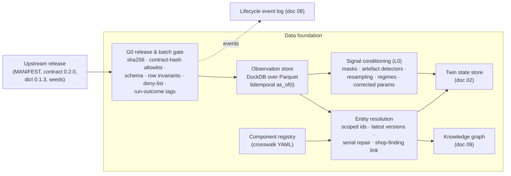

# 03 · Data foundation: contract gate, as-of store, identity, registry

Everything else in the platform reads from this layer. Its job is to turn the data layer's contract into a
trustworthy, time-correct, identity-correct view of the fleet — and to make "what did we know at time t"
a single function call.

Related: [02 digital twin](02-digital-twin.md) (what is built on top), [09 knowledge graph](09-knowledge-graph.md),
[08 learning & assurance](08-learning-and-assurance.md) (the event log), data docs
[`../data-layer/11-preview-v0.9.md`](../data-layer/11-preview-v0.9.md).

## Requirements this layer must satisfy (from the data layer and the research)

| # | Requirement | Source |
|---|---|---|
| R1 | Accept only contract 0.2.0 files (hash allowlist), read by column name, bridge older versions explicitly | contract `MIGRATION.md`; AD-41 |
| R2 | Every read is **as of** a decision time: `t_ingest ≤ t` per topic | invariant I5; RULES.md rule 2 |
| R3 | Idempotent ingest by `record_id`, earliest `t_ingest` kept, conflicting content quarantined | contract; A-W0.4-18 |
| R4 | Scoped identity in the preview (8 independent worlds): (`tail_no`, `record_id`), (`tail_no`, `serial_no`), (`target_tail_no`, `order_id`) | our profiling, doc 11 |
| R5 | `_restricted_labels/` is never opened by the system under test (path deny-list + test) | I5; EASA DA-04 independence |
| R6 | Data quality is surfaced, never silently "fixed" (sentinels, unflagged freezes, `XXX` serials, aborted sorties) | GAO-20-316 ALIS lesson; doc 03 data-layer |
| R7 | Dataset identity is reproducible: release = MANIFEST sha256 + contract hash + dictionary hash + code commit + seeds | MLOps research; EASA CM-01 |

## Components



### 1. G0 — release and batch gate

Cheapest checks first; any failure **quarantines** the batch (never silently drops rows) and writes a
`batch.quarantined{reason}` event:

1. **Integrity:** file sha256 = `MANIFEST.json` entry.
2. **Contract:** Parquet metadata `phalanx.contract_hash` ∈ allowlist (`a4396f1d…` for 0.2.0); Arrow schema =
   pinned consumer schema. 0.1.0 files are bridged with the data layer's `phalanx.ground.migrate.upgrade`.
3. **Dictionary:** `dict_hash` registered; a new dictionary version emits a `regime.changepoint{DICT_RELEASE}`
   (feature semantics such as native steps and code tables can change — 0.1.3 changed 15 channels).
4. **Row invariants:** `t_ingest ≥` event time; `quality_flags & 0xFFFFF800 == 0`; no NaN/∞; `record_id` unique
   per scope; repeats with different content → `RecordIdConflict` quarantine.
5. **Run outcomes:** join `_runs/*.json` (consumer-side metadata, not restricted) and tag aborted telemetry
   sorties `run_outcome=ABORTED(sim_artefact)` — 5 of 6 preview sorties end in a simulator ground impact, and a
   model must not learn "crash" from a simulator bug. The contract itself has no completion field.
6. **Deny-list:** any path under `_restricted_labels/` raises; a unit test asserts it.

Tools: the data layer's own `Contract.validate` / `ParquetStore` / `migrate` (authoritative) + **pandera**
(MIT) for our derived tables. Rejected: Soda Core v4 (Elastic License 2.0 since Jan 2026), Great Expectations
(heavier; optional for HTML data docs), deequ (Spark).

### 2. Observation store (bitemporal, as-of)

- **DuckDB + pyarrow over the contract Parquet trees**, partitioned by `release_id`. MIT, embedded, air-gap
  friendly, and fast enough: counting TJ212's 44.9 M rows took 0.13 s and 10-s binning of `ENG.N2` over the
  whole sortie 0.24 s on an M4 laptop (assistant research).
- **Bitemporal by construction:** event/valid time = `t_sample`/`t_occurrence`/`t_event`; knowledge/transaction
  time = `t_ingest`. The single entry point is `as_of(t, topic, …)`: filter `t_ingest ≤ t` **first**, then
  resolve the latest `record_version` per (`scope`, `record_type`, `record_key`), then DuckDB `ASOF JOIN` for
  event-time alignment.
- **Never merge releases into one dedupe space:** a regenerated dataset can reuse a `record_id` with different
  content (record ids hash identity components, not values).
- **Point-in-time tests (CI):** (a) every derived table asserts `max(t_ingest of inputs) ≤ as_of`;
  (b) **shuffle-the-future** — perturb all rows with `t_ingest > t`; features at t must not change;
  (c) rebuild a sample of rows from scratch via `as_of(t)` and compare.
- Rejected: **Feast** (default point-in-time join uses created-timestamp only to break ties, so late backfills can
  leak; overkill for 8–32 tails), **XTDB** (native bitemporal but a JVM service), **Kafka** (no live transport
  exists upstream; the replay streamer is enough).

### 3. Entity resolution (scoped, versioned, repaired)

| Problem (observed in v0.9) | Resolution |
|---|---|
| 8 tails are 8 independent worlds; 3,388 `maint.records` rows share a `record_id`; serials `ADC-000001` etc. exist on every tail; `order_id` `scheduled:20260507T023000:001` on two tails | **scope** = `tail_no` for the preview (world id); every key is (`scope`, natural key); switch to global keys when the data layer ships a shared-world fleet (W2.6) |
| `SHOP_FINDING` rows have `tail_no` null (partition `__null__`) | link to a world by matching `job_no` + `serial_no` + time against that world's `COMPONENT_LIFE REMOVE` row |
| Records are versioned (10,085 rows → ~2.7 k entities) | `latest_version(as_of)` per (`scope`, `record_type`, `record_key`) |
| Injected defects: `XXX` serials (31), missing part records, duplicate snags, 14-day reconciliation lag, noisy text | serial repair from corrective-action text ("REMOVED S/N HYDP-000001, INSTALLED S/N HYDP-000003") via regex + fuzzy match against the template inventory; duplicate-snag merge (same scope, code, ingest window); every repair is a derived record with provenance, flagged in the UI; scored offline against the restricted DEFECT labels (evaluation only) |
| Same item under different names: `HYD_PUMP` (suspect id) / `SYN-PN-HYDP` (part no) / `HYDP-000002` (serial); `MC` (event source) vs `OAC` (dictionary); AVI-204 narrative says "radar" while dictionary 0.1.3 says AHRS | the **component registry** (below) is the only crosswalk; codes are resolved from coded fields + dictionary, never from free text; conflicts are surfaced |
| `COMPONENT_LIFE` has no position/LRU column | positions **inferred** from concurrent installs (e.g. HYDP ×2, BRAKE ×2, BCU ×2), flagged "inferred" |

### 4. Component registry (the crosswalk)

One versioned file, `component_registry.yaml`, ~60–70 nodes (union of 30 dictionary LRUs, 16 serialised part
classes in `COMPONENT_LIFE`, 42 `suspect_lrus` ids, plus networks and zones). It is the **only** place where
3D mesh names, dictionary LRUs, event suspect ids, part numbers, system codes, channels, synthetic ATA chapters
and synthetic zones meet.

```yaml
- id: HYD.PUMP
  label: Engine-driven hydraulic pump (synthetic)
  kind: part                 # lru | part | sensor | harness | bus | network | zone | system
  suspect_ids: [HYD_PUMP]
  part_no: SYN-PN-HYDP
  serial_prefix: HYDP-
  system_code: HYD
  subsystem: hydraulics
  ata_syn: "29"              # our mapping, labelled synthetic (the dictionary has no ATA field)
  zone_syn: Z4-ENGINE-BAY    # our schematic zone
  multiplicity: 2
  positions: [SYS1, SYS2]    # inferred, flagged
  reported_by: [BHEEM_EU]
  channels: [HYD.SYS1.P, HYD.SYS2.P, HYD.SYS1.T]
  mesh_ids: [cmp__HYD_PUMP__1, cmp__HYD_PUMP__2]
```

Build-time tests make "the 3D is connected to the data" a **testable property**: every mesh with a `node_id`
exists in the registry; every identifier seen in the data (`source_lru`, `suspect_lrus[].lru`, `part_no`,
`system_code`) resolves to a node or lands in a visible **unmapped** bucket (e.g. `MC`).

### 5. Signal conditioning (L0) — shared by monitoring and the assistant

Deterministic, tested transforms over `param.samples` (details and evidence in
[04](04-condition-monitoring-and-diagnostics.md)):
- mask `SENTINEL` and `validity != NORMAL`; keep `OUT_OF_RANGE` as signal; per-channel **information-content
  mask** (e.g. `ENG.T5` pinned at its 371 °C floor with no flag; `ENG.OIL_T` constant 180 °C + OUT_OF_RANGE at
  ground idle);
- unflagged-artefact detectors: "constant while coupled drivers move by > k LSB" (freeze), top-of-scale spikes
  (glitch) — naive run-length rules false-alarm because `ENG.OIL_P` naturally holds a lattice value for 9 s;
- per-clock-domain resampling ("latest at or before grid instant", masks kept) to a common ≤ 5 Hz grid, so
  fast-path (60/80/200 Hz) and full-path (25/12.5/6.25 Hz) data give the same features;
- regime/flight-phase segmentation, steady-window extraction, event-snapshot windows (−5 s/+25–35 s),
  corrected parameters (θ, δ).

Raw samples never leave this layer: downstream consumers (models, UI charts, assistant) get windows, bins and
statistics.

## Technology decisions

| Need | Choice | Why | Rejected |
|---|---|---|---|
| Storage and query | DuckDB 1.5 + pyarrow + Parquet | MIT, embedded, ASOF JOIN, sub-second on the 163 M-row preview | Postgres/Timescale (ops), Feast, XTDB, Kafka |
| Contract validation | data layer `Contract.validate` + pandera | owner's validator is authoritative; pandera MIT, light | Soda (ELv2), GX (heavy) |
| App state | DuckDB/SQLite (single writer) behind a FastAPI service | one process owns writes; event log is append-only | separate DB server |
| Dataset version | `release_id = sha256(MANIFEST.json)` + hashes | content-addressed upstream already | DVC (not needed; now part of lakeFS) |

## Issues to raise with the data-layer team (consolidated from all research streams)

1. Cross-world collisions of `record_id`, serials, job numbers and order ids in `fleet/` (documented nowhere in
   the preview README).
2. `SHOP_FINDING` rows with null `tail_no`.
3. All 91 shop findings are RTOK (0 CONFIRMED) — no positive failure class; no MODIFICATION, CANNIBALISATION or
   EXCEEDANCE_INSPECTION records; `sw_config_id` only `SW-BASE`.
4. Narrative catalogue out of sync with the dictionary code table (AVI-204 text "FIRE-CONTROL RADAR", dictionary
   AHRS).
5. Suspect sub-item names (e.g. `N1_PICKUP_A`, `T5_HARNESS_A`) do not match M18's removable classes.
6. `ENG.T5` sits at its 371 °C range floor with no `OUT_OF_RANGE` flag.
7. Consumer `param.samples` carry no A/B lanes (lane-disagreement validation impossible).
8. `detection_far_per_fh` is a constant 6.1e-4 for every code.
9. `MX.*` inspection values (SOAP Fe, oil added, borescope) have no contract transport.
10. Fork API defaults: `BranchSpec.mode` defaults to `"oracle"`, `what_if()` maps oracle to ensemble (true hidden
    state), and `OpsSession.records()` returns restricted truth rows — unsafe defaults for a system under test.
11. `ConditionBasedPolicy` finds deferred jobs by substring match on noisy text; SUPPLY_DEMAND has 25 record_ids
    with differing content on the same tail.
12. The TJ108 engine removal (day 9) has no visible reason in consumer records.
