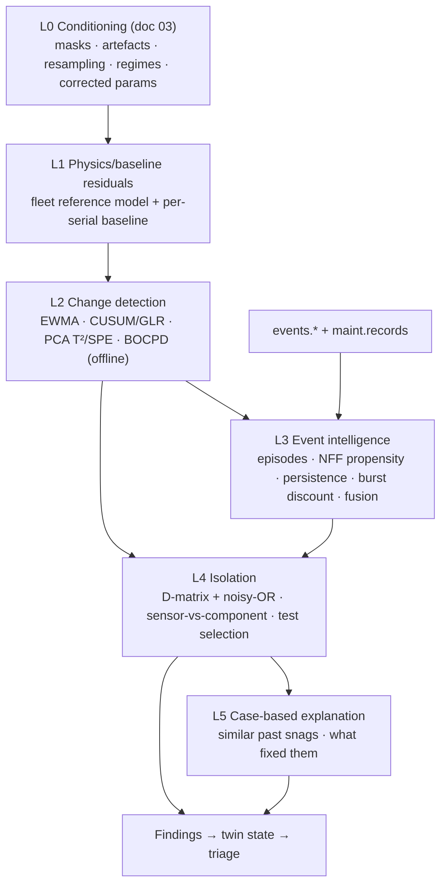

# 04 · Condition monitoring and diagnostics (descriptive → diagnostic intelligence)

Questions this layer answers: **Is something abnormal? Is it real or a false alarm? Which item is it? Is it
the sensor or the component? What fixed it last time?** It produces typed **findings** (with evidence
`record_id`s and confidence) that feed the twin state, triage ([07](07-triage-policy-decision-loop.md)) and
prediction ([05](05-prediction.md)).

## Headline decisions

1. **Event/BIT intelligence first.** Fleet-scale data is dominated by events and maintenance outcomes, and the
   operational pain is NFF/false alarms (NFF 29.5–63 % by LRU technology; F/A-18E/F BIT false alarms 33.5–86 %).
   The v0.9 preview is exactly this regime: **1,021 BIT events → 687 BIT-evidenced jobs → 398 could-not-duplicate,
   171 deferred-and-admin-closed, 92 remove/replace; all 91 shop findings RTOK; 50 % of defect man-hours spent on
   no-fault jobs.** This is demonstrable now and directly moves man-hours and availability.
2. **Physics/baseline residuals + simple sequential change detection** for parameter health, not deep anomaly
   detection or time-series foundation models. Independent benchmarks show simple statistical methods tie with or
   beat deep and transformer detectors (TSB-AD, NeurIPS 2024; TimeEval, PVLDB 2022; Wu & Keogh, TKDE 2023;
   "When foundation models are one-liners", ICLR 2026).
3. **Fault isolation = coarse D-matrix + leaky noisy-OR Bayesian reasoner**, seeded from engineering structure and
   the `suspect_lrus` the contract delivers, learned from maintenance outcomes — the industrial pattern of the
   Boeing 777 central maintenance system and QSI TEAMS.
4. **Sensor-vs-component isolation is an explicit layer** with a legitimate "undetermined" output: NASA TM-4551
   proves bias and deterioration are observationally equivalent from gas-path residuals alone, and the data layer
   deliberately scores whether we confuse them.

## Layered architecture

---

## D1 · BIT episode and NFF intelligence (L3) — *build first, demo now*

| Aspect | Detail |
|---|---|
| Stakeholder problem | Squadron Engineering Officer and line technicians spend most defect labour chasing BIT codes that end CND/RTOK; pilots and planners lose aircraft to precautionary snags. |
| KPIs moved | NFF/RTOK rate of removals; no-fault man-hours per FH (preview ≈ 5.8 h/FH); unscheduled NMCM time; repeat/recur rate; BIT false-alarm rate per FH. |
| Approaches considered | raw code counting; persistence rules (reference CBM rule "≥2 in 10 days"); Bayesian per-code/per-unit priors; HMM/DBN with imperfect tests (Ruan et al. 2009; Ying et al. 2000); "Smart BIT" Markov filters; gradient-boosting triage classifier. |
| How the chosen approach works | (1) **Episodes:** dedupe BIT and caution rows sharing `event_id`, collapse per sortie, chain the same (tail, code) within 10 days by `t_ingest` → issues. (2) **Per-code base rate** of "real" vs CND/RTOK/admin-close, learned from outcomes and shrunk to the fleet rate (Beta-Binomial), by BIT maturity regime. (3) **Per-(code, serial) chronic-nuisance prior** — the simulator's BIT statistic has a per-unit offset, so healthy units recur chronically (HYD-101 on TJ107: 42 consecutive flights, all RTOK). (4) **Software-load burst discount** for ~10 sorties after a `LOAD_SOFTWARE`. (5) **Corroboration** from parameter residuals in the event snapshot window, co-occurring exceedances/cautions. (6) Fusion → P(real fault \| evidence) per issue, plus a calibrated **P(defect closes CND)** classifier (gradient boosting with SHAP), trainable now on ~1,000 BIT-discovered defects counted per world. |
| Evidence | Khan, Phillips, Jennions & Hockley, "No Fault Found events in maintenance engineering" Parts 1–2, RESS 123 (2014); Söderholm, RESS 92 (2007); Ruan et al., IEEE TSMC-A 39(6) 2009; Wickens et al. 2009 (alarm credibility matters more than count). |
| Open source | pgmpy (MIT; `NoisyOR`, DBN, EM); lifelines/PyMC for priors; LightGBM/XGBoost; SHAP. |
| Strengths / limits | Data-light, explainable, matches the dominant data; limit: labels reflect M18's maintenance policy, not truth — scored against truth offline only. |
| Data | `events.*` (code, persistence, `suspect_lrus`, snapshot window), `maint.records` DEFECT_WO (`evidence_record_ids`, action codes), SHOP_FINDING, MODIFICATION/LOAD_SOFTWARE for bursts. |
| Fit | **High, now.** `detection_far_per_fh` is a constant in v0.9, so base rates must be learned from outcomes. |
| Decision | **Adopt as the first-class diagnostic engine.** Output feeds the triage score and the "troubleshoot before replace" recommendation. |

## D2 · Parameter health monitoring: physics/baseline residuals + change detection (L1–L2)

| Aspect | Detail |
|---|---|
| Stakeholder problem | Engine and utility degradation (fouling, erosion, pump wear) shows as slow between-flight drift long before BIT trips; maintainers need early, interpretable deltas. |
| KPIs moved | Detection lead time vs spares lead time; in-flight failures; unscheduled engine removals; false alarms per 1,000 flights. |
| Approaches considered | Gas-path analysis (Urban 1973; WLS-GPA, Doel 1994); Kalman/tuner health estimation (Simon & Garg 2010; Simon & Armstrong 2012); fleet-baseline trend monitoring (ΔEGT/ΔN2/ΔWF); MSET/AAKR; PCA T²/SPE, CUSUM/EWMA/GLR, BOCPD; Isolation Forest/LOF; deep TSAD (LSTM-AE, USAD, OmniAnomaly, TranAD, Anomaly Transformer, TimesNet); TSFMs (MOMENT, TimesFM, Chronos). |
| How the chosen approach works | **L1:** a fleet reference model regresses each *corrected* gas-path output (T5c, WFMc, PS3/δ, N1c, P5/δ; OIL_P vs N2c) on operating point (N2c, Mach, Hp, T1) — a GAM or monotone gradient boosting fit on early-life data; then a **per-serial baseline offset** (median residual over the first ~10 flights after install/overhaul). The health indicator is the per-flight robust median Δ from that serial's baseline. **L2:** EWMA with a 10-flight delta-delta, two-sided CUSUM/GLR over 5 flights, PCA T²/SPE on the residual vector with shrinkage covariance; thresholds from bootstrap of healthy residuals to a budget of ≤ 1 false alarm per 1,000 flights (the ProDiMES convention and the mature-BIT target). BOCPD/`ruptures` offline to annotate wash/install steps. Phase 2: constant-gain EKF tuner estimation with a pyCycle-derived influence matrix and transient residuals (Simon & Rinehart 2015) — fighters rarely hold steady (2–8 % of 10-s windows qualified on TJ212). |
| Evidence | **ProDiMES** public benchmark (Simon, Borguet, Léonard & Zhang, NASA/TM-2013-218082; JEGTP 136(4) 2014): at ≤ 1 FP/1,000 flights, TPR 44.7–51.9 %, latency 4–4.9 flights; analytical and empirical classifiers performed about equally. TSB-AD (Liu & Paparrizos, NeurIPS 2024): PCA ties CNN/LSTM at VUS-PR 0.31 on multivariate; TimesNet 0.19, TranAD 0.18. Kim et al. AAAI 2022: under point-adjust a random score is "state of the art". |
| Open source | pyCycle (Apache-2.0); statsmodels/numpy (EKF is ~100 lines; filterpy is unmaintained); ruptures (BSD-2); river (BSD-3); PyOD (BSD-2) for an IF/ECOD secondary novelty score. |
| Strengths / limits | Physics-aligned, engineering-unit explanations, works with snapshot data; limits: under-determined isolation, scarce steady points, "inverse crime" risk if we diagnose a pyCycle-structured simulator with pyCycle-structured models (test with deliberate model mismatch). |
| Data handling | Lattice data: floor every σ at max(σ̂, q/√12) (OIL_P q/√12 = 0.70 psi); monitor per-flight aggregates, not raw 60 Hz samples (86–99 % of consecutive samples are identical); never use LOF on tied data; threshold by bootstrap, not Gaussian tables (Etgar & Freund 2023 on rounded-data control charts). |
| Fit | Pooled L1 reference model and L2 mechanics on injected faults: **now**. Per-serial baselining and detection performance: **later** — one telemetry sortie per tail, no persistent faults, B7 signature signs not yet correct, EGT/WF lags are PROXY in v0.9. |
| Decision | **Adopt L1+L2 as the parameter-health core.** Deep TSAD: at most one small challenger on residual windows, admitted only if it beats PCA/IF at matched false-alarm rate. **TSFMs for anomaly detection: rejected.** |

## D3 · Sensor-versus-component isolation (L4a)

| Aspect | Detail |
|---|---|
| Stakeholder problem | Replacing a healthy engine module because a sensor drifted (or vice versa) — a classic NFF driver; the data layer scores this confusion explicitly (AD-26). |
| KPIs moved | NFF removals avoided; correct isolation rate; sensor-vs-component confusion matrix. |
| Approaches considered | lane disagreement / voting; parity space; bank of Kalman filters (Kobayashi & Simon, NASA/TM-2004-213203); multiple-model hybrid KF + GLR (Pourbabaee et al., IEEE TCST 2016); augmented influence matrix with sensor-bias columns + sparse L1 WLS (ProDiMES method #3); AAKR leave-one-out reconstruction. |
| How the chosen approach works | Structural cues, in increasing order of cost: (1) a single-channel residual inconsistent with ≥ 2 physically coupled channels → sensor; (2) a coherent multi-channel signature in a physics-consistent direction → component; (3) **natural experiments** in the records — an engine wash recovers fouling (ρ≈0.8) but not sensor bias; a residual that follows the engine serial across installs vs one that stays with the tail; steps at sensor/LRU replacement; (4) FADEC substitution bit / VOTED_OUT flag as hints; (5) phase 2: sparse augmented-ICM WLS and a Kalman bank. Output is three-way: **sensor / component / undetermined**. |
| Evidence | Espana & Gilyard, NASA TM-4551 (1993): measurement biases and engine deviations are equivalent from the estimator's view. |
| Fit | v0.9 has **no A/B lanes** in consumer samples, so lane checks wait; natural-experiment logic is buildable now (washes every 50 FH are in the orders). |
| Decision | **Adopt as an explicit layer with an honest "undetermined".** |

## D4 · Fault isolation: D-matrix + noisy-OR reasoner + consolidation + test selection (L4b)

| Aspect | Detail |
|---|---|
| Stakeholder problem | Given a set of codes, which replaceable item is most likely faulty, which test separates the candidates, and is this code just a symptom of an upstream failure (bus, power, AMAGB)? |
| KPIs moved | Isolation top-k accuracy; troubleshooting man-hours; NFF rate; repeat-defect rate. |
| Approaches considered | D-matrix / multi-signal flow graphs (Deb, Pattipati et al., IEEE AES Magazine 1995; QSI TEAMS; IEEE 1232 AI-ESTATE); Bayesian networks / leaky noisy-OR (Mack, Biswas, Koutsoukos & Mylaraswamy, IEEE T-ASE 14(1) 2017 — the 777 CMC pattern: reference model + abductive/naive-Bayes reasoner); Boeing's 2025 hybrid of history-learned and schematic BNs (Adhikari et al., PHM Asia-Pacific 2025); fault trees/FMECA; consistency-based diagnosis (de Kleer & Williams 1987; Reiter 1987); causal discovery; GNNs. |
| How the chosen approach works | A coarse **D-matrix** over ~20 removable positions/sub-items × ~100 tests (BIT codes, CWS legends, exceedance monitors, inspections, troubleshooting checks), built by reachability over our engineering graph ([09](09-knowledge-graph.md)); identical columns form **ambiguity groups**. A **leaky noisy-OR** network (pgmpy) gives a posterior over items: item priors from delivered `suspect_lrus` confidences, leak ≈ the code's learned false-alarm propensity, detection parameters learned from outcomes (Dirichlet/EM). **Consolidation** suppresses cascaded symptoms under their source, like a central maintenance computer (e.g. AVI-301 MUX bus with AVI-201/202/203). **Test selection** ranks the next TROUBLESHOOT/INSPECT by expected information gain per man-hour — emitted as orders. Remove only if the posterior exceeds a cost-derived threshold (see [06](06-prescription-and-planning.md)). |
| Strengths / limits | Transparent, auditable, data-light, matches the vocabulary of IAF/DRDO reviewers; limit: with **0 CONFIRMED findings in v0.9**, only leak (false-alarm) parameters are learnable; true-detection parameters stay as priors until calibrated data (W2.5b). |
| Honesty rule | Seed only from contract artefacts and public architecture (dictionary LRUs/buses/RT map, `bit_codes` `lru`/`monitor`/`legend`, delivered `suspect_lrus`, observed part classes, public AMAGB coupling). **Never copy the simulator's `catalogue.yaml`/`graph.yaml` detection coverage, rates, latencies or M18's `p_isolate`** — that would be reading the answer key. |
| Decision | **Adopt.** Rejected: GDE (no component behaviour models), causal discovery (structure known; co-occurrence lift covers sympathetic codes), GNNs (no labelled faults, poor explainability). |

## D5 · Case-based reasoning and maintenance-text extraction (L5)

| Aspect | Detail |
|---|---|
| Problem | "Have we seen this before, and what fixed it?" — the question every technician asks. |
| Approaches considered | MaintIE NER (Bikaun et al., LREC-COLING 2024), MaintNorm (W-NUT 2024), NIST Nestor, technical language processing (Brundage et al., Manufacturing Letters 27, 2021), text embeddings, structured similarity. |
| Chosen | Our narratives come from ~20 templates with character-level noise ("TROUBLESOT", "REMVD"): normalise by fuzzy-matching the template inventory (rapidfuzz), regex-extract code, item phrase, procedure reference (`PHX-TASK-*`, `PHX-FIM-*`), action, removed/installed serials; case similarity on **structured features** (code-set Jaccard, system, persistence, repeat flag, serial history, outcome), embeddings only as a tiebreaker. Free text is **untrusted input**: it never drives a decision directly and never reaches an LLM with tools. |
| Decision | **Adopt structured CBR + rule-based extraction; do not train NER.** |

## D6 · Repeat-defect and rogue-unit detection

| Aspect | Detail |
|---|---|
| Problem | Units that keep coming back RTOK (rogue units) and defects that recur after a "fix" waste spares and labour. |
| Chosen | REPEAT_OF links (same scope + code/system within N sorties/days); escalation after a failed R/R ("replaced, code returned" is evidence against the removed item); per-serial unscheduled-removal rate vs part-class rate (Poisson / empirical Bayes), weighted by RTOK share. Preview candidates: TJ107 HYDP-000001 removed 6×, TJ105 JFS-000001 5×, TJ103 BCU-000001 5×. |
| Limit | "Symptom follows the serial across tails" — the cleanest rogue discriminator — is not testable on v0.9 (one tail per world). |
| Decision | **Adopt now (within-tail); cross-tail when the shared-world fleet arrives.** |

## Evaluation protocol (applies to every engine here)

1. Rolling-origin, as-of `t_ingest` backtests; split by serial and tail, never by sample.
2. Truth tiers: (a) `labels.truth` FAULT/HIDDEN_STATE offline only (not in v0.9); (b) observable proxies —
   CONFIRMED vs RTOK/BCM, removals, borescope; (c) seeded faults in healthy residual histories, tested with
   deliberate model mismatch.
3. Metrics: false alarms per 1,000 FH at a matched operating point; detection latency in flights; event-wise
   precision/recall (Tatbul et al., NeurIPS 2018) and VUS-PR; **no point-adjusted F1**; isolation top-k and kappa;
   sensor-vs-component confusion matrix with the undetermined rate; NFF removals avoided; KPI deltas on forks.
4. Mandatory baselines: random score, limit check, moving variance, PCA error, status-quo BIT, the reference CBM
   rule. Any complex model must beat them at matched false-alarm rate. No model selection by internal metrics
   (Ma, Zhao & Akoglu 2023).

## Key sources

- ProDiMES benchmark — https://ntrs.nasa.gov/api/citations/20140003941/downloads/20140003941.pdf
- Simon & Garg (2010) tuner selection — https://ntrs.nasa.gov/api/citations/20100006914/downloads/20100006914.pdf
- Simon & Rinehart (2015) streaming anomaly detection — https://ntrs.nasa.gov/citations/20150000721
- Kobayashi & Simon (2004) bank of Kalman filters — https://ntrs.nasa.gov/api/citations/20040110846/downloads/20040110846.pdf
- Espana & Gilyard, NASA TM-4551 — https://ntrs.nasa.gov/citations/19940017406
- Liu & Paparrizos, TSB-AD (NeurIPS 2024) — https://github.com/TheDatumOrg/TSB-AD
- Wu & Keogh, TKDE 2023 — https://arxiv.org/abs/2009.13807 ; Kim et al., AAAI 2022 — https://arxiv.org/abs/2109.05257
- Schmidl et al., TimeEval, PVLDB 2022 — https://www.vldb.org/pvldb/vol15/p1779-wenig.pdf
- Zhu et al., "When foundation models are one-liners", ICLR 2026 — https://mlanthology.org/iclr/2026/zhu2026iclr-foundation/
- Han et al., ADBench (NeurIPS 2022) — https://github.com/Minqi824/ADBench
- Mack et al., IEEE T-ASE 14(1) 2017 — doi:10.1109/TASE.2016.2542186
- Adhikari et al. (Boeing), PHM Asia-Pacific 2025 — https://papers.phmsociety.org/index.php/phmap/article/download/4524/phmap_2025_4524
- NASA/QSI TEAMS — https://ntrs.nasa.gov/api/citations/20110004130/downloads/20110004130.pdf
- Khan et al., NFF Parts 1–2, RESS 123 (2014) — https://dspace.lib.cranfield.ac.uk/handle/1826/9947
- pgmpy — https://github.com/pgmpy/pgmpy ; pyCycle — https://github.com/OpenMDAO/pyCycle ; ruptures — https://github.com/deepcharles/ruptures ; PyOD — https://github.com/yzhao062/pyod
- MaintIE — https://github.com/nlp-tlp/maintie ; Brundage et al. 2021 — doi:10.1016/j.mfglet.2020.11.001
