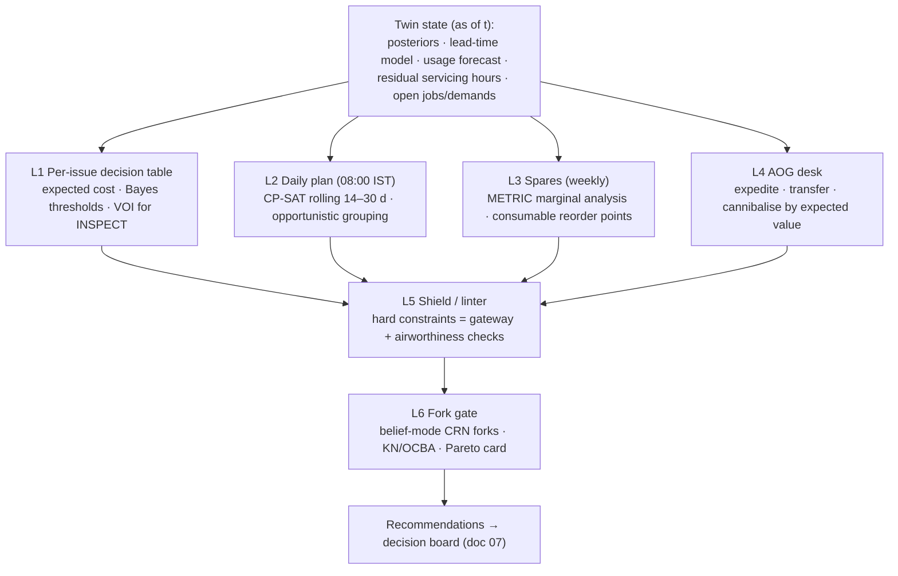

# 06 · Prescription and planning (prescriptive intelligence)

Questions this layer answers: **What should we do about this issue? What should the fleet fly and service over
the next weeks? What spares should we order, expedite or move? Is the recommended plan actually better than
what we would do anyway — and by how much?**

## First, the evidence on where availability is lost (the team's thesis, refined)

The team believed "availability is lost mostly while aircraft wait (for spares, repairs, decisions), not during
the repair itself; value comes from acting earlier". The research supports the first half and refines the
second.

**Real-world priors.** CAG's 2015 audit put Su-30MKI serviceability at 55–60 % against a 75 % norm, blamed
largely on spares and repair; the data layer's CAG-derived priors are ≈ 13–14 % AOG, ≈ 20 % in 1st/2nd-line
maintenance and 11–12 % in HAL overhaul — supply waiting is roughly a third of unavailability, maintenance and
depot time the rest. CAG 24/2017 (IL-76): only 10.8 % of AOG demands met within 15 days, 22.5 % took > 6 months;
only 30–37 % of second-line servicings finished on time.

**Preview v0.9 decomposition** (8 tails × 180 days; SCIR occupancy rebuilt from AVAILABILITY_STATE and
attributed to the U/S jobs in the tech log):

| State | Tail-days of 1,440 | Share of downtime | Main causes |
|---|---|---|---|
| NMCS (awaiting parts) | 284.7 | 50 % | tyres 147 (52 % of NMCS), FADEC 57, hydraulic pump 28, brake chute 22 |
| NMCM (maintenance) | 250.6 | 44 % | SRV-L2-major 77 (median 21.6 d vs 15 d prescribed), tyre replacement 66, SRV-L1 20 |
| NMCD (depot) | 37.9 | 7 % | ROH overhaul |

- Tyres alone ≈ 37 % of all downtime — a **predictable consumable** (8-landing life) whose demand is
  deterministic from the flying plan.
- Every FADEC and hydraulic-pump AOG wait came from **removing a healthy unit** (all shop findings RTOK).
- Flying-task achievement averages 0.42 against MC 0.60 — the flying plan is a lever in its own right.

**Refined thesis we adopt.** Recoverable waiting has three sources, each with a different fix:
1. **Inventory policy for predictable demand** → stock levels and reorder points (logistics).
2. **Self-inflicted demand** — removals on alarms that end NFF → act *more selectively* (diagnostics + rules).
3. **Capacity queues and servicing overruns** → scheduling and grouping (planning).

Earlier *prediction* pays only where the warning horizon ≥ the supply lead time and precision is high — i.e.
wear-out items ([05](05-prediction.md)). For randomly failing LRUs with heavy-tailed lead times (median ≈ 29 d,
mean ≈ 159 d at AOG priority), a 30-day warning recovers only ≈ 13 % of AOG days; **stock beats foresight**.

## Prescriptive stack — the cheapest method that solves each decision

### L1 · Per-issue expected-cost decision table — *adopt now*

- **Problem.** For each triaged issue: defer and monitor, troubleshoot, inspect, remove/replace, requisition,
  restrict usage or ground?
- **How.** Choose the action minimising expected cost under the posterior p (P(true fault on this serial within
  h)): act when p > C_FP / (C_FP + C_FN) (Elkan 2001). Costs from KPI proxies — man-hours, relative unit cost
  (depot repair 0.3 × unit cost), expedite premium, and an explicit, swept value per mission-capable day.
  **Safety is a constraint, not a price**: GROUND if P(in-flight failure on next sortie) exceeds a policy
  ceiling; RESTRICT_USAGE (AB/G) as the intermediate step.
- **Value of information for INSPECT** (borescope POD 0.7, NDT 0.8; levels 0.3–0.9 in the registry): after a
  negative inspection p⁻ = p(1−d) / (p(1−d) + (1−p)(1−f)); e.g. p = 0.2, d = 0.7, f = 0.05 → p⁻ ≈ 0.07,
  p⁺ ≈ 0.78. Inspect only when VOI > inspection cost — the middle band of p (Raiffa & Schlaifer 1961; Straub &
  Faber 2005).
- **Lead-time logic.** Requisition when P(fail before the L_q lead-time quantile) exceeds the critical ratio;
  train predictors on this decision loss, not RMSE ("smart predict-then-optimise", Elmachtoub & Grigas 2022).
- **NFF lever.** M18 replaces the top suspect of an unreproduced grounding report with p 0.35, and grounding
  defects cannot be deferred by order — so the strongest available lever is **CHANGE_MONITORING_CONFIG**
  (filter nuisance codes; HUMAN-only, F-35 practice). We *recommend* filter changes with fork evidence of the gain
  vs the change in in-flight failures (preview: FADEC/HYDP RTOK removals ≈ 84 NMCS tail-days).

| Situation | Rule |
|---|---|
| Single unconfirmed BIT code, non-grounding | DEFER and monitor (status quo 3 flights); TROUBLESHOOT on recurrence only if trend/co-occurrence lifts p above threshold |
| Intermediate p | INSPECT if VOI > cost |
| High p, spare on hand | REMOVE_REPLACE at the next window, grouped with servicing |
| Moderate p, no spare, long lead | REQUISITION (MCM/PHU) now, keep flying with monitoring |
| Very high p, safety-critical | GROUND (consent required) |

### L2 · Daily flight-and-maintenance plan — *CP-SAT rolling horizon (fleet after W2.6); opportunistic rule now*

- **Problem.** Which tails fly how much, and when does each enter servicing, to maximise availability and flying
  task while keeping residual hours staggered (the "sliding scale") and maintenance load smooth?
- **Evidence.** Flight-and-maintenance planning (FMP) for air forces: Kozanidis et al. (Hellenic AF; *EJOR*
  2015, *NRL* 2012), Cho 2011 (MIT, USAF phase maintenance), Vojvodić Rosenzweig et al. 2010 (Croatian AF sliding
  scale), Safaei, Banjevic & Jardine 2011 (workforce-constrained military fleet), Verhoeff et al. 2015, Peschiera
  et al. *OR Spectrum* 2021 (French AF-like; MIT instances), Vescovi et al. 2026 (one-shot 5-year plan not
  computable → 24-month receding horizon). The closest precedent to our design is the **Finnish Air Force**:
  simulation-based decision support delivered to maintenance designers (Mattila, Virtanen & Raivio,
  *Interfaces* 38(3) 2008), later with simulated-annealing search evaluated by replicated simulation and interval
  multi-attribute value analysis.
- **How.** OR-Tools **CP-SAT** (Apache-2.0): interval, cumulative and no-overlap constraints express "2 hangar
  slots, 4 teams of 3 per base" directly; a rolling 14–30 daily periods with a 30–120 s time limit, hinted from
  yesterday's plan; days 31–90 in weekly buckets; sample-average approximation over 20–50 posterior samples of
  unscheduled downtime; a chance-constrained spare-tail margin P(MC tails ≥ demand) ≥ 1 − α. Plan with servicing
  **overrun distributions** (only 34 % finish on time), not prescribed durations. Lexicographic objectives
  (safety margin → flying task → MC → man-hours → cost) via ε-constraints, not one weighted sum.
- **Opportunistic grouping rule (per tail, now).** When a tail goes NMC with expected remaining downtime E[R],
  bring forward any servicing of duration ≤ E[R] whose residual interval is below a threshold fraction (Dekker et
  al. 1997 economic dependence).
- **Outputs.** ASSIGN_SORTIE (only MC tails; must precede the 00:00 UTC planning run), BRING_FORWARD_SERVICING,
  RESTRICT_USAGE; DEFER_SERVICING only as a HUMAN-signed draft (≤ 20 %).
- **Data gap.** Planned flight hours (`kpi.plan`) are not a contract topic; the planner takes sortie demand from
  user input or scenario parameters (raised with the data layer).

### L3 · Spares — *single-site METRIC marginal analysis + consumable reorder points*

- **Evidence.** METRIC (Sherbrooke, *Operations Research* 16(1) 1968, RAND), MOD-METRIC (Muckstadt, *Management
  Science* 20(4) 1973 — adopted by the USAF for F-15 recoverables), VARI-METRIC (Sherbrooke 1986), Dyna-METRIC
  (RAND, surge), Basten & van Houtum 2014 survey. CAG 17/2015: 4 reserve engines per 20 LCA; of 344 LCA LRUs, 90
  non-repairable and 69 without HAL overhaul facility.
- **How.** Palm's theorem: pipeline count is Poisson with mean = demand rate × **mean** resupply time; expected
  backorders EBO(s) per stock level; greedy marginal analysis by ΔEBO/cost traces the availability-vs-cost
  curve. Demand rates come from P2/P5 in [05](05-prediction.md) — **including NFF removals, which are still
  demand**. Consumables (tyres, chutes) use reorder points from planned landings/streamings × life + a lead-time
  quantile. Size on the mean lead time, never the median (mean ≈ 5.4 × median).
- **Why single-site.** The simulator's supply chain is single-echelon (PROXY A-W1.8-17); multi-echelon gains
  cannot be validated. ~200 lines of our own code (no maintained OSS implementation exists).
- **Outputs.** REQUISITION_SPARES top-ups; TRANSFER_STOCK after W2.6.

### L4 · AOG desk — *expedite now; cannibalise/transfer after W2.6*

- Heavy tails mean the expected *remaining* wait grows the longer a demand is open (159 d at day 0, ≈ 280 d after
  30 days): **expedite the oldest AOG demands first** when E[remaining wait] × 0.5 × value per MC-day exceeds the
  premium.
- **Cannibalise** when E[remaining wait] × value per MC-day exceeds CANN man-hours (≈ 6.2 h each, GAO-02-86) +
  maintenance-induced defect risk + donor opportunity cost; keep holes consolidated on already-down donors.
  GAO-02-86 documents CANN's hidden costs (workload, morale, extra man-hours).
- **TRANSFER_STOCK** (2 days) beats both when another base has stock.

### L5 · Shield / linter — hard constraints

Replicates the gateway and M18 checks before anything reaches a human: schema (`additionalProperties: false`),
`t_issued` = session time, evidence ingested, authority (HUMAN-only actions), airworthiness (no RELEASE with an
open grounding defect, no DEFER of a grounding defect, ASSIGN_SORTIE only for MC tails), resources (slots, teams,
stock, donors). Owned by the policy layer — see [07](07-triage-policy-decision-loop.md). **Never chain orders to
get round a cap** (e.g. repeated DEFER_SERVICING).

### L6 · Fork gate — the backbone of the credibility claim

- **Ranking and selection with common random numbers**: KN fully sequential (Kim & Nelson 2001) and OCBA (Chen
  et al. 2000) put replicates where candidates are close; analytic pre-screening first.
- **Belief mode in the loop, ensemble/oracle only for offline scoring.** The fork service's defaults are unsafe
  for a system under test (`BranchSpec.mode` defaults to oracle; `what_if()` uses ensemble = true hidden state).
  In v0.9 only the engine bearing-spall state implements the belief interface, so in-loop forks are a PROXY and
  the demo says so.
- **Budget is real.** Measured on the preview: ≈ 0.25 s per tail-day with real modules → a 30-day per-tail fork
  ≈ 7.5 s; a 32-tail 30-day branch ≈ 4 min; K = 6 candidates × 10 pairs ≈ 4.7 h serial. Hence KN/OCBA,
  parallelism, 14–30-day horizons, pre-computed showcase forks.
- **Optimizer's curse** (Smith & Winkler 2006): tune on members 0–19, report on fresh members 20+.
- **Output: the recommendation card** — action, target, fork counterfactual ("MC over 30 d +0.031 [0.012, 0.050]
  vs status quo, n = 10 CRN pairs; man-hours +12 [5, 19]; in-flight failures Δ 0 [−0.3, 0.3]"), evidence
  `record_id`s, binding constraints ("Sulur hangar slots full D+3 to D+17"), assumptions swept and whether the
  recommendation holds across them, and a Pareto view (availability vs man-hours vs cost) for plan-level choices.

## What we deliberately do not do

- **Reinforcement learning** (deep, multi-agent, offline): no evidence of deployed RL in military fleet
  maintenance; sample cost ≈ 8.7 CPU-days per tail for 10⁵ 30-day episodes; the uncalibrated preview (100 % RTOK)
  would teach "never remove"; only 7 logged orders; authority and explainability requirements. Keep the
  `Policy.decide(obs, ctx)` interface RL-ready for later.
- Oracle/ensemble forks or `labels.truth` inside the decision loop.
- Multi-echelon VARI-METRIC or full Dyna-METRIC on a single-echelon simulator.
- One-shot 90-day daily MIPs or full scenario-tree stochastic programmes.
- Treating "act earlier" as the objective — early action on weak BIT evidence raises NFF and AOG.
- Fleet-level CANN/pooling/manpower claims from the one-tail-per-world preview.

## Demonstration protocol (credible KPI claims)

1. Pre-register one primary KPI per claim, plus guardrails and horizons.
2. Snapshot at several epochs (no cherry-picked state).
3. StatusQuo / Scheduled / ConditionBased vs ours as CRN pairs (n ≥ 10, 30–90-day horizons).
4. Tune on members 0–19; report on 20+.
5. Mean Δ with 95 % CI; Holm correction on secondary KPIs.
6. Ablations (logistics-only, rules-only, plan-only, combined) to show where the gain comes from.
7. An oracle-informed ceiling, labelled evaluation-only, and our share of it.
8. Assumption sweeps (supply factor 0.1–1, POD, BIT regime immature/mature).

| Capability | Primary KPI | Secondary | Guardrail | v0.9 |
|---|---|---|---|---|
| Consumable reorder points + METRIC | `nmcs`, `aog_days` | `mc`, `flying_task` | `cost` | tyres yes |
| Per-issue rules + nuisance filtering | `man_hours`, `nmcs` | `cost`, `mc` | `in_flight_failures` non-inferior | yes |
| INSPECT by VOI | `in_flight_failures`, `nmcm` | `man_hours` | `mc` | yes (few true faults) |
| Expedite / CANN / transfer | `aog_days`, `mc` | `cann_rate` | `man_hours`, `cost` | expedite yes |
| Flight-and-maintenance plan | `mc`, `flying_task` | `flown_fh`, `nmcm` | `man_hours` | after W2.6 |

## Key sources

- Sherbrooke, METRIC, *Operations Research* 16(1) 1968 — https://www.rand.org/pubs/research_memoranda/RM5882.html
- Muckstadt, MOD-METRIC, *Management Science* 20(4) 1973 — https://pubsonline.informs.org/doi/10.1287/mnsc.20.4.472
- Sherbrooke, VARI-METRIC, *OR* 34(2) 1986 — https://pubsonline.informs.org/doi/10.1287/opre.34.2.311
- RAND Dyna-METRIC — https://www.rand.org/pubs/reports/R3389.html
- Basten & van Houtum 2014 — https://research.tue.nl/en/publications/system-oriented-inventory-models-for-spare-parts/
- Mattila, Virtanen & Raivio, *Interfaces* 38(3) 2008 — https://ideas.repec.org/a/inm/orinte/v38y2008i3p187-201.html
- Cho 2011 (MIT) — https://dspace.mit.edu/handle/1721.1/67773 ; Peschiera et al. 2021 — https://arxiv.org/abs/2001.09856 ; Vescovi et al. 2026 — https://arxiv.org/abs/2609.11710
- Safaei, Banjevic & Jardine 2011 — https://ideas.repec.org/a/spr/annopr/v186y2011i1p295-31610.1007-s10479-011-0885-4.html
- Vos, Peng, Lee & Wang 2023 (RL fleet availability) — https://cambridge.org/core/journals/aeronautical-journal/article/aircraft-fleet-availability-optimisation-a-reinforcement-learning-approach/6B72F70C245B97DA2331C73BF5F6CB8E
- GAO-02-86 (cannibalisation) — https://www.gao.gov/products/gao-02-86
- OR-Tools — https://github.com/google/or-tools ; HiGHS — https://github.com/ERGO-Code/HiGHS ; SimOpt — https://github.com/simopt-admin/simopt
- CAG/Su-30MKI coverage — https://www.defensenews.com/home/2015/12/21/india-s-auditing-agency-punches-holes-in-russian-sukhoi/
