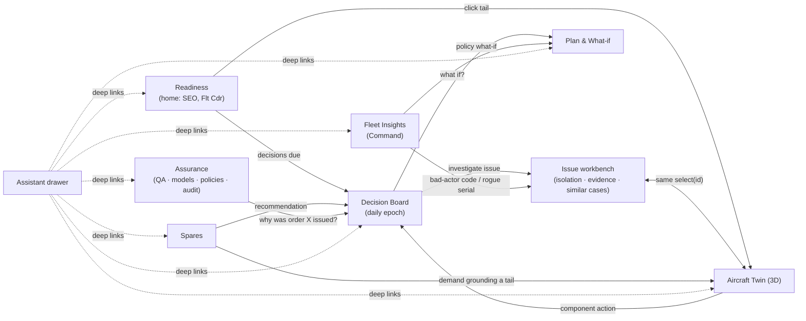

# 11 · UI/UX: decision workspaces around one digital twin

Goal: nothing confusing, every screen earns its place, and the 3D aircraft visibly *is* the digital twin — not
decoration. The design follows the research in [01](01-problem-stakeholders-kpis.md) (workspaces, not tiers),
[02](02-digital-twin.md) (3D as index and lens), [07](07-triage-policy-decision-loop.md) (issues, not alerts;
consent; no nagging) and [10](10-assistant.md) (assistant as a side panel, never the primary UI).

## Design principles (each traced to evidence)

1. **Decisions first.** Each workspace answers one stakeholder's recurring question and ends in an action
   (Skywise/AVIATAR/Navy MOC pattern). If a screen has no decision, it is a panel inside another screen.
2. **One twin, one `as_of`.** A global as-of clock drives every screen; scrubbing time replays what the twin
   believed *then*, using only ingested data (makes information discipline and lead time visible).
3. **3D is an index and a lens, numbers live in 2D** (St. John et al. 2001; Tory et al. 2006; Munzner "no
   unjustified 3D"). Clicking a mesh = searching for it = selecting it in the tree: one `select(id)`.
4. **Same five-part card everywhere:** state → why (record_ids) → forecast (uncertainty) → proposed orders
   (AGENT/HUMAN badge) → expected KPI delta (CRN fork vs status quo).
5. **Situation-awareness ordering** (Endsley): perception (status) → comprehension (assessment) → projection
   (forecast), then action.
6. **Uncertainty is visible, not hidden:** quantile dotplots for remaining life (Fernandes et al., CHI 2018);
   value-suppressing palettes on the 3D health lens (Correll, Moritz & Heer, CHI 2018) — high uncertainty
   desaturates toward grey; "no estimate" is hatched grey, never green.
7. **Load discipline:** issues, not alerts; flood mode when items exceed 2× budget; no badges, counters or
   pushes except P1 (ISA-18.2/EEMUA 191; Google SRE "actionable pages only").
8. **Answer the nine user questions in fixed places** (Liao et al. XAI question bank): how, why, why not, what
   if, how to be that, data, output, performance — each recommendation has a "Why", "Why not", "What if" tab.
9. **Honesty chrome:** a permanent banner `SYNTHETIC · PREVIEW v0.9 · contract 0.2.0 · dict 0.1.3 · not real
   Tejas/IAF data`; inferred positions, repaired serials and data-quality flags are shown, never silently fixed
   (the ALIS lesson).
10. **Role-aware landing, shared navigation.** Each role lands on its home workspace; everyone can reach all.

## Global shell

```text
┌──────────────────────────────────────────────────────────────────────────────────────────────┐
│ PHALANX TWIN   [Readiness][Decisions][Twin][Plan & What-if][Spares][Fleet Insights][Assurance]│
│ AS OF ◀ 14 Apr 2026 06:12 IST ▶  next epoch 08:00 (1 h 48 m) │ ⌕ tail / serial / code / job  │
│ SYNTHETIC · PREVIEW v0.9 · contract 0.2.0 · dict 0.1.3                    role: SEO ▾  ◧ Ask   │
├──────────────────────────────────────────────────────────────────────────────────────────────┤
│                                   workspace content                                │assistant│
│                                                                                    │ drawer  │
└──────────────────────────────────────────────────────────────────────────────────────────────┘
```

Universal search resolves tails, serials, part numbers, BIT codes, jobs, demands, orders and parameters; selecting
a result navigates to the right workspace with the entity selected (e.g. a serial opens the Twin with that
component highlighted at its as-of position).

## Navigation map and journeys



| Journey | Steps |
|---|---|
| **SEO, every morning** | Readiness (what's down and why) → Decision Board (5–10 issues) → open an issue → workbench/Twin evidence → approve / modify / reject → board frozen 07:45 → orders issued 08:00 → statuses flow back next epoch |
| **Technician, a snag** | Twin (tail) → Evidence lens → click suspect component → panel: is it real (NFF propensity, base rate), ambiguity group, next best test, similar past snags and fixes, applicable procedure → draft TROUBLESHOOT/INSPECT for SEO approval |
| **Logistics officer** | Spares → open demands sorted by aircraft grounded × expected remaining wait → expedite / reorder recommendations with fork deltas → approve |
| **Flight Commander** | Readiness (tails available tomorrow / this week) → Plan (flying programme vs servicing, ASSIGN_SORTIE recommendations) |
| **Command / Air HQ (and judges)** | Fleet Insights (downtime waterfall, bad actors, NFF, rogue units, record integrity) → Plan & What-if (policy comparison on CRN forks with CIs) |
| **QA / policy owner** | Assurance (model and policy lifecycle, drift with change-points, override analytics per rule, provenance query) |

## Workspaces

### 1 · Readiness (home) — *SEO, Flight Commander* · tiers D P
Question: "What can fly, what can't and why — today and this week?"
- **Fleet strip:** one card per tail coloured by SCIR state (FMC/PMC/NMCM/NMCS/NMCD), NMC driver ("AWP HYDP,
  demand 12 d old"), estimated time in commission, open snags, servicing due, last ingest.
- **Tomorrow and 7-day availability** vs the flying task (projection from open jobs, AWP ETAs, servicing due).
- **Downtime waterfall** (flying / FMC idle / touch maintenance / AWM / AWP-NMCS / depot / decision wait) and
  **evidence-to-action latency** — the thesis made visible.
- "**N decisions due before 07:45**" → Decision Board. KPIs: MC, FMC, TNMCM, TNMCS, flying task, latency.

### 2 · Decision Board — *SEO (approves), Flight Commander* · tiers G P R
Question: "What should we do today, and why?" — the human gate of the daily loop ([07](07-triage-policy-decision-loop.md)).

```text
┌ DECISION BOARD · epoch 15 Apr 08:00 IST · board closes 07:45 ─────────── 6 items (budget ≤ 10) ┐
│ P1 ▸ TJ104  WARNING ENG-503 recurring 2× / 3 flights          → TROUBLESHOOT  [consent] ▸ open │
│ P2 ▸ TJ107  HYD-101 standing 42 flights · HYDP-000001 removed 6× (RTOK loop) → nuisance + rogue │
│            recommend: STOP R/R · TROUBLESHOOT harness · CHANGE_MONITORING_CONFIG [HUMAN-only]   │
│ P3 ▸ TJ102  tyres: 2 landings to limit · stock 0 · lead p90 37 d → REQUISITION ×4 [consent]     │
│ P4 ▸ … grouped: 3 ADVISORY/MFL codes, all CND-dominated (base rate 0/41 confirmed)  [monitor]  │
├─ selected: TJ107 HYD-101 ────────────────────────────────────────────────────────────────────────┤
│ STATE    serial HYDP-000001 pos SYS1 (inferred) · removed 6×, shop findings RTOK · tail FMC      │
│ WHY      42 consecutive flights · code no-fault rate 0.97 (n=138) · no corroborating trend       │
│          evidence: 7 record_ids ▸ (all ingested ≤ 06:00)                                         │
│ FORECAST P(true pump fault in 30 d) 0.04 [0.01, 0.12] · NFF if removed again: 0.93               │
│ ORDERS   TROUBLESHOOT {code: HYD-101}  ·  CHANGE_MONITORING_CONFIG {filter_codes_add:[HYD-101]}  │
│          [AGENT]                           [HUMAN-only — draft for your signature]               │
│ IMPACT   30-d fork vs status quo (belief mode, 10 CRN pairs): man-hours Δ … [ci] · NMCS Δ … [ci]│
│ [Why] [Why not REMOVE?] [What if defer 3 sorties?]        Approve ▸  Modify ▸  Reject ▸  Snooze │
└──────────────────────────────────────────────────────────────────────────────────────────────────┘
```
(Illustrative wireframe. Probabilities, rates, dates and stock levels are placeholders; real cards render values
from the twin state and actual fork runs. Real preview observations used: HYD-101 standing on TJ107 for 42
consecutive flights, HYDP-000001 removed 6× in an RTOK loop, HYD-101 suspects HYD_PUMP 0.8 / AMAGB 0.2.)
- Bands P1–P4 with all score components visible (consequence, urgency, P(true), confidence), never one opaque
  number; flood mode groups P3/P4 by root cause.
- Approve / modify / reject / snooze with **optional** one-tap reasons; doing nothing = status quo (stated).
- After 08:00, each approved item shows its order lifecycle (ACCEPTED → QUEUED → IN_WORK → COMPLETED/REJECTED
  with reason) and, later, its outcome (CONFIRMED / CND / RTOK).
- **Issue workbench** (opens from any issue): evidence chain (event → defect → troubleshoot/removal → shop
  finding), suspect posterior and ambiguity group, next-best test by information gain per man-hour, similar past
  cases and how they closed, applicable procedures, sensor-vs-component verdict — with "Open in Twin".

### 3 · Aircraft Twin (3D) — *everyone* · all tiers
Question: "What is the state of this aircraft and each of its components — and where are they?"

```text
┌ TWIN · TJ107 · FMC · as of 14 Apr 06:12 IST · last ingest 13 Apr 21:40 ──────────────────────────┐
│ ⌕ search  │                                                      │ COMPONENT · HYD.PUMP (SYS1)    │
│ ▾ TJ107   │        [ stylised segmented 3D aircraft ]            │ serial HYDP-000001 · inferred  │
│  ▸ Engine │   lens: (Health)(Evidence)(Maintenance)(Systems)     │ STATUS   open: none · FMC      │
│  ▸ Hyd    │          (What-if)                                   │   1 issue: HYD-101 (standing)  │
│   • Pump1◀│   BHEEM_EU ──0.8──▶ HYD_PUMP   ──0.2──▶ AMAGB          │ ASSESS   NFF propensity high   │
│   • Pump2 │   (reporter → suspects, thickness = confidence)      │   remaining-life dotplot ▪▪▪▫▫ │
│  ▸ Elec   │                                                      │ PROJECT  risk next 10 sorties  │
│  ▸ Fuel   │   ghosted airframe · selection outlined · x-ray      │ ACTIONS  2 recommended ▸       │
│  ▸ FCS    │                                                      │ WHY / WHY NOT / WHAT IF        │
│  ▸ Zones  │                                                      │ HISTORY  serial timeline ▸     │
│           │                                                      │ SIGNALS  HYD.SYS1.P ▸          │
│           │                                                      │ REFERENCES PHX-FIM-HYD ▸       │
├───────────┴──────────────────────────────────────────────────────┤ provenance: model v · policy v │
│ ◀────●────────────●──────●──────────────●───────────▶  as-of scrubber (ticks = ingests, ◆ = 08:00 epochs) │
└──────────────────────────────────────────────────────────────────────────────────────────────────┘
```

**Lenses (all data-driven from the twin state at as-of):**
- **Health** — colour = P(unserviceable within H) with a value-suppressing uncertainty palette; "no estimate"
  hatched grey.
- **Evidence** — over a chosen window, reporter LRUs pulse; lines run reporter → suspects with thickness =
  `isolation_confidence`; badges show issue counts and confirmed vs unconfirmed.
- **Maintenance** — open, deferred, AWP defects; the **NMC driver** highlighted.
- **Systems** — networks as data, not art: hydraulic SYS1/SYS2, electrical (GEN → TRU → DC buses), fuel,
  1553 AV-MUX-1/2 with RT allocations from the synthetic ICD, engine gas-path stations; a linked 2D graph shows
  fault-propagation/consolidation paths from our knowledge graph ([09](09-knowledge-graph.md)).
- **What-if** — after a belief-mode fork, nodes affected by the alternative plan are highlighted with their
  KPI deltas.

**Interactions:** click / search / tree → one `select(id)`; x-ray (ghost others), isolate, exploded view
(per-node explode vectors), section; fit-to-selection; zone query ("what else is in this bay?" — for MSG-3-style
work bundling while a panel or the engine is open); BIT-code search highlights reporter + suspect group; serial
search shows where it is installed *as of t* or "removed / on shelf".

**Component panel** (top to bottom = SA levels → action): header (id, role, installed serial as of t, inferred
flag, data-quality flags) → **Status** (open/deferred/AWP defects, NMC driver?, aggregated issues confirmed vs
unconfirmed, inspections due) → **Assessment** (risk with remaining-life quantile dotplot; observability class of
the dominant failure mode — tells the user *what evidence would reduce uncertainty*; part-class NFF/RTOK history)
→ **Projection** (risk over next N sorties; useful lead time = predicted window − spares lead time) →
**Recommended actions** (ranked orders with authority badge and fork KPI delta; "Draft order" pre-fills evidence
`record_id`s and pre-checks ingestion) → **Why / Why not / What if** → **History & lineage** (per-serial timeline;
per-position history; cross-tail lineage disabled with an explanation on v0.9) → **Signals** (linked channels from
telemetry with validity/sentinel flags) → **References** (synthetic procedures with applicability) → provenance
footer (contract/dictionary hashes, model and policy versions, as-of, track record).

**The 3D view earns its place only if it passes these acceptance tests:**
1. Every colour, badge and line is computed from the twin state at the as-of time; no decorative meshes without
   a registry entry; "no estimate" ≠ "healthy" (build-time registry tests, [03](03-data-foundation.md)).
2. It answers spatial questions 2D answers poorly: zone co-location and access bundling; where the suspect group
   sits relative to the reporter; how a network propagates.
3. Time travel is honest: scrubbing replays the twin's belief from ingested data only.
4. It closes the loop: panel → draft order with evidence → belief fork → KPI delta → highlighted affected nodes.
5. It never invents data: no per-location fatigue painting (Nz counters are per tail), inferred positions flagged,
   data-quality defects surfaced, lineage limits explained.
6. It is redundant by design: a 2D SVG schematic generated from the same registry anchors carries the same
   information (accessibility, low-end machines, and proof that 3D is not the source of truth).

**Build:** React + TypeScript + Vite; three.js r186 + React Three Fiber 9 + drei 10 + postprocessing +
three-mesh-bvh (all MIT/Apache/Zlib; xeokit rejected — AGPL-3.0); one zustand store `{asOf, tail, selectedId,
lens}` shared by 3D, tree, search and panel; GLB with meshopt compression; budget < 150k triangles, 100–200 named
nodes, GLB < 5 MB, `frameloop="demand"`. **Model:** our own stylised, segmented Blender model (≈ 2–3 person-days)
with schematic internals in synthetic zones and a permanent watermark "SYNTHETIC SCHEMATIC — placement
illustrative, not actual Tejas layout". The only legally clean downloadable Tejas mesh found is a 10.6k-face CC BY
game asset of uncertain provenance — usable only as an optional ghost shell after a provenance check; no
editorial-only, NC or game-ripped assets; no HAL/ADA logos.

### 4 · Plan & What-if — *SEO, Flight Commander, Station CEO, Command* · tiers P R
Question: "What should the fleet fly and service over the next weeks — and is our plan better than the status quo?"
- 14–30-day Gantt per tail (flying, servicing, down, predicted unscheduled risk band), servicing and life-due
  forecast (SRV-L1/L2/ROH, LUI limits), plan recommendations (ASSIGN_SORTIE, BRING_FORWARD_SERVICING,
  RESTRICT_USAGE; DEFER_SERVICING as a HUMAN draft) with binding constraints ("Sulur slots full D+3–D+17").
- **Scenario comparison:** baseline (status quo) vs candidates; belief-mode CRN forks; KPI deltas with 95 % CI;
  Pareto (availability vs man-hours vs cost); assumptions swept and whether the choice holds. Pre-computed
  showcase forks for the live demo (fork compute is minutes, not seconds).

### 5 · Spares — *logistics officer / Equipment Depot* · tiers D P R
Question: "Which demands are grounding aircraft, what will we need inside the lead-time window, and what should we
order, expedite or move?"
- Open demands sorted by aircraft grounded × expected *remaining* wait (heavy tails: older demands wait longer);
  expedite recommendations; consumable reorder points from planned landings/streamings (tyres, chutes);
  reliability-based demand forecast with Poisson-binomial bands; lead-time distributions per class (mean, not
  median); METRIC availability-vs-cost curve (fleet, after W2.6).

### 6 · Fleet Insights — *Command HQ / Air HQ / CSDO / BRD* · tiers D G
Question: "Where is availability being lost, and which fix buys the most back?"
- Downtime waterfall by base/type; AFLMA leading/lagging KPI panel with trends; top NMC degraders (Pareto);
  bad-actor codes and NFF/RTOK by LRU; rogue serials; repeat/recur; repair pipeline (TAT, RTOK share at the
  depot); **record-integrity monitor** (duplicate snags, `XXX` serials, reconciliation lag, missing part
  records) — "real-data ready" signal. Each insight links to a policy what-if in Plan.

### 7 · Assurance — *QA / airworthiness, policy owners, model owners* · cross-cutting
Question: "Can we trust the data, the models and the rules — and why did the system recommend this?"
- Data releases and quarantines; model registry with lifecycle states and gate evidence bundles; drift panels
  segmented by change-points (software loads, mods, releases) with "expected shift" vs true alarm; policy
  versions and lifecycle; **override analytics per rule** (never per person); provenance query "Why was order X
  issued?" (evidence → features → model/policy versions → fork → approver → outcome); the EASA/ETAI/NIST mapping
  table.

### Assistant drawer — *everyone*, contextual, read-only
Opens with the current selection as context (tail, component, issue) and suggested questions ("Why is TJ107
down?", "Compare TJ102 and TJ104 hydraulic issues", "What if we expedite demand X?"). Answers show an AS-OF pill,
cited record_ids, a collapsible tool trace, and deep links back to workspaces; what-ifs open a confirmation card
before running a belief fork; the most it can produce is a DRAFT order ([10](10-assistant.md)).

## What we deliberately left out

- A separate "AI models" or "Predictions" screen — predictions live where decisions use them (cards, panel,
  plan); model governance lives in Assurance.
- A separate tier-named navigation (Descriptive / Diagnostic / …) — tiers are badges on cards.
- Raw alert lists — replaced by issues; raw events remain reachable from evidence chains.
- A chat-first home screen — the assistant is a drawer.
- Per-location fatigue heatmaps, cross-tail serial lineage, cannibalisation boards — not supported by the data
  yet; shown as explained "not available" states rather than invented.

## Key sources

- Endsley 1995, *Human Factors* 37(1) — doi:10.1518/001872095779049543 ; Shneiderman 1996 — https://drum.lib.umd.edu/handle/1903/5784
- St. John et al. 2001 — https://swov.nl/en/publicatie/use-2d-and-3d-displays-shape-understanding-versus-relative-position-tasks ; Tory et al. 2006 — https://www2.cs.sfu.ca/~stella/papers/2006/TVCG2006.pdf ; Cockburn & McKenzie 2002 — https://courses.washington.edu/hcde511/a14/readings/cockburn-chi02.pdf ; Munzner — https://cs.ubc.ca/~tmm/talks/vad/VAD-rules.pdf
- Henderson & Feiner, ISMAR 2009 (AR maintenance localisation) — https://ieeexplore.ieee.org/document/5336486
- Amershi et al., HAX guidelines — https://www.microsoft.com/en-us/haxtoolkit/ai-guidelines/ ; Liao, Gruen & Miller, CHI 2020 — https://arxiv.org/abs/2001.02478
- Fernandes et al., CHI 2018 (quantile dotplots) — https://mucollective.northwestern.edu/files/2018-UncertainBusDecisions-CHI.pdf ; Correll, Moritz & Heer, CHI 2018 (VSUP) — https://www.tableau.com/research/publications/value-suppressing-uncertainty-palettes
- Airbus Skywise Health Monitoring — https://runwaygirlnetwork.com/2019/04/10/press-release-airbus-launches-skywise-health-monitoring-with-allegiant/
- three.js — https://github.com/mrdoob/three.js ; React Three Fiber — https://github.com/pmndrs/react-three-fiber ; drei — https://drei.docs.pmnd.rs/ ; three-mesh-bvh — https://github.com/gkjohnson/three-mesh-bvh ; glTF-Transform — https://gltf-transform.dev/ ; xeokit licence — https://xeokit.io/
- Tejas model licence check (CC BY 4.0 candidate) — https://sketchfab.com/3d-models/hal-tejas-fd95c85e2452490cbe32f80175498441
