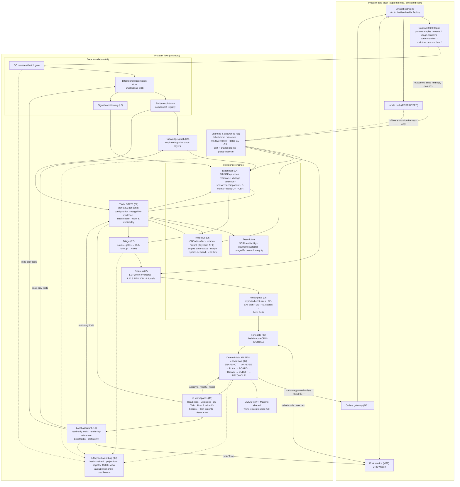
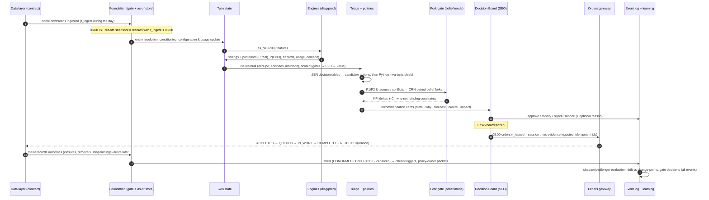

# 12 · End-to-end architecture flow

How every piece connects: data stream → digital twin → descriptive/diagnostic/predictive/prescriptive engines →
triage → policies → deterministic decision loop → human gate → orders → world → outcomes → learning — with the
knowledge graph, simulations, CMMS view, ML lifecycle and the assistant attached to the same state and the same
event log.

## 1. Component view

**Three cohesion rules make this one system rather than a set of features:**
1. **One state.** Every consumer (3D, panels, triage, planner, forks, assistant) reads the twin state through the
   same `as_of` API. There is no second source of truth.
2. **One loop.** Every decision flows through the same daily MAPE-K epoch and the same human gate; the only way
   anything changes the fleet is a typed order with evidence.
3. **One log.** Every state transition — data batch, finding, issue, recommendation, approval, order, outcome,
   label, model version, policy version, assistant answer — is an event in one hash-chained log; registry,
   CMMS view, dashboards and provenance are projections of it.

## 2. A day in the loop (sequence)

## 3. The explanation chain judges will ask for

| Question | Answer in Phalanx Twin |
|---|---|
| **What are we solving?** | Availability lost while aircraft wait — for parts, for repair, for decisions — and the self-inflicted demand of acting on false alarms; because health data, technical records, spares and agencies are not integrated ([01](01-problem-stakeholders-kpis.md)) |
| **For whom?** | Squadron Engineering Officer and Flight Commander (daily plan), technicians (snags), logistics officer (spares), station CEO (servicing), Command/Air HQ (policy), QA/airworthiness (trust) — each with a workspace ([11](11-ui-ux.md)) |
| **What data?** | The frozen contract (0.2.0) of a simulated Tejas-class fleet — BIT/caution/exceedance events, usage counters, maintenance records (11 record types), telemetry for sampled sorties, orders — read strictly as of ingest time; synthetic and preview-grade today, real-data-ready by contract design ([03](03-data-foundation.md)) |
| **What models / methods?** | Event/NFF intelligence + physics/baseline residuals + change detection + D-matrix/noisy-OR isolation (diagnostic); Bayesian hierarchical survival, state-space degradation, structural usage and reliability-based demand (predictive); expected-cost rules, CP-SAT planning, METRIC sparing, R&S on CRN forks (prescriptive) |
| **Why these?** | Each chosen on fit to censored, event-dominated, sparse, quantised data with few failures, interpretability for maintainers, and independent evidence; deep TSAD, TSFMs (incl. TimesFM 3), deep RUL, GNNs, GraphRAG and RL rejected or demoted to baselines with reasons ([13](13-decision-register.md)) |
| **How does intelligence flow?** | contract → gate → as-of store → twin state → engines → findings → issues → policies → candidate actions → fork gate → recommendation cards (section 1–2 above) |
| **How are decisions made?** | Deterministic daily MAPE-K loop; four-layer policies (invariants in code, organisational and decision rules in ZEN, bounded preferences); consent by default, HUMAN-only actions drafted for signature, exception mode only after canary evidence ([07](07-triage-policy-decision-loop.md)) |
| **How does it learn and improve?** | Outcomes become labels with known-time; frozen model versions promoted through gates including CRN fork superiority and human sign-off; drift separated from known change-points; policies promoted through the same lifecycle; overrides analysed per rule by policy owners; everything replayable from the event log and the data layer's order log ([08](08-learning-and-assurance.md)) |

## 4. Deployment view (air-gapped, single workstation for the demo)

| Process | Tech | Notes |
|---|---|---|
| UI | React + TS + Vite; React Three Fiber; React Flow/Cytoscape for graphs | static bundle served locally |
| API + orchestrator | Python 3.13, FastAPI | owns writes to the event log and app state (single writer) |
| Observation store | DuckDB + pyarrow over the consumer Parquet trees (read-only mount) | `_restricted_labels/` not mounted in the system under test |
| Engines | Python (numpy/pandas/statsmodels, PyMC, lifelines, LightGBM, pgmpy, NetworkX, OR-Tools CP-SAT) | deterministic seeds; pinned versions |
| Policy engine | `zen-engine` 2.1.x (Python binding) | JDM files in git, hashed |
| Decision loop | python-statemachine + event-sourced reducers; cron-like epoch scheduler on sim time | no wall-clock reads in decisions |
| Fork worker | data-layer `phalanx` package in-process (`OpsSession`, `ForkService`), belief mode forced | async jobs; pre-computed showcase forks |
| Registry & tracking | MLflow 3.x (SQLite + file store) | aliases set only by the gate service |
| Monitoring | Evidently reports, river detectors | rendered into Assurance |
| Assistant | llama.cpp `llama-server` (gpt-oss-20b default) + our tool server | no network egress |
| Evaluation harness (separate process, evaluator role only) | reads `_restricted_labels/`, runs oracle/ensemble forks | never callable from the system under test |

Open interface question (shared with the data-layer team): how a separate repo calls orders and forks — today
in-process Python only ([../data-layer/09](../data-layer/09-implications-and-open-questions.md)).

## 5. Build phasing

| Phase | Data | Deliver | Demo claim |
|---|---|---|---|
| **A — now (preview v0.9)** | 8 tails × 180 days per-tail worlds; 6 telemetry sorties | foundation (gates, as-of, scoped identity, registry, LEL); descriptive (readiness, waterfall, latency, record integrity); BIT/NFF intelligence + CND classifier; servicing/life forecast; tyre/consumable reorder; expedite rule; triage + ZEN policies + daily loop + Decision Board; 3D twin with lenses; assistant with core tools; fork gate on per-tail worlds | "Integrated, as-of-correct twin; fewer no-fault removals and faster evidence-to-action, shown on paired forks (preview, uncalibrated)" |
| **B — calibrated data (W2.5b / W2.6)** | persistent faults, shared-world fleet, multi-year | removal hazards with real cause labels; engine health state-space; signature-based isolation; fleet CP-SAT plan; METRIC pooling, transfer, cannibalisation; cross-tail lineage | quantitative KPI deltas on calibrated fleets |
| **C — real data path** | sanitised ECMS/HUMS/e-MMS/IMMOLS extracts decoded to the same contract | revalidation through gates; Maximo work-request integration | contract-level readiness for real data |

## 6. Demo storyline (≈ 8 minutes; every number shown must come from a real run)

1. **Readiness** — the downtime waterfall on the preview: where availability went (supply, maintenance, depot,
   decision wait) and the evidence-to-action latency; the thesis made visible.
2. **Decision Board** — today's handful of issues (not hundreds of alerts); open the TJ107 HYD-101 standing alarm:
   42 consecutive flights, a hydraulic-pump serial in an RTOK loop → recommendation: stop removing, troubleshoot,
   nuisance review with a HUMAN-only CHANGE_MONITORING_CONFIG draft; fork KPI deltas.
3. **Twin** — the same issue in 3D: Evidence lens shows BHEEM_EU → HYD_PUMP 0.8 / AMAGB 0.2; component panel:
   serial history, NFF propensity, procedures; scrub the as-of clock back to show what we knew when.
4. **Spares** — tyre reorder points from planned landings (the largest NMCS driver in the preview) and the
   expedite rule on the oldest AOG demand.
5. **Plan & What-if** — status quo vs our policy bundle on CRN-paired belief forks: KPI deltas with CIs;
   assumption sweep.
6. **Approve → 08:00 orders → lifecycle → outcome → label** — the loop closes.
7. **Assurance** — "why was this order issued?" provenance; an expected shift after a software load vs a real
   drift alarm; the model and policy lifecycle.
8. **Assistant** — "Why is TJ107 down and what if we expedite demand X?" → tool trace, cited record ids, belief
   fork, draft order for the SEO.
