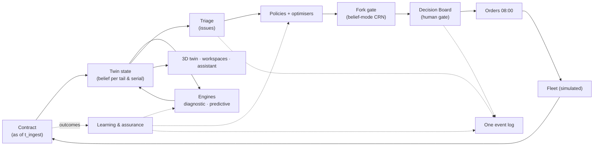

# Phalanx Twin — solution architecture

Research-backed architecture for the problem statement **"Air Power – Predictive Maintenance & Fleet Availability"**,
built on the team's Phalanx data layer (preview v0.9, contract 0.2.0). Data-layer understanding lives in
[`../data-layer/`](../data-layer/README.md).

## The product in one paragraph

**Phalanx Twin** is a decision-support digital twin of a (simulated) Tejas Mk1A-class fleet. It keeps one
probabilistic *belief state* per aircraft and per serialised component — configuration, usage and life, condition
evidence, health, work and availability — built only from data the fleet has actually downloaded. Diagnostic,
predictive and prescriptive engines read that state; triage turns their findings into a handful of issues; versioned
policies and optimisers turn issues into recommended orders; a deterministic daily loop puts those recommendations
in front of the Squadron Engineering Officer before 08:00, and approved orders go to the fleet. Outcomes come back
as labels, and models and policies improve only through gated, replayable promotion. A 3D aircraft shows the twin
spatially; an air-gapped assistant answers questions over the same state; every step is on one audit log.

## What → who → data → models → why → flow → decisions → learning

| | |
|---|---|
| **What we solve** | Availability lost while aircraft *wait* — for parts, repair, decisions — plus the self-inflicted demand of removing healthy units on false alarms, because health data, records, spares and agencies are not integrated ([01](01-problem-stakeholders-kpis.md)) |
| **For whom** | Squadron Engineering Officer, Flight Commander, technicians, logistics officer, station CEO, Command/Air HQ, QA/airworthiness — each with a decision workspace ([01](01-problem-stakeholders-kpis.md), [11](11-ui-ux.md)) |
| **What data** | The frozen contract: BIT/caution/exceedance events, usage counters, 11 types of maintenance records, sampled telemetry, orders — read strictly as of ingest time; synthetic, preview-grade, real-data-ready by contract design ([03](03-data-foundation.md)) |
| **What models** | Diagnostic: BIT/NFF episode intelligence, physics/baseline residuals + change detection, D-matrix + noisy-OR isolation, sensor-vs-component checks, case-based reasoning ([04](04-condition-monitoring-and-diagnostics.md)). Predictive: CND classifier, Bayesian hierarchical survival for removals, state-space engine prognostics, availability-conditioned usage, reliability-based spares demand, lead-time survival ([05](05-prediction.md)). Prescriptive: expected-cost rules with value of information, CP-SAT planning, METRIC sparing, AOG desk, ranking-and-selection on paired forks ([06](06-prescription-and-planning.md)) |
| **Why these** | Fit to censored, event-dominated, sparse, quantised data with few failures; interpretability; independent evidence. Deep anomaly detection, time-series foundation models (incl. TimesFM 3), deep RUL, GNNs, GraphRAG and RL were evaluated and rejected or demoted to baselines ([13](13-decision-register.md)) |
| **How intelligence flows** | contract → gate → as-of store → twin state → engines → findings → issues → policies → candidate orders → fork gate → recommendation cards ([12](12-end-to-end-flow.md)) |
| **How decisions are made** | A deterministic daily MAPE-K loop: four-layer policies (invariants in code, rules in ZEN, bounded preferences), consent by default, HUMAN-only actions drafted for signature, no LLM in any decision step ([07](07-triage-policy-decision-loop.md)) |
| **How it learns** | Outcomes → labels with known-time → frozen model versions promoted through gates incl. paired-fork superiority and human sign-off → drift separated from known change-points → policies promoted the same way; all on one hash-chained event log ([08](08-learning-and-assurance.md)) |

## Platform: IBM LinuxONE

The whole system — simulated fleet, engines, policies, daily loop, event log, API and screens — runs on **IBM
LinuxONE (IBM Z, s390x)**. Why IBM Z fits a defence availability system, what was measured on LinuxONE, the s390x
porting work and the IBM Z roadmap per layer: [`../ibmz/README.md`](../ibmz/README.md).

## Three cohesion rules

1. **One state** — every screen, engine, fork and the assistant read the twin state through one `as_of` API.
2. **One loop** — every decision passes the same daily epoch and human gate; the fleet changes only through
   typed, evidence-citing orders.
3. **One log** — every transition is an event on one hash-chained log; registry, CMMS view, dashboards and
   provenance are projections of it.

## Documents

| # | Doc | Covers |
|---|---|---|
| 01 | [Problem, stakeholders, KPIs](01-problem-stakeholders-kpis.md) | evidence on where availability is lost; IAF maintenance structure; stakeholder decisions; KPI definitions; tiers vs workflows; prioritised use cases |
| 02 | [Digital twin](02-digital-twin.md) | rigorous definition; asset / fleet / simulation twins; twin state; synchronisation; honest claims |
| 03 | [Data foundation](03-data-foundation.md) | release gate; bitemporal as-of store; scoped identity; component registry; conditioning; issues for the data-layer team |
| 04 | [Condition monitoring & diagnostics](04-condition-monitoring-and-diagnostics.md) | BIT/NFF intelligence; residual health monitoring; sensor-vs-component; isolation; case-based reasoning; evaluation |
| 05 | [Prediction](05-prediction.md) | survival and state-space models; usage and spares forecasting; TimesFM/TSFM verdict; lead-time logic; evaluation |
| 06 | [Prescription & planning](06-prescription-and-planning.md) | the "waiting" thesis tested; decision rules; CP-SAT planning; METRIC spares; AOG desk; fork gate; demonstration protocol |
| 07 | [Triage, policies, decision loop](07-triage-policy-decision-loop.md) | issue construction and scoring; ZEN policies; deterministic MAPE-K loop; approval modes; explanations; non-pressuring feedback |
| 08 | [Learning & assurance](08-learning-and-assurance.md) | one event log; state machines; EASA/ETAI mapping; promotion gates; drift vs change-points; labels; CMMS integration |
| 09 | [Knowledge graph](09-knowledge-graph.md) | where graphs help; schema; applicability; technology |
| 10 | [Assistant](10-assistant.md) | constrained analyst design; models and serving; tool catalogue; evaluation; must-nevers |
| 11 | [UI/UX](11-ui-ux.md) | principles; navigation and journeys; seven workspaces; the 3D twin screen and its acceptance tests |
| 12 | [End-to-end flow](12-end-to-end-flow.md) | component view; a day in the loop; explanation chain; deployment; phasing; demo storyline |
| 13 | [Decision register](13-decision-register.md) | challenged ideas; 30 architecture decisions with alternatives and revisit triggers; questions for the data-layer team |

Suggested reading: judges and new members → README, 01, 12, 11. Builders → 03, then the capability doc for your area,
then 07 and 08.

## How this was researched (and its limits)

Nine parallel research streams (stakeholders/KPIs, digital twin/3D, condition monitoring, prediction/TSFMs,
diagnostics/graphs, prescriptive optimisation, triage/policies, ML lifecycle/CMMS, local assistant) on 15 Oct 2026,
each required to cover use case, KPI, methods, mechanism, papers, open source, strengths/limits, data needs, fit to
our data stream and a verdict, and to profile the v0.9 preview where relevant. Primary sources were preferred;
versions, licences and repository activity were checked against GitHub, PyPI and model cards. A shared web-search
budget ran out late in several streams; facts checked afterwards came from direct fetches of known primary pages,
and a few classic textbook/journal references (e.g. Elkan 2001, Raiffa & Schlaifer 1961, Kim & Nelson 2001,
Fine & Gray 1999, Smith & Winkler 2006, Croston 1972) were cited from prior knowledge rather than re-fetched —
re-check those before quoting them in a deck. Vendor figures are labelled as claims. The preview data is
synthetic and unvalidated: it is used to calibrate design (alert load, data shapes, what is demonstrable), never as
evidence about real Tejas or IAF behaviour.
