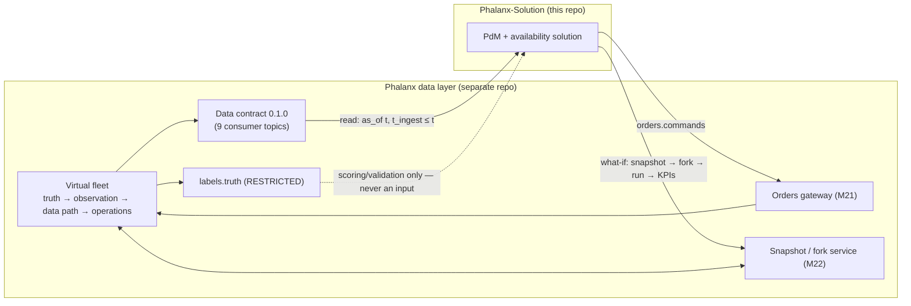

# 01 · Data layer overview and the consumer boundary

Source kit: `/Users/abishaikc/Downloads/phalanx_solution_context/` (snapshot 2026-10-15, source commit
`972d46fd…`). Primary references: kit `README.md` §1–4, §12–14; `reference/architecture.md` §1–6, §11–13.

## What the data layer is

**Phalanx** is a deterministic, forkable *simulator of a virtual fighter fleet* that emits the same data a real
fleet would. It is a separate repository built by our team; this repo (Phalanx-Solution) builds the
downstream predictive-maintenance (PdM) and fleet-availability solution on top of it.

- **Platform:** HAL Tejas Mk1A-class airframe (single-engine tailless delta, quadruplex FBW) with a GE
  F404-GE-IN20 "composite F404" engine (84 kN, 70 kg/s, OPR 28, FADEC). AD-01.
- **Everything is synthetic.** The ICD (bus map, RT/subaddress/label allocations), every BIT/fault/caution code,
  maintenance code tables and part numbers (`SYN-…`) are synthetic, not the real Tejas ICD. Credibility ceiling:
  **NASA-STD-7009B Level 2 against proxy data** (P9).
- **Principle P1: state produces observations.** Data are never generated directly; every value has a causal
  path back to simulated physical/operational state. Faults enter only as state changes (I6), so healthy and
  faulty data come from the same generation path (anti-label-leak).
- **Principle P5: one contract, many sinks.** The ground-decoder contract is meant to accept future *real* data
  (DSSC/IAF/HAL extracts) unchanged. Building strictly against the contract is what makes our solution
  "real-data ready".

## The boundary: three interfaces, nothing else

| Interface | Direction | What it is | Doc |
|---|---|---|---|
| **Data contract** `phalanx.ground_decoder_contract` 0.1.0 (frozen) | layer → us | 9 consumer-visible topics as Parquet (Hive-partitioned), Arrow schemas as source of truth, Avro/JSON-Schema mirrors | [02](02-contract-topics.md), [03](03-time-and-quality.md) |
| **Orders channel** (`orders.commands` → `orders.status`) | us → layer | The *only* way decisions enter the simulated fleet: 18 typed actions, validated, applied at daily decision epochs | [06](06-orders-forks-closed-loop.md) |
| **What-if forks** (M22) | us ↔ layer | Snapshot the world at a decision epoch, fork with a different order suffix/policy, compare CRN-paired KPI deltas | [06](06-orders-forks-closed-loop.md) |
| `labels.truth` (restricted) | layer → evaluators | Hidden health states, fault schedule, truth samples, data-defect manifest. **Never** given to the system under test (invariant I5) | [07](07-truth-health-faults.md) |

**Out of scope for the data layer (= our job):** downstream AI/ML models, dashboards, optimisation policies.
The layer ships three *reference policies* (status quo / scheduled / simple condition-based) only as baselines
we must beat.

**Not specified yet (important for us):** how a *separate repository* submits orders or requests forks across a
process/network boundary. Today both are **in-process Python APIs** (`phalanx.fork.OpsSession.submit`,
`ForkService`). See [09](09-implications-and-open-questions.md).

## Four simulation layers (22 modules)

| Layer | Modules | Role |
|---|---|---|
| **Truth** — the world as it is | M02 scenario/missions, M03 environment + process disturbances, M04 pilot, M05 FCS (DFCC), M06 airframe 6-DOF, M07 F404 engine, M08 FADEC, M09 utilities, M10 health/degradation, M11 fault injection | Physics at 240 Hz, hidden health per serial, faults, operations. Truth only goes to `labels.truth` |
| **Observation** — how the aircraft perceives itself | M12 sensor physics/dynamics, M13 acquisition + texture, M14 monitoring/BIT/ECMS/CWS | Produces the **CIR** (Canonical Internal Representation) and on-board events |
| **Data path** — how data reaches the ground | M15 MIL-STD-1553B / ARINC 429 bus encoder, M16 IRIG 106 Ch10 recorder + download, M17 ground decoder, M19 Parquet store/replay | Bus encoding on drifting clocks → per-sortie Ch10 file → batch download → decode into the contract |
| **Operations** | M18 maintenance/logistics/records/availability, M21 orders, M22 snapshot/fork | Discrete-event maintenance world; availability is *computed* from job states |
| Cross-cutting | M01 parameter dictionary, M20 validation harness | Single source of channels/scalings/codes; realism battery |

Module READMEs are in the kit's `modules/` folder; the architecture spec is `reference/architecture.md`.

## Two data paths, identical schema

| | Fast path (`provenance = direct`) | Full path (`provenance = full_path`) |
|---|---|---|
| Route | CIR → contract directly | CIR → 1553/429/PCM bus → Ch10 recording → download → ground decoder |
| Bus/recorder fields (`t_bus`, `t_record`, `raw_counts`, `bus`, `rt_sa_word`, `label_sdi`) | null | filled |
| `t_utc` | `= t_sample` (PROXY: perfect time source) | aircraft time source, can lose lock |
| Flags possible | acquisition-scope (+ `OUT_OF_RANGE`) | bus/recorder/ground scopes; *cannot* recover `GATED`, `HELD_STALE`, `SUBSTITUTED`, `VOTED_OUT` |
| `record_id` | differs from full path for the *same physical sample* (provenance is a key component) | |

Consequence: **never join or dedupe across paths by `record_id`**; key on `(tail_no, sortie_id, param_id,
source_lru, lane, t_sample)` if you ever need to align them.

`events.*` are emitted on the fast path only at the snapshot commit; the full-path event route is a W2.2 item.

## Two fidelity tiers sharing state and random keys (AD-10)

| Mode | What runs | Produces | Speed target |
|---|---|---|---|
| **Usage mode** | M02, M10, M11, M18, M21, M22 at sortie-summary level; engine via a surrogate | Usage counters, health evolution, events, maintenance records, availability — **fleet-years** | fleet-year in minutes |
| **Telemetry mode** | Full 240 Hz truth → observation → data path for *selected* sorties/windows | `param.samples` (+ decoded events) | ≥ 50× real time per core |

Implication: **fleet-scale data will be dominated by events, counters and maintenance records**; high-rate
`param.samples` exist only for sampled sorties and fault-onset/exceedance windows (planned reference dataset:
e.g. 30 tails × 2 years usage mode + telemetry for sampled sorties). Our ML must work on sparse telemetry +
dense records, not on continuous sensor streams for every flight.

## The virtual fleet (illustrative scenario `tejas_two_squadrons.yaml`)

- 2 squadrons × 16 aircraft: `TJ101…TJ116` at **Sulur (SUL)** in an OCU (training) role and `TJ201…TJ216` at
  **Nal** in an operational role; one calendar year with a 15-day surge (A-W1.1-32).
- Sorties: lognormal duration, median ≈ 47–51 min (P5–P95 ≈ 25–90 min); 1–2 sorties/aircraft/flying day in
  peace, 4–6 in surge; night ≈ 16 %; Mon–Fri flying.
- Plan-level usage gates pass on n = 2,138 planned sorties (e.g. Type III cycles 6.29/FH, time ≥ IRP 17.9 %,
  TAC 2.90/FH). Engine dispersion 1.14 vs ≈ 1.3 target (waived).
- Decision epoch: **daily 08:00 IST** (UTC+05:30).
- Example kit data uses tail `TJ101`, base `SUL`, sortie `TJ101-20261010T0902`, engine `ENG-000001`.

## Status at the snapshot (2026-10-15) — read before relying on data

- Every module is built and passed Wave-1 acceptance (exit gate E1: GO-WITH-CONDITIONS; 2,330 tests green).
- **No integrated end-to-end synthetic sortie exists yet.** The 240 Hz truth loop (W2.1) and observation/data-path
  integration (W2.2) are in progress. The `examples/` are **FORMAT EXAMPLES only** (hand-set ramps) — never use
  their values as physics or behaviour.
- 261 of 464 dictionary channels had no producer at Wave-1 exit; a channel coverage plan arrives in W2.2.
- Behavioural realism (B1–B9 battery), fault signatures at fleet scale, BIT/event rates and availability priors
  are **not yet validated/calibrated** (availability priors are strict expected failures until W2.6).
- `sortie.manifest` is not emitted by any module yet (example row assembled by the kit builder).

**Data availability milestones (no dates):** (1) first full sortie through the integrated loop → (2) skeleton:
one tail, one sortie, both paths, deterministic replay, mid-sortie fork → (3) first synthetic B1–B6 quick look →
(4) proxy-mode gate on archive 2 (E2) → (5) **calibrated fleet datasets** with manifest, defect manifest and
credibility card → (6) v1 release (E3).

## Determinism guarantees we can lean on

- I1: same (root seed, config, dictionary, order log) → bitwise-identical outputs (pinned on darwin-arm64,
  NumPy 2.5.4; x86 bitwise unmeasured).
- Identity-keyed RNG (scenario, base, tail, serial, date, sortie, job, order, …) → **common random numbers**
  across forks: changing one order doesn't perturb the exogenous future of other identities.
- `record_id` is stable across re-deliveries/replays; the same consumer tree read twice gives the same rows in
  the same order. Seeds are restricted (consumers cannot regenerate truth).
