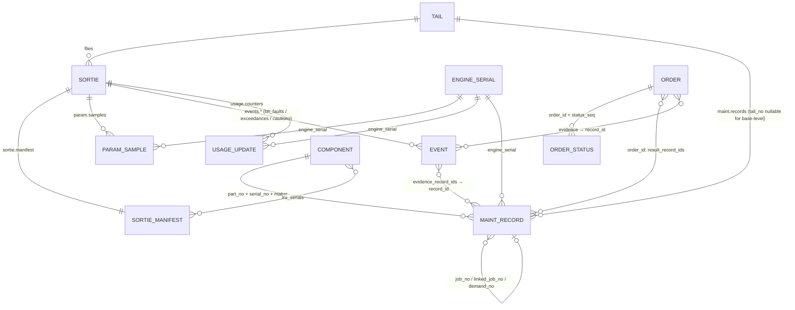

# 02 · The data contract: topics, identities and linkage

Contract `phalanx.ground_decoder_contract` **0.1.0, FROZEN** (AD-41). Contract hash
`18d7627ba6f0f9b694c1978bd4c6cad65f62fea8fd4e8fcb537801c8cf57cc4e`, schema hash `5bd2b54c…`, dictionary
`tejas` 0.1.2 (`a8b02cab…`). Full field tables: kit `contract/contract.md`; consumer field summary: kit
`README.md` Appendix A. Arrow schemas (`contract/arrow/*.consumer.schema.b64`) are the single schema source.

## Topics at a glance

| # | Topic | One row is… | Event time | Ingest time | Partitions | Fields (consumer) |
|---|---|---|---|---|---|---|
| 1 | `param.samples` | one decoded parameter value per acquisition | `t_sample` | `t_ingest` | date/tail_no/sortie_id | 23 |
| 2 | `events.bit_faults` | one BIT fault declaration (PBIT/CBIT/MBIT/IBIT) | `t_occurrence` | `t_ingest` | date/tail_no/sortie_id | 30 |
| 3 | `events.exceedances` | one limit exceedance (over-temp, overspeed, over-g, hard landing) | `t_occurrence` | `t_ingest` | date/tail_no/sortie_id | 34 |
| 4 | `events.cautions` | one CWS caution/warning (30 legends, 4 voice warnings) | `t_occurrence` | `t_ingest` | date/tail_no/sortie_id | 32 |
| 5 | `usage.counters` | one update of a life/usage counter (cumulative value) | `t_update` | `t_ingest` | date/tail_no/sortie_id | 20 |
| 6 | `sortie.manifest` | one sortie: configuration + data provenance | `t_start` | `t_ingest` | date/tail_no/sortie_id | 22 |
| 7 | `maint.records` | one *version* of a maintenance record (11 record types) | `t_event` | `t_ingest` | date/tail_no | 52 |
| 8 | `orders.commands` | one order (decision) as issued | `t_issued` | `t_issued` | date | 17 |
| 9 | `orders.status` | one lifecycle step of an order | `t_status` | `t_status` | date | 9 |
| — | `labels.truth` | **RESTRICTED** truth label — not in the consumer tree | `t_true` | none | date/tail_no/sortie_id | — |

Restricted fields inside consumer topics: `sortie.manifest.root_seed`, `.rng_stream_table` (dropped from the
consumer schema). Only `sortie.manifest` differs between producer and consumer schemas.

## Common fields on (almost) every record

| Field | Meaning |
|---|---|
| `record_id` | `fixed_size_binary(16)`: blake2b-128 (person `phalanx.rid.v0`) over the topic + its identity components. **Idempotency key.** JSON form: 32-char lower-case hex |
| `dict_version`, `dict_hash` | Dictionary the record was produced against (nullable only on `orders.commands`) |
| `provenance` | `direct` (fast path or ground producer) / `full_path` (bus → Ch10 → decoder) |
| `quality_flags` | `uint32` bit set (see [03](03-time-and-quality.md)) — on samples, events, counters |
| `validity` | ARINC-429 SSM semantics + `BUS_INVALID` — on samples and counters |

### record_id key components (what makes a record unique)

| Topic | Components (in order) |
|---|---|
| `param.samples` | provenance, tail_no, sortie_id, channel_id*, param_id, seq*, msg_index* |
| `events.*` | provenance, tail_no, sortie_id, channel_id*, event_code, seq*, msg_index* |
| `usage.counters` | provenance, tail_no, sortie_id, engine_serial, item_serial, param_id, update_seq |
| `sortie.manifest` | tail_no, sortie_id |
| `maint.records` | record_type, record_key, record_version |
| `orders.commands` | order_id |
| `orders.status` | order_id, status_seq |

`*` = supplied by the producing path, not stored as columns (fast path: `channel_id = direct:<lru>:<lane>`,
`seq` = CIR sample index, `msg_index = 0`; full path: Ch10 channel ID, cumulative packet count, word index).
You can recompute `record_id` only for topics whose components are all columns (counters, manifest, records,
orders). For samples/events treat it as opaque.

## Identity and linkage model

| Identity | Format / notes |
|---|---|
| `tail_no` | pattern `^[A-Za-z0-9][A-Za-z0-9._-]*$`; e.g. `TJ101` |
| `sortie_id` | `<tail>-<YYYYMMDD>T<HHMM>` (UTC take-off), ground run `<tail>-<YYYYMMDD>-GR` |
| `engine_serial`, `serial_no`, `item_serial` | **Opaque strings**; format not specified (M18 uses `ENG-000001`, M02 plan `IN20-<tail>`). Defect injection can write `XXX` |
| Component triplet | (`part_no`, `serial_no`, `maker`); part numbers `SYN-…` |
| `job_no` / `demand_no` | maintenance job ("snag") / supply demand; `record_key` of maint.records |
| `sw_config_id` | software configuration of an aircraft |
| `order_id` | `^[A-Za-z0-9][A-Za-z0-9._:-]*$`, chosen by the issuer (e.g. `AIRHQ:20261014:001`) |
| `event_id` | stable between the on-board Ch10 copy and the ground record |
| `snapshot_id` | world snapshot (fork service) |

**Serials move.** Components and engines are installed/removed (COMPONENT_LIFE records, `cfg.install/remove`).
Health travels with the serial, not the tail. Build per-serial histories from `maint.records`
(`install_action`, `item_hours`, `item_cycles`) and `sortie.manifest.engine_serials` / `lru_serials`.

## Per-topic notes

### `param.samples`
`param_id` = dictionary **measurand** (e.g. `ENG.N2`), `lane` separates redundant channels (`A`–`D`, `V` =
voted/validated; null if simplex), `source_lru` = acquiring LRU. Values: `value_eu` (float64, non-null, in
`units`), `raw_counts` (full path only). Bus location `rt_sa_word` (`RTnn/SAnn/Wnn`, **0-based word**;
dictionary/TMATS/ICD are 1-based) or `label_sdi` (`Looo/SDIn`). Long format: one row per value — pivot to wide
per (tail, sortie, lane) for modelling.

### `events.bit_faults` / `events.exceedances` / `events.cautions`
Shared S5000F event fields: `event_id`, `event_code` (synthetic `SSS-NNN`), `event_group`, `severity`
(ADVISORY/CAUTION/WARNING), `description`, `confirmed_status` (**always `UNCONFIRMED` on board**),
`detection_mechanism`, `detection_far_per_fh` (**nominal** spec FAR, not the simulator's true rate),
`fault_list` (PFL pilot-visible / MFL maintenance-only), `latched`, `persistence_count`, `suspect_lrus`
(ordered list of `{lru, isolation_confidence}`), `snapshot_t_start/end` (window of `param.samples` around the
event: ≈5 s before, 25–35 s after), `ch10_event_number`.
- Exceedances add `param_id`, `limit_id`, `limit_value`, `peak_value`, `units`, `t_end`.
- Cautions add `legend`, `displayed` (a caution can be recorded without reaching the pilot), `voice_warning`,
  `t_cleared`.
- BIT adds `lane`, `raw_bit_word`.
- `sortie_id` is null for ground events outside a sortie (line IBIT/MBIT).

### `usage.counters`
Cumulative `value_eu` as reported + optional `increment_eu`; `update_seq` per counter within the sortie.
ECMS LUIs update **twice per flight** (landing, shutdown). Counters: `LUI.*` (EFTC, EOT, PS3_FULL/PART, SRC,
TAMP, TYPE1, TYPE3), `USAGE.*` (TAC, FLIGHT_HOURS, LANDINGS, ENGINE_STARTS.*, AB_LIGHTS, JFS_STARTS.*,
GEAR_CYCLES, CHUTE_STREAMINGS, BRAKE_APPLICATIONS.*, G_EXCEEDANCE.*, AMAGB_HOURS), `STRUCT.NZ_COUNTERS.L1–L8`.
`validity`: TAC cross-check gives `NO_COMPUTED_DATA` on a data gap, `FAILURE_WARNING` outside 0.4–15 TAC/FH.

### `sortie.manifest`
One per sortie: `base`, `mission_type`, `crew_id` (pseudonymous), `sw_config_id`, `engine_serials[]`
(`position`, `serial`), `lru_serials[]` (`lru`, `part_no`, `serial_no`, `maker`), `t_start/t_takeoff/t_landing/t_end`
(takeoff null = ground abort), `contract_version`, `config_hash`, `code_commit`, `library_versions`,
`run_manifest_hash`. **Not yet emitted by any module.**

### `maint.records`
One topic, discriminated by `record_type` (11 types). Each status change = new `record_version` with its own
`record_id`; `record_key` is the natural identity across versions (job no., demand no., or synthetic key). To
get current state: take the max `record_version` per (`record_type`, `record_key`) **as of** your decision time.
Details in [05](05-events-usage-maintenance.md).

### `orders.commands` / `orders.status`
Orders we send and their lifecycle. Details in [06](06-orders-forks-closed-loop.md).

## Row invariants (validated on every batch)

`t_ingest ≥ event time` everywhere; `t_bus ≥ t_sample`; `snapshot_t_end ≥ snapshot_t_start`; exceedance
`t_end ≥ t_occurrence`; caution `t_cleared ≥ t_occurrence`; manifest `t_takeoff ≥ t_start`, `t_landing ≥
t_takeoff`, `t_end ≥ t_start`; maint `t_close ≥ t_open`; order `t_effective ≥ t_issued`; status `reason`
required when `REJECTED`; `record_id` unique per batch. No NaN/∞ ever; non-nullable fields never null.

## Storage layout and formats

- Consumer tree: `<topic>/date=YYYY-MM-DD/<partition field>=<value>/part-<min t_ingest ns>-<content digest>.parquet`
  (`__null__` for a null partition value). Per-sortie topics: `tail_no/sortie_id`; `maint.records`:
  `tail_no`; orders: date only.
- Parquet: zstd 3, 131,072-row groups, format 2.6, Arrow schema stored, rows sorted by (event time,
  `record_id`), deterministic bytes, name derived from content digest (idempotent writes).
- File name: the 20-digit number is the file's minimum `t_ingest` in ns; the 32-hex suffix is
  `blake2b(file_bytes, digest_size=16)`. Which time drives `date=` (event vs ingest) is undocumented.
- Schema metadata on every file: `phalanx.contract`, `phalanx.contract_version`, `phalanx.contract_hash`,
  `phalanx.topic`, `phalanx.topic_restricted`, `phalanx.event_time`, `phalanx.ingest_time`,
  `phalanx.partition_by`, `phalanx.record_id_key`, `phalanx.audience`. **Contract-aware readers reject files
  with a different contract hash** — do the same. Full verified details: [10](10-worked-example.md).
- Enums are UTF-8 strings (not Arrow dictionary arrays). `orders.commands.parameters` is canonical JSON text.
- Avro (`contract/avro/`) exists for a planned Kafka adapter (v1.x, partitioned by `tail_no`); **no live
  transport exists yet**. JSON-Schema (draft 2020-12) for `sortie.manifest`, `orders.commands`, `orders.status`.
- Reference reader API in the data-layer repo: `ParquetStore(root, contract).read(topic, tail_no=…,
  sortie_id=…, date_from=…, date_to=…, t_from=…, t_to=…)` — dedupes by `record_id` (earliest ingest), returns
  rows in (event time, record_id) order. `ReplayStreamer` emits per-sortie bursts in (`t_ingest`, tail, sortie)
  order with **watermarks**; `ObservationView.as_of(t, topic)` returns only `t_ingest ≤ t`.

## Versioning and change policy

- SemVer on the contract: additive → minor, breaking → major + migration note + decision-register entry.
  Quality-flag bit positions never move; new flags take the next free bit.
- Dictionary has its own version + hash on every record; any content change bumps it (0.1.3 batch is open).
- **Planned:** contract 0.2.0 (additive) adds a recording/sink id for per-sink recordings; `events.*` move to the
  full path; ECMS take-off records need a new minor version. 0.1.0 consumers must keep passing.
- Detect versions from Parquet schema metadata and `sortie.manifest.contract_version`.
