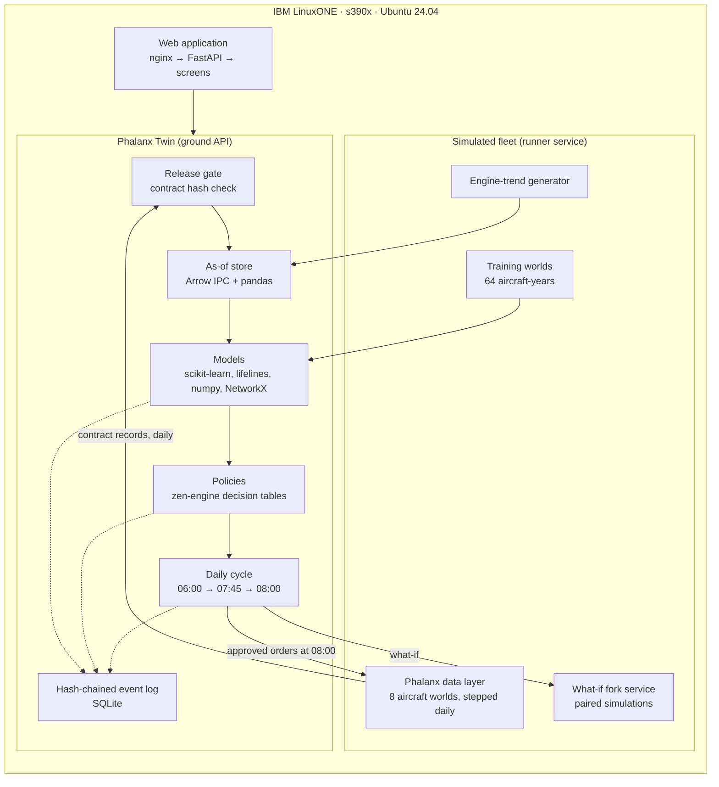

# Phalanx Twin on IBM Z and LinuxONE

**IBM Z Datathon entry · Team Dilijens · theme: real-time AI for critical decisions.** Phalanx Twin is a
decision-support digital twin for military aircraft fleet availability
(the Indian Air Force problem statement "Air Power – Predictive Maintenance & Fleet Availability"). The whole system —
a physics-based fleet simulator, the analytics and machine-learning models, the policy engine, the daily decision
loop, the tamper-evident audit log, the API and the web application — runs on **IBM LinuxONE**, on the s390x
architecture, and is live at **https://148.100.99.205/**.

This document explains why IBM Z is the right home for this kind of system, what we built and proved on LinuxONE,
what it took to bring a modern Python data stack to a big-endian mainframe architecture, and how IBM Z capabilities
strengthen each layer as the system grows from a prototype to a squadron and command deployment.

---

## 1. Why IBM Z for fleet availability

The problem is availability: aircraft lost to waiting — for parts, for repairs, for decisions — and to removing
healthy parts on false alarms. The platform that decides what keeps aircraft flying has to share the properties it is
asked to improve.

| What the mission needs | Why it matters for this system | What IBM Z / LinuxONE is built for |
|---|---|---|
| **Always available** | The daily decision board must be ready before 07:45 every morning; a lost night means grounded aircraft | IBM designs LinuxONE for very high availability — up to "eight nines" (99.999999 %) for LinuxONE Emperor 5 in IBM's stated configurations [1][2] |
| **Trustworthy decisions** | Maintenance orders affect airworthiness; every recommendation must be traceable, replayable and signed by the right person | Hardware cryptography on every core (CPACF) [6], tamper-responding HSMs certified to FIPS 140-2 Level 4 (Crypto Express) [5] |
| **Sovereign, protected data** | Fleet health and maintenance records of a defence force cannot leave controlled premises or be visible to platform administrators | Confidential computing with IBM Secure Execution for Linux — workloads isolated from the hypervisor and administrators, boot images encrypted and measured by their owner [3][4] |
| **One system of record** | Readiness, maintenance, logistics and analytics must read the same state at the same moment | Consolidation of many Linux workloads on one frame, next to the data — and the enterprise asset-management system (IBM Maximo) also runs on IBM Z [9] |
| **AI where the data is** | Every downloaded fault code should be scored as it arrives, not hours later | On-chip AI acceleration in the Telum processors, with ONNX models compiled for it by the IBM Z Deep Learning Compiler [7][8] |
| **Long service life, low footprint** | Defence systems run for decades and at many bases | Consolidation on LinuxONE instead of x86 servers — IBM states up to 75 % lower energy use for Rockhopper 4 under its test conditions [10] |

## 2. What runs on LinuxONE today

Everything below runs on one LinuxONE guest from the **LinuxONE Community Cloud** (Ubuntu 24.04.5 LTS, s390x,
3 vCPUs, 7.8 GB RAM) [11]. Nothing runs on x86 or in a public cloud.



**Measured on the LinuxONE guest** (17 Oct 2026):

| Proof point | Result |
|---|---|
| Fleet simulation reproduces the reference data | The 8 aircraft worlds, rebuilt on s390x to 22 Jun 2026, match the published data set **row for row in every topic** (9,202 maintenance records, 1,192 alerts, 19,404 usage counters), and so does the next simulated day |
| Daily cycle | One simulated day for all 8 aircraft in **3.5 s**; full rebuild to the demo day in about 3.5 min |
| Model training | **32 training worlds** (4 seeds × 8 aircraft × 2 years = 64 aircraft-years) built in 57 min with 2 worker processes |
| What-if analysis | 10 paired simulations of an order vs doing nothing in 2–3 min (e.g. TJ107: mission capable +18.0 points [+7.7, +28.3] over 30 days) |
| Policy engine | zen-engine compiled from source for s390x gives exactly the expected decision on the reference case |
| Responsiveness | Every screen answers in under 110 ms once the day's results are pre-computed |
| Quality | 74 automated tests pass on LinuxONE (and on a little-endian laptop); the end-to-end flow — decisions → orders accepted by the simulator's gateway → next morning → verified audit chain — passes |

## 3. Engineering for s390x

LinuxONE runs the same Linux distributions and Python as anywhere else, but s390x is **big-endian**, and much of the
Python scientific ecosystem publishes ready-made wheels only for x86 and ARM. Porting the stack was real work, and
the result is a stronger system.

| Challenge on s390x | What we did | Why it made the system better |
|---|---|---|
| No PyPI wheels for numpy, scipy, pandas, pyarrow, scikit-learn, statsmodels | One Anaconda environment with s390x builds (numpy 2.2, scipy 1.15, pandas 2.2, pyarrow 19, scikit-learn 1.6, statsmodels 0.14); pure-Python packages from PyPI | A single, reproducible environment for the whole stack |
| The simulator uses numba (no s390x build) | A small pure-Python stand-in for numba's decorator; measured cost is small (one aircraft to the demo day: 13 s interpreted vs 6 s compiled) | The simulator runs unchanged; nothing in the data layer was edited |
| Parquet files written or read by pyarrow on big-endian were corrupted when columns held nulls or lists | All run data is written as **Arrow IPC** (Arrow's native format, which records byte order) with the same layout and contract metadata; the reference data is read from an IPC copy | A format that is byte-order-safe by design; the contract-hash check still applies to every file |
| DuckDB has no s390x build | The as-of store uses pyarrow and pandas (the data is tens of thousands of rows per topic) | Fewer moving parts |
| zen-engine (Rust) had no s390x wheel, and one dependency lacked s390x bindings | Built from source with Rust on LinuxONE after supplying the missing binding file; the decision result is verified against the reference | The production rules engine runs natively on IBM Z |

**Bit-for-bit reproducibility across architectures** is the most important result here. The same simulation,
rebuilt on a big-endian mainframe architecture, produces exactly the same records as on a little-endian laptop.
For an airworthiness-adjacent system, being able to replay and reproduce a decision anywhere is assurance evidence,
not a detail.

## 4. How IBM Z strengthens each layer

| Layer of Phalanx Twin | Today on LinuxONE | IBM Z capability that strengthens it | Status |
|---|---|---|---|
| Daily decision loop | runs as system services with automatic restart; the simulator rebuilds its state from an order journal after a restart; resets for demos | LinuxONE hardware availability (redundancy, concurrent maintenance), up to eight nines in IBM's stated configurations [1][2] | platform roadmap: production hardware |
| Audit trail (one hash-chained event log; replay recomputes snapshot, order id and policy trace) | blake2b chain in software | **CPACF** on every core accelerates SHA-2 and SHA-3 [6]; moving the chain to SHA-256/SHA3 puts the audit log on hardware-accelerated hashing | small change, planned |
| HUMAN-only orders (monitoring changes, modifications, deferrals need a named signature) | a named signature recorded on the log | **Crypto Express HSM** (FIPS 140-2 Level 4, CCA or PKCS #11 / EP11 modes) to hold each officer's or station's signing key [5] | roadmap |
| Protecting fleet and maintenance data | contract gate, as-of reads, truth data kept out of the system under test | **IBM Secure Execution for Linux**: the twin runs in a secure guest whose memory and image are protected even from platform administrators [3][4] | roadmap |
| Scoring every alert as it arrives (false-alarm, fault isolation, removal risk) | lightweight statistical models on the general-purpose cores | **Telum on-chip AI accelerator** with the **IBM Z Deep Learning Compiler** compiling ONNX models; IBM cites large-scale, low-latency in-transaction inference [7][8] | roadmap: export models to ONNX |
| Maintenance records and work orders (CMMS) | a Maximo-shaped order outbox in the architecture | **IBM Maximo Application Suite** core and Manage support s390x on Red Hat OpenShift on IBM Z — the asset system and the twin on one platform [9] | roadmap |
| Squadron → command scale | one LinuxONE guest runs the whole stack for 8 aircraft | many squadron twins consolidated on one LinuxONE frame; IBM states up to 75 % lower energy than equivalent x86 under its test conditions [10] | roadmap |

## 5. Deployment picture

- **Squadron station server**: one LinuxONE guest per squadron runs the full twin — as in this prototype — close to
  the maintenance records and the daily download of aircraft data; it works air-gapped.
- **Command level**: one LinuxONE frame hosts the twins of many squadrons side by side, with Maximo and the logistics
  systems on the same platform, so fleet-wide moves (spares, cannibalisation) can be planned on one consistent state.
- **Assurance**: every recommendation, signature and order is on one hash-chained log; with HSM-held keys and
  hardware hashing the chain becomes evidence an airworthiness authority can audit.

## 6. Scope

- The prototype runs on a LinuxONE Community Cloud guest (3 vCPUs, 7.8 GB RAM), not on production LinuxONE
  hardware; it does not use the Telum AI accelerator, Secure Execution or Crypto Express yet (section 4 says which are
  roadmap).
- Availability, energy and inference figures in sections 1 and 4 are IBM's published claims under IBM's stated
  conditions, not our measurements. Section 2 lists what we measured.
- Fleet data comes from the team's Phalanx data layer, a physics-based, forkable fleet simulator with a frozen data
  contract (see the root README, "The data behind it"); connecting a real fleet means implementing the same contract.

## 7. Run it on LinuxONE

From a checkout, with the server's SSH details in `proto/deploy/ssh_config` (copy `ssh_config.example`):

```bash
proto/deploy/sync.sh --restart
```

```bash
proto/deploy/remote.sh 'proto/deploy/services.sh reset'
```

```bash
proto/deploy/remote.sh 'proto/runner/run.sh proto/runner/gonogo.py'
```

The first pushes the code and reloads the API; the second rebuilds the fleet at the demo day (about 4 minutes,
then the what-if simulations pre-run); the third re-runs the cross-architecture reproduction check. Setup details:
[`../../proto/README.md`](../../proto/README.md) and [`../prototype/DEVELOPMENT.md`](../prototype/DEVELOPMENT.md) §3.

## Sources

1. IBM, "Telum processor for IBM LinuxONE" — https://www.ibm.com/products/linuxone/telum
2. eeNews Europe, "99.999999% availability with the new IBM LinuxONE mainframe" — https://www.eenewseurope.com/en/99-999999-availability-with-the-new-ibm-linuxone-mainframe
3. IBM Docs, "Confidential computing" (IBM Secure Execution for Linux) — https://www.ibm.com/docs/en/linuxonibm/lxsw/lxsw_confidential.html
4. IBM, "Security for IBM LinuxONE" — https://www.ibm.com/products/linuxone/security
5. IBM Docs, "Hardware security modules (HSMs)" — https://www.ibm.com/docs/en/linuxonibm/lxsw/lxsw_hsms.html
6. IBM Docs, "CP Assist for Cryptographic Functions (CPACF)" — https://www.ibm.com/docs/en/linuxonibm/lxos/lxos_hw_cpacf.html
7. IBM, "AI on IBM LinuxONE" — https://www.ibm.com/linuxone/ai-processor
8. IBM Community, "IBM Z Deep Learning Compiler 5.1.0" — https://community.ibm.com/community/user/blogs/sunny-anand/2026/06/29/ibm-z-deep-learning-compiler-510
9. IBM Docs, "What's new in Maximo Application Suite 9.1" — https://www.ibm.com/docs/SSRHPA_cd/appsuite/overview/whats_new_91.html
10. IBM, "IBM LinuxONE 4" — https://www.ibm.com/products/linuxone-4
11. SHARE, "LinuxONE Community Cloud" — https://www.share.org/Events/Past-Events/Proceedings/Proceeding-Details/15614-linuxone-community-cloud-using-ibm-cloud-infrastructure-center-icic-to-bring-zlinux-to-the-world
