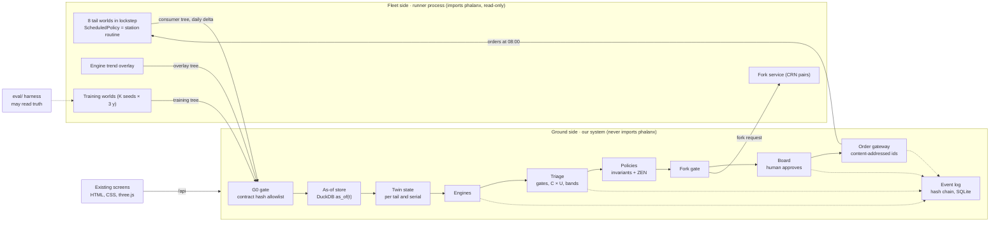

# Phalanx Twin prototype — development document

| | |
|---|---|
| Version | 1.0 · 17 Oct 2026 · ready to build |
| Goal | A working daily decision loop over a live simulated fleet, on the existing screen design, built in one day |
| Readers | the team, and the four parallel build sessions |
| Builds on | [`../architecture/`](../architecture/README.md) (the planned system), [`../data-layer/`](../data-layer/README.md) (the data), [`../../RULES.md`](../../RULES.md) (rules that apply to every line) |
| Data | Phalanx data layer preview v0.9 — contract `phalanx.ground_decoder_contract` 0.2.0 (hash `a4396f1d…`), dictionary tejas 0.1.3 — plus data we generate (§2.3). Synthetic, unvalidated |

Contents: 1 Product spec · 2 System spec · 3 Tech stack · 4 Phases · 5 Expected results · 6 Test plan ·
7 Risks and cut order · 8 Session briefs · 9 Open questions · 10 Glossary

---

## 1. Product spec

### 1.1 What the prototype does

> Press **Advance epoch**. The simulator delivers a day of fleet data. The twin updates, triage ranks the
> issues, the engineering officer reviews the evidence and approves on the board, the orders reach the simulator
> at 08:00, the next morning's Readiness shows what changed, and Provenance shows every link from evidence to
> order.

The loop the user walks through, one epoch per simulated day:

```
Readiness → Decisions → Decision / Why → Workbench → Twin (models) → Epoch → Provenance → (next day) Readiness
```

### 1.2 Users

| User | What they do in the prototype |
|---|---|
| Squadron Engineering Officer (primary) | reads Readiness and the board, opens a decision, checks why, approves / modifies / rejects / snoozes, signs HUMAN-only orders, advances the epoch |
| Technician / engineer | reads the Workbench: is it the sensor or the component, which test next; drafts the test as an order |
| QA / auditor | opens Provenance for any order and verifies the chain |

### 1.3 Functional requirements

| ID | Requirement |
|---|---|
| FR-01 | The system runs one decision epoch per simulated day on command (**Advance epoch**) or for N days (**Autoplay**). There is no wall-clock waiting. |
| FR-02 | **Readiness** shows, as of the epoch snapshot: aircraft mission capable now (x of 8), MC rate and fully-capable rate over 30 days against the 75 % norm, share of possessed time waiting for parts over 30 days, decisions due before 07:45, and a fleet row per aircraft with status and why it is down. |
| FR-03 | **Decisions** shows every open issue scored into bands P1–P4 (P4 advisories grouped), the alert → issue → open → decision funnel, and the epoch's progress (06:00 snapshot → 07:45 freeze → 08:00 orders). |
| FR-04 | **Decision** shows one recommendation with State (DESC), Why (DIAG), Forecast (PRED), Orders with authority and mode, and Impact (PRESC) from paired simulations; actions **Approve / Modify / Reject / Snooze**; HUMAN-only orders show **Sign**. |
| FR-05 | **Decision · Why** shows the evidence list (each record with its ingest time, all before the snapshot), the policy rule that fired step by step, why the alternative actions lose, and the do-nothing forecast for 30 days. |
| FR-06 | **Workbench** shows the per-sortie strip (alarm fired or not, coloured by the serial fitted), the suspect ranking with probabilities, and the ranked next tests with man-hours and robustness ("best in x of 24 assumption settings"). The engineer drafts the chosen test as a TROUBLESHOOT / INSPECT order; its result arrives later as an outcome record. |
| FR-07 | **Twin** works for any of the 8 aircraft: system tree, 3D viewport with lenses (status, alarm evidence, false-alarm probability, life left, removal risk, engine margin), component panel, as-of scrubber, serial lineage across aircraft, search by tail / serial / code / job. |
| FR-08 | **Epoch** shows the day's timeline, the orders for 08:00, gateway checks per order (schema, issued at session time, authority, evidence ingested before issue), the event-log entries written, and the signature step for HUMAN-only orders. |
| FR-09 | **Provenance** shows, for any order: evidence record ids → snapshot hash → model and policy versions → paired-simulation result → approver → gateway verdict; **Verify chain** recomputes every hash; **Replay** re-runs the epoch and shows the identical order id. |
| FR-10 | The system generates the data the preview lacks (§2.3) and labels every value derived from it with its source. |
| FR-11 | Every model run, policy evaluation, decision, order and verdict is an event on one hash-chained log. |
| FR-12 | Candidate orders with an availability effect are tested with paired simulations against doing nothing before the board freezes. |

### 1.4 Non-functional requirements

| ID | Requirement | Target |
|---|---|---|
| NFR-01 | Information discipline: every feature, label, prediction and order at time t uses only records with `t_ingest ≤ t` | enforced in the store and by the data layer's gateway; tested |
| NFR-02 | Determinism: the same run inputs give the same board, order ids and hashes | replay test passes |
| NFR-03 | Performance on one Apple-silicon laptop (8+ cores) | step 8 aircraft one day ≤ 30 s; engines per epoch ≤ 20 s; API responses ≤ 500 ms (cached per epoch); paired simulations ≤ 3 min per candidate at 10 pairs, in the background |
| NFR-04 | Air-gapped: no network calls at run time | fonts, three.js and GSAP are already vendored under `assets/` |
| NFR-05 | Design fidelity: same elements, classes and CSS as the film screens | screenshot comparison at 22 Jun |
| NFR-06 | Honesty: generated values carry their source label; nothing is called real, validated, or Tejas / IAF data | review checklist in Phase 5 |
| NFR-07 | Safety: no automatic grounding; HUMAN-only actions need a named signature; no LLM in any decision step | tested |
| NFR-08 | Boundary: our system never imports the data-layer code, never reads `_restricted_labels/` or `labels.truth` | static check + runtime guard |

### 1.5 Out of scope

React / React Three Fiber port, MLflow, PyMC, CP-SAT planning, METRIC sparing, the local assistant, user accounts
and roles, multi-station deployment. Moving parts between aircraft (CANNIBALISE, TRANSFER_STOCK) is a stretch goal
that depends on the data layer's multi-aircraft release (§9). The film pages outside the loop stay in
`video/screens/` and are not part of the prototype's navigation.

---

## 2. System spec

### 2.1 Architecture



| Component | Side | Responsibility |
|---|---|---|
| Runner | fleet | builds and steps the 8 tail worlds; runs the station routine (`ScheduledPolicy`); accepts orders through the data layer's own gateway; runs paired simulations; generates training worlds and the engine overlay; writes only contract Parquet |
| G0 gate | ground | accepts a Parquet part only if its schema metadata carries contract 0.2.0's hash; reads columns by name; tags the source |
| As-of store | ground | the only read path: `as_of(t)` over the run's Parquet trees |
| Twin state | ground | one state per aircraft and per serial, rebuilt each epoch |
| Engines | ground | diagnostic and predictive models; each output carries model id, version and source label |
| Triage | ground | issues → bands → ranked board; issue state machine |
| Policies | ground | invariants (Python), decision tables (ZEN), preferences (YAML) → candidate orders |
| Fork gate | ground | asks the runner for paired simulations of candidate orders; keeps or drops them |
| Order gateway | ground | content-addressed ids, authority, consent, signature; sends to the runner at 08:00 |
| Event log | ground | one hash-chained log; registry, issue history and provenance are views of it |
| API + screens | ground | FastAPI serves `/api` and the existing pages |
| Evaluation | separate | may read training-world and overlay truth; nothing in `ground/` imports it |

### 2.2 Verified data-layer building blocks

Checked in the preview's code on 17 Oct 2026.

| Need | Data-layer API | Already used in |
|---|---|---|
| Build a tail world | `tools/build_preview._fleet_world(k, days)` | `video/tools/forks/phx_forks.py` `TailWorld` |
| Step a day | `OpsSession.run_until(t)` → `ScheduledPolicy.decide(obs, ctx)` → `OpsSession.submit(orders)` | `TailWorld.run_reference` (the builder's own loop) |
| Read what was ingested | `session.obs.as_of(t, topic)` | builder `run_fleet` |
| Event rows into the observation set | `MirrorSession` (our documented addition) | `phx_forks.py` |
| Usage counters | builder `run_fleet` emits them from M14's outbox per sortie | copy that logic into the runner |
| Write contract Parquet | `ParquetStore(root, contract).write(topic, table)`; `rows_to_table(contract, topic, rows)` | builder |
| Paired simulations | `ForkService` / `MirrorForkService`, belief and ensemble modes | `video/data/forks/` S1–S3 |
| Order actions | INSPECT, TROUBLESHOOT, REMOVE_REPLACE, WASH_SERVICE, CANNIBALISE, REQUISITION_SPARES, EXPEDITE_SPARES, TRANSFER_STOCK, GROUND, RELEASE, BRING_FORWARD_SERVICING, CHANGE_MONITORING_CONFIG, … | `phalanx/orders/model.py` |

Measured: a tail world runs to the 22 Jun epoch in about 6.4 s and matched the preview row for row
(`video/data/forks/reproduction_*.json`); one paired simulation takes 2–15 s.

### 2.3 Data spec

**Contract topics read (preview v0.9 schema metadata: contract 0.2.0, hash `a4396f1d5482ce781635…`)**

| Topic | Key columns used | Used for |
|---|---|---|
| `maint.records` | `record_id, record_type, record_version, tail_no, base, sortie_id, job_no, linked_job_no, demand_no, part_no, serial_no, system_code, malfunction_code, action_taken_code, man_hours, priority, install_action, shop_finding, availability_state, flight_hours, landings, item_hours, item_cycles, evidence_record_ids, t_event, t_open, t_close, t_ingest` | jobs, removals, findings, availability, demands, life, sorties |
| `events.bit_faults`, `events.cautions` | `record_id, event_id, tail_no, sortie_id, source_lru, event_code, severity, suspect_lrus, persistence_count, latched, lane, t_occurrence, t_ingest, quality_flags` | alerts → episodes → issues; isolation |
| `usage.counters` | `param_id, tail_no, sortie_id, engine_serial, item_serial, value_eu, increment_eu, validity, t_update, t_ingest` | usage and life |
| `orders.commands`, `orders.status` | `order_id, issuer_kind, policy_version, action, parameters, evidence, t_issued` / `status_seq, status, reason, result_record_ids, t_status` | our orders, verdicts, outcomes |
| `param.samples` (overlay only) | contract 0.2.0 columns incl. `recording_id`, `sink` | engine trend |

Record types in the preview: SORTIE 643, DEFECT_WO 3,902, TECH_LOG 2,260, AVAILABILITY_STATE 1,340,
SUPPLY_DEMAND 614, INSPECTION 320, COMPONENT_LIFE 915, SHOP_FINDING 91 (all 8 worlds, whole preview).

**Identity and quality**

- Fleet records keyed (`tail_no`, `record_id`); serials keyed (`tail_no`, `serial_no`) — the 8 worlds reuse ids.
- Training worlds keyed (`world_seed`, `tail_no`, `record_id`).
- Duplicates: keep the earliest `t_ingest`; the latest `record_version` wins for state.
- SHOP_FINDING rows have no tail: link by job + serial + time.
- `SENTINEL` masked; `validity != NORMAL` treated as missing; `OUT_OF_RANGE` kept as signal.

**Run directory** (git-ignored)

```
runs/<run_id>/
  run.json                    # start epoch, seeds, code and config hashes
  fleet/<topic>/…             # live world, ParquetStore layout, daily deltas
  _restricted_labels/fleet/   # live world's truth — evaluation only (ParquetStore keeps it outside fleet/)
  overlay/param.samples/…     # generated engine trend
  overlay/_restricted_labels/ # planted truth — evaluation only
  train/seed=<k>/<topic>/…    # training worlds
  train/seed=<k>/_restricted_labels/  # their truth — evaluation only
  lel.sqlite                  # event log
```

**Generated data**

| Gap in the preview | What we generate | Source label | Day 1 |
|---|---|---|---|
| 0 CONFIRMED shop findings → no failure labels | **Training worlds**: the same builder for the same 8 tails with K = 12 extra session seeds over 1,095 days. The simulator confirms a removal only when the serial truly carries a fault (`maintenance/world.py` `_to_repair`). If a class has fewer than 10 events, a **stress scenario** (a copy of the fault parameters with higher rates; data-layer source never edited) | "Simulated fleet history, 12 × 8 tail-worlds × 3 y" (+ "stress scenario") | yes |
| Engine health from sensors: 6 telemetry sorties, 5 end in `ground_impact`; no `param.samples` in fleet worlds | **Engine trend overlay** in the runner: per sortie of the live world, takeoff and cruise snapshots (EGT, N2, fuel flow, ambient temperature) for each tail's engine; EGT-margin loss per engine flight hour, recovery at engine wash, noise, quantisation, sentinel and validity defects at preview rates, 2 planted faults with recorded onset | "Generated engine trend (overlay v0.1)" | yes |
| Moving parts between aircraft | needs the data layer's multi-aircraft (W2.6) release; optional 2-hour router spike in `proto/runner/` | — | stretch |

A model trained or tested on generated data proves the pipeline works, not that it would catch real faults.

### 2.4 Twin state spec

**`TailState`** — `tail_no, base, as_of, snapshot_id, last_ingest`;
`status` (FMC / PMC / NMCM / NMCS / NMCD from the latest AVAILABILITY_STATE), `status_since`,
`down_reason` (waiting for part / work / decision / inspection);
usage (sorties, flight hours, landings — all time and last 30 days);
`installed` {position → serial, installed at, `inferred` flag when the install record is not yet ingested};
`open_jobs`, `open_demands`; `alarms` {code → count, last seen, consecutive flights}; `issues` (ids).

**`SerialState`** — `tail_no, serial_no, part_no, class`; position history (tail, position, from, to);
hours / cycles since install; removals (job, reason, finding); findings count (RTOK / CONFIRMED / BCM);
`belief` {false-alarm probability, suspect probability, removal risk, life left, engine margin}, each with
model id, version, interval and source label.

**`FleetState`** — daily MC series, KPIs (MC, FMC, NMCM, NMCS, NMCD over 30 days and all time),
downtime attribution, alert funnel counts.

### 2.5 Engine spec

| Engine | Input | Method | Output | Ported from |
|---|---|---|---|---|
| `episodes` | `events.*`, DEFECT_WO | merge alerts per tail + code into episodes; power-supply inhibition (ELE-405, ENG-401 suppress dependent BIT fails in the same sortie); group advisories | issues (tail, code, first, last, n, severity, LRU, suspects) | `insights_asof.py`, `decision_screens_data.py` |
| `cnd` | jobs + shop findings per code | Beta-Binomial per code, Jeffreys prior, shrunk to fleet rate (prior strength 2.0); learned challenger (logistic / gradient boosting) must beat it to replace it | P(confirmed fault \| code), P(RTOK if removed), interval, n | `assure_cnd.py` |
| `isolation` | alerts, suspect LRUs, outcomes | leaky noisy-OR posterior over {component, indication path, drive, undetermined}; expected information gain of each test over 24 assumption settings | suspect probabilities; ranked tests with man-hours and robustness | `decision_screens_data.py` |
| `similar` | codes, LRUs, serials, jobs, outcomes | NetworkX graph; nearest past cases by shared code + LRU + outcome path | top cases with outcomes | `decision_screens_data.py` |
| `leadtime` | SUPPLY_DEMAND | Kaplan-Meier + log-normal model by part and priority | median and p90 days to arrival | `assure_models.py` |
| `life` | COMPONENT_LIFE, SORTIE, counters | used vs limit; landings per day | life left, date at limit | `plan_spares_data.py` |
| `hazard` (new) | training-world removals and findings | Weibull failure-time model per removal class with partial pooling to the fleet; INSUFFICIENT_EVIDENCE under 10 events | removal risk before next servicing, interval | — |
| `engine_health` (new) | overlay `param.samples` | corrected EGT margin; Kalman level + trend; CUSUM on innovations; wash = known change point | margin, trend, days to limit (10th percentile), step alerts | — |
| `drift` | event counts per code per week | Poisson GLR, segmented at known change points (installs, washes, releases) | drift alerts | `assure_models.py` |

### 2.6 Triage spec

1. **P1 gates** (any one): WARNING / PFL code recurring; open grounding defect or exceedance inspection;
   hard-time or life limit reached within the horizon; removal risk above the critical threshold on a
   safety-critical item.
2. **Consequence C**: 3 not mission capable, 2 partly capable on planned missions, 1 partly capable on unplanned
   missions only, 0 no effect. From `triage/effects.yaml`: dictionary severity (WARNING / CAUTION → 3,
   ADVISORY → 1) with overrides (e.g. tyre at life limit → 2).
3. **Urgency U**: from the time-to-act margin M = time to failure (10th percentile) − (lead time + epoch delay +
   work time) when a time to failure exists: U3 M < 0, U2 0–3 d, U1 3–14 d, U0 > 14 d. Otherwise from state:
   aircraft down for this issue → U3; recurring with mission effect → U2; recurring and recovered → U1;
   aircraft FMC → U0.
4. **Band** = C × U lookup; a policy decision-table row may raise the band (never lower it):

   | | U3 | U2 | U1 | U0 |
   |---|---|---|---|---|
   | **C3** | P2 | P2 | P3 | P3 |
   | **C2** | P3 | P3 | P4 | P4 |
   | **C1** | P4 | P4 | P4 | P4 |
   | **C0** | monitor | monitor | monitor | monitor |

5. **Rank within band** by expected NMC-days avoided = P(true \| evidence) × (NMC-days if unplanned − NMC-days
   if planned) − weighted cost; confidence shown; tie-break on `issue_id`.
6. **States**: NEW → TRIAGED → ACKNOWLEDGED → PROPOSED → APPROVED → ORDERED → IN_WORK → RESOLVED
   {CONFIRMED | CND | RTOK} → CLOSED (after 3 clean flights); side states MONITORING, SHELVED (snooze, time-bound),
   SUPPRESSED_BY_DESIGN, REOPENED (recurrence within 30 days).

### 2.7 Policy spec

| Layer | Holds | Technology |
|---|---|---|
| Invariants | HUMAN-only actions (mods, software loads, monitoring-config changes, servicing deferrals); no automatic grounding; evidence ingested before issue; one open order per (tail, action, target) | Python, tested |
| Organisation and decision rules | `P-ORG-01/02/03`, `P-DEC-01/02` decision tables | `zen-engine`, files from `video/data/policies/`, hashed and versioned |
| Preferences | thresholds, fork pair count, horizon | `policies/prefs.yaml`, bounded |

Authority (AGENT / HUMAN per action) is copied from the data layer's authority matrix into
`policies/authority.yaml`; a test checks they agree. **Mode**: every rule starts on **consent** — an order is issued
only if approved before the 07:45 freeze.

### 2.8 Decision cycle spec

| Step | Logical time | What happens | Event logged |
|---|---|---|---|
| SNAPSHOT | 06:00 IST | runner has advanced to 06:00; ground seals the snapshot (hash of the part files ingested ≤ 06:00) | `SNAPSHOT_SEALED` |
| ENGINES | 06:00+ | twin state, engines, triage, policies | `ENGINE_RUN`, `ISSUE_STATE_CHANGED`, `POLICY_EVALUATED` |
| BOARD_OPEN | | board visible; paired simulations run in the background | `FORK_RESULT` |
| FREEZE | 07:45 | decisions locked; unapproved orders marked NOT_ISSUED | `BOARD_FROZEN` |
| SUBMIT | 08:00 | runner runs to 08:00, station routine decides, our approved orders are submitted; gateway verdicts recorded | `ORDER_SUBMITTED`, `GATEWAY_VERDICT` |
| STEP | → next 06:00 | runner advances all tails; writes the delta (+ overlay rows) | `STEP_DONE` |

Failure handling: a failed step leaves the epoch at its last completed state and can be retried; order ids are
content-addressed, so a retry never issues twice.

### 2.9 Order spec

- **Id**: `phx:<rule>:<policy semver>:<epoch YYYYMMDDTHHMM>:<tail>:<action>:<blake2b-8 of canonical payload + evidence ids>`.
- **Payload**: the `orders.commands` columns — `order_id, issuer_id, issuer_kind (AGENT | HUMAN),
  policy_version, t_issued, t_effective, target_tail_no, target_base, target_lru, target_serial, action,
  parameters (JSON, validated against the data layer's schema), priority, evidence (record ids)`.
- **Statuses** from `orders.status` (QUEUED, ACCEPTED, REJECTED, COMPLETED, …) with `result_record_ids` linking
  outcomes.

### 2.10 Event log spec

SQLite table `events(seq, t_logical, t_wall, type, subject, payload_json, prev_hash, hash)`;
`hash = blake2b(prev_hash ‖ seq ‖ type ‖ canonical_json(payload))`. Event types: `RUN_STARTED`, `SNAPSHOT_SEALED`,
`ENGINE_RUN`, `MODEL_REGISTERED`, `GATE_RESULT`, `ISSUE_STATE_CHANGED`, `POLICY_EVALUATED`, `FORK_RESULT`,
`BOARD_FROZEN`, `ORDER_APPROVED / MODIFIED / REJECTED / SNOOZED / SIGNED`, `ORDER_SUBMITTED`,
`GATEWAY_VERDICT`, `ORDER_STATUS`, `OUTCOME_LABELLED`, `STEP_DONE`, `CHAIN_VERIFIED`. The model registry, issue
history and provenance are queries over this table.

### 2.11 API spec

**Runner** (internal, port 8710)

| Method | Path | Body → result |
|---|---|---|
| POST | `/init` | `{run_id, start}` → builds the 8 worlds, writes history ingested ≤ start |
| POST | `/step` | `{to}` → advances all tails; writes the delta and overlay rows; returns rows per topic and digests |
| POST | `/orders` | `{orders: [...]}` at an 08:00 epoch → gateway verdicts per order |
| POST | `/fork` | `{t, tail, orders, n_pairs, horizon_days}` → job id; `GET /fork/{id}` → status, KPI deltas with 95 % CI |
| POST | `/train` | `{seeds, days}` → builds training worlds (S3) |
| GET | `/status` | current logical time, tails, run id |

**Ground** (port 8700). Responses use the `window.PHX_*` shapes the screens already read.

| Method | Path | Returns / does | Screen |
|---|---|---|---|
| GET | `/api/epoch` | epoch state, timeline, orders, gateway checks, log entries (`PHX_EP`) | Epoch, Decisions |
| POST | `/api/epoch/advance`, `/api/epoch/autoplay` | `{n}` → runs the cycle | Epoch |
| GET | `/api/readiness?asof=` | fleet, MC daily, KPIs, downtime, funnel (`PHX_DATA`) | Readiness |
| GET | `/api/board` | bands, rows, funnel (`PHX_DEC.board`) | Decisions |
| GET | `/api/issues/{id}` | card: state, why, forecast, orders, impact; why page: evidence, rule trace, why-not, do-nothing | Decision, Why |
| POST | `/api/issues/{id}/decision` | `{action: approve \| modify \| reject \| snooze, by, params?, until?}` | Decision |
| POST | `/api/orders/{order_id}/sign` | `{by}` | Decision, Epoch |
| GET | `/api/workbench/{issue_id}` | sortie strip, removals, suspects, tests (`PHX_WB`) | Workbench |
| POST | `/api/workbench/{issue_id}/draft` | `{test_id}` → drafts the test as an order on the board | Workbench |
| GET | `/api/twin/{tail}?asof=` | tree, components, lenses, panel, strip | Twin |
| GET | `/api/serial/{tail}/{serial}` | lineage | Twin |
| GET | `/api/search?q=` | tails, serials, codes, jobs | all |
| GET | `/api/provenance/{order_id}` | chain (`PHX_PROV`) | Provenance |
| POST | `/api/provenance/verify`, `/api/provenance/replay` | recompute hashes / re-run the epoch | Provenance |

### 2.12 Screen spec

All pages keep their elements, classes and `data-shot` panels; text that is typed into the film pages becomes
rendered from `/api`.

| Page | Panels (`data-shot`) | Data | Interactions | Accepted when |
|---|---|---|---|---|
| `readiness.html` | `kpi-now`, `kpi-mc`, `kpi-parts`, `kpi-due`, `fleet` | `/api/readiness` | tail row → Twin; "Open board" → Decisions | 22 Jun values match §5.1 |
| `decisions.html` | `epoch`, `board`, `funnel` | `/api/board`, `/api/epoch` | row → Decision | 7 rows and bands of §5.1 |
| `decision.html` | `reco`, `approve`, `state`, `why`, `forecast`, `orders`, `impact` | `/api/issues/{id}` | Approve / Modify / Reject / Snooze; Sign | decision logged and shown on Epoch |
| `decision-why.html` | `evidence`, `rule`, `whynot`, `donothing` | `/api/issues/{id}` | evidence row → record detail | every evidence row ingested before the snapshot |
| `workbench.html` | `strip`, `cause`, `tests` | `/api/workbench/{id}` | draft test as order | TJ107 numbers of §5.1 |
| `twin.html` + `twin3d.js` | `tree`, `viewport`, `swap-insight`, `panel`, `scrubber` | `/api/twin/{tail}`, `/api/serial/…` | tail picker, lens switch, component click, scrubber, search | any tail renders; lenses carry source labels |
| `epoch.html` | `epoch`, `orders`, `gateway`, `log`, `sign` | `/api/epoch` | Sign, Not now, Advance, Autoplay | 5 epochs run from the page |
| `provenance.html` | `chain`, `query`, `replay`, `standards` | `/api/provenance/{order_id}` | order picker, Verify, Replay | verify passes; replay gives the same id |

### 2.13 Repository layout

```
proto/
  runner/        world.py · overlay.py · train_worlds.py · forks.py · service.py
  ground/        gate.py · store.py · twin.py · registry.yaml · triage.py · forkgate.py · orders.py ·
                 epoch.py · lel.py · api.py
    engines/     episodes.py · cnd.py · isolation.py · similar.py · leadtime.py · life.py · hazard.py ·
                 engine_health.py · drift.py
    policies/    invariants.py · authority.yaml · prefs.yaml · P-*.jdm.json
  web/           copy of video/screens/ + assets/api.js + render modules
  eval/          backtests, planted-fault report (may read truth)
  tests/         golden · rules · boundary · integration
runs/            git-ignored
```

Film code that moves: `phx_load.py`, `assure_load.py`, `data_foundation.py` → `store.py`, `gate.py`;
`insights_asof.py` → `episodes.py`, `twin.py`; `decision_screens_data.py` → `isolation.py`, `similar.py`,
`triage.py`, `orders.py`; `assure_cnd.py` → `cnd.py`; `assure_models.py`, `plan_spares_data.py` →
`leadtime.py`, `life.py`, `drift.py`; `assure_policies.py` → `policies/`; `assure_provenance.py`,
`order_dryrun.py` → `lel.py`, `orders.py`; `build_screen_assets.py` → `api.py`; `tools/forks/*` →
`runner/`. The film copies stay untouched.

---

## 3. Tech stack and deployment

Everything runs on the team's **LinuxONE server** (IBM Z, **s390x, big-endian**, Ubuntu 24.04, 3 vCPU, 7.8 GB RAM,
50 GB disk; user `linux1`). Code is edited on the Mac and pushed with `proto/deploy/sync.sh`; commands run there
with `proto/deploy/remote.sh`; the screens are reached through `proto/deploy/tunnel.sh` → http://localhost:8701.
IBM Z changed four choices (checked on the server, 17 Oct 2026):

| Layer | On the server | Planned | Why it changed |
|---|---|---|---|
| Language and environment | Python 3.12, one Anaconda env `~/envs/phx` (numpy 2.2.4, scipy 1.15, pandas 2.2.3, pyarrow 19.0, scikit-learn 1.6, statsmodels 0.14, networkx) + pip pure-Python packages (FastAPI 0.143, lifelines 0.30, python-statemachine, pint, …) | `uv` venvs with the data layer's exact pins | PyPI has no s390x wheels for numpy, scipy, pyarrow, pandas, numba, DuckDB, scikit-learn or zen-engine; Anaconda builds most of them for s390x |
| Simulated fleet | Phalanx data layer v0.9 code, in-process, read-only, with a **pure-Python numba stand-in** (`proto/runner/numba_shim`) | same, compiled with numba | no numba/llvmlite for s390x; the fleet worlds hardly use compiled kernels (one tail to 22 Jun: 13.2 s without JIT vs 6.4 s with) |
| Run files | **Arrow IPC** (`.arrow`, zstd) in the data layer's tree layout with the contract metadata (`proto/runner/ipcstore.py`); the preview is read from an IPC copy | Parquet | Parquet in pyarrow is unreliable on big-endian (a round trip of a nullable list column fails); Arrow IPC handles byte order |
| As-of store | pyarrow + pandas | DuckDB | no s390x build; ~30 k rows per topic need no database |
| Policies | `zen-engine` 2.1.3 built from source with Rust | wheel | no s390x wheel; one dependency (QuickJS bindings) lacked an s390x binding file |
| API and orchestration | FastAPI + uvicorn, `httpx`, `pydantic` | same | — |
| Event log | SQLite (WAL) + `hashlib.blake2b` | same | — |
| UI | existing HTML, `app.css`, `shell.js`, vanilla JS, vendored three.js and GSAP; no build step | same | — |
| Tests | pytest on the server and on the Mac | same | — |
| Heavy batch (optional) | Kaggle (x86) if the server is too slow | — | the user offered it; the server is preferred |

The Mac keeps working too (real numba; the preview read as Parquet, runs written as Arrow IPC), so every check can run in both places.

**Why not the planned stack everywhere:** the existing screens are the design, so React waits; MLflow, PyMC,
OR-Tools and the assistant add nothing to the loop. All are in the architecture and come later.

---

## 4. Phases

Four parallel build sessions: **S1** runner and loop, **S2** engines / triage / policies, **S3** generated data and
new models, **S4** screens. About 11 hours wall clock.

```
hour      0    1    2    3    4    5    6    7    8    9    10   11
S1        [P0 ======][P1-A store/twin ====][P2 loop =========][P4 prov ][P5]
S2                   [P1-B engines/triage/policies ====][P2 ===]
S3                   [P1-C generated data + new models =====]
S4                   [P3 screens on film data ====][switch to /api ===][P5]
```

### Phase 0 — Foundations and go/no-go (0:00–1:30 · S1)

**Stack:** Python 3.12, `uv`, Phalanx data layer v0.9 (read-only), `pyarrow`, `ParquetStore`, FastAPI + uvicorn
skeleton, `proto/deploy/launch.json`.

| Tasks | Deliverables |
|---|---|
| Create `proto/` (§2.13), two venvs, launch configs, `.gitignore` for `runs/`; copy `video/screens/` → `proto/web/` | skeleton that starts |
| **Go/no-go:** build the 8 worlds to 2026-06-22 08:00 IST; write all rows ingested by then (incl. usage counters as the builder does) to `runs/<id>/fleet/`; step one day with the station routine; write only the new day | `runner/world.py`, `POST /init`, `POST /step` |
| Fix shared interfaces: `as_of`, `TailState` / `SerialState`, `Finding` / `Issue` / `CandidateOrder`, runner API, `PHX_*` shapes | `ground/interfaces.py` |
| Start S2, S3, S4 with their briefs (§8) | three sessions running |

**Expected results / exit:** row counts before the epoch match `reproduction_*.json` (e.g. TJ107: 1,343
maint records); every part file carries contract hash `a4396f1d…`; the one-day delta holds only rows ingested in
that day; `POST /step` for 8 tails ≤ 30 s.
**If it fails:** run each day as a one-member fork from the previous snapshot with the approved orders.

### Phase 1-A — Store and twin (1:30–5:00 · S1)

**Stack:** DuckDB, `pyarrow`, pandas, `pydantic`, SQLite + `blake2b`, FastAPI, pytest.

| Tasks | Deliverables |
|---|---|
| G0 gate: hash allowlist, column-by-name reads, source tags | `gate.py` |
| `as_of(t)` views with scoped dedupe, record versions, shop-finding linkage, quality masks | `store.py` |
| Tail, serial and fleet state (§2.4) | `twin.py` |
| Event log and API skeleton: `/api/readiness`, `/api/twin/{tail}`, `/api/search` | `lel.py`, `api.py` |

**Expected results / exit:** golden test at 2026-06-22 06:00 passes the readiness and TJ107 values of §5.1;
colliding record ids across tails stay separate; a file with a wrong hash is rejected.

### Phase 1-B — Engines, triage, policies (1:30–5:00 · S2)

**Stack:** numpy, pandas, scipy, statsmodels, lifelines, scikit-learn, NetworkX, `zen-engine`,
`python-statemachine`, pytest.

| Tasks | Deliverables |
|---|---|
| Port and generalise `episodes`, `cnd`, `isolation` (+ test ranking), `similar`, `leadtime`, `life`, `drift` | `engines/*.py` |
| Triage per §2.6 with `effects.yaml`; issue state machine | `triage.py` |
| Invariants, authority, ZEN evaluation of the 5 decision tables → candidate orders | `policies/` |

**Expected results / exit:** at 22 Jun the board reproduces the 7 decisions and bands of §5.1 and the TJ107
model values; any difference is written down with its reason, not tuned away; every engine output carries
model id, version and source label.

### Phase 1-C — Generated data and new models (1:30–5:00 · S3)

**Stack:** data-layer builder with new seeds, `concurrent.futures` process pool, `rows_to_table` +
`ParquetStore`, lifelines (Weibull model), numpy (own Kalman filter, EWMA, CUSUM), scikit-learn and lifelines
metrics.

| Tasks | Deliverables |
|---|---|
| 12 seeds × 8 tails × 1,095 days; count CONFIRMED findings per class and per tail-year **before** fitting | `train_worlds.py`, count report |
| Removal-risk model per class; INSUFFICIENT_EVIDENCE under 10 events; stress scenario only if needed | `engines/hazard.py` |
| Engine overlay generator and engine-health model | `overlay.py`, `engines/engine_health.py` |
| Evaluation: held-out seeds and planted faults vs truth | `eval/` reports |
| Register model versions and gate results on the event log | `MODEL_REGISTERED`, `GATE_RESULT` events |

**Expected results / exit:** see §5.3. The training run takes about 10 minutes on 8 cores (estimate from 6.4 s
per tail to 22 Jun).

### Phase 2 — Close the loop (5:00–8:00 · S1 + S2)

**Stack:** FastAPI (both services), `httpx`, data-layer `ForkService` / `MirrorForkService`, `scipy.stats`,
`python-statemachine`, SQLite event log, background workers.

| Tasks | Deliverables |
|---|---|
| Daily cycle per §2.8 with Advance and Autoplay | `epoch.py` |
| Paired simulations per candidate (10 pairs live, 30 offline), cached by (snapshot, order digest); drop orders with no effect; safety non-inferiority on in-flight failures | `forkgate.py`, `runner/forks.py` |
| Orders per §2.9; consent and signature; submit at 08:00; verdicts back | `orders.py` |
| Outcomes → issue states → labels for `cnd` and `isolation` | feedback path |

**Expected results / exit:** five consecutive epochs from 22 Jun run end to end; the data layer's gateway
accepts every issued order; outcomes of 22 Jun orders appear in later deltas; see §5.2.

### Phase 3 — Screens on the same design (1:30–8:30 · S4)

**Stack:** existing HTML, `app.css`, `shell.js`; vanilla JS (ES modules, `fetch`); vendored three.js through
`twin3d.js`; GSAP; FastAPI static serving; browser preview.

| Tasks | Deliverables |
|---|---|
| `api.js`: fills `window.PHX_*` from `/api`, or from the film data files with `?source=film`; `?asof=`, `?tail=` | one loader |
| Turn typed-in pages (`decisions`, `decision`, `decision-why`, `epoch`) into render functions emitting the same elements and classes | render modules |
| Twin for any tail; lenses from `registry.yaml` and twin state; lineage drawer; search | `twin.html`, `twin3d.js` |
| Interactions of §2.12; nav limited to the loop pages | wired pages |

**Expected results / exit:** no live page loads a film data file; screenshots at 22 Jun match the film pages'
layout; all interactions write events to the log.

### Phase 4 — Provenance and rule tests (8:00–9:30 · S1)

**Stack:** SQLite + `blake2b`, pytest, ruff banned-imports, runtime path guards.

| Tasks | Deliverables |
|---|---|
| Provenance view for any order; Verify; Replay | `provenance.html` wired |
| Rule tests of §6 | `tests/rules/` |
| Stretch: live Policies trace, Assurance model cards | two more pages |

**Expected results / exit:** every rule test passes; Verify passes on the demo run; Replay gives the same id.

### Phase 5 — Demo run and polish (9:30–11:00 · S1 + S4)

**Stack:** everything above; frozen run folder.

| Tasks | Deliverables |
|---|---|
| Scripted run of §5.4; honesty review (source labels, no "real" / "validated" claims) | demo script |
| Browser check at 1440 and 1280 px; no console errors | screenshots |
| Freeze the run id as the fallback | `runs/demo-<date>/` |

**Expected results / exit:** the full loop demo runs in under 10 minutes from a cold start of the servers.

---

## 5. Expected results

### 5.1 Golden values at 2026-06-22 06:00 IST (from the film's computed data in `video/data/`)

| Area | Value |
|---|---|
| Alerts → decisions | 1,192 alert rows over 168 days (921 BIT + 271 cautions) → 326 issues → 33 open → 7 decisions |
| Readiness | 6 of 8 mission capable now; 30-day MC ≈ 54.5 % (fully capable 52.6 %) against a 75 % norm; waiting for parts 25.4 % of possessed time. The film screen shows 54.5 % and `kpis_asof_20260622.json` 0.547 — Phase 1-A records which definition (record-version aware) it uses |
| Board bands | P1: TJ103 LGB-501, TJ106 LGB-501 (gate: warning recurred) · P2: TJ107 HYD-101 (policy floor, nuisance review), TJ108 brake chute (NMCS) · P3: TJ105 SPS-501 (C3 U1), TJ105 tyre (C2 U3) · P4: advisory group (C1 U0) |
| TJ107 twin | HYD-101 on 59 of 61 sorties; 10 pump serials through system 1; 28 pump removals; 61 sorties · 49.6 FH · 116 landings; last ingest 19 Jun 22:27 |
| TJ107 models | fleet: 107 HYD-101 jobs (71 CND, 35 removed → all RTOK, 1 troubleshoot), 0 confirmed; 33 of 33 pumps RTOK; P(confirmed pump fault) 0.005 [0.000, 0.023]; P(RTOK if removed) 0.985 [0.93, 1.00]; suspects: indication path 0.56, gearbox drive 0.44, pump < 0.0001; best test: indication-path isolation, 7.3 man-h, best in 19 of 24 settings |
| Lead time | closed demands n = 127, median 4.6 d, p90 38.3 d (most demands lack `tail_no`; shown with that caveat) |
| Epoch | 6 orders issued at 08:00, 6 of 6 pass the gateway checks, one HUMAN signature (CHANGE_MONITORING_CONFIG); tyre requisition dropped by the fork gate |
| Order id | e.g. `phx:P-DEC-01:1.4.0:20260622T0800:TJ103:TROUBLESHOOT:54d7fe500658cf7d` reproduced exactly |

### 5.2 Loop results

| Measure | Expected |
|---|---|
| Epochs run end to end | 5 consecutive, from 22 Jun |
| Step time (8 tails, 1 day) | ≤ 30 s |
| Engines per epoch | ≤ 20 s |
| Paired simulations | ≤ 3 min per candidate at 10 pairs, finished before the freeze |
| Gateway | every issued order ACCEPTED; a forced order citing un-ingested evidence is REJECTED by the data layer |
| Feedback | outcome records of 22 Jun orders change issue states within the run |

The live run is **one** realisation of the world; the paired-simulation result is an average over many. On one
run TJ107 can still have a bad day; the screens say so rather than picking a lucky seed.

### 5.3 Model results

| Model | What we expect | Why |
|---|---|---|
| False-alarm (CND) | the per-code base rate stays champion; the learned challenger does not beat it | same result as the film's assurance run on 22 Jun |
| Isolation | reproduces §5.1 at 22 Jun; updates after TROUBLESHOOT outcomes arrive | ported logic |
| Removal risk | fitted only for classes with ≥ 10 confirmed events in the training worlds; others show INSUFFICIENT_EVIDENCE; held-out Brier score and calibration reported | the preview had 0 confirmed in about 3.7 tail-years, so the count is measured first, not assumed |
| Engine health | detects both planted faults before the margin limit; lead time and false alarms per 100 flights reported | pipeline proof — it finds what we planted |
| Drift | alerts only outside known change points | ported logic |

### 5.4 Demo script and expected outcome

1. Readiness, 22 Jun: 6 of 8 mission capable; board has 7 decisions.
2. Decisions → TJ107 "hydraulic alarm that never clears" (P2).
3. Decision / Why: 0 of 107 confirmed; the alarm follows the aircraft, not the pump.
4. Workbench: indication path most likely; best next test 7.3 man-h.
5. Approve TROUBLESHOOT; sign CHANGE_MONITORING_CONFIG. Impact from paired simulations — reference (30 pairs,
   film run): MC +21.7 pts [+16.7, +26.8], man-hours −116, days grounded for parts −3.7, in-flight failures +0.07
   (not significant). At 10 pairs live, expect the same direction with wider intervals.
6. Epoch: orders pass the gateway at 08:00; advance 3–5 days.
7. Readiness and Twin: TJ107's status and HYD-101 history after the orders; engine-margin and removal-risk lenses
   with their source labels.
8. Provenance: Verify chain passes; Replay gives the same order id.

### 5.5 What the prototype will not show

Failure prediction for classes without enough simulated events; engine health from the simulator's own physics;
moving parts between aircraft (unless the stretch router works); anything that could be taken as real Tejas / IAF
data or validated physics.

---

## 6. Test plan

| Kind | Tests | Phase |
|---|---|---|
| Golden | as-of 22 Jun values (§5.1) for readiness, funnel, board, TJ107 twin and models | 1-A, 1-B |
| Rules | wrong contract hash rejected · no order cites a record ingested after its epoch · `ground/` never imports `phalanx` or `eval/`, never opens `_restricted_labels/` · dedupe keeps colliding worlds apart · HUMAN-only actions need a signature · no automatic GROUND | 4 |
| Determinism | same run → same board, ids, hashes; Replay | 4 |
| Integration | 5 epochs end to end; gateway verdicts; outcomes flow back | 2 |
| Models | backtests on held-out seeds; planted-fault detection report | 1-C |
| Screens | no film data loaded on live pages; console clean; screenshots at 1440 / 1280 px | 3, 5 |

---

## 7. Risks and cut order

| Risk | Fallback |
|---|---|
| Runner cannot write daily deltas cleanly | fork-as-live (one-member fork per day) |
| Paired simulations too slow | 5 pairs live; 30-pair results cached from offline runs |
| Too few confirmed failures | stress scenario; otherwise INSUFFICIENT_EVIDENCE shown |
| Overlay too clean | defects at preview rates; evaluation reports false alarms |
| Design drift when converting typed-in pages | screenshot comparison against the film pages |
| Day overruns | cut, in order: live Policies / Assurance → parts-between-aircraft spike → live paired simulations (use cached) → engine overlay |

Never cut: the as-of boundary, the rule tests, the event log.

---

## 8. Session briefs

Every session first reads `RULES.md`, this document and `proto/ground/interfaces.py`; touches only its own
files; commits nothing; asks before any git operation.

| Session | Owns | Brief |
|---|---|---|
| S1 | `proto/runner/{world,forks,service}.py`; `proto/ground/{gate,store,twin,lel,epoch,orders,forkgate,api,interfaces}.py`; `tests/` | Phases 0, 1-A, 2, 4, 5 |
| S2 | `proto/ground/engines/` except `hazard.py` and `engine_health.py`; `triage.py`; `policies/` | Phase 1-B, then the engine side of Phase 2; golden test against the 22 Jun board |
| S3 | `proto/runner/{overlay,train_worlds}.py`; `engines/{hazard,engine_health}.py`; `eval/` | Phase 1-C; count events before fitting; label every output with its source |
| S4 | `proto/web/` | Phase 3; same elements and classes as the film pages; start on the film data |

---

## 9. Open questions for the data-layer team

1. Can we have the W2.6 multi-aircraft release, so CANNIBALISE and TRANSFER_STOCK can be simulated?
2. Is a parameter-copy stress scenario (higher fault rates) acceptable for training worlds?
3. When will full-path telemetry sorties land without `ground_impact`
   ([issue list](../data-layer/12-issues-for-data-layer-team.md))? The overlay is replaced by real
   `param.samples` when they do.

---

## 10. Glossary

| Term | Meaning |
|---|---|
| MC / FMC | mission capable / fully mission capable share of possessed time |
| NMCM / NMCS / NMCD | not mission capable for maintenance / supply (waiting for parts) / depot |
| CND / RTOK | could not duplicate the fault / retest OK in the shop — the removed part was healthy |
| Epoch | one daily decision cycle: 06:00 snapshot, 07:45 freeze, 08:00 orders |
| As-of | reading only what had been ingested by a given time |
| Paired simulations (CRN) | the same random futures run with and without an order, so the difference is the order's effect |
| Consent mode | an order is issued only if a person approves it before the freeze |
| Source label | the tag saying where a value came from: live simulated fleet, simulated fleet history, or generated engine trend |
